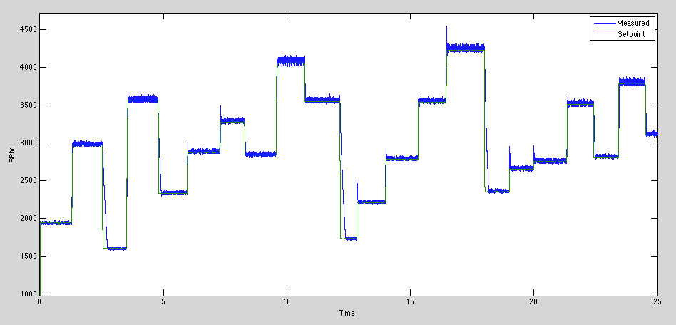
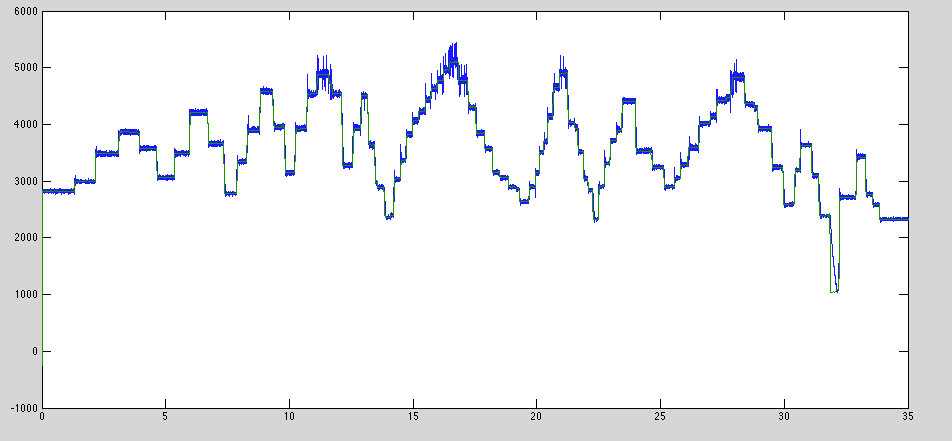
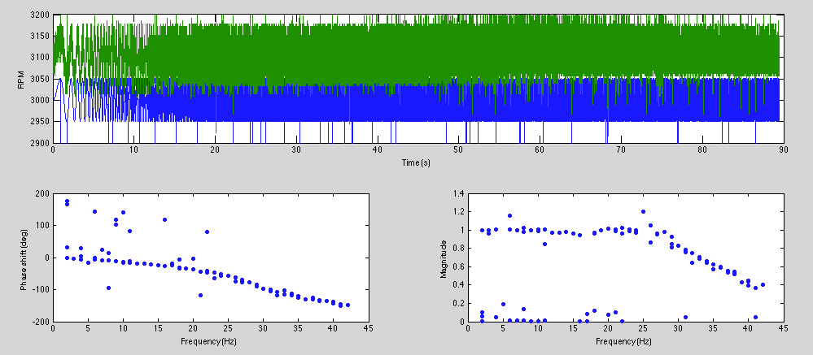
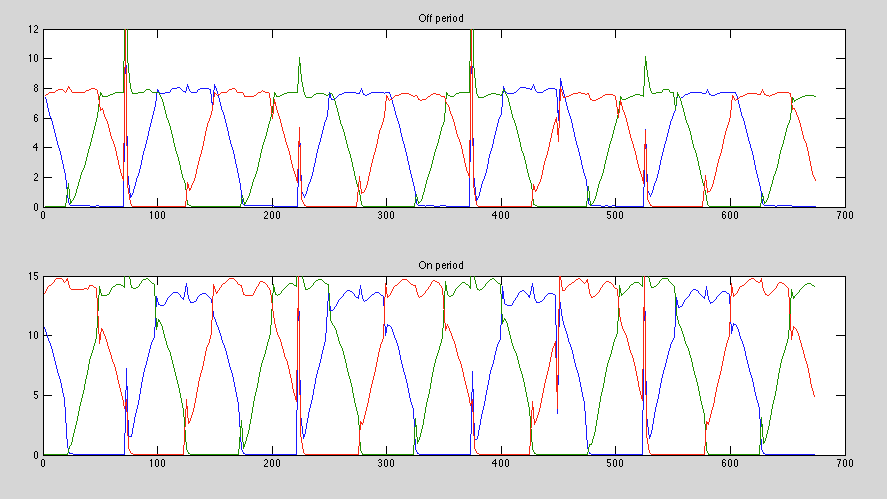

**Note: this is a copy of some of my notes from other forums about the development of the ESC**

So my pet backburner project since Portugal has been an ESC after seeing how they are essentially the limiting factor in flight performance. We had the big prototypes flying a while back but just got back the latest revision of the ESCs which will probably be the production version. I'm extremely excited with the performance: 

#### Initial prototype:

   

::: {.archive-video video-id="24952342" source="vimeo" title="More ESC testing"}
:::

#### And some of the first flight tests:

  

::: {.archive-video video-id="32459975" source="vimeo"}
:::

Features:

- Compact form factor
- Probably good for 40-50A (needs testing, I haven't got the transistors hot yet)
- 2S-4S capable
- Very high speed response
- Self testing with diagnostic codes for failure
- Tunable control loops to optimize for various motors and props. I'll have good values for some common ones.
- Accurate current monitoring with soft limit (slows RPM to keep at the current limit) and emergency shut down for higher limit
- Closed loop control so input determines precise RPM, regardless of prop size, etc
- PWM control for standard compatibility. I2C/Serial/CANBus support for bidirectional communications for monitoring.
- Configurable settings for current limit, control loop coefficients, RPM range

I'll be sending some out to testers and working on the GCS to make it easy to configure. More updates to come and characterization data. Overall though it flies great. The quad really was locked on and because I could get the gains much higher reacted very quickly when asked to without any wobble. I haven't actually tuned this yet so it's not at the limit of how well it can perform.

### Testing

Also I've been tuning up the controller for my 8" props on KEDA 20-22L motors. I'm quite pleased with the response. The time from the setpoint change to 90% is around 30 ms for rise and 35 for small falls. You see the larger falls aren't quite as fast yet - I suspect that's the integral so a better tuned up FF model will help.

I'm using a transmitter for the control so it's at the point you hear the sound from the 50 ms updates when you move the stick slowly!

We'll definitely have to build up a database of settings for different motor/prop/battery combinations (although I think battery we can normalize out). One thing I've heard about MK ESCs that I'd like to avoid is that only some combinations work well with them. I'd like to avoid that for our system. 

And another with the feedforward model tuned up:

even faster - more like 25 ms most of the time.

And here it is characterizing the system response:  

::: {.archive-video video-id="33139935" source="vimeo"}
:::

I managed to get the bandwidth up to 35 Hz or so. This is the response to sinusoidal inputs:

  Also some code that can visualize the voltages on all the motor phases:

