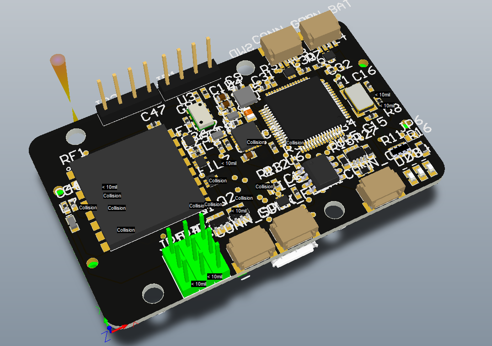
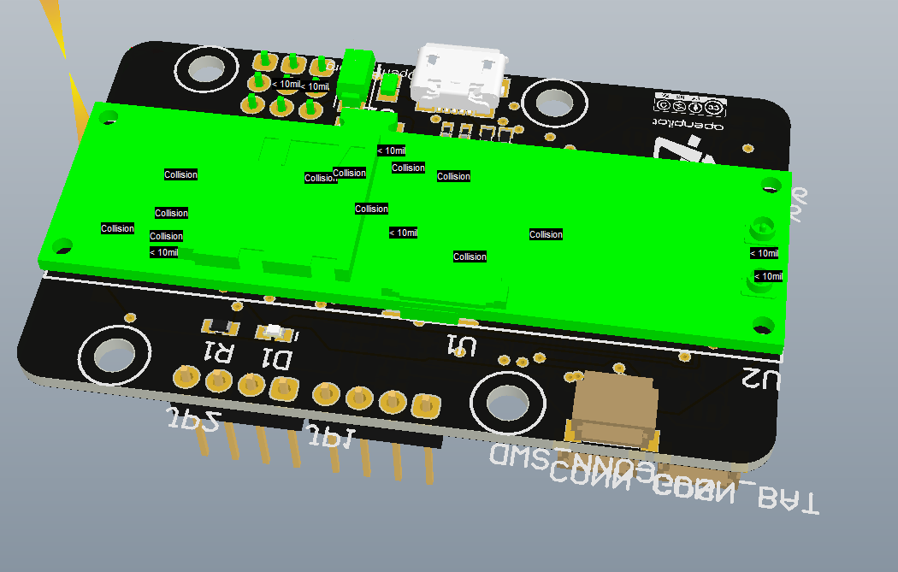

Ok progress is being made.  I have the schematic essentially finished and the placement done.  I need to figure out how to convince Altium DRC not to complain about the components under the Overo.   Truth be told, I'm anxious about them.  However I've checked quite a few times on my existing board and everything seems clear.

So a few screenshots:

