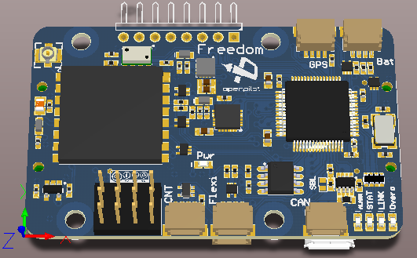
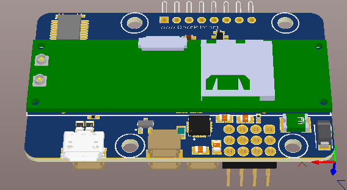
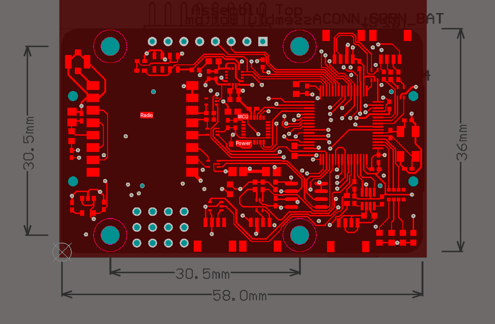

Ok so the board - OpenPilot Freedom - is finishing, pending final approval from a few people.  There were a few hold out connections that took some effort to route but nothing near any critical paths so I feel pretty good about it.  In the end the ground plane is completely uninterrupted and not used for any routing which was one of my main goals. 
A few features:

- 12 general purpose PWM pins (in or out), many of which also have ADC functionality.  Four are on a traditional servo header (for BEC and gimbal) and 8 are on a single row right angle header.
- CAN transceiver for electrically robust add-ons, such as digitally connected ESCs
- JST input pin capable of PPM, Spektrum and S.Bus
- Two serial ports, one of which supports I2C
- Reverse polarity protection on servo pins and serial inputs
- Efficient switching supply provides operation from 3-17V
- EMI filtering between radio and MCU
- Built in radio (RFM22b) with a U.Fl. header to provide a low profile fit (without the servo header FC height is < 0.25")
- Runs OpenPilot software

  

