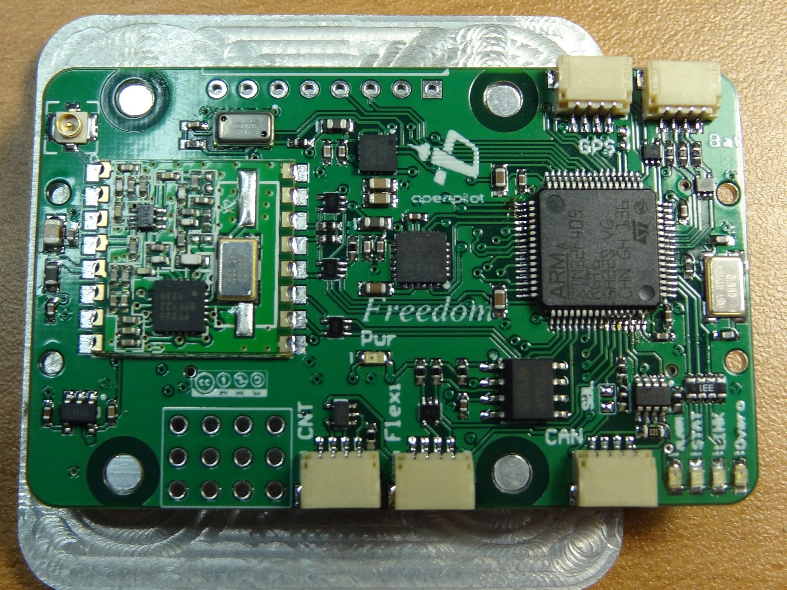
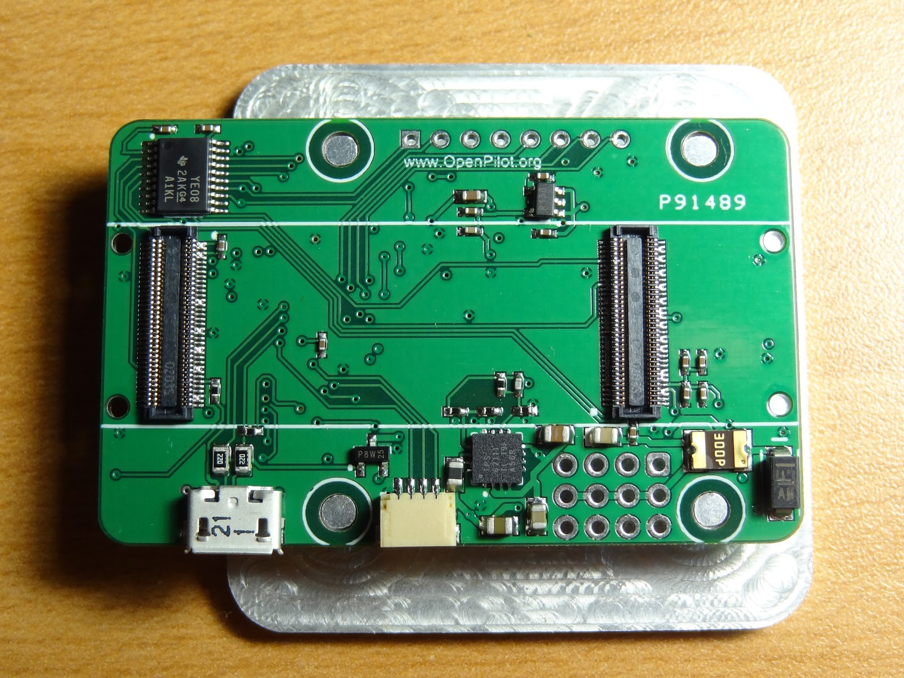
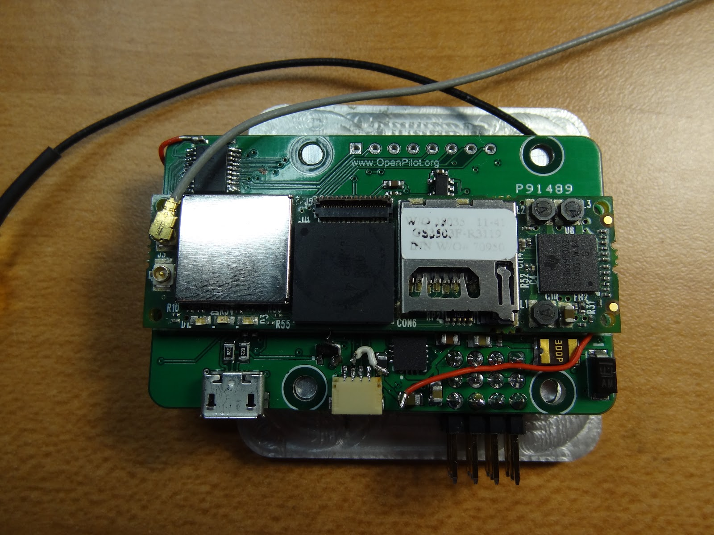

**Update:**See [this post](../2014-03-23-vertical-control/index.qmd) for an example of utilizing the overo extension [or this](../2014-03-15-logging-and-python-parsing/index.qmd) for examples of log analysis in python 

So it was a long weekend but I got the boards assembled and flying.  Here are some photos. 

  

So far all the sensors are tested and working.  The modem works and gives a really nice dB level at the PipX side.  I need to do some head-to-head testing.  There are a few small mistakes that I managed to work around and will be easy to fix in another revision.  

The Overo works and boots (another small error in the supply lines needs some work but was an easy workaround).  The power supply _seems_ to be flaking out as I get FC reboots when powering via the servo lines.  If I power the 3.3V line directly there are no issues.  I think the inductor I used for the switcher is under spec'd so I've ordered another to test.  Luckily it should fit in relatively easily.  A more bothersome issue is the OVERO_CLK line is not getting through the level shifter right now - even after I cut the traces on the level shifter output side.  I need more sleep and it will probably be obvious. 

Best part - it flew!  No issues, and flew quite well.  Much better than first RM flight, although those horrible big twitches are gone for RM too. 

  

[https://vimeo.com/53914555](https://vimeo.com/53914555)  

Tested:

- USB
- MPU6000 - working (need to get noise levels)
- MS5611 - working
- HMC5883L - working, orientation dealt with
- RFM22B - working, needs range testing
- Overo - NOT COMMUNICATING YET

Not tested: 

- Current/voltage sensor
- CAN transceiver
- Reverse voltage protection (last thing :D)
