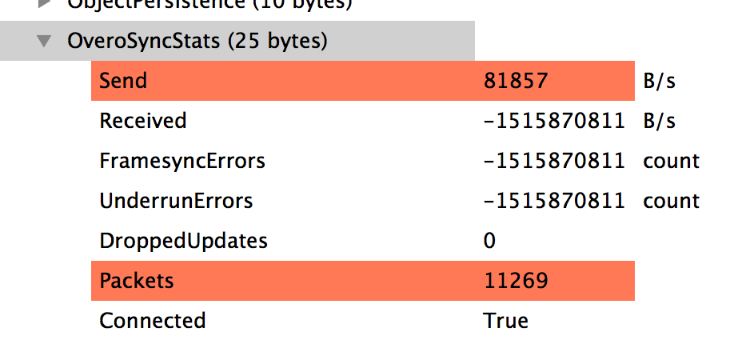

Ah, finally found the problem with the Overo.  After hours and hours of tracking down an imaginary hardware bug due to the fact my scope sucks, it turned out to be an IRQ configuration. 

So now I am just waiting for a new part to try out in the power circuit and then the design will be ready to spin a second version.
