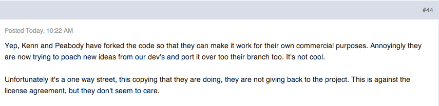

Oh classic:  [http://forums.openpilot.org/topic/14537-geofencing/page__st__20#entry153125](http://forums.openpilot.org/topic/14537-geofencing/page__st__20#entry153125)

This was my favorite:

LOL.  Most of the devs have already left and we are definitely implementing our own ideas, but heck - Dave is even claiming he came up with "PhoenixPilot" and probably the idea of putting your pants on one leg at a time.  Coincidentally the domain phoenixpilot.org disappeared last week :).  And of this demonstrates a complete lack of understanding of what the GPL means - there is nothing about it which requires one to actively push changes back upstream and all our work is published without any private repos.  The hypocrisy of that after being "strongly encouraged" to work in a private repo for the last year is astounding.  And of course the idea we are forking for commercial purposes instead of just to avoid the bullshit.  It's 99% likely Freedom will be CC-BY-SA unless we go try and go through Sparkfun or something. 
While everyone else is trying to get work done, Dave of course wants to make things political and his hoard of drones starts talking shit.  The best part of it was Kenn had planned to make sure his work to merge it went upstream to OP since Dwillis doesn't know about all the drama in the background and doesn't deserve to have his work marginalized.  We predicted any response would lead to thread closure and sure enough...  Plus he was even pushing other miscellaneous fixes to the OP repo last week, but the facts interfere with the story so they should be ignored.

Meanwhile people are getting banned on IRC in the #openpilot channel, including all of BU and randomly George Tech (cause I guess, fuck them?).

Oh drama.  It's nice to be free of it.

On the up side we have a few more developers working with us now and things are really starting to roll.  Lots of cleanup on the ground and flight side and we should have quite a few boards integrated into the tree shortly.  Also, all the changes for Freedom have been tested and the next revision should be really slick.  The nav improvements and refactoring are coming along really well and I think there is a fair chance we can get that code running on both CC3D and Freedom as well as another board that will be entering the mix (more on that later).
