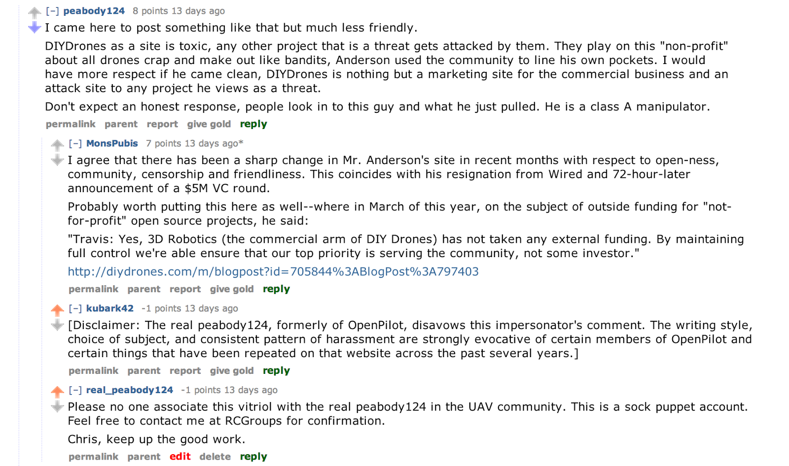

Last week, now they are using sock puppet accounts to try and make people look bad.  This is someone impersonating me on [reddit](http://www.reddit.com/r/IAmA/comments/14qpof/i_am_chris_anderson_former_wired_editorinchief_ama/):

 "peabody124" in this case is not me.  Just someone with too much spare time trying to be a troll. I don't know who it is although phrases like "class A manipulator" sound like someone I know who matches a similar description.  The account was coincidentally created around the time PP started doing well, too.   These people are embarrassing themselves.  Then you have some (the same?) guy registering phoenixpilot.org and setting the whois page to "James is a dick, ave" and some new vitriol now.

Seriously, I guess those who can't create anything themselves just feel the need to try and knock down others who can.  However, the good news is Phoenix is making great progress and extremely active.  We have a great team going and now the F3 port and Freedom and both working well.  I think Quanton should be out early next year too which is looking really promising.
