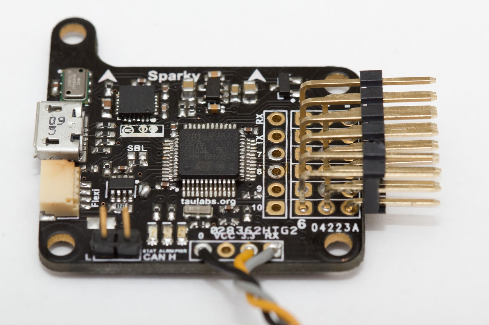
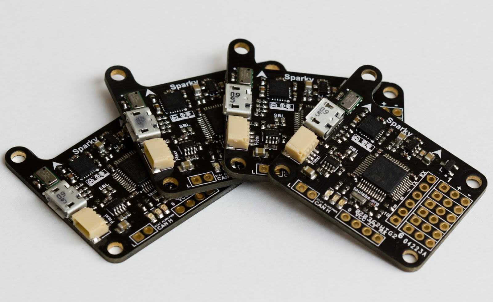
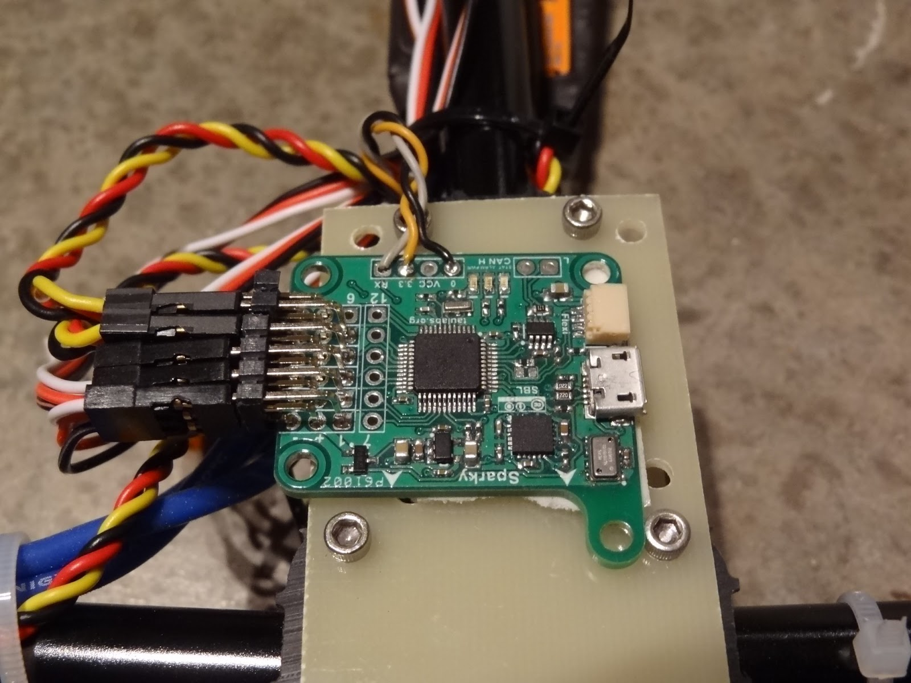
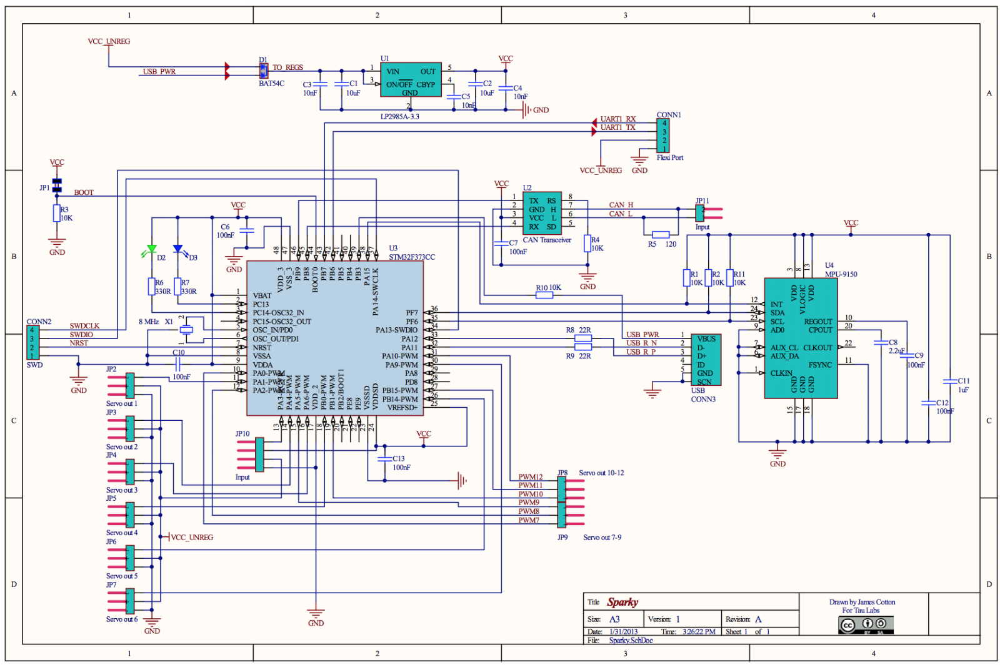
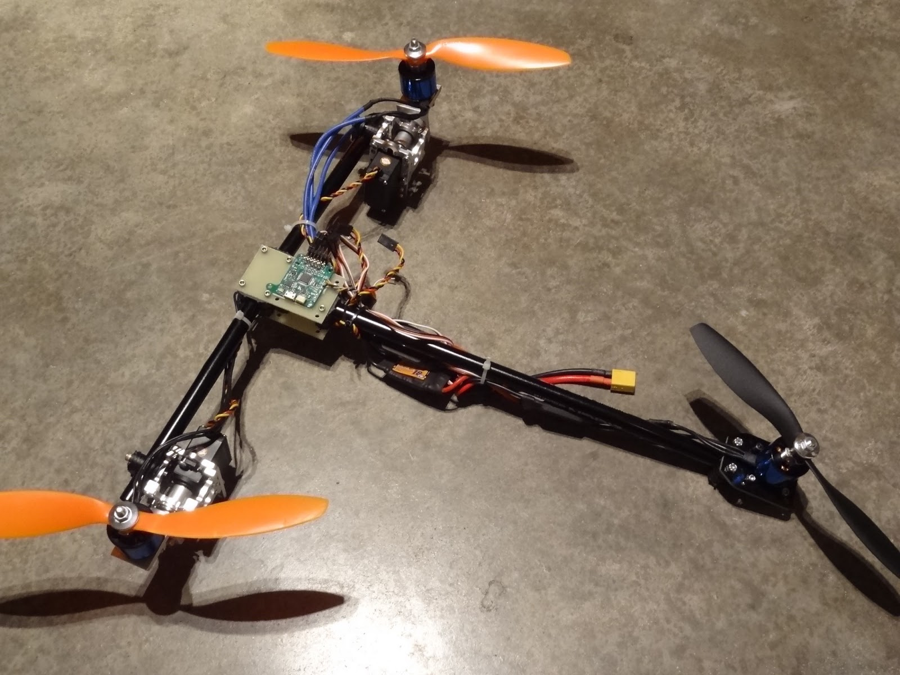
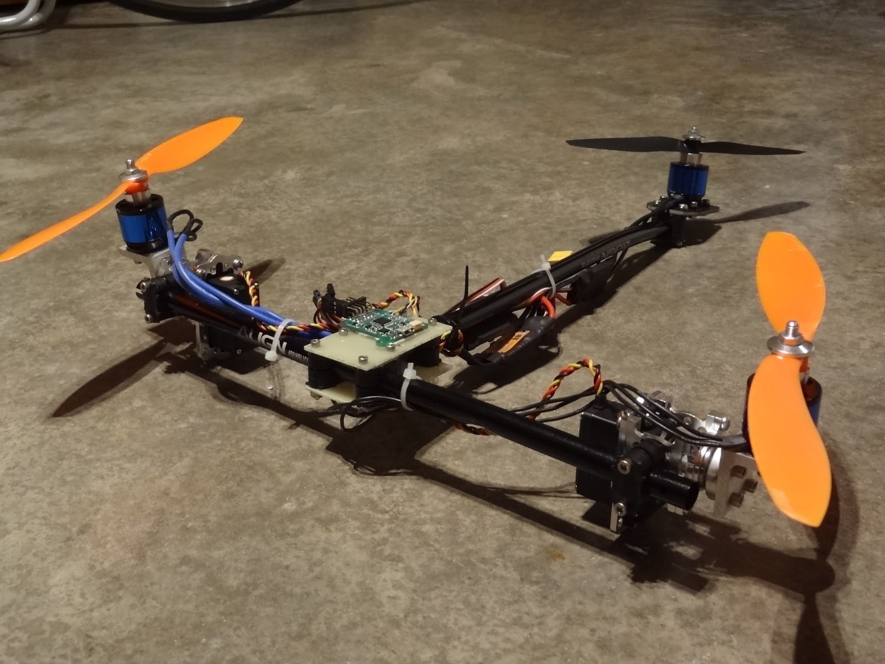

**Update2: Sparky2 is available here [http://www.hobbiesfly.com/taulabs-sparky2-0.html](http://www.hobbiesfly.com/taulabs-sparky2-0.html)** 

### Sparky

I recently built a flight controller board for [Tau Labs](http://forums.taulabs.org/) named Sparky.  It uses an MPU9150 for the main sensor, which combines a 3-axis gyro, mag, and accelerometer which allows tracking the attitude of the airframe.  In addition it has an MS5611 pressure sensor for altitude sensing and control.  One of the main goals for this board were to keep it small and single sided - so it could just be taped onto things.  I also kept three of the holes compatible with the same mounting pattern we have been using so it can easily be swapped out for CC or Freedom.

It has a micro-USB header and 12 PWM in/out pins.  The receiver header breaks out VCC in and 3.3V so it can directly power a spektrum satellite receiver (or in my case an OrangeRX) without an adapter.  There is also a JST-SH header for GPS.  I've already designed a revision with an additional serial port exposed for telemetry as I've become addicted to using my [tablet in the field](https://vimeo.com/63529694) for tweaking.

The first flight tests were quite pleasing 

::: {.archive-video video-id="63619336" source="vimeo" title="Sparky First Flights"}
:::

The smaller frame (Silver Hornet) was using off-the-shelf ESCs so it can't be tuned as aggressively.  The larger one has my ESCs so tunes in really well.  Altitude hold worked quite well - the baro wasn't even covered.

Here is the schematic and code

pdf version: https://dl.dropboxusercontent.com/u/6645063/Sparky.pdf code: https://github.com/peabody124/TauLabs/tree/sparky

### TriBlivion

In addition, ever since I saw the trailer for the movie Oblivion, I really wanted to build something like the [aircraft Tom Cruise' character flies](http://myhobbycraft.blogspot.com/2013/02/aircraft-from-oblivion-135.html).  It has two front motors that can rotate so it can basically behave like a tilt rotor.  I ordered some parts a while ago and they've been sitting around for a while and I finally decided to try and build something similar, which I call (for lack of a better name) TriBlivion.

The front two motors are mounted on servos (using an adapter from servocity to provide some strength).  The yaw channel is mapped to drive each servo in opposite directions to create a yaw torque.  In addition there is an accessory channel mapped to point them both forward to create forward thrust.  I'm really pleased that it stays extremely close to level in this condition with the motors pointed forward at about 30 degrees.  It did need the battery quite far backwards to balance the weight of the servo cages. 

I know normal tricopters are meant to have a good yaw feel but I've generally been underwhelmed with my tail servo one.  In comparison this yaw feels EXTREMELY locked in - more than anything else I've flown. 

This will hopefully make a really good FPV frame since the camera can be mounted on the front and have a forward view while flying forward.  Of course, it's going to be really important to not get confused since while in motors tilted mode full negative pitch will basically make it stop but you'll be looking at the sky.  This is also just stage one of my quest to build a tilt rotor aircraft and get the best of both fixed wing and quadcopter behaviors. 

So here it is flying 

::: {.archive-video video-id="64357725" source="vimeo" title="TriBlivion"}
:::

Unfortunately flying into the fence at the end stripped both servo gears, so it will be a week or two before I get more gears and try it for FPV.

Build list:

- 2x Servo blocks http://www.servocity.com/html/standard_hitec_servoblocks.html
- 2x Hitec servo http://www.servocity.com/html/hs-6635hb_stan__hi-torque.html
- 3x KEDA 20-22L http://hobbyking.com/hobbyking/store/__4700__hacker_Style_Brushless_Outrunner_20_22L.html
- 3x ESC http://hobbyking.com/hobbyking/store/__6548__Hobbyking_SS_Series_18_20A_ESC_card_programmable_.html
- 2x align 450 size tubes
- 7x clamping blocks http://www.shop.aglhobbiesllc.com/Frame-Spare-Parts/Delrin-Clamping-Block.html
- 3x motor mounts http://www.shop.aglhobbiesllc.com/Motor-Mounts/UAP1-Large-Universal-Slotted-X-Base-Mount.html
- cut G10 plate to sandwich motor mounts at 90 degrees
