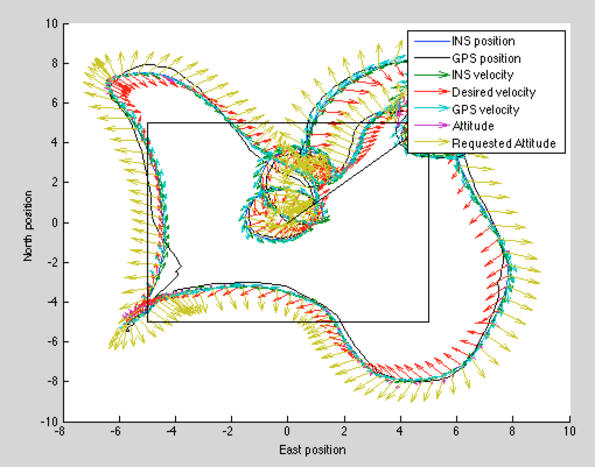
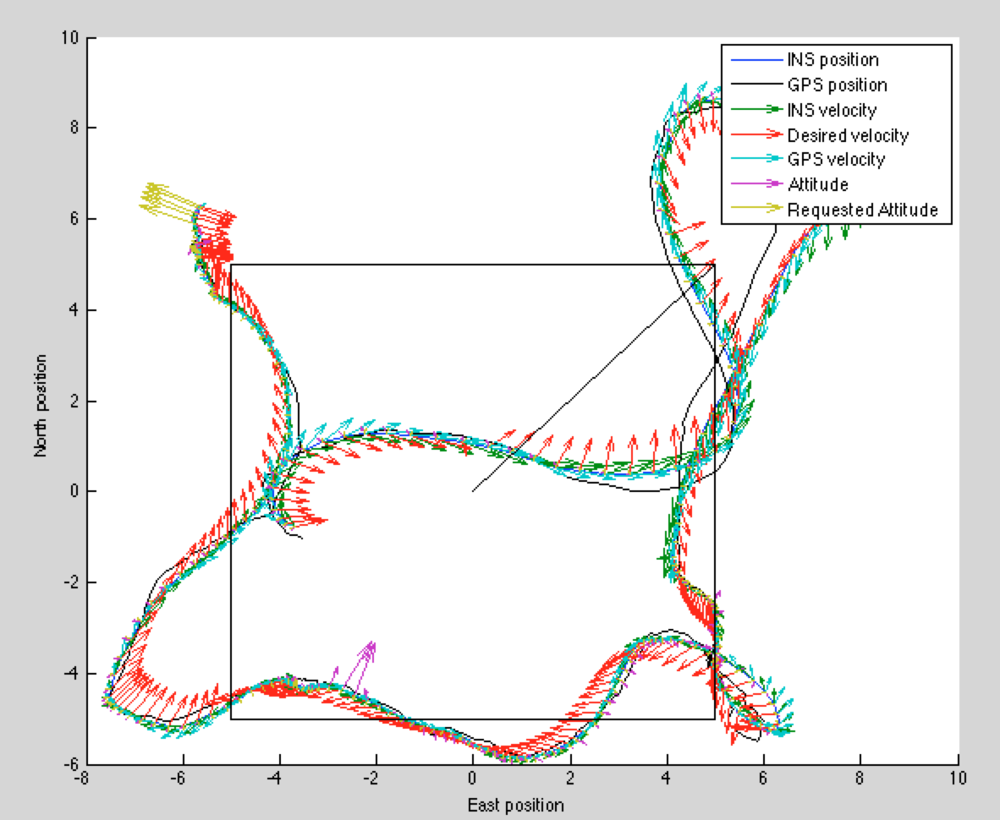

So thanks you Vassilis for writing a path planner module for testing ground control navigation.  For those that don't know, Vassilis was one of the main designers behind the architecture that powers Tau Labs: UAVTalk, UAVObjects and how we clearly separate the code between the Modules.

I was testing this the other day to drive in a 10m box:

::: {.archive-video video-id="64454388" source="vimeo" title="Rover Navigation Testing"}
:::

and a few things stood out.  First, I was using an OpenPilot GPS, which it turns out does *not* like to work near the ground.  Despite reporting a high signal quality, it was easily drifting around 10m in airplane mode.  It's possible other settings would work different, but be wary.  I've got a CN-06 module that just arrived which I'll replace it with.

Despite that, I could look at the high speed logs from the [Overo](../2012-11-19-freedom-assembly-and-first-flight/index.qmd) and see that it thought it was doing well given that noisy information:

It's quite overtuned as you can see from the oscillation around the desired path, but not bad for out of the box initial settings.  Also asking a car to drive in a box at a fixed velocity is an impossible task so I'll try later with mitered edges.

The more striking thing was the knack of the it to spin around 360 degrees while driving south.  I reproduced this in normal attitude mode (where the sticks just say head North/South) and noticed it only occurred when being told something near -180, never near +180 (which are physically identically). Finally digging through the logs I found a case where it happened and sure enough desired was -170 and the current heading was more like 170.  I mocked up all the values in matlab and everything seemed fine, but the acuator output had the wrong sign!

Finally it turned out fmodf produces negative values, which is different from Matlab, and this bug can be fixed with a simple four character [tweak](https://github.com/TauLabs/TauLabs/commit/5e266b6b2176f1c5fb02ace66caa73b21a1bb705).

Anyway, I drove this around and it works well now.  Once I get the GPS replaced with something that works better, I'm looking forward to making it drive around the park or use tablet control to follow me around.
