**Update2: Sparky2 is available here [http://www.hobbiesfly.com/taulabs-sparky2-0.html](http://www.hobbiesfly.com/taulabs-sparky2-0.html)**
**Update: for information on Sparky 2 see [this](../2014-08-29-sparky-20-and-taulink/index.qmd) post**
  **Warning: there are reports that some of the cheaper boards (e.g. from Witespy / ReadyToFlyQuads) have problems with the baro, so you will not be able to do altitude hold or navigation. There is also no "V1.2 2.0" - he is selling version 1.0 with known problems.**

Now that I have some boards back of the final revision of Sparky, I've been hard at work upgarding my fleet from CC3D.  If you missed the previous posts, Sparky is somewhere between CC3D and Quanton/Revolution. There is also discussion the [old Tau Labs forums](https://groups.google.com/forum/#!msg/phoenixpilot/Yw-1yUFcoiE/O80P1omQKNMJ).

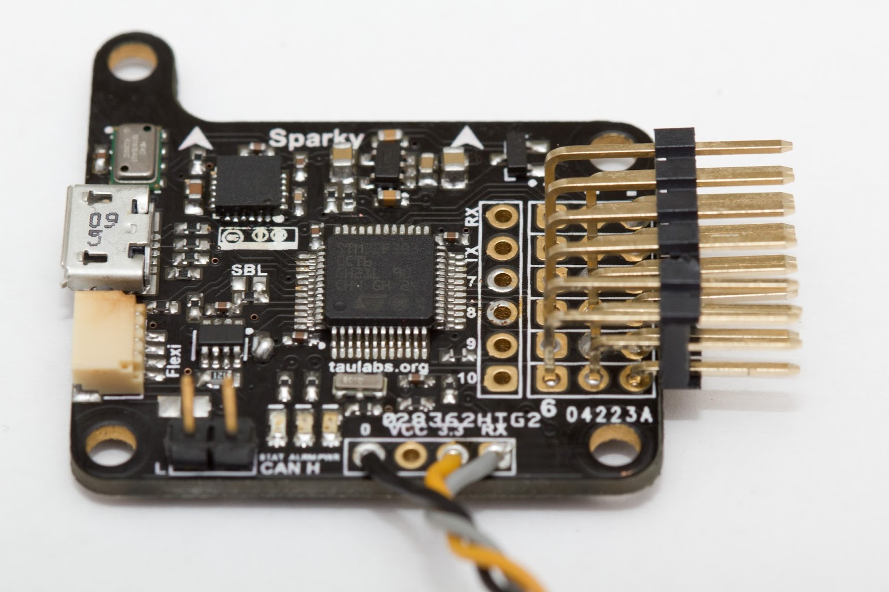

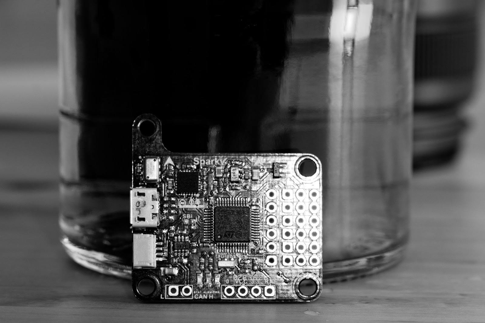

Basically this board evolved cause I have a lot of frames and wanted something high quality and easy to make a bunch of for myself.  Hopefully others will like it too.  Here is a list of the features

- Smaller than CC3D by 20%
- Single sided for easy assembly and also you can double sided tape it to things
- It has a mag, accelerometer, gyro and barometer which means it is capable of full navigation (hopefully I'll do some RTH testing this week).
- Two serial ports, one of which supports Mavlink + GPS so you can have OSD, GPS and Telemetry.
- Altitude hold
- Runs the full INS EKF at 500 Hz
- There are 10 channels of output (of you can use some of those for ADC inputs for battery / RSSI sensing)
- OSD via minimosd using mavlink protocol (so you can run the regular firmwares or the minimosd-extra)
- CAN bus support with built in driver for easy extensibility
- Daughter board that can drive a [brushless gimbal system](https://vimeo.com/65476828) (still under development to get it really locked in)
- Camera stabilization support
- It is *not* designed to take PWM inputs though, to keep the size down.  It supports DSM2, S.Bus, and PPM.  I know not everyone will like this tradeoff although you can use a PWM to PPM converter if needed.

So I've been putting it through the ringer and having lots of fun.  If you saw my [previous post,](../2013-04-18-triblivion-and-sparky/index.qmd) I built a pretty cool tricopter that has the servos on the front and can do horizontal forward flight.  Here are the rest of the things I converted over to Sparky: 

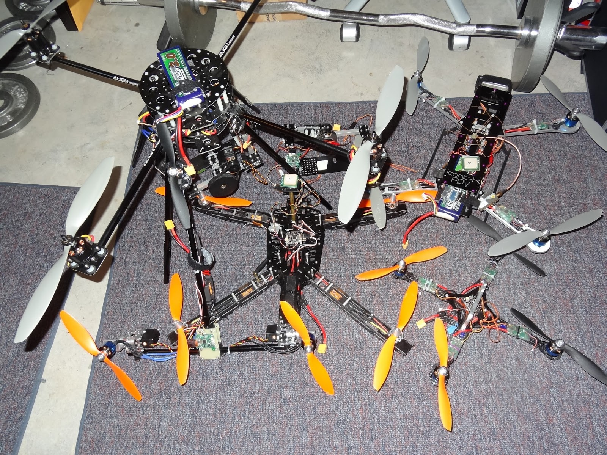

So those are 

  

- Triblivion
- UAP-1 with RusticWave gimbal
- Iconic-X FPV frame (from Quadaddict)
- Aggressor (again from Quadaddict, a great sport flyer)
- HT-FPV
- And a UG-2 gimbal I'm tuning up

The receiver port pinout is super useful, at least for me.  All my quads are flying using an OrangeRX satellite and the receiver port has both the board supply and regulated 3.3V. That means each board I just solder three wires of the satellite cable to the board and I'm good to fly.

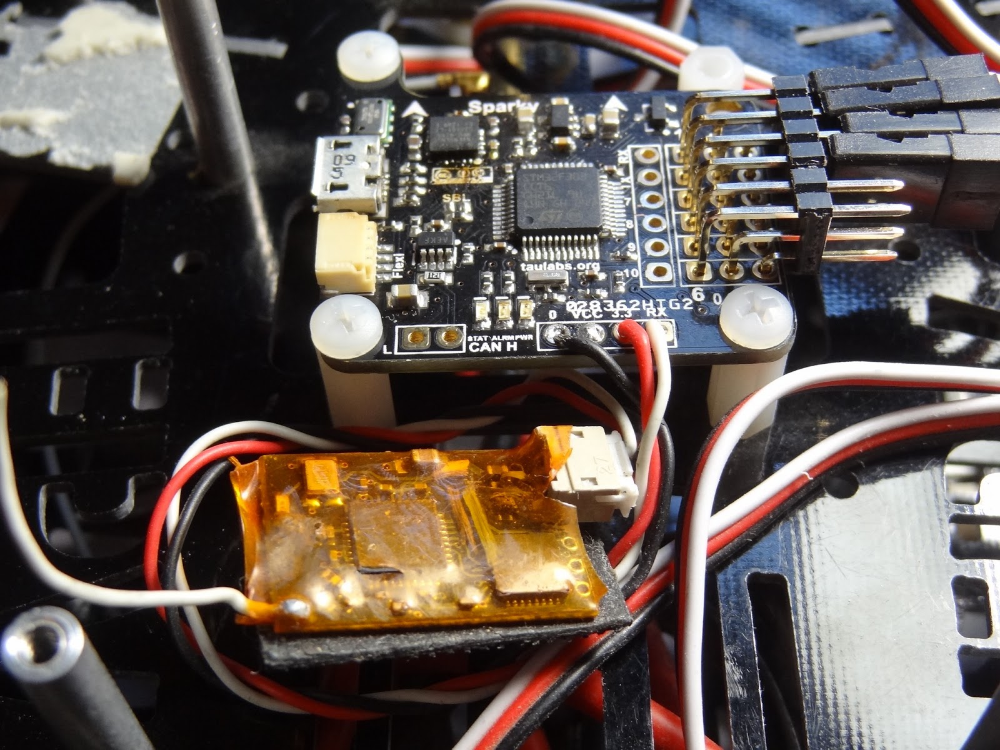

It's nice to no longer need a satellite adapter like on CC3D.  Now I just need a few more OrangeRX satellites (hurry up Hobbking!).  I'm really happy with how they all fly, although I think one of the motors on aggressor is going bad (again, hurry up Hobbyking!). 

Here is a video showing off a few of the features.  I need to spend a lot more time flying to really show this thing off, and hopefully I'll get some RTH tests in this week.

::: {.archive-video video-id="66517016" source="vimeo" title="Sparky Testing"}
:::

The main things this shows off are

- Altitude hold
- OSD with home direction and coordinates (F3 ADC code is about to merge so then I'll redo this with battery voltage and current on the OS D too).  Sorry the video recorder was cropping the screen, and my RF link wasn't behaving terribly well :(
- Camera stabilization
- Brushless gimbal control with a daughter board

I still need to test position hold and return to home - hopefully the wind drops in the next day or two.  

### Soldering

Now that I have six soldered up for myself and getting my fleet airborne again (selfish bastard I am), it was time for a solder party to make a few boards for devs and testers.  It was a long couple of hours, but actually went faster than when I made the first 15 prototype CC3Ds for testers (man that was ages ago).  That's the big benefit of keeping it single sided for home assembly.  Anyway, I took some photos for you guys if you haven't seen the process before. 

Jigging them up and using the stencil to apply paste 

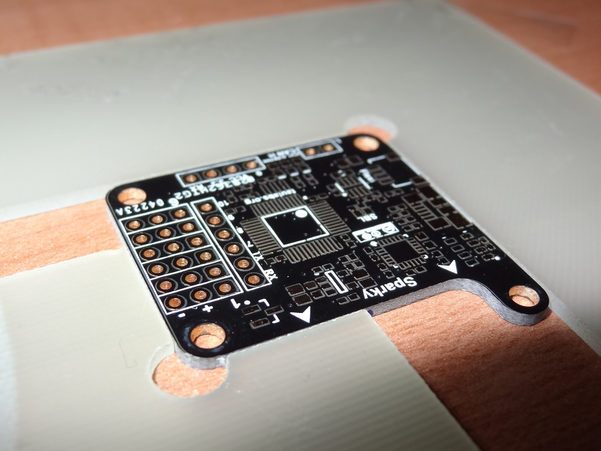

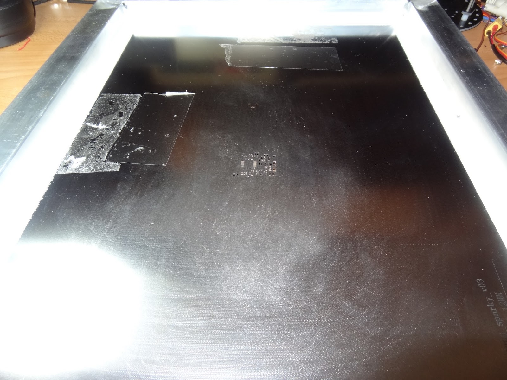

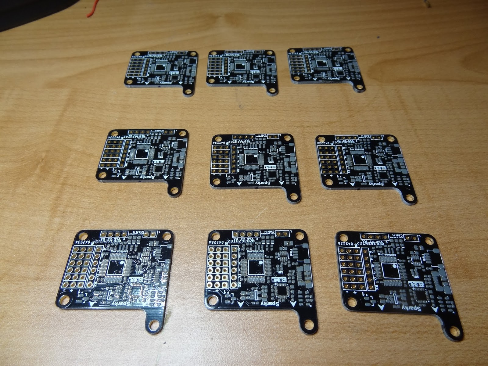

All the ICs are now placed.  Woops, short one MCU.  Always should count parts before deciding how many to solder. 

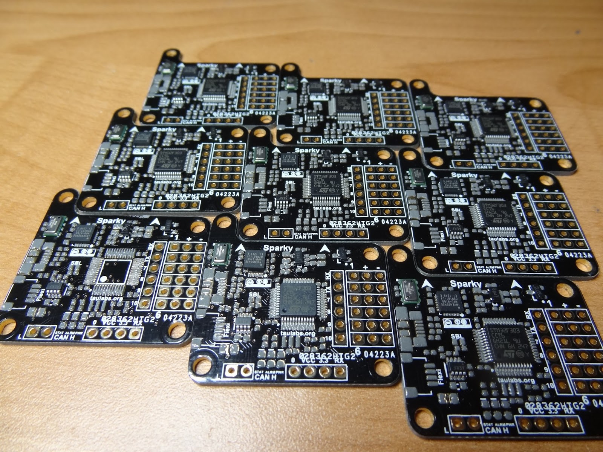

Ok, now all the parts are placed into the oven with you.  Careful not to put any on the bent wire since I did that the other night and knocked one down, ruining all the placements *sigh*. 

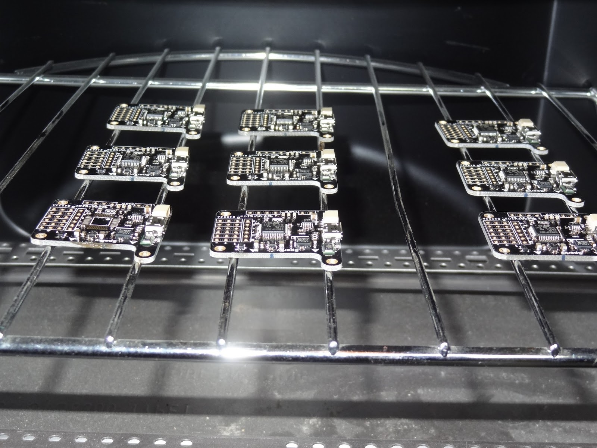

And the finished product.  All flashed and ready to rumble. 

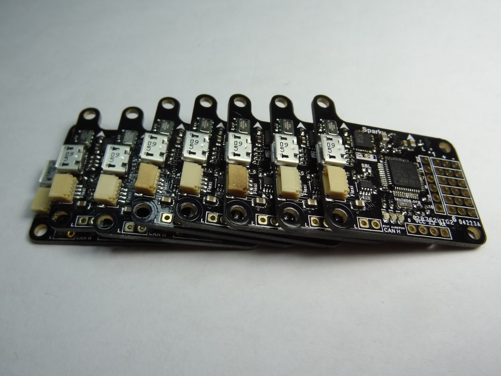

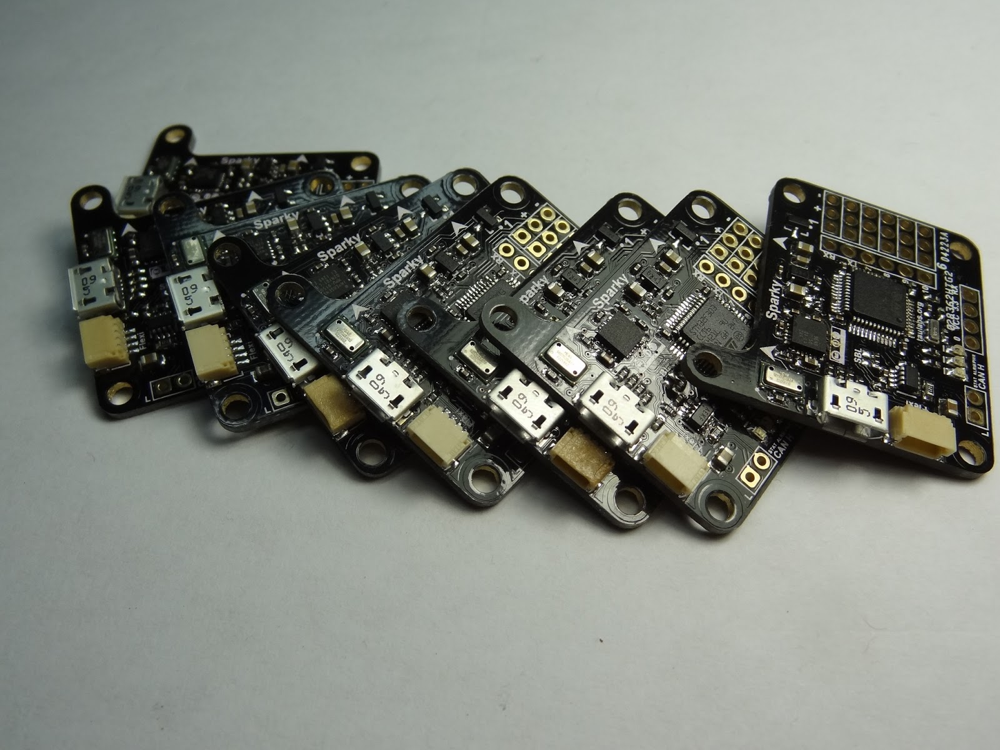

So that was my Saturday evening.  Well there was also scotch.  I have a few spare so if anyone wants one drop me a line.  I'll make another batch if there is demand.

**Update:**Here is a demo of Sparky doing PH and RTH:

   

::: {.archive-video video-id="84639710" source="vimeo" title="Sparky testing PH and RTH"}
:::
