Time for a follow up on my [previous post](../2013-05-06-brushless-gimbal-driver-add-on-for-sparky/index.qmd) about the brushless gimbal driver add-on for Sparky!  It is now working and I even have some testing flights when I'm quite happy with the results. 

### Iconic-X Frame modification

I mounted two GoPro's on my [Iconic-X FPV](http://www.rcgroups.com/forums/showthread.php?t=1695136) frame.

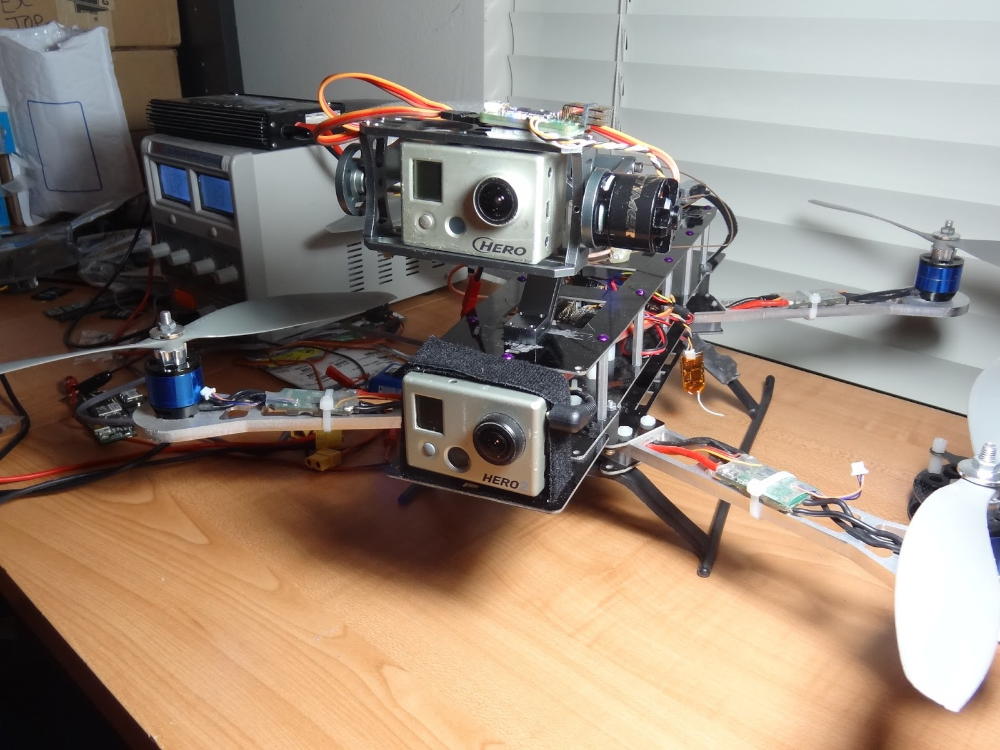

The first is obviously mounted like the normal FPV camera (which then uses a minimosd as described [here](../2013-05-19-sparky-testing-and-building-no-crashing/index.qmd)).  I then bolted the RCTimer 2-axis gimbal to the top of the isolated part of the frame (very little vibration in this configuration).  Also, tanks to Kendall at [UAVObjects](http://www.uavobjects.com/) for having the gimbal in stock and really fast delivery.  So at this point it's quite a monsterous beast (and one I don't want to crash).   You'll see it works really well for roll but I haven't tuned up the pitch quite enough. 

It also still has the minimosd being fed directly from Sparky to provide an OSD which you'll see again in the video below. 

### UG-2 Gimbal

I was also really excited to get a brushless gimbal for larger cameras from Rusty at [AGLHobbies](http://www.shop.aglhobbiesllc.com/) which is using two motors that are prewound from [RCTimer](http://www.rctimer.com/index.php?gOo=goods_details.dwt&goodsid=870).  You can see it in the second half of the video above although I need to get some more flights in and do some more tuning to really show it off. Here are some pics of putting it together for anyone that was as clueless as me.    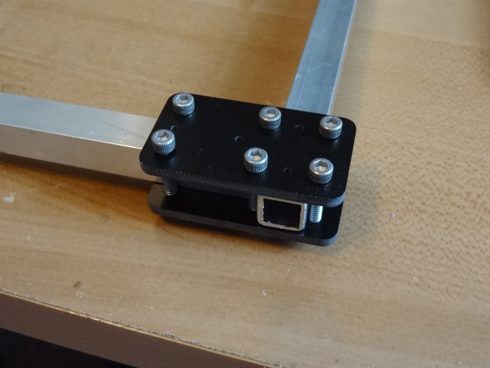  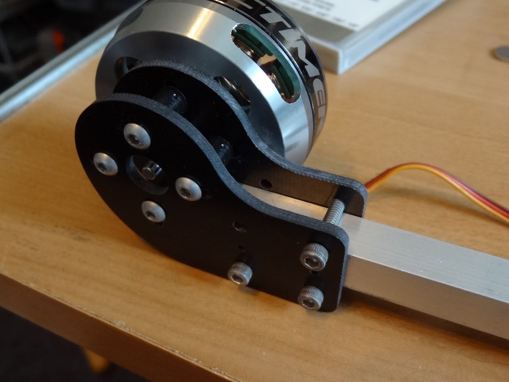  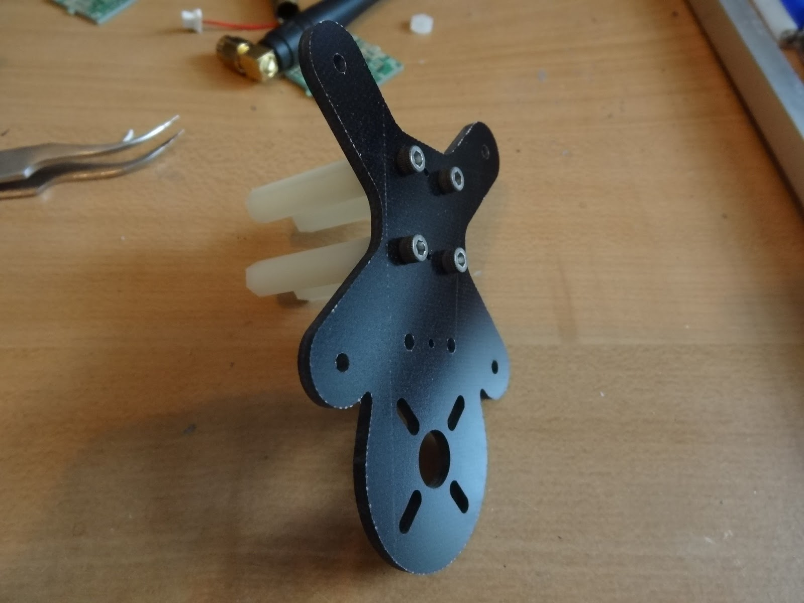    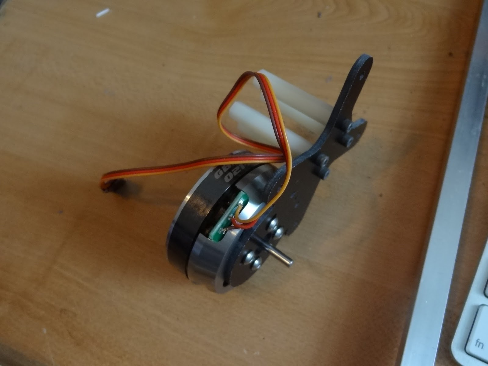  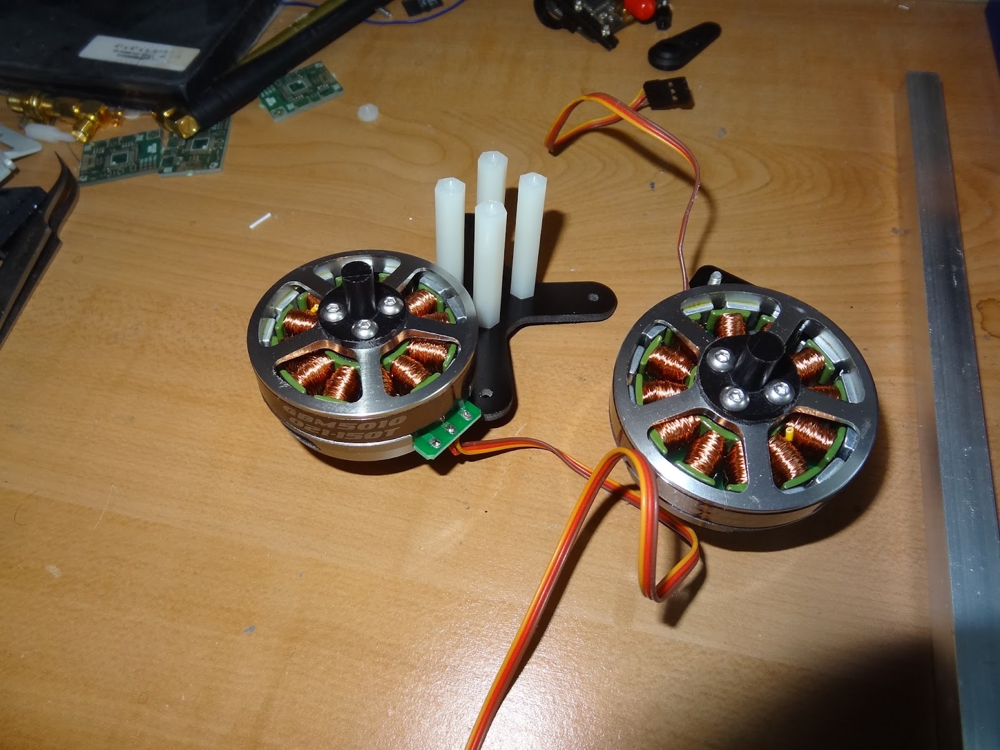  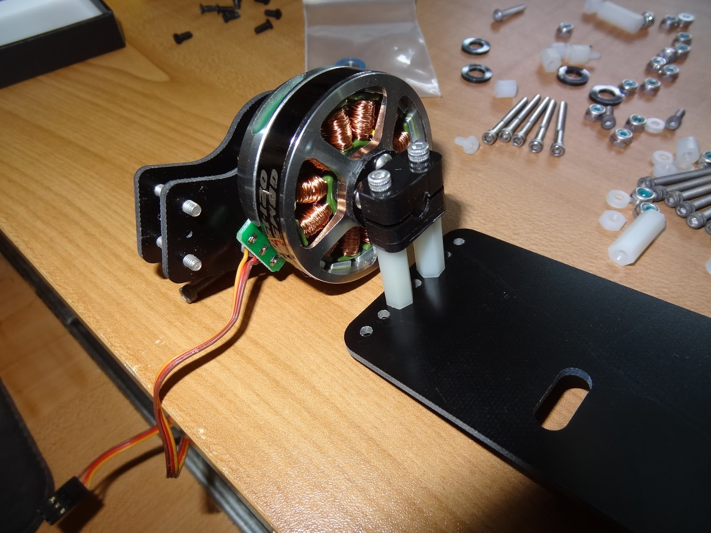    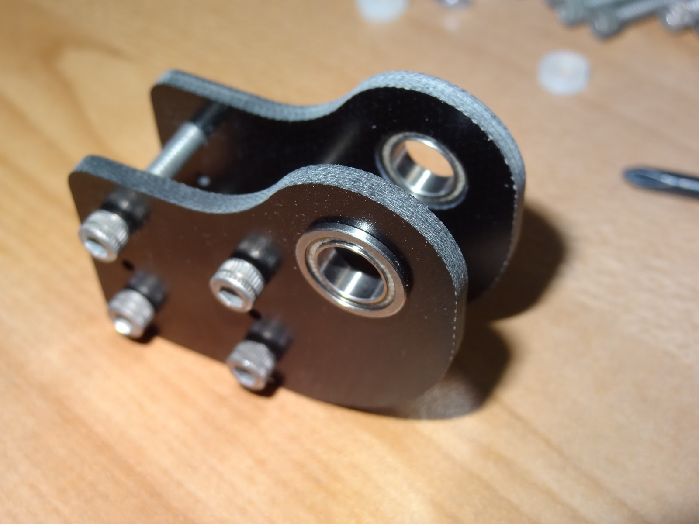  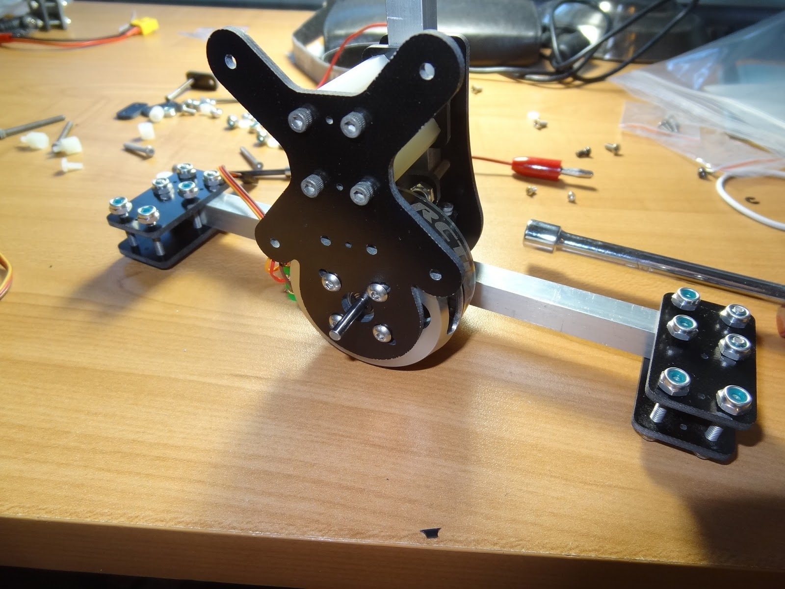  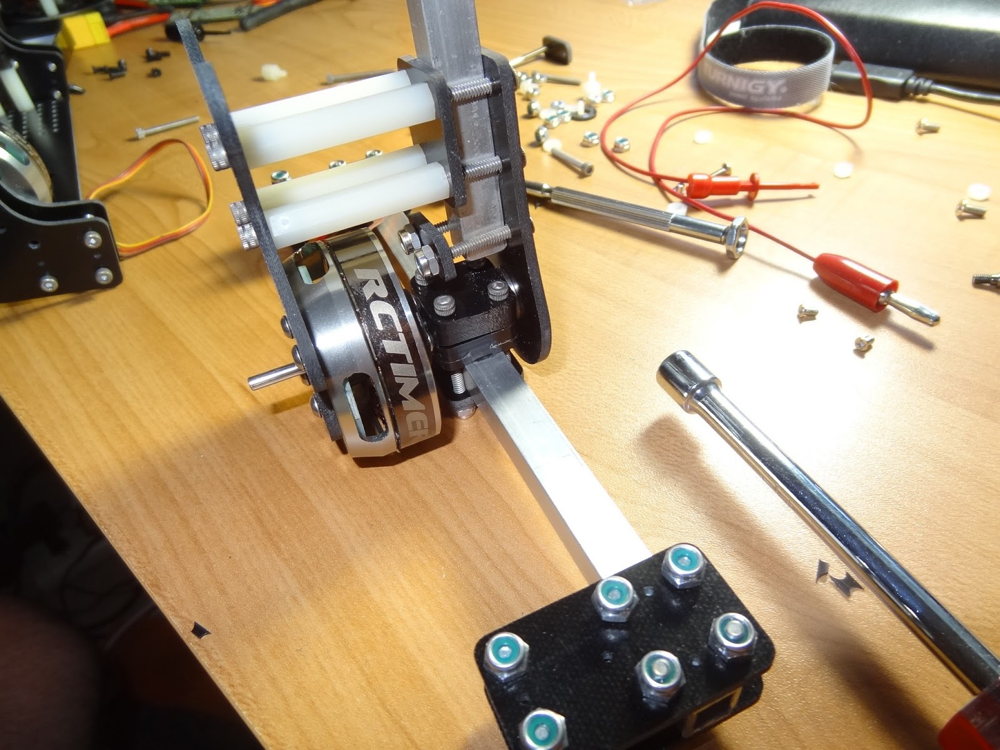    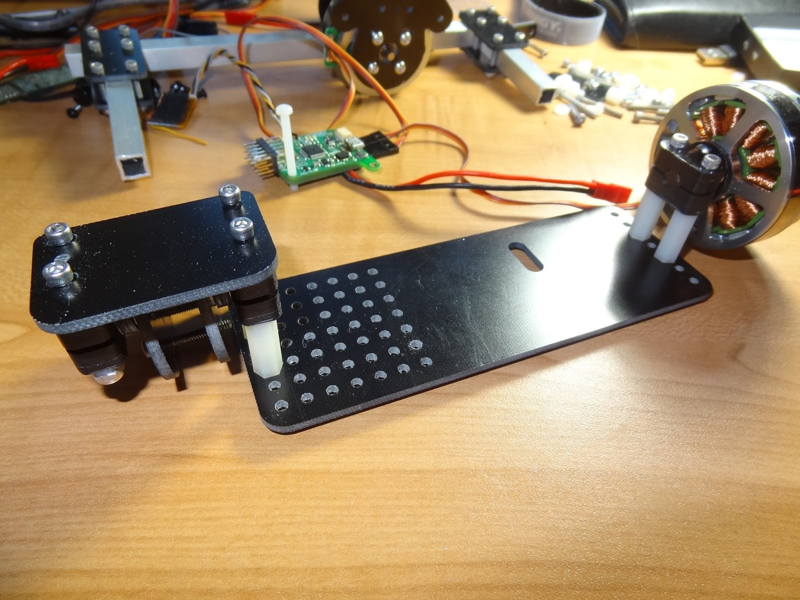   

I have a little bit of testing in the video below and it's working pretty reasonably (like the RCTimer gimbal Sparky is under-compensating pitch) but this was the first flight and I need to spend some time tuning it.

### Tests

So without further ado, a video: 

::: {.archive-video video-id="66624740" source="vimeo" title="Sparky Brushless Gimbal add-on success"}
:::

When demonstrating the gimbal in flight there are four screens.  The normal FPV from gopro, the version from the ground station (with OSD overlay), one from a fixed tripod, and finally the stabilized gimbal.  Overall I'm pretty happy with the results and want to take this out in a big field and do some FPV and enjoy the video madness. 

You can see during some of the more aggressive maneuvers the attitude drifts - this is likely the complimentary filter drifting from acceleration.  I'll try tweaking the settings and seeing if I can get it more resilient.  There is also a noticeable under-compensation in pitch although I'd say it is eating up 95% of the movement.  

### Control Scheme

So this threw me for a loop for a few days.  It was trivial to get it working *ok* but I wasn't getting great results.  Especially roll just had insufficient torque and felt sloppy.  I ordered a gimbal controller (the Martinez controller I believe) from UAVObjects (thanks again) and pretty quickly got the RCTimer gimbal working, so I now knew the hardware was capable and that I was failing.  However one thing I picked up pretty quickly from the tuning settings people were using was they typically used a lot less power than I started with (e.g. around 30%) which did improve things substantially. 

I conceded defeat and looked into the code at https://code.google.com/p/brushless-gimbal/.  What seemed odd to me was that the gyro came in twice - once where it was integrated to determine the electrical output phase (scaled by what they called Kp) and a second time after the integration where it was added to the phase to create a phase lag or lead essentially (what they call Kd).  That seemed a bit odd, but when you write it out that basically is the same as normal Kd, except they bypass differentiating and then integrating it right back.  I'm guessing this improves the noise performance.  This term made quite a difference.  Here is a picture of the control scheme for the curious: 

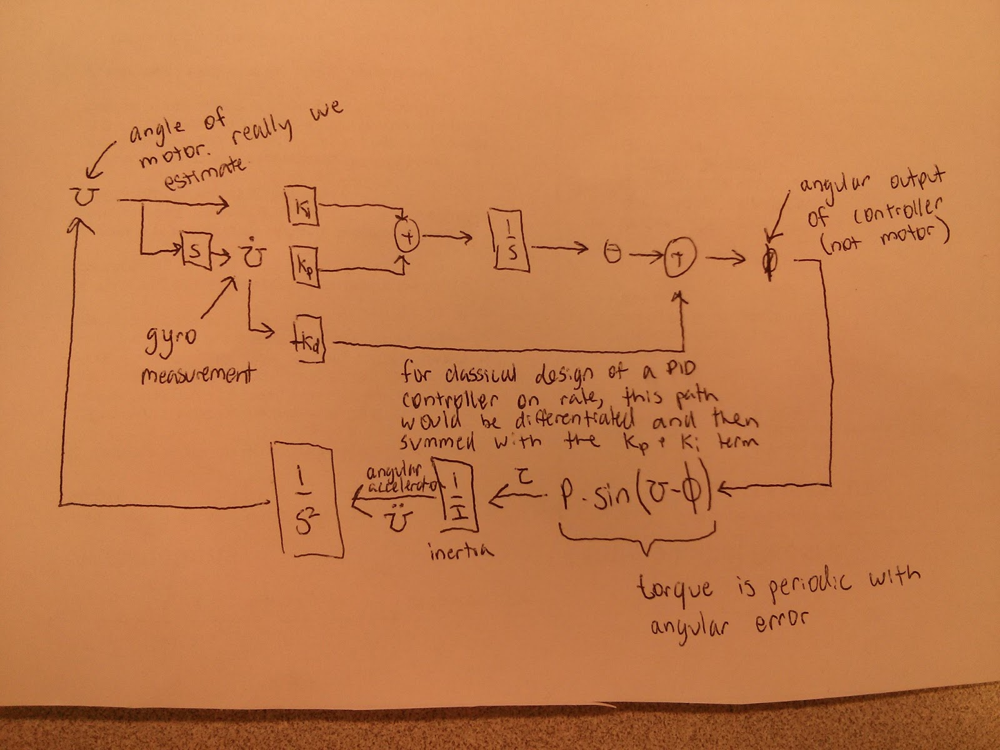

Where in my case I'm using essentially attitude control mode where the outer Kp maps to that Ki, the inner Kp maps to that Kp, and then I have an additional damping term that is fed into pios_brushless.c which creates a phase offset to the integrated position.  There are still lots more knobs to tweak, and I'd like to try setting that damping to zero and using a normal Kd since we have control over the bandwidth then.  At least convince myself I can get somewhere similar. 

Anyway, that was fun. 

Also I want to thank, ReadError who is awesome and threw a few brushless add-on boards in with one of his PCB orders.
