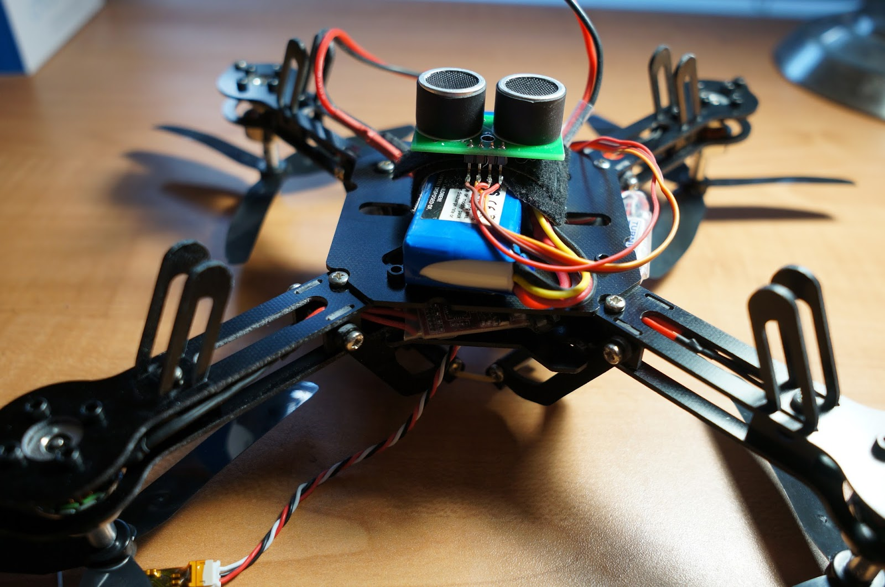
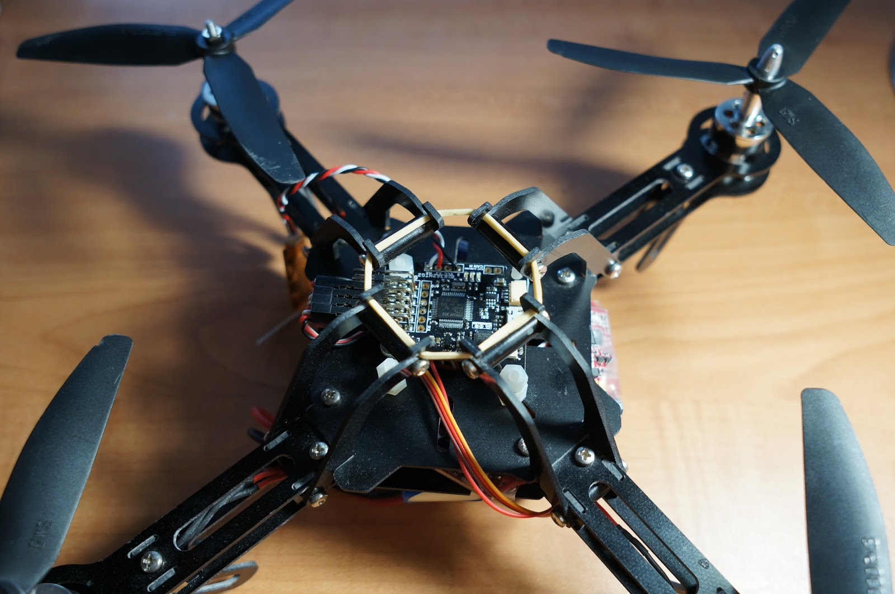

So following up on Stac and scenkov's really nice work I added support for SMD-IO-UART sonar module which I had laying around and connected it to [Sparky](../2013-05-19-sparky-testing-and-building-no-crashing/index.qmd). This one is a bit different than the HCSR04 which encodes the range in the duration of a positive digital pulse. Instead, it had a negative pulse with a duration of 150µs when it finds an obstacle and the latency from the trigger to the pulse indicates the distance.  For more details check [this out](http://www.elecfreaks.com/264.html).

I mounted the module on the bottom of my silver hornet, which is a bit too big for the landing gear but works for now:

With the module working, I hacked up some code to pass that data into the altitude hold EKF.  I played around with the tuning a bit and can't get to the point where I'm super happy with it.  The next step will be trying a different module (e.g. I have an XL-MaxSonar sitting on my desk right now which people on IRC say good things about).  However it does work.

::: {.archive-video video-id="72598372" source="vimeo" title="Sonar altitude hold"}
:::

One thing that is a problem with the current implementation is that if you go too high and the sonar goes out of range, then the EKF no longer has anything to correct the altitude. This means it goes into a straight prediction mode based on integrating the accels but depending on the direction of the bias this can make it *think* it is going down and correct by going up.

I suppose an alternative might be to keep correcting with the previous altitude (or max for that sonar) which should in any case be higher than what you engaged it at and cause it to come back down. A better approach would be to fill in that missing information with the baro.

If anyone wants to play with it, the code is currently at my [Tau Labs github fork.](https://github.com/peabody124/TauLabs/tree/sonar_hcsr04)
