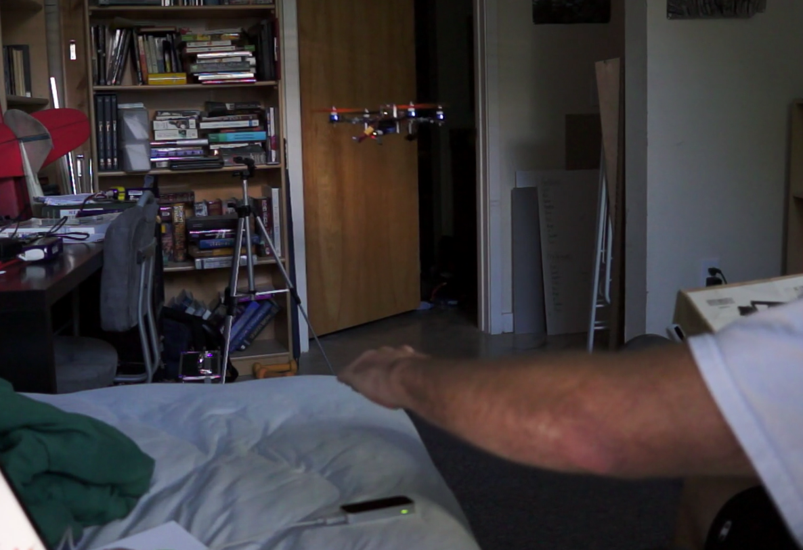
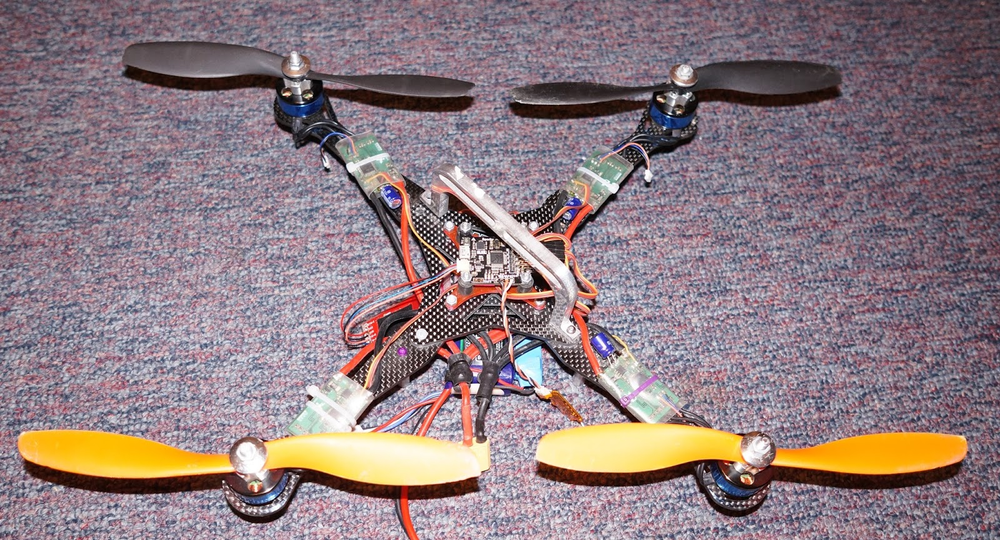
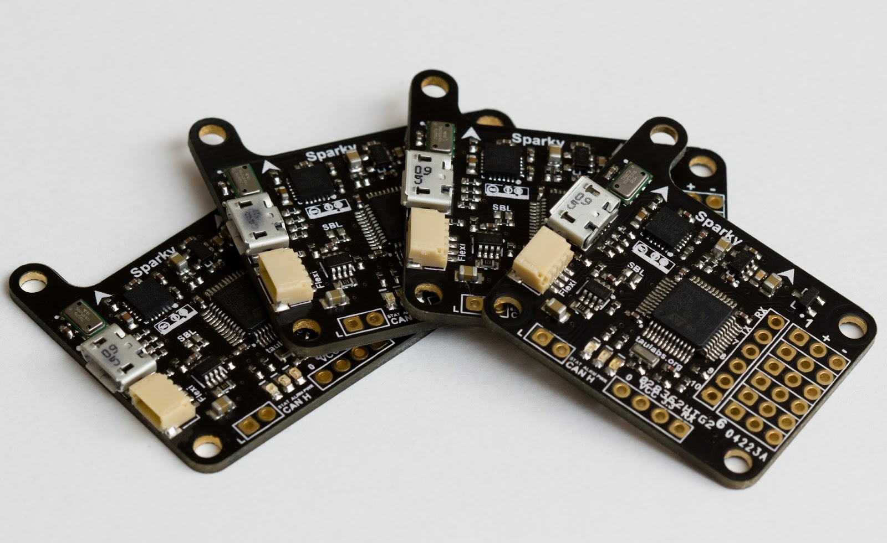

So I just recently purchased a [Leap Controller](https://www.leapmotion.com/).  For those of you not familiar with it, this is an amazing device that can track your fingers and hands extremely precisely.  So of course, the first thing I wanted to do was use it to control a quadcopter!

The API is actually fairly straightforward to interface to C++ and you can access it [here](https://www.leapmotion.com/developers).  I wrote a plugin for Tau Labs GCS which would access the hand position and the roll-pitch-yaw value of the palm of hand. Right now I'm not doing anything with the position (other than checking a hand is there) and the RPY value is packaged into a LeapControl UAVO and relayed via the telemetry link to the FlightController.

On the flight controller side, I extended the ManualControl module to support another flight mode position (LeapControl). When the flight mode switch is in that position, then the LeapControl UAVO is used to set the desired attitude (yaw is used to set the turning rate, not absolute heading) and the throttle from the transmitter is used.  If a hand is missing it turns off the motors (a nice safety feature you'll see in the video).

The code changes can be found [here](https://github.com/peabody124/TauLabs/tree/leap) although check the commit history since it requires some hardcoded paths to the Leap libraries.

The flight platform was my IconicX, which is beautifully light, has good flight times and only uses 8 inch props.  All really good things for indoor testing of a brand new and probably terribly advised control scheme.  It used bluetooth for telemetry to get the LeapControl information from GCS (more on that later).

The flight controller is the [Sparky](../2013-05-19-sparky-testing-and-building-no-crashing/index.qmd) board that I designed for [Tau Labs](http://forums.taulabs.org/):

But of course, you really just want to see the video, so without further ado: 

::: {.archive-video video-id="73060129" source="vimeo" title="Controlling quad with a wave of the hand"}
:::

### Conclusions

It's definitely flyable. Especially after a few minutes practice (I'd recommend a larger space).  A few things I need to change or would like to address in the future 

- Increase the yaw sensitivity.  Right now the highest value is only a few degrees per second. However, it's a bit tricky because the Leap seems to zero yaw at the something random (related to what it first saw) and I'm finding "zero" seems a bit arbitrary.  Probably a dead band and some exponential on the GCS side would go a long way.
- **Lag**. This is the biggest blocker I think.  This quad is well tuned and reacts _really_ fast and so I can tell the limitations from hand controller. Of course the Leap itself has some latency, but I think something is going on in terms of the bluetooth serial port backing up data.  When I set the update rate too high there is a very clear backlog that occurs. Using a PipX might help since we have a bit more control about the lower level buffers.  Probably the serial code needs a goo review *and* for things like this we need a low latency protocol for sending the same object. I did something similar for the Tau Labs [android app](https://play.google.com/store/apps/details?id=org.taulabs.androidgcs&hl=en) I wrote which made a huge difference for telemetry control (also bluetooth).
- Use hand position - I feel like tracking the position could allow a stronger communication of "oh shit" when getting near something.  Possibly if the hand moves rapidly then it applies a short lived roll signal to the quad to pull it away from the object but avoid the pilot induced oscillations from the latency.  And of course the Z position can also be used for ...
- Integrate this with the [sonar based altitude hold](../2013-08-18-tau-labs-sonar-altitude-hold/index.qmd) (after some improvement) I described last week so that the hand height directly indicated the altitude.  That could create a really cool control scheme.
- Using overo on [Freedom](../2012-11-19-freedom-assembly-and-first-flight/index.qmd) for optical flow then the X and Y position can actually indicate a rate to move at.  That would be really awesome.
- Try this outdoors.  I'm not sure how well the Leap will work there.

But it was fun.  I definitely won't give up my transmitter this week though.  If you are interested in this or our other developments, make sure to drop by [Tau Labs](http://forums.taulabs.org/) and say hi.
