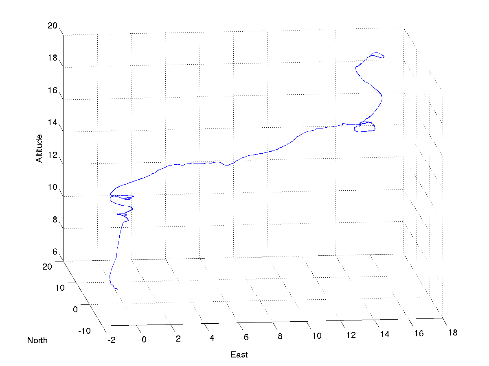
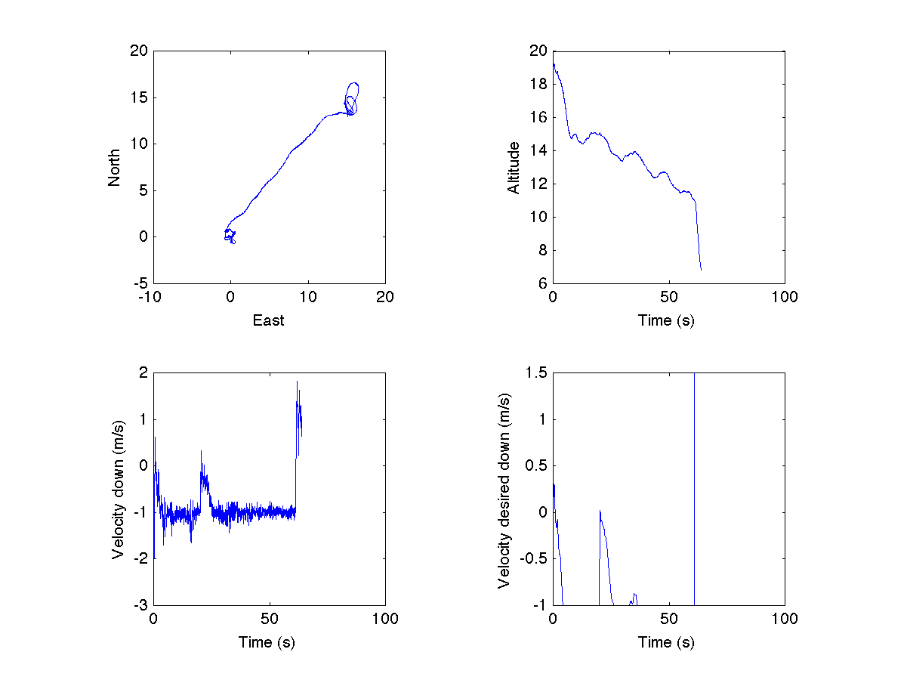
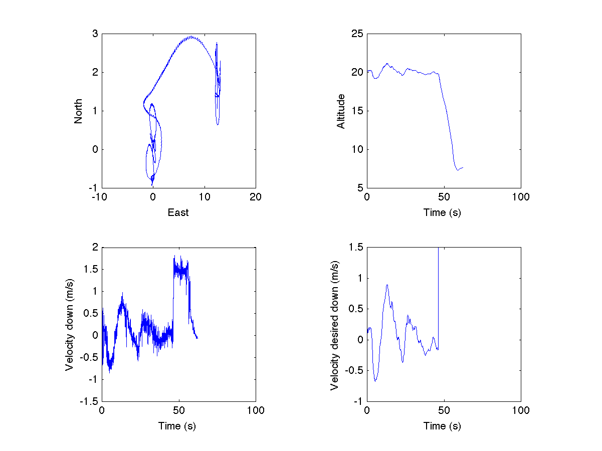

So at the last Houston meetup at that Haymerchant I was talking with Oso Grande and he described the Naza failsafe sequence. Essentially hover in PH mode for a few seconds, then fly home, hover over home and finally land. It seemed like a good idea, but our current Vtol Path Follower didn't support any multi-step sequences like that. A day or two of thinking about it and a pretty clean implementation crystalized in my head.

Essentially for any "goal" the path follower might have, which range from simple ones like "hover here indefinitely" to the one described above, there would be an FSM that is switched in, which allows arbitrary levels of complexity. The basic description can be seen [on GitHub](https://github.com/TauLabs/TauLabs/issues/1012).

I went ahead and implemented it this week and surprisingly it worked in simulation right away, so I got ambitious and went ahead and tested it at our Houston meetup [this weekend](http://fpvlab.com/forums/showthread.php?8252-Checkin-From-Houston-Tx&p=376632&viewfull=1#post376632). The results were pretty good. Also it was flown on Freedom, which has the benefit of providing high quality logs for offline analysis. I had one flight where it wasn't performing terribly well because I forgot to calibrate the mags (no fly away but some serious toiletbowling). However you can decide for yourself on the other flights:

::: {.archive-video video-id="79603584" source="vimeo"}
:::

  

And here is an image of the position data as it returned: 

The location control was pretty good and the path home nice and straight. The altitude control wasn't great. It was meant to hold a minimum altitude of 15 m above home, which it tried but gradually dropped. However the altitude drop came from two issues:
 1. the accels were biased so the estimate of vertical velocity was a bit off so when it was still it though it was already going up 0.5 m/s
 2. the max vertical velocity was set at 1 m/s so it spend most of the time with this request pegged and not making much progress

First the good points. You can see there is less than 1-2 meters of error in the PH segments. However, you can also see how the altitude slowly droops down in the upper right panel, and the velocity is basically thinking it is going up (down at -1) 1 m/s squared so it thinks everything is peachy. After recalibrating the z-accel, this is the result: 

Luckily we [added a button](https://github.com/TauLabs/TauLabs/pull/1001) the other week to facilitate this.

I also had the opportunity to see Naza PH and RTH, and I have to say I was impressed. It holds well and is nice and stable. It definitely has me questioning whether our dual loop controller for PH is the right design, as opposed to a directly PID control on position. We used to have an implementation of the later, so I'll probably try and resuscitate it and play this week. Also our altitude controller in general needs some love.

So a suggested change is that, like Naza, it also ascends in place when it is going to, before returning home. Also making the time it hovers in place programmable before RTH is important. Then add a simple geo fence and we should be able to get some users testing this. If we can make it robust it might actually be an option for failsafe in not too long!
