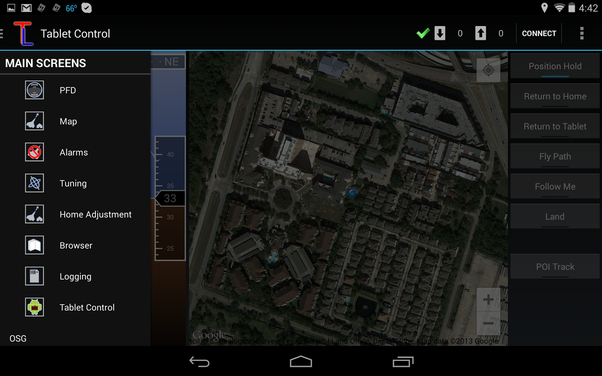
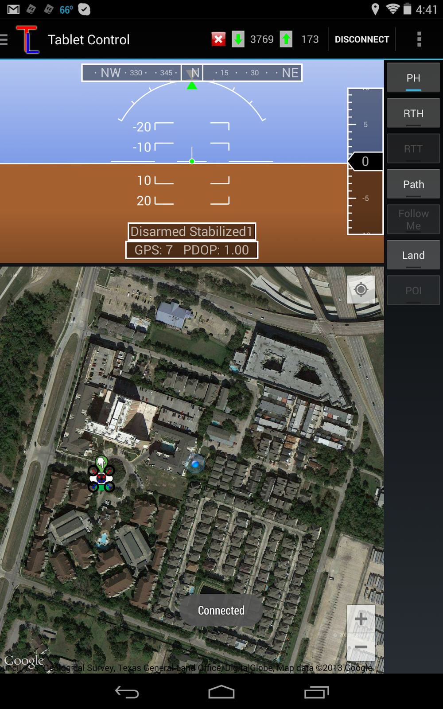
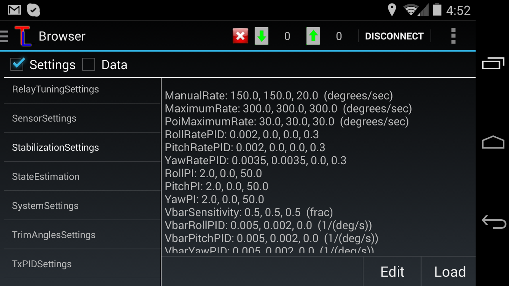
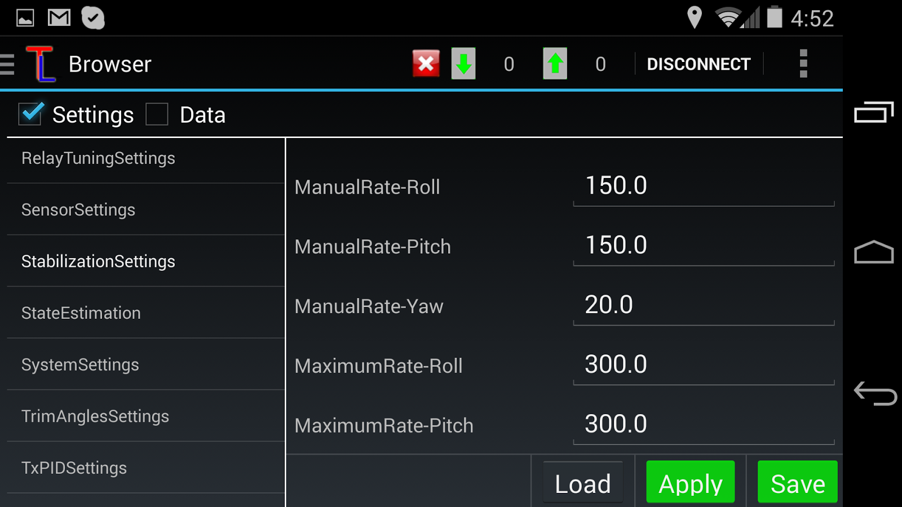

I pushed a pretty major update of the Android application to the Google Play Store today that I'm quite pleased with.  Felix Da Cat suggested using a Navigation Drawer to get around the app (he actually suggested it on the OP forums, which puzzles me since they don't have an android app). A year back I tried getting rid of the home page by using a spinner bar at the top and really wasn't happy with the results, but this worked much better.

So you swipe from the left hand side or touch the title bar and you can directly jump to the other pages. The back button should work fairly intuitively to the previous view. This also led to me converting more pages into fragments and really working on how they store state. The most useful of these changes was in the map, so that when you rotate the tablet or phone it will preserve your current zoom level and location. Also the zoom level is cached between runs so no more starting at an awkward way zoomed out distance. 

Tablet mode got some aesthetic love. The armed/flight mode notifications were added to the PFD which cleared up some space. Also it didn't seem necessary to show the alarms (cropped) at the bottom of the page when you can just touch the alarm summary button. Getting rid of that junk made it easier to handle rotations in tablet mode too - which behaves reasonably for phones (at least on my N5) and tablets. 

The browser was touched up. Editing and viewing both take place in the side view (which behaves well with rotation also) and the back stack will take you back to the previous UAVO you were viewing (but skips editing). This system seems to work well, although it is a bit tight in portrait mode on a phone. 

Finally the most useful change (at least to me) is the map now shows a history of where the UAV was. This shows up as a small white trail. Currently rotating or changing screens will flush this which is unfortunate. Later I need to make this aspect of the logging happen at the level of the telemetry service so it can persist between views. But that is for another update. Unfortunately I don't have a screenshot from when I was outside so feel free to send me one :).
