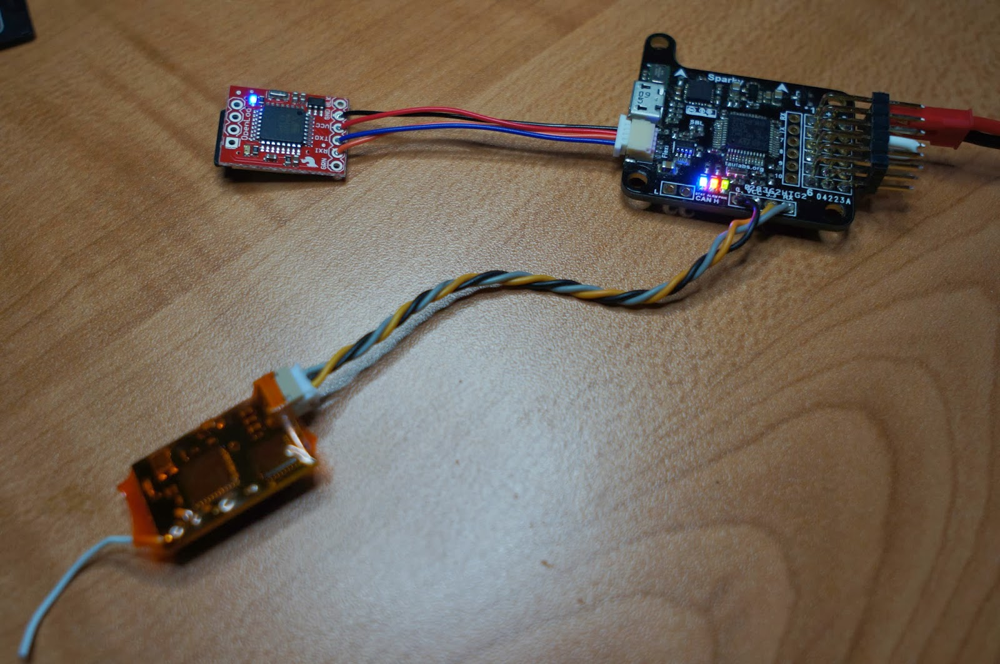
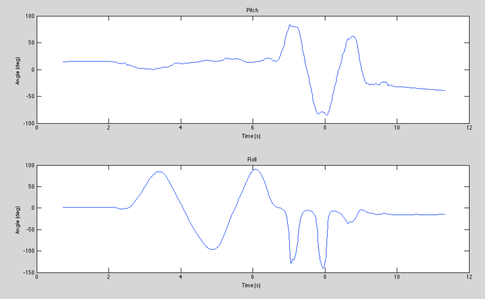

So one of my friends has wanted something light and easy that he can use to log data, and also Aqualuna on IRC has been wanting something similar. After seeing some of the logs that Ardupilot produces that my friend was getting with his Revo port I was really encouraged to just come up with something quick and easy that would just work. 

And this was definitely easy. I think it took about 15 minutes from when I told Aqualuna I definitely wouldn't start working on this to having a working log file. I used an [OpenLog](https://www.sparkfun.com/products/9530) and then connected it up to the flexiport on Sparky. Then I configured it to run at 57600 baud and first showed that it would work and collect data using the mavlink output.  

However, this has a limitation that there is no timestamping data (or handy parsing code) so I decided to adopt the uavorelay module to this purpose. Luckily from the Overosync module I'd added a native timestamped packet to uavtalk so I just modified it to send that type of message and periodically send AttitudeActual, Accels and PositionActual. Then I grabbed the file off the SDCard and ran it through the matlab LogConvert.m (from "make matlab"). Easy peasy, plot of the attitude of the board on my desk: 

One of the nice things about this design is it is super flexible. For example, you could just have this attached to the line going to your telemetry system and have it redundantly log all the telemetry data in case you drop out (or don't always have it running) or you could even write a custom data format that is highly efficient to collect as much data as possible at a fixed rate. You can find the branch I'm using here. Hopefully at some point I'll tie it into our logging metadata so you can easily select which objects update at what rate. For the time being I'm just hardcoding it to a fixed rate for preselected objects. 

For now I'll probably just make another module (don't want to break UAVORelay) that just allows streaming a few of the major data objects at a fixed rate. 

If anyone wants to play with this, the code I used it located [here](https://github.com/peabody124/TauLabs/tree/logging).
