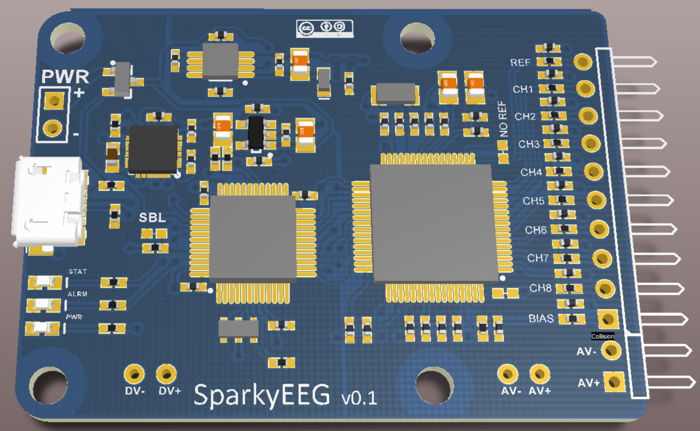
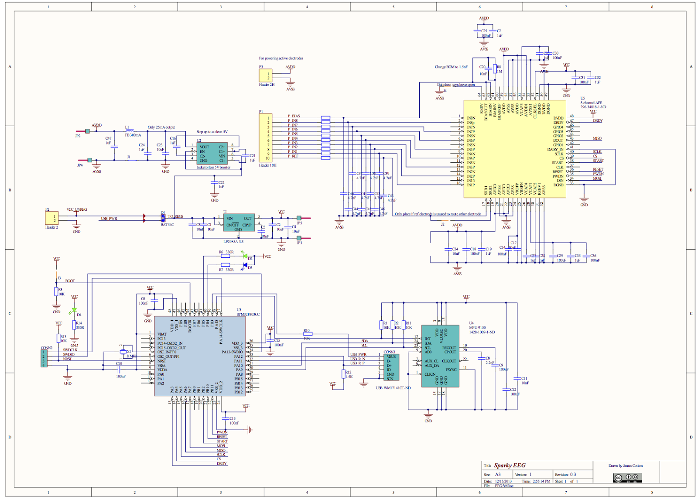
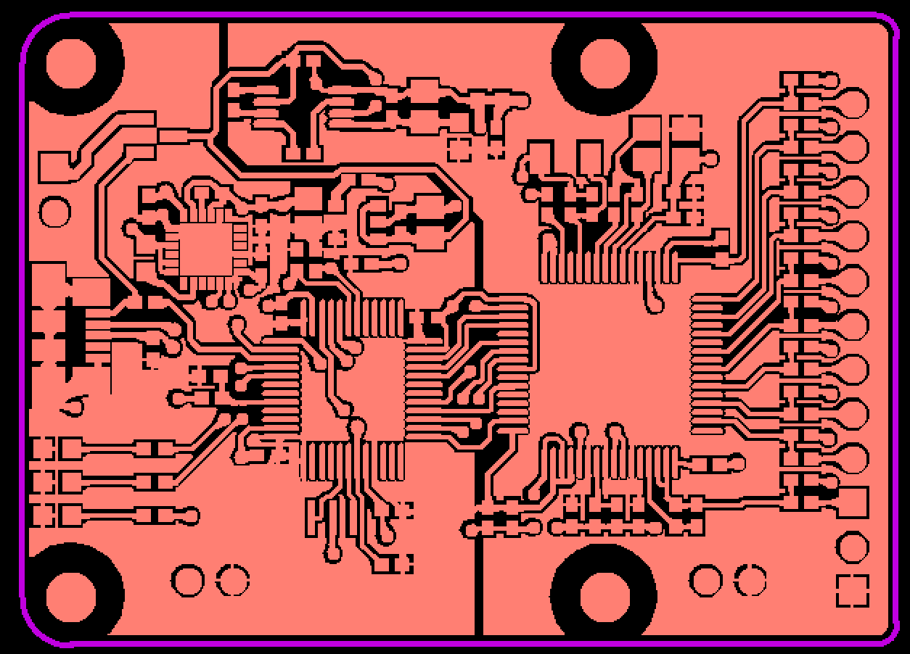
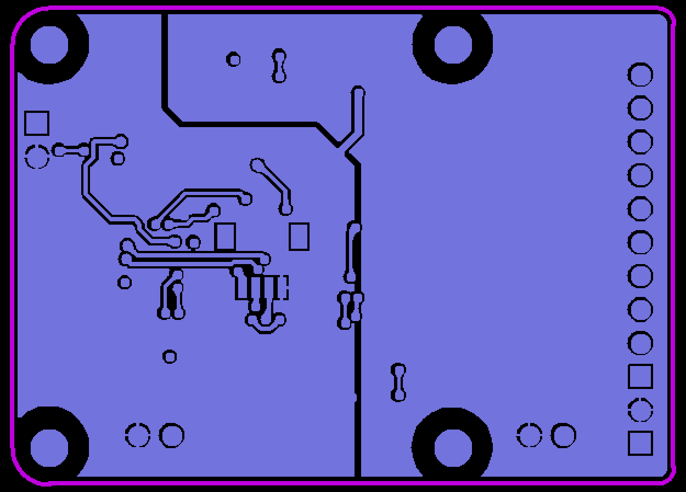

So I've wanted to build an EEG since I was in college and have numerous times spec'd out parts etc but never really got going. I've followed the OpenEEG project for ages, but technology wise it has remained rather stagnant. However, I just recently came across the [OpenBCI](http://www.openbci.com/) project which pointed me at the [ADS1299](http://www.ti.com/product/ads1299) chip and that has reinvigorated my interest in building a simple EEG. It's a long shot, but my ultimate plan is to create a system like this: 

  

::: {.archive-media-placeholder}
**YouTube Video** — Embedding unavailable; [try watching on YouTube](https://www.youtube.com/watch?v=6LWz4qa2XQA).
:::

   

One thing I wanted to change from the OpenBCI design was to use an STM32 processor, since that is what I'm more familiar with. My goal is to avoid a lot of the safety issues regarding powering from a computer by running the data via my phone. This also gives me free perks like wifi, screen, bluetooth, etc. I should be able to pretty easily use the [Android GCS](https://play.google.com/store/apps/details?id=org.taulabs.androidgcs&hl=en) as a basis, especially since that already has a lot of the core code for handling data via USB (HID and Serial) as well as WiFi (great for running simulations).

It was pretty straightforward to base the design off [Sparky](../2013-05-19-sparky-testing-and-building-no-crashing/index.qmd) which seemed like a pretty good starting point - both in terms of electrical and mechanical properties. I had to extend the board a bit to fit the ADS1299 on there without going to four layers (I'm cheap and would rather a bigger board for the prototype). This is the end result:

  

The final board is 50 x 35 mm. I can easily shave 5 mm off the right side, but figured I'd leave it this size in case the next revision has more channels and needs that space.  Currently it is single sided so lots of room for expansion. And it's nice because I can reuse a lot of the code from Sparky and just write a new PiOS driver that speaks to the ADS1299 chip. For laughs, I left the accel/gyro/mag chip in case I want to have some kind of head tracking. Either that or try and use it strapped to my arm like a Thalmic labs wrist band. 

Here is the schematic. Sorry the layout is really ugly - I should redo the TPS60241 component so the power comes in on the left and goes out on the right. 

#### Layout

The ground plane is split to keep the analog electronics and digital electronics as separate as possible. The top plane on the analog side is AVDD and the bottom is AVSS. This is where a four layer design would be a bit better but for now I'll save some money. 

Top: 

Bottom: 

### Features

- 8 Channels of single ended input, 1 driven bias electrode and one common reference electrode
- Small (36mm x 50mm)
- Utilizes ADS1299 chip
- Optional reference and bias electrodes
- Powered by USB. Small step up inverter generates a clean 5V after the input diode (probably not necessary if I never plan to use battery input). This can supply up to 25mA of current and the analog supply only requires 10.
- Single sided power supply design (so patient will be at 2.5V relative to the board)
- Solder pad allows using any electrode (routed out via SRB2) to serve as the negative input for the others. Alternatively use an additional reference electrode such as an ear clip.

### Notes and quirks of the ADS1299

There were a number of things that were not obvious to me from a first pass through the datasheet. This is mostly a reference for me when I forget them after I came to a conclusion.

biasin - At first I assumed this input was something to do with computing the actual bias value. However, it is actually for situations where you want to reduce the number of electrodes going to the patient. In this case, you actually connect the biasin signal to the positive pin of a channel (i.e. electrode) which creates the path for the driven bias current. This will (obviously) introduce a small bias into the signal recorded on that channel, but this should be small and slow compared to the signals of interest. 

srb1/2 -  Again, like with biasin, at first I assumed that both of these were meant to be treated as inputs. Either to provide a reference for the positive or negative inputs. However, (and again like biasin) this is to allow reducing the electrodes to the patient. In this configuration, you select an electrode (positive input) that will serve as the reference for others and route it out of SRB2. Then there is an external bridge from SRB2 to SRB1 which passes this signal back in and allows it to be the negative channel for all the other electrodes.

#### #### Input configuration

The ADS1299 has a pretty powerful analog multiplexer - but what is a tad counterintuitive or non-obvious is that channels can be mapped to inputs or outputs implicitly. The input mixer also gives lots of options. I'm going with what I think is the standard configuration and what seems most referenced in the EVM notes. This means the CHxSET register will be 000 for the mux "main" with SRB1 high. The positive values will all be routed out to the electrodes and the negative values will all go to SRB1.

#### Anticipated bias and reference

The full cable set will generally be used, at least at first. This means a reference electrode (e.g. earlobe) will come in to SRB1 and be connected to the negative input of all the channels. All of those channels will be averaged internally to compute the biasinv signal. The internal bias generation (2.5V) will be used for the positive input. The output (biasout) will then go to an electrode (via a protection resistor).

### Thoughts

**Inputs** - OpenBCI used the negative inputs at SRB2 for their channels. I can't really understand why they did this (although it looks like it should work) but it won't be in "normal electrode" mode.  

I'm pretty tempted to switch a bipolar power supply like that in the EVM. The advantage of this is the patient is driven to zero volts relative to the digital electronics. This shouldn't ever be an issue provided everything is running from batteries but still is a potential safety improvement. It adds another chip though.

**Isolation** - one thing OpenBCI did quite nicely was solid isolation. This is important, especially if you want to make something commercial. I'm just goofing around and will try and only use it via phone or worst case when laptop is not powered by mains. To be honest, I just don't feel like putting all the components down for it.

**Ground** - Related to the the isolation issue, I hope I routed the ground appropriately. The ground plane is split - digital ground over the digital electronics and analog under the ADS1299. The digital grounds from the ADS go over to the digital ground plane and then are star grounded to the analog plane near the analog regulator. The AVSS and AVSS1 are both just connected locally to the ground plane rather than separately routed back to the star ground. The AVDD plane is similar.

Also one limitation of using my phone to collect the signals (provided processing power isn't the limit) is that I cannot simultaneously connect to a USB radio and control a quadcopter. However - if I get to the point that is the limit I'll happy redesign and use something like [Freedom](../2012-11-19-freedom-assembly-and-first-flight/index.qmd) with more build in processing in the embedded board, or combine an RFM22b onto it.

Anyone have any comments on the schematic? I don't think I've got any glaring errors but you never know...

### References

- http://www.ti.com/lit/ug/slau443/slau443.pdf
- http://www.ti.com/lit/an/sbaa188/sbaa188.pdf - good DRL notes
- http://www.ti.com/lit/gpn/ads1299
- http://www.openbci.com/technology-update/
