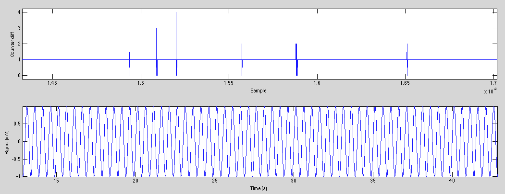
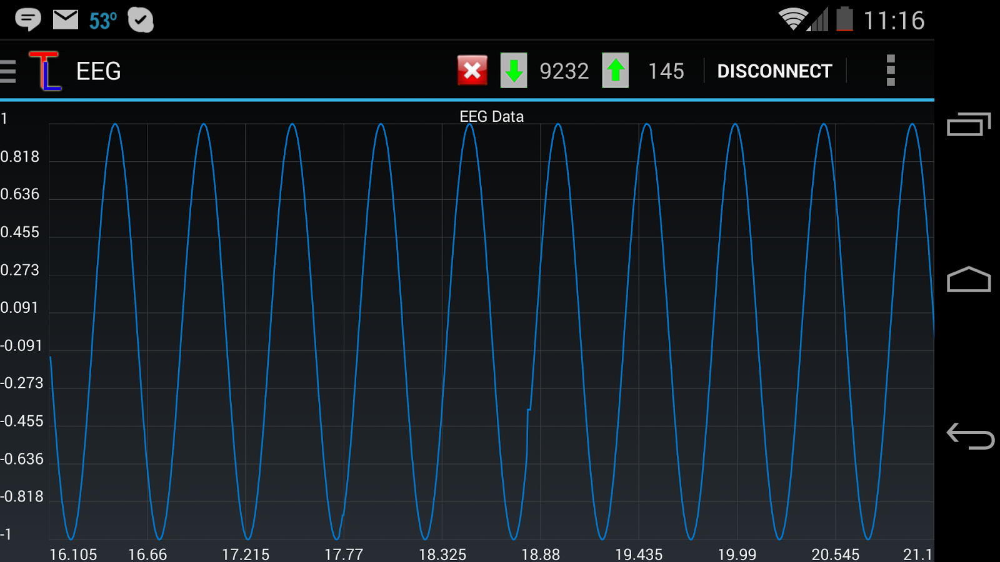
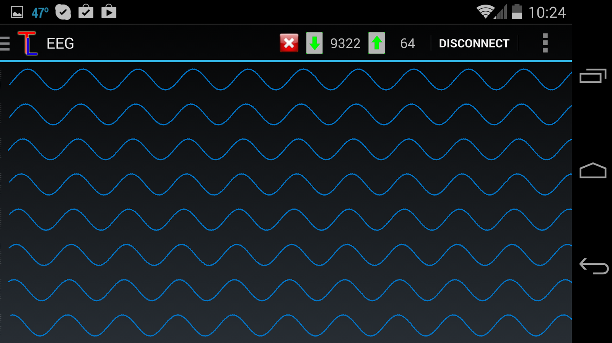
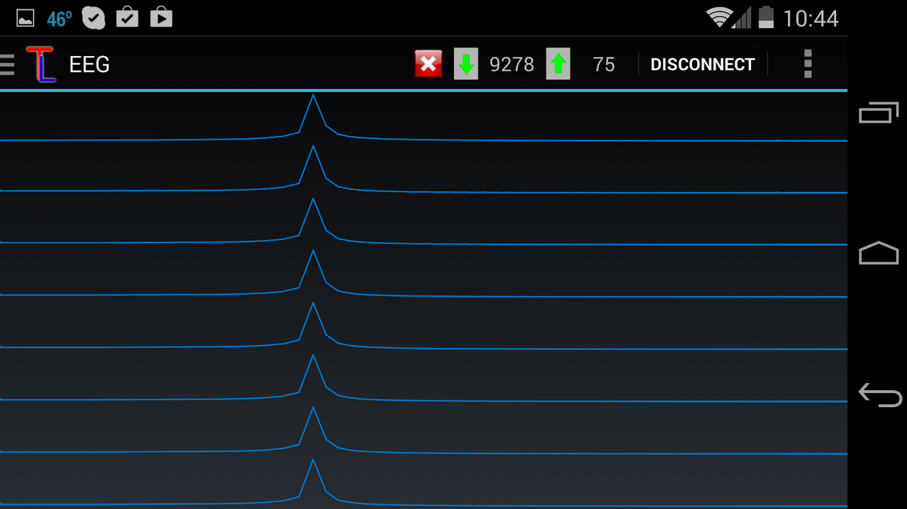
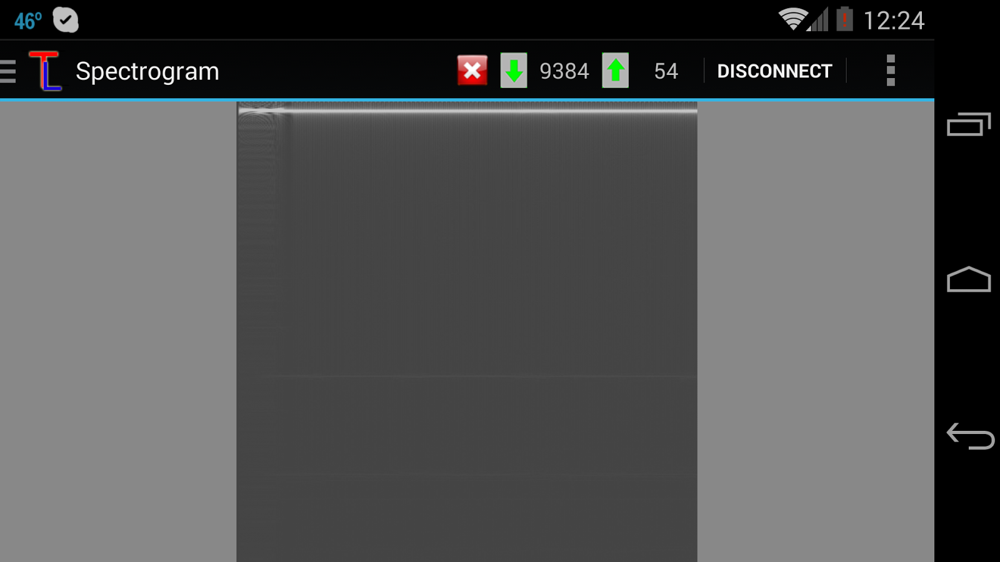

## Plan

So now the [EEG board](../2013-12-14-eeg-design-time-for-something-totally-different/index.qmd) is out for manufacturing it is time to start designing the software. I figure I can use an existing Sparky to generate fake data and begin on the android application. Here are a few of the features I want to have in the app:

- Configuration (e.g. setting reference electrodes and bias configuration)
- Noise measurement
- Waveform visualization (with filtering)
- Spectra visualization (as well as pseudocolored time plots)
- Basic control app (e.g. 2-D cursor that you try and move around)

So this will be done by modifying the existing software stack (android app and sparky firmware). I think I will keep the UAVO manager in place and use that for general settings and status information. This can work via the USB HID interface. 

Initially for the data stream I will attempt to run it via UAVO updates as well to try for the greatest reusability of the code. However, if this doesn't work then I'll use a VCP stream. This just gets a bit awkward when using TCP as then we will need two independent streams (e.g. separate sockets). 

Since the data is 24 bits wide, I could either pack it into int32 fields or just use real units and represent it as a single - the latter seems preferable to me. I'll make an object which has a sample counter and an array of singles. In the future if I use multiple ADS1299 then I can just go ahead and use a multiple instance UAVO. 

So with this plan the steps going forward are: 

1. Create the data UAVO
2. Create a firmware module that in the future will read from the ADS1299. For now it will just generate synthetic data at 200 Hz.
3. Check that all the samples are received
4. Create an android activity that plots the traces

## Implementation

  

### Streaming bandwidth

With a modified firmware in hand sourcing sin waves sampled at 200 Hz, I got hacking on the Android app. I wrote a telemetry task that runs within the service context and keeps a running buffer of the last few seconds of data. It monitors for any skips in the sample counter and at that rate I see about 1 or 2 skips every second. Not perfect but good enough for now. It's comfortably sustaining 10 KB/s. 

Later I'll try and determine if those are skips on the firmware transmission side or somehow they are dropped updates on the android side. The event system doesn't indicate any missed updates so I'm guessing that is what is happening. It's pretty nice because the built in logging for the UAVs is working for this transparently, so I can email the logs and process them with the matlab code for visualization. 

The top row shows the diff on the sample index. It looks like most of the time there is a missed update there is a zero for the counter difference - so I'm guessing there is a timing error  on the flight side and it is skipping one sample and then sending duplicates of the same data point. Since the whole point of this is streaming this data I will modify telemetry to have a special queue that actually stores the history of values to send instead of pointers to which object to send. It might be easier to have the EEG module try and pack the data too if that doesn't break telemetry talking to the the USB comm device. 

### Visualization

For now I just wanted a simple streaming graph. I'm using the [GraphView library](http://www.jjoe64.com/p/graphview-library.html) which is pretty straightforward and seems to perform well. 

And then you can plot all the channels. This gets a little tight on screen real estate and also the update rate starts to drop a bit. For fancier visualizations like this I will probably need to come up with a more performant library. Also, without modifying GraphView it isn't possible to get the graphs all close to each other. Perhaps one widget that is directly rendering it all. However, this isn't a huge issue right now so I'll put it off. 

#### Spectrum

It can also plot the spectrum of the traces. No labels yet. The speed seems reasonable.  

Finally a simple spectrogram plot. None of the bells and whistles such as selectable channels or multiple channels yet, let alone windowing parameters. I'll leave that for when I know what I'm looking for. 

This doesn't have a logarithmic scale yet, so the 2 Hz wave is close to the edge of the axis (full bandwidth 100 Hz). 

## Conclusion

Anyway, not a bad start I think. When it is charged tomorrow I'll try the app out on my Nexus 7. The bigger screen should be nice, although I think both it and the Nexus 5 are 1080p so no real pixels extra. Some of these functions I'll probably backport to TauLabs as having some of the plotting functions might be useful in the field. 

Now It's really just wait for the board to arrive, or start reading about various signal processing algorithms and start hacking. However, those are typically better done on real data. The logging function will be extremely useful for having the code already written to record the sessions.
