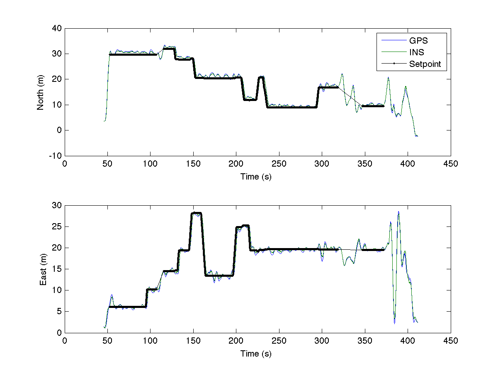
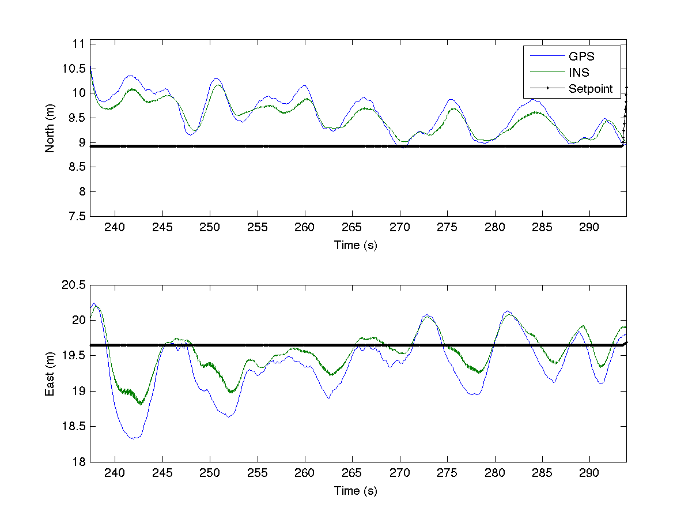
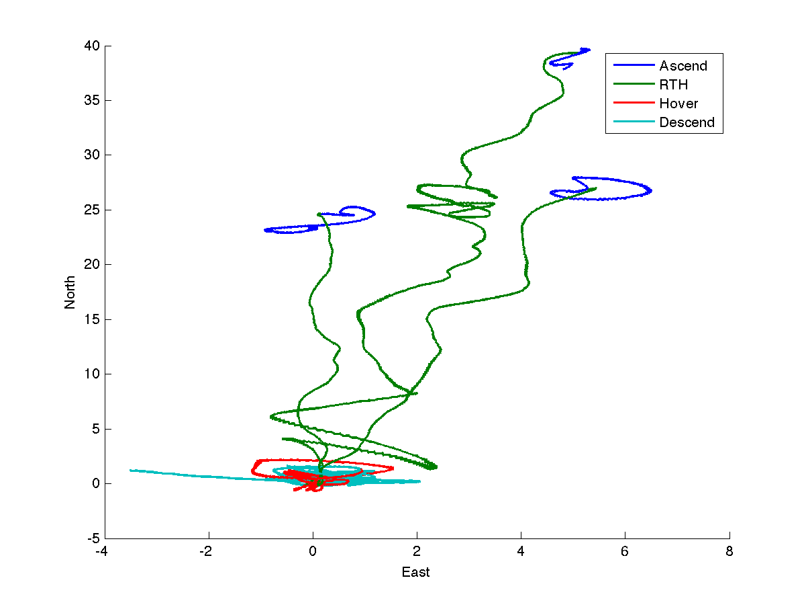
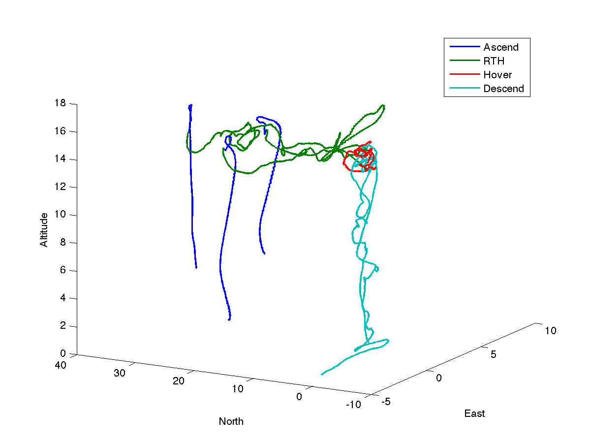

So I met up with the [Houston flying crew](http://fpvlab.com/forums/showthread.php?8252-Checkin-From-Houston-Tx) yesterday and had the chance to do more testing of the new [RTH and loiter](https://github.com/taulabs/taulabs/issues/1054) modes.

## Loiter testing

One of the changes in this code is that now the VTOL control loop actually tries to control acceleration (and through that the airframe angle). This is inspired by the Arducopter code and seems like a sensible idea since it makes the control laws more linear. It does mean that units of the parameters change so it was necessary to retune.

It took me a bit to find good tuning parameters but overall I was happy with the results by the end of the day. Here are my final gains:

- HorizontalPosPI.Kp was 0.8 with zero Ki
- HorizontalVelPID.Kp was 2 with a Ki and Kd of 0.

::: {.archive-video video-id="83416006" source="vimeo" title="Tau Labs Loiter and RTH testing"}
:::

The loiter mode is very similar to the Arducopter code. You apply pitch and that will move the set point for position hold forward at a rate proportional to the stick input. Roll moves it sideways.

Mike suggested an alternative control scheme: when the stick input is outside a certain range you fall back to stabilized mode so you can basically free fly, then when you release it goes back to PH mode where you are. I might implement that later and let people compare the two.

I was doing this on [Freedom](../2012-11-19-freedom-assembly-and-first-flight/index.qmd) so I had [Overo](../2012-11-19-overo-comms/index.qmd) logs afterward to look at. You can see this above - the black dots indicate updates of the setpoint and when I use the stick movement the position moves. The quad does a really nice job of tracking it. If we really zoom in on a steady segment we can see the amount of drift: 

You can see there is above 1 meter oscillation around the setpoint. This probably reflects some gains that are too high. I also didn't have any integral yet and it was fairly breezy which explains the residual error. I definitely need to do some work on how to compute optimal tuning parameters for PH and navigation. 

## Return to home

As you can see in the video above, RTH is also working pretty reliably. I think I probably did about 5 or 6 runs with it and it usually landed within a meter of home. It doesn't turn off the motors when it lands right now - that will come later. The stability during the landing decent wasn't quite as good as some of the other platforms people were showing off - I'm not sure yet if that is a tuning issue or what. 

Here are three RTH flights overlaid. You can see it pretty reliably flew back at the right altitude and landed in the correct location. There is also a view from the top. Ignore that trail for one of the flights once it lands - that is just dragging on the ground. 

Some interesting points. The middle flight is the one in the video. You can see where it starts shifting back and forth is when the wind was gusting. I should have remembered to do a test flight above the 15m minimum RTH altitude. The RTH paths aren't quite as straight as I would like, but that also comes up to tuning. 

Overall it is working well enough to get the copter home, so that is good.
