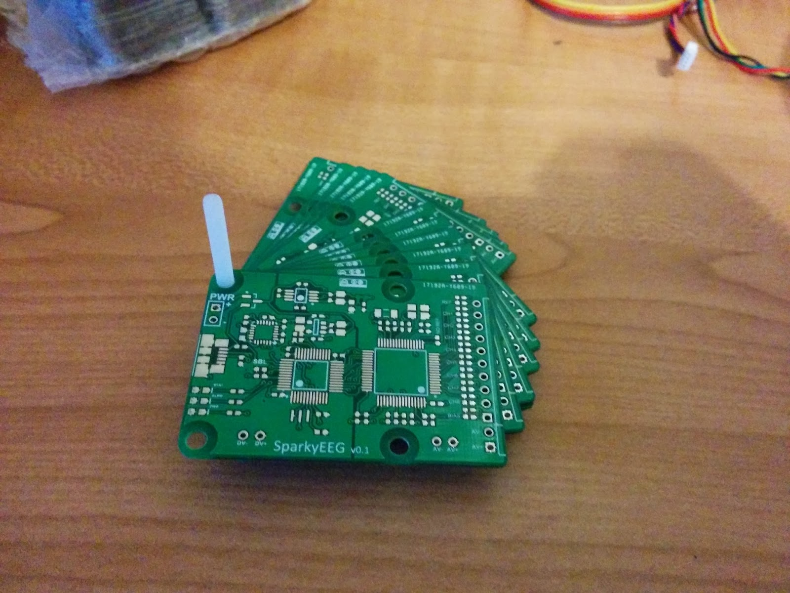
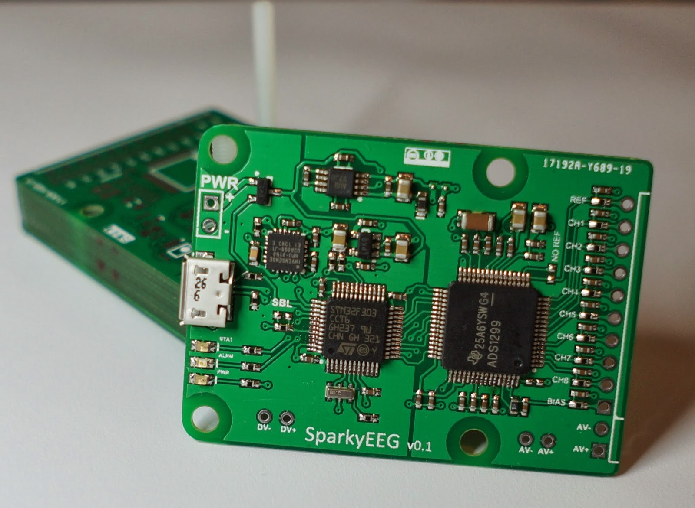
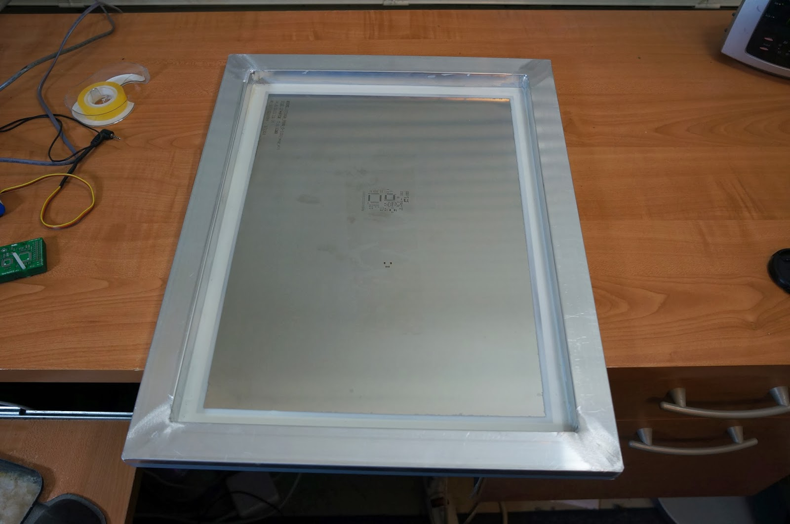
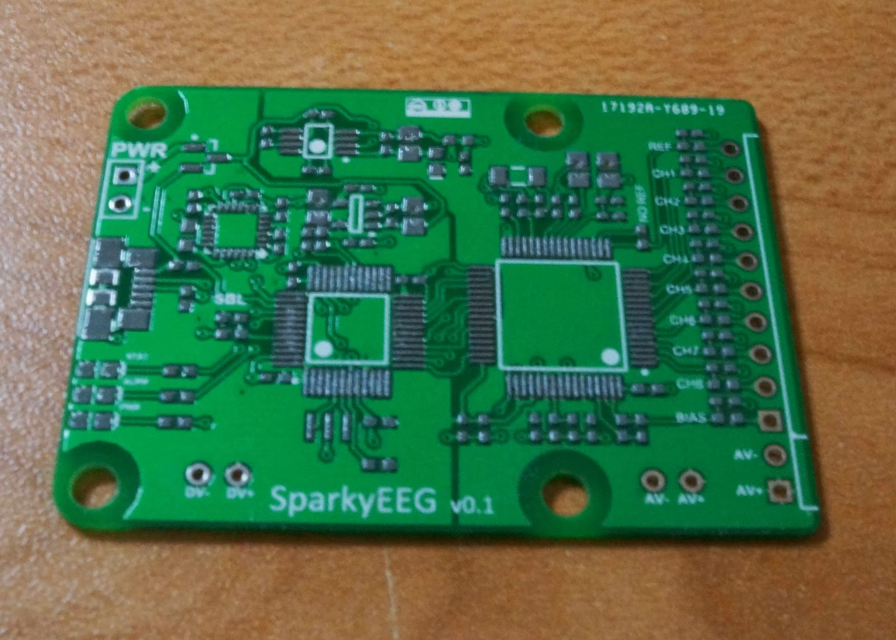
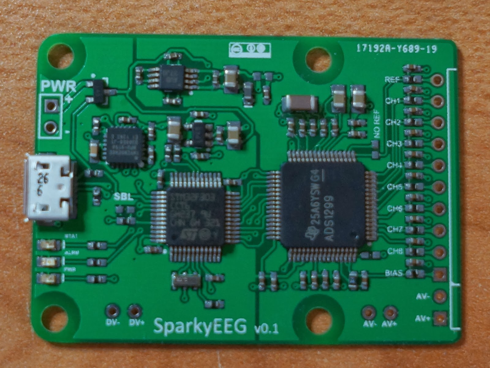
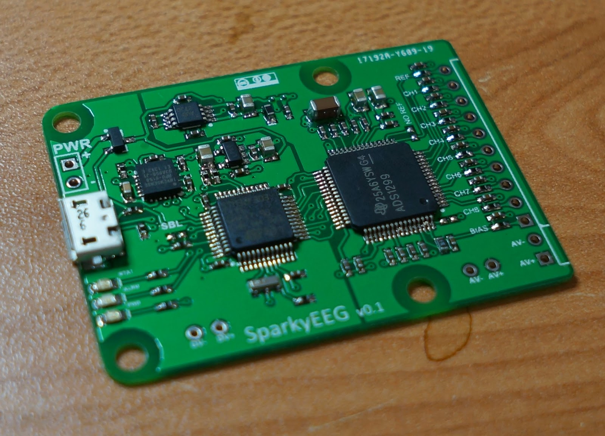
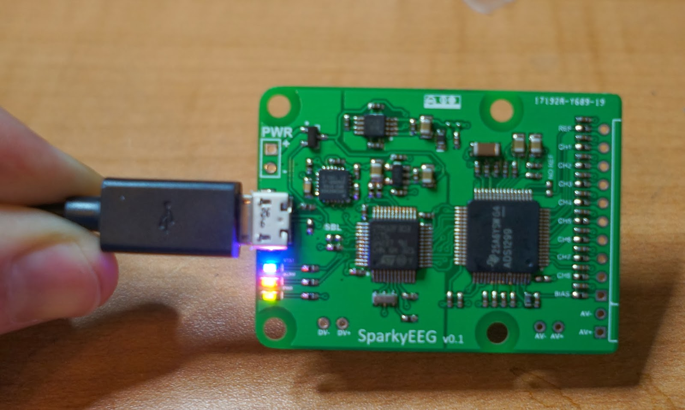
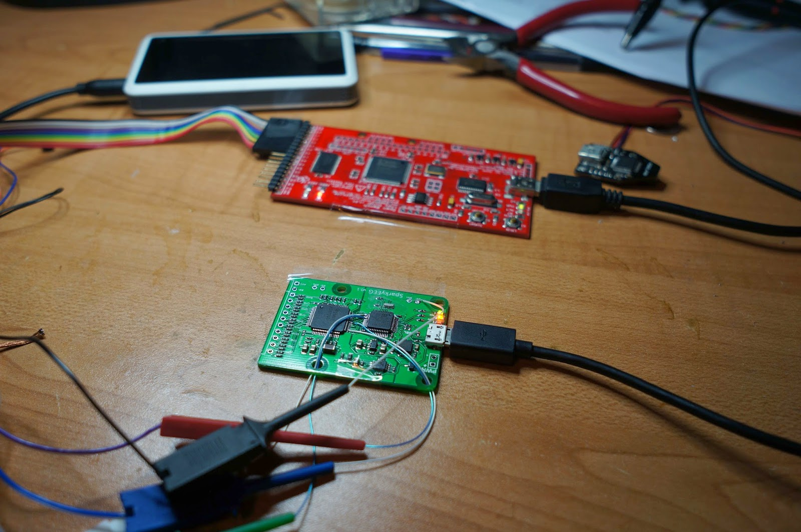
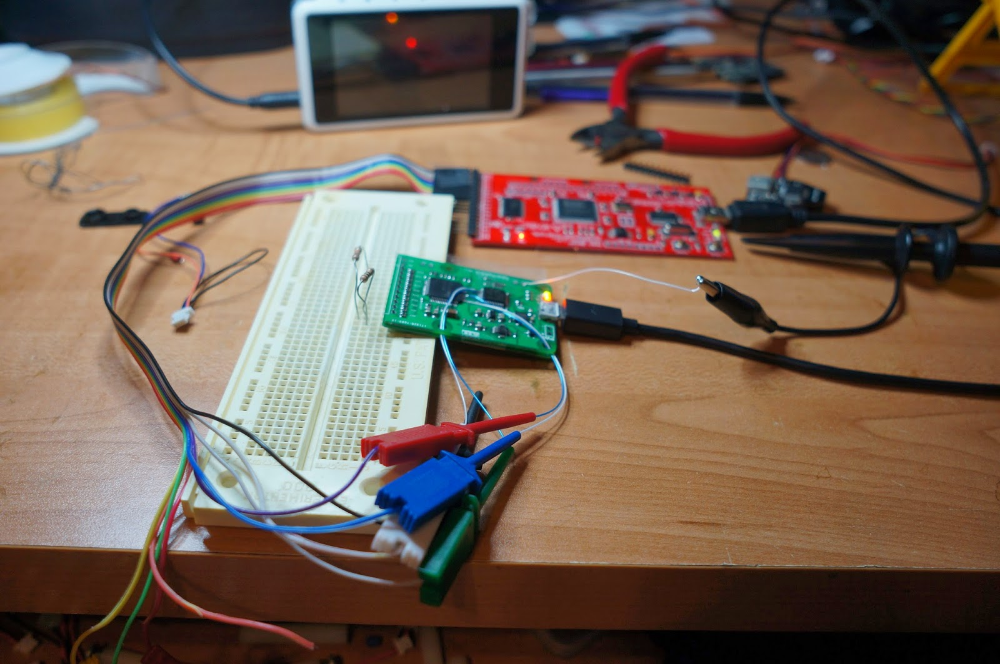
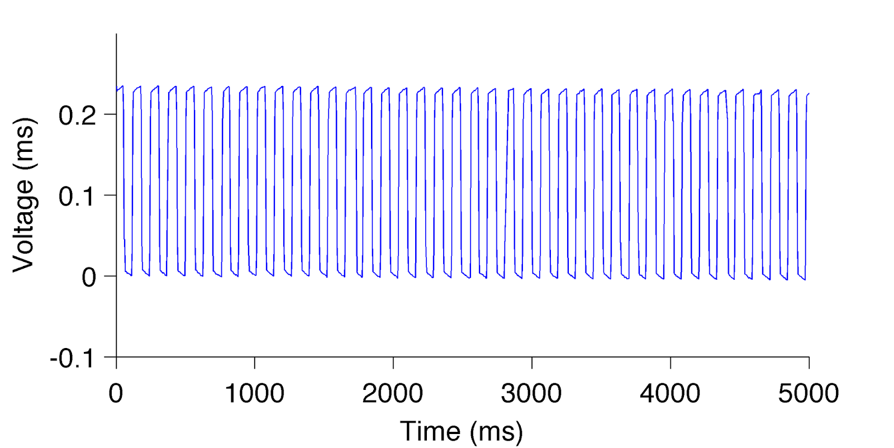

So my Sparky [EEG board](../2013-12-14-eeg-design-time-for-something-totally-different/index.qmd) data boards arrived the other week. I'm quite happy with how they turned out. I used a 0.8mm manufacturing to have something smaller to mount on the head and it seems sufficiently strong.

  

  

Before getting into the build, I'll cut straight to the cool punchline.   

::: {.archive-video video-id="84103008" source="vimeo" title="EEG Testing"}
:::

I finally had the opportunity to solder up one up yesterday. The first board I pasted was a little heavy. I'm not used to the 0.8mm boards I ended up using. However, since I only expect to solder one of the 10 boards I got it seemed not worth worrying about so I immediately set the rest of them up as a platform and got a great solder application. The rest of assembly was great and there were a few solder bridges that were easily touched up. 

Then the super fun (read: tedious) part of populating the board. 

Finally throw it in the toaster oven until done. Only a few shorts which were easily fixed. 

  It was pretty easy to bring the board up and get it reading the accelerometer and gyro since that isn't changed from Sparky proper.

  However, I wasn't initially getting any ID when I attempted to query the ADS1299 chip, so it was time to bring out the good old OpenLogic analyzer. Finally I realized I didn't have the SPI Mode correct for this chip and the data phase was wrong. Once that was fixed the communications were flawless. A few hours of writing a driver to work with the chip, bring it up, get the inputs in the right mode, etc.

At this point it was essentially working, and I plugged it into the android app to be able to check out the data (although I can also use the Tau Labs GCS). I went ahead and soldered a straight header on for now so I can test it on the bread board, adding another 10k between VIN1P and SRB1 and then using the 7.8 Hz lead off detection. The data looks pretty good. 

With the period matching pretty well. I'm not sure right now why it doesn't look more sinusoidal.
