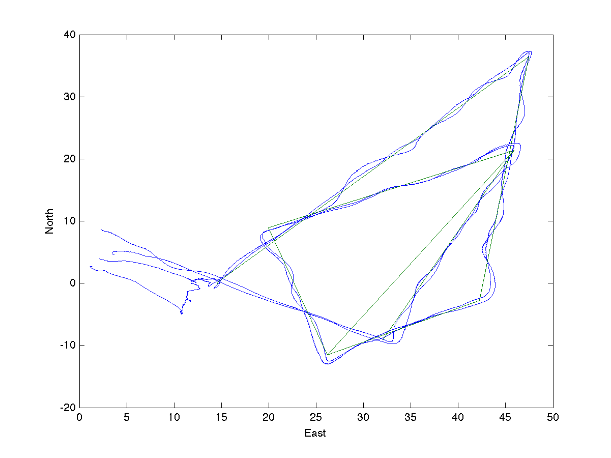
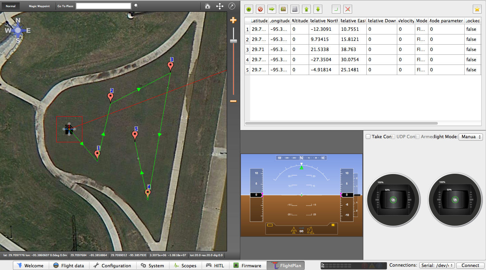
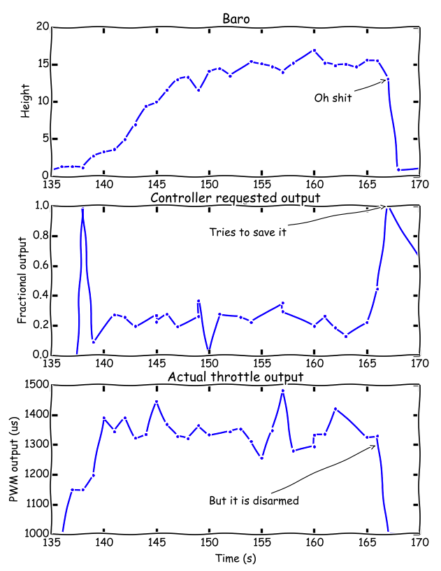
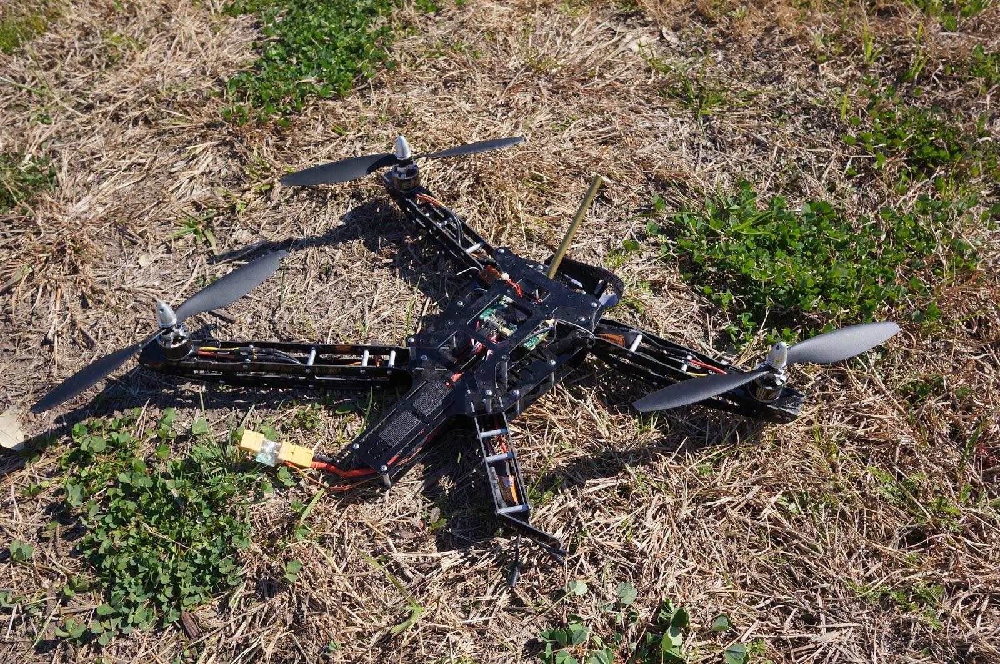

Another fairly typical day or two of testing navigation but with some amusing crashes.The first day was uneventful, but the second less so:

::: {.archive-video video-id="84184234" source="vimeo" title="Tau Labs Waypoint Testing"}
:::

   

::: {.archive-video video-id="84484126" source="vimeo" title="More Waypoints and Crash Analysis"}
:::

The navigation portion worked really well. I flew a 7 point sequence twice and got very nicely reproducible results.

This shows the log from two sequential flights. You can see the blue trace (real position) follows the path desired (green) quite closely. It's also quite interesting to see that the errors in how it flies the path are quite reproducible. Specifically trying to ask for a sharp angle makes it start oscillating. Parly from the amount of oscillations you can see that this is underdamped and I'll be trying to tune it. 

However, the other half of the problem is that the path isn't achievable. Quads cannot make instantaneous turns. We have some code that can reshape paths to something more achievable. 

  

  
Unfortunately I didn't get a chance to test that yet. When I was testing I did get good performance on the navigation. However, I had two crashes that were pretty bad. In the middle of flying the path it just randomly fell out of the sky.

Luckily the second one I got a log which showed the culprit. Once I started doing nav from takeoff (i.e. arm and flip switch) I kept leaving the throttle in a low position. This resulted in a disarm timeout after 30 second. I decided to use the awesome [Python log parsing](https://github.com/TauLabs/TauLabs/pull/1072) that Stac has written to visualize the results, as well as the new feature in matplotlib for XKCD-style plots. 

  

So this plot pretty clearly shows the drop in altitude from the baro. While that is happening the desired throttle goes to max, but the actual PWM output drops because the system is disarmed. Unfortunately telemetry didn't catch the change in FlightStatus to definitely prove this, but the time from arming to falling is 30 seconds (both times in the video) which is pretty much conclusive as far as I'm concerned.

  

So the simple solution to this is to keep throttle above zero while performing anything autonomous. This is even on the wiki and something I knew about. I'm hesitant to remove the disarming right now though since when I had the flyaway attempt at OP that was the only thing that ultimately brought it down. For sure the GCS should be honking a huge alarm at you (and Android should) if you are doing this though since it is a guaranteed crash combination.  I opened an issue to discuss this https://github.com/TauLabs/TauLabs/issues/1078 .
