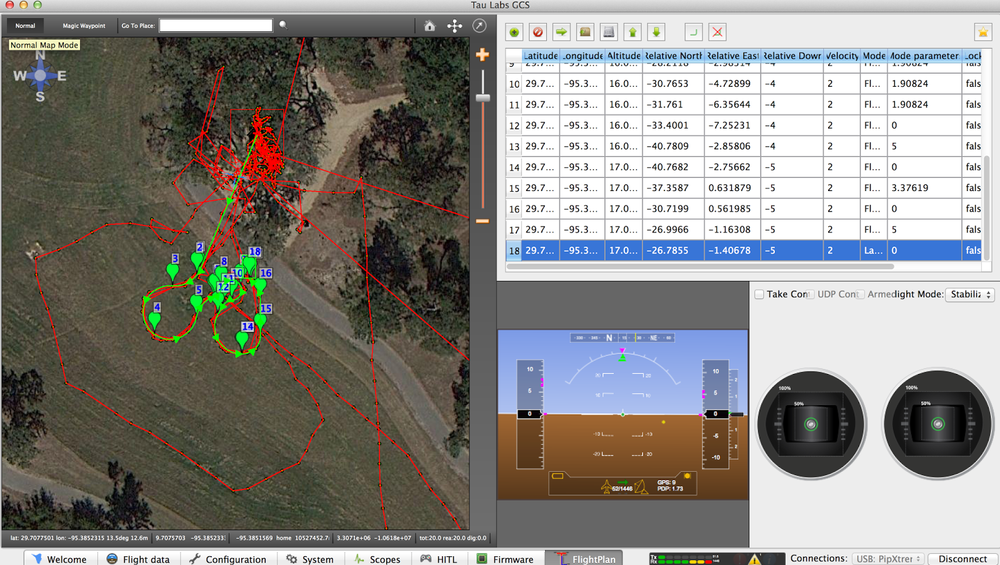
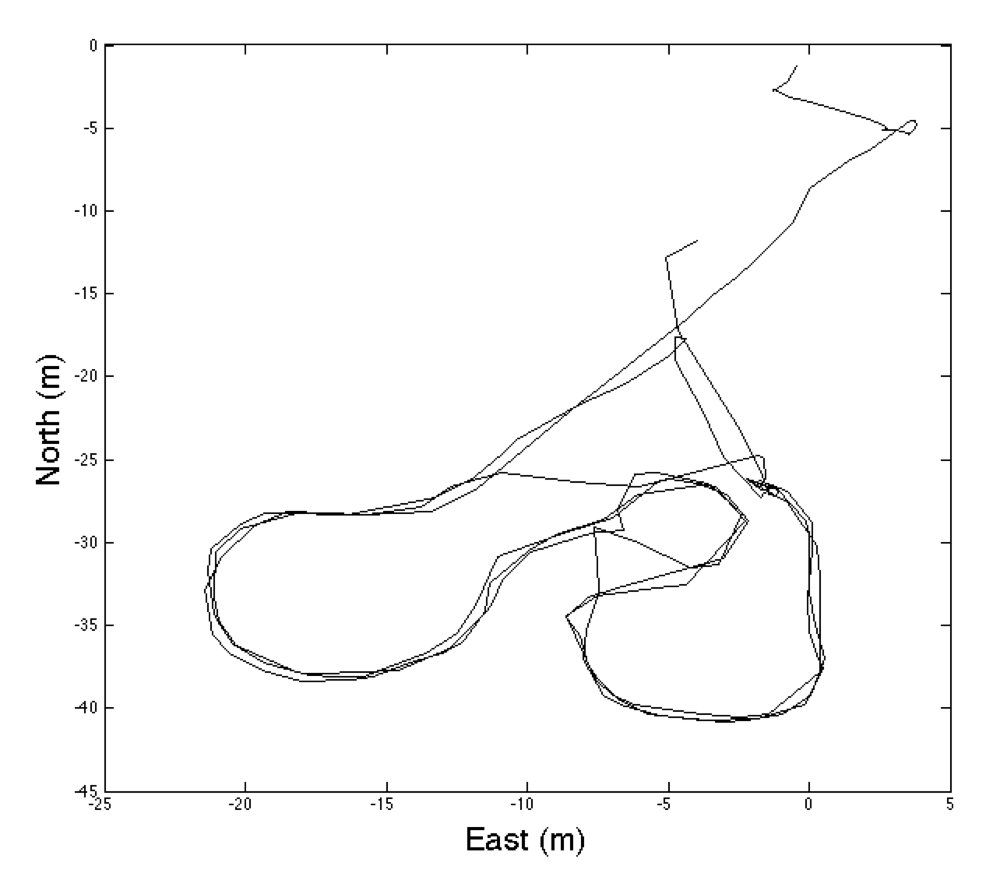

I commented in my [previous post](../2014-01-18-navigation-testing-and-post-crash-disection/index.qmd) that there was some oscillations in the flight when it would be asked to do impossible things (e.g. sharp turns with constant velocity). Kenn wrote a really nice (and necessary) feature for the fixed wing code that would fillet the turns and generate nice smooth curves when you request impossible flight plans. I ported this to the general waypoint editor so you can apply algorithms to a flight plan, such as smoothing it.

The nice thing about this, is you can take a flight plan with sharp edges and generate a nicely smoothed plan:

I also updated the VTOL follower to properly handle landing waypoints and finally had a chance to test it out. The result was quite nice

This shows three flights plotted on top of each other. There are one or two spots where it diverged a bit (it was a bit breezy today) but generally it behaved quite well. It also removed any obvious ringing like the flights last week. Unfortunately, I haven't written the matlab code to visualize curved flight plans, so I can overlay the intended plan. However you can see it in the previous figure and it's pretty much spot on. 

The landing waypoint type also worked well, which is nice. However, it is an important warning that with multirotors you can have the landing location a good distance from the previous waypoint. In this case it just starts decending and going sideways rapidly. I might update it to have a similar sequencing to the RTH sequence: fly to landing location at a fixed altitude and then descend. 

So here is the video. The first half just shows making the path and is kind of boring. Sorry about the excessive reflexion from my screen. The second half shows the flight and also overlays the telemetry data for comparison. 

::: {.archive-video video-id="85122181" source="vimeo"}
:::
