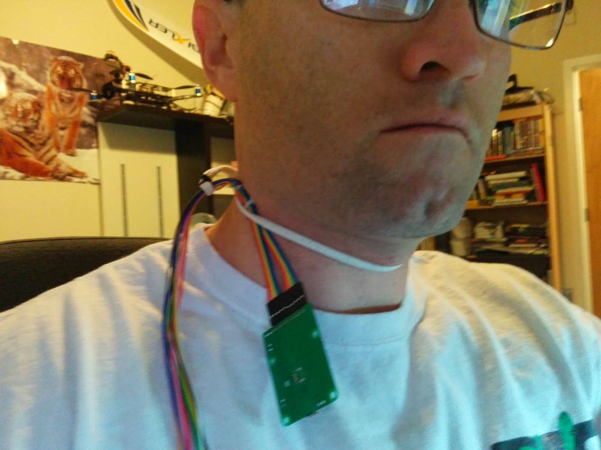
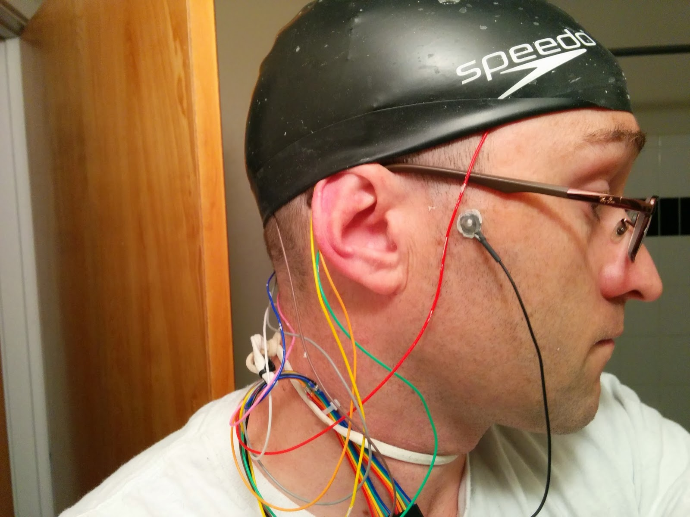
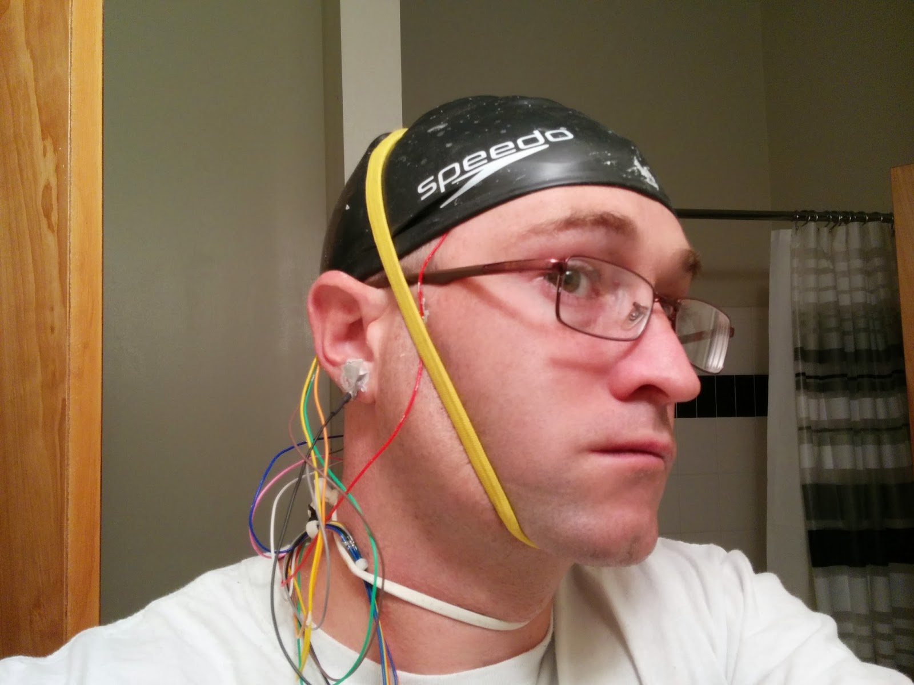
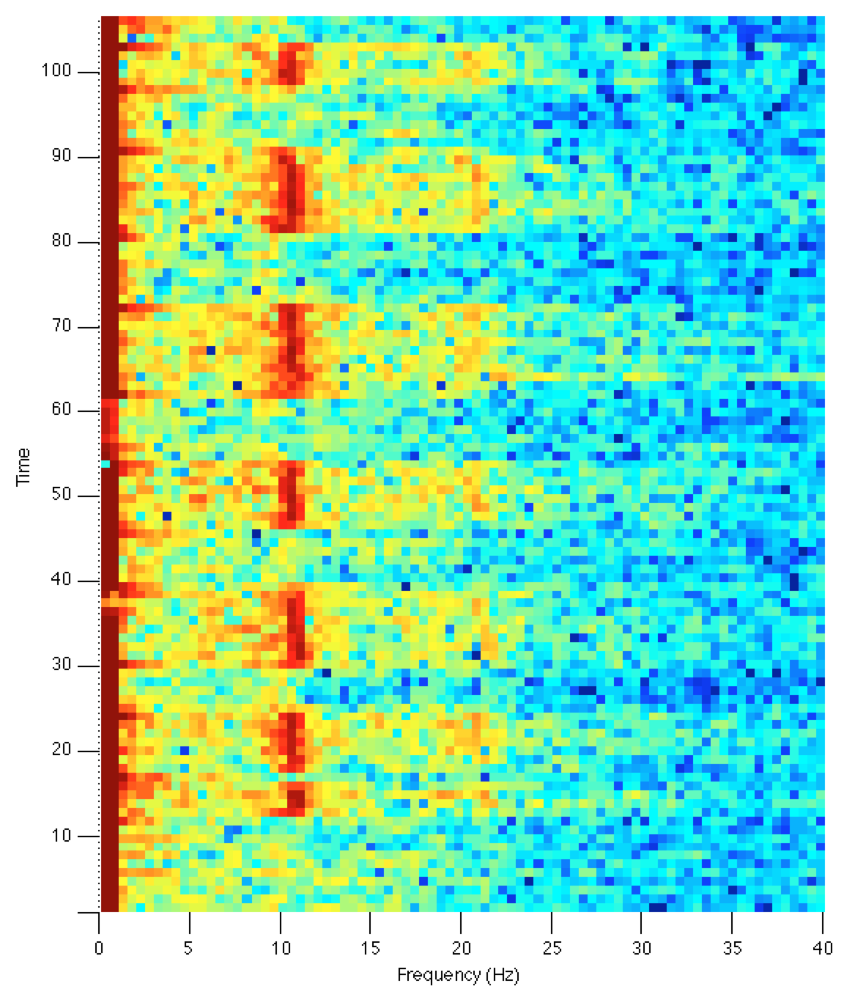
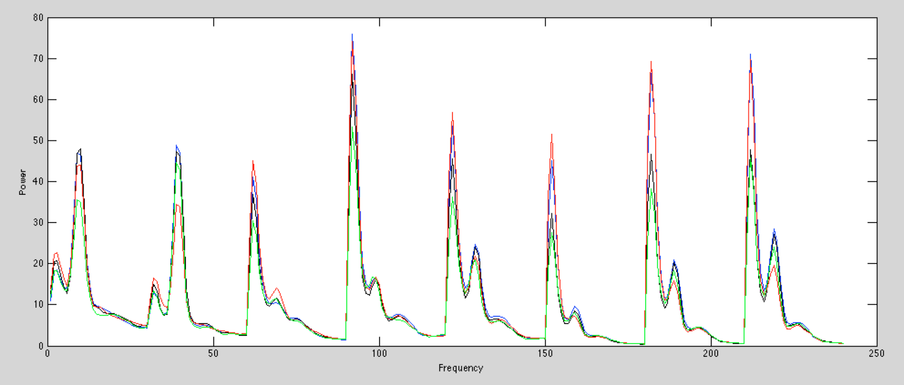

Following up on the EEG I [designed](../2013-12-14-eeg-design-time-for-something-totally-different/index.qmd) and [built](../2014-01-13-eeg-stuffing-and-testing/index.qmd), I have been playing around with it somewhat to try and do some basic brain control work.

## EKG Testing

First I tested it as a basic EKG. I did this partly because it is a really strong signal and an easy check, and partly because i wanted to see how resistant to movement the system is. I was fairly pleased with the results. Even when I ran it produced a fairly robust signal and the heart rate was easily detectable. I was also pleased to see the 60 Hz level was fairly low in this situation, which is consistent with my theory that what I see is mostly RF pickup in the recording leads rather than a problem with the referencing.

::: {.archive-video video-id="85627917" source="vimeo"}
:::

  

## EEG Electrodes positioning

So on to some basic brain activity classification. The first step was to reduce the noise, which means less hair.

I'm using [AgCl electrodes now](http://www.neuro-source.com/product.php?id_product=544) (an improvement on my washers) recommended by [Chip](http://www.openbci.com/forums/topic/check-out-my-hardware/page/3/#post-563). Putting them on is a fairly annoying and messy affair, but only takes about 10 minutes.

::: {.archive-video video-id="eeg_blogger_video" source="mp4" title="EEG electrode setup and recording (rescued Blogger video)"}
:::

My electrode placement was as follows:

  

- Bias Black - right ear
- Ch1 Light Gray - LV1
- Ch2 Dark Gray - RV1
- Ch3 White - left lower parietal
- Ch4 Pink - right lower parietal
- Ch5 Blue - left middle parietal
- Ch6 Green - right middle parietal
- Ch7 Yellow - left upper parietal
- Ch8 Orange - right upper parietal
- Ref Red - forehead

Using the impedance monitoring, I first saw that the occipital electrode impedances were high. This was easily fixed by adding more paste, and the monitoring confirmed the impedance was then normal. However, my upper parietal electrodes on both sides were also running fairly high. This was quite apparent when I walked to a part of my apartment with more electrical noise. Since these are obviously over the leg region, this was a problem. However, nothing another hairband from my girlfriend cannot fix. 

In the long run, I'm definitely going to need something better to position the electrodes. I'm thinking it is time to drag out some old MRIs I got done during neuroscience experiments and [use my CNC to build a solution](../2014-02-22-shapeoko-assembly-and-testing/index.qmd).

## Theta Waves

  

I have [previously shown](http://www.openbci.com/forums/topic/check-out-my-hardware/page/2/#post-544) that with washers I can get a pretty nice modulation in the theta band from the occipital cortex when I close and open my eyes. 

## Brain control

To get the ball rolling with brain control, I wanted to see if I can classify real motion. This obviously has potential confounds of the motor activity directly modulating the EEG but let's ignore that for now. I wrote a stimulus for the android app that rotates through telling me to move my right arm, right leg, left arm and left leg. This produces a nice log file that automatically has this stimulus information synchronized to the EEG traces. I ran a shortly preliminary experiment and analyzed it, which was promising, so then I ran a longer 15 minute training session. Also for my own reference, this is the mapping from stimulus number to command: 

- stim 2 - left arm
- stim 3 - right arm
- stim 4 - left leg
- stim 5 - right leg

  

::: {.archive-video video-id="88209271" source="vimeo"}
:::

  

For the analysis I extracted all of the two second segments for each stimulus and each channel and performed a welch spectral estimate. I then took the frequency bins between 1 and 30 Hz and concatenated those features together from all the channels to create a 240 dimensional feature vector for each trial. This processing of the log files was just done using the nice [python parsing framework](https://github.com/TauLabs/TauLabs/pull/1108) we just merged into [Tau Labs](http://taulabs.org/). I then saved the parsed data in a matlab structure since I'm more comfortable doing the machine learning there (although hopefully I'll get there with SciPy and Python). 

A first pass glance at the average response in each of the four conditions shows what appears to be a difference, although of course this lacks any statistics. 

Since I didn't run tons of trials, I wanted to reduce the dimensionality a little bit for the classifier, so picked the three frequency peaks from all the channels to feed into the classifier. This reduced things to a 24 dimensional space. 

I used [variational bayesian logistic regression](http://arxiv.org/pdf/1310.5438v1) which I used in some of my thesis work and seems to work quite well for building well regularized classifiers. I would collect all the trials from two stimuli, and using leave-one-out cross validation measured how well I could classify the EEG feature vectors by the stimuli shown.

This is the performance of the classifier with 267 trials for all the pairwise comparisons:

|    | RA     | LL     | RL     |
|----|--------|--------|--------|
| LA | 0.5469 | 0.5386 | 0.5625 |
| RA | 0      | 0.5381 | 0.4766 |
| LL | 0      | 0      | 0.6394 |

Which shows the average performance is around 0.55. This is better than chance, but not anywhere near as good as I would like. Interesting, the performance on my preliminary analysis was better:

|    | RA     | LL     | RL     |
|----|--------|--------|--------|
| LA | 0.3333 | 0.6111 | 0.7222 |
| RA | 0      | 0.5278 | 0.7500 |
| LL | 0      | 0      | 0.5278 |

Although one condition was doing poorly, most of them were doing better. This is despite having many less trials. My guess in this case is that electrode placement played a role and I wasn't properly over the motor cortex in this recent attempt. Also I think my upper parietal electrodes were a bit low. Not putting the occipital electrodes improved the performance on the larger experiment, most likely by reducing overfitting.

|    | RA     | LL     | RL     |
|----|--------|--------|--------|
| LA | 0.5469 | 0.6475 | 0.5781 |
| RA | 0      | 0.6304 | 0.5000 |
| LL | 0      | 0      | 0.7003 |

This brought the average to 0.6. However, this is still not enough to be flying with. 

## Going forward

  

- I think I'll try putting all the electrodes over the parietal or motor cortex and not bother with an occipital electrodes.
- Longer training session as well as using one second stimulus presentations to try and get the trial numbers up.
- Different classifiers. From what I have seen from the number of included features, there is not enough regularization.
- Run classifier continuously on data rather than on individual trials
- Once that is working, write some online visualization of the classifier output
