This is a followup on my [previous post](../2014-02-23-microquad-from-hovership-pro/index.qmd) about my foldable microquad from Hovership. I added a Mobius camera and 3DR radio so I could get telemetry. You can also see how I mounted the foam.

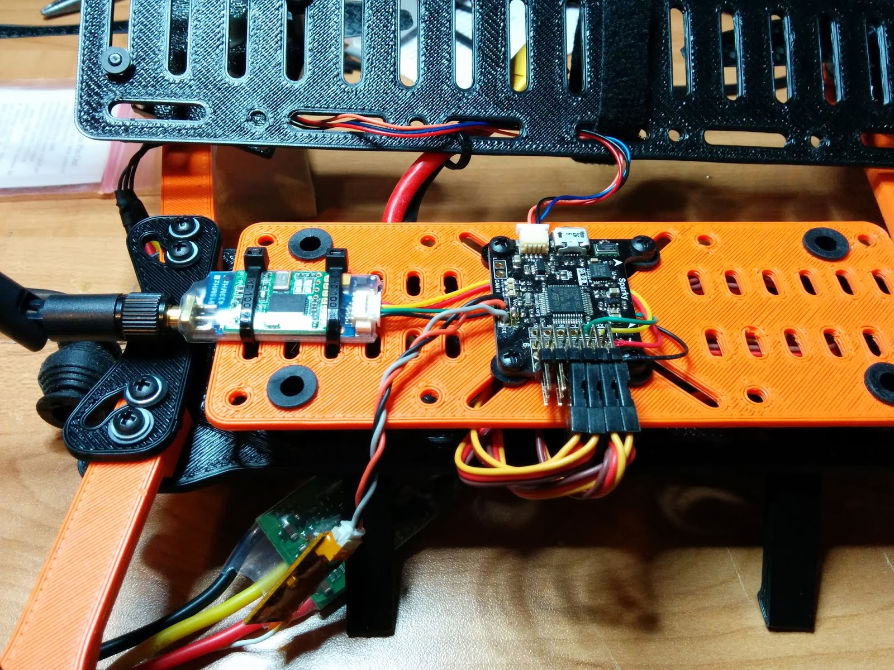

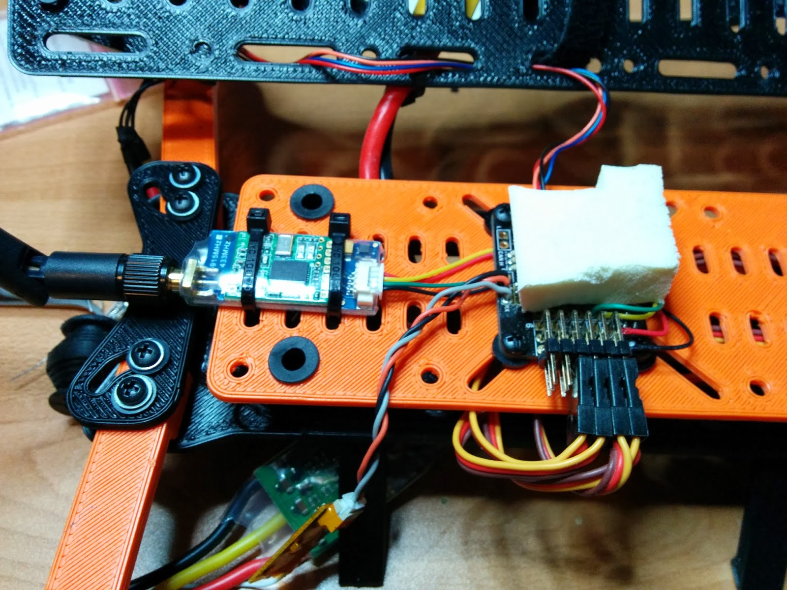

Probably not necessary, but I added some moon gel under the Mobius for a tad more vibration damping. 

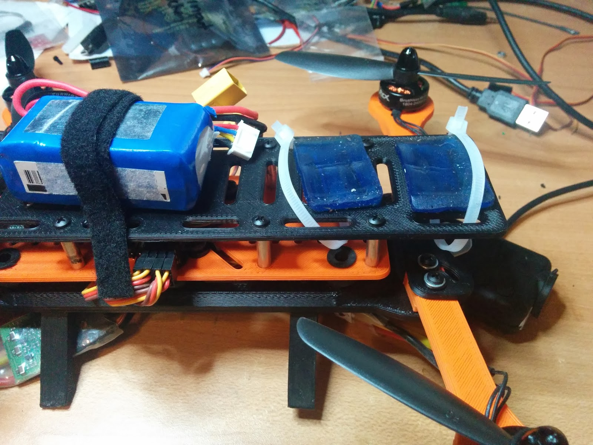

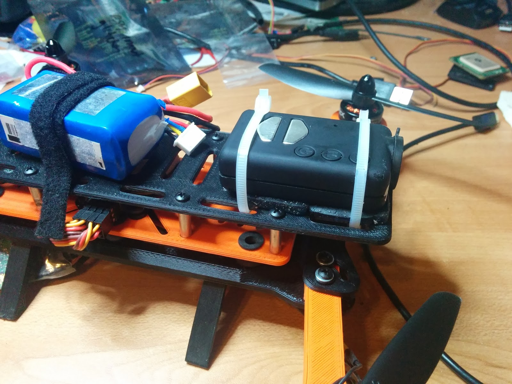

Finally the arms are replaced with the latest version which lets them go on the right way up. Note the little channel for the wire so it doesn't add any strain. 

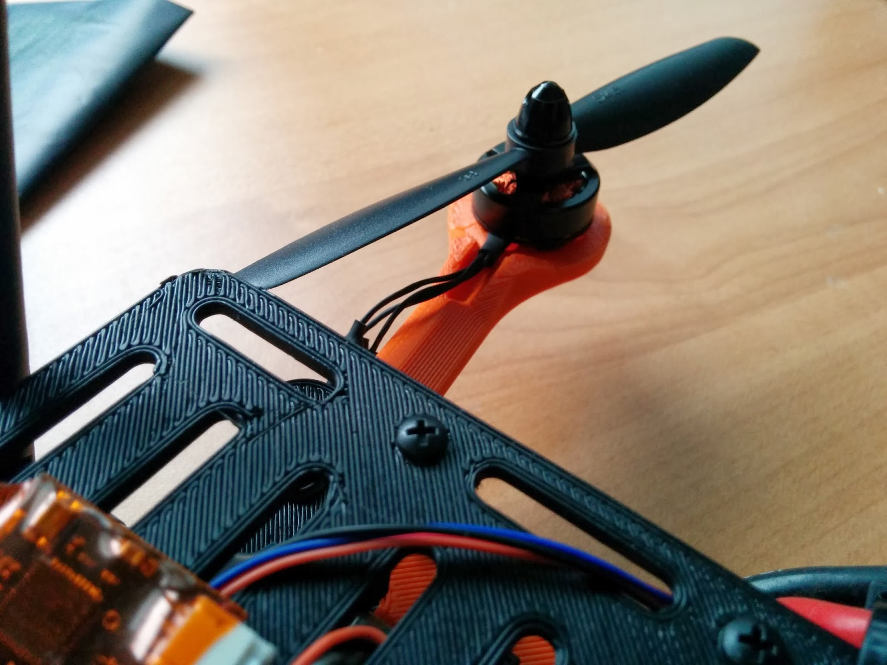

## Camping

I took it camping, and my friend had a nice camera and got some great shots of it in the air. I really like these. 

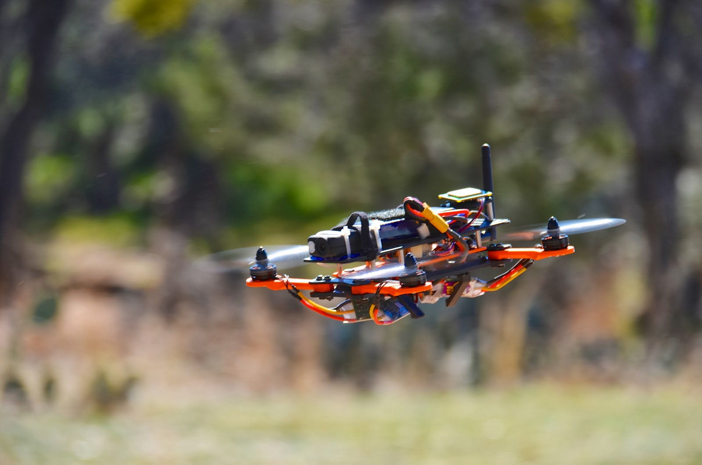

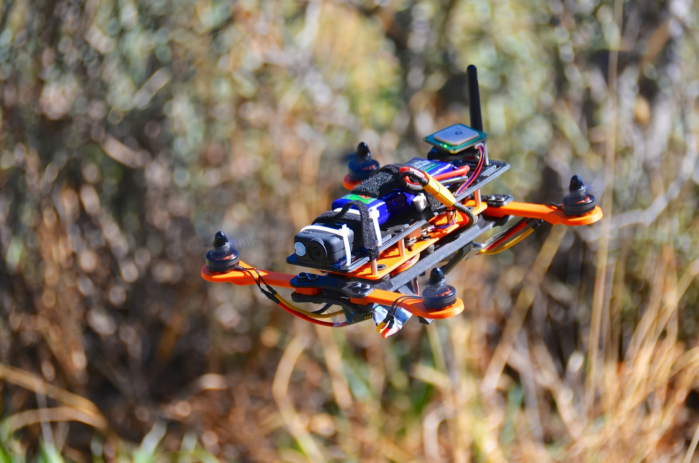

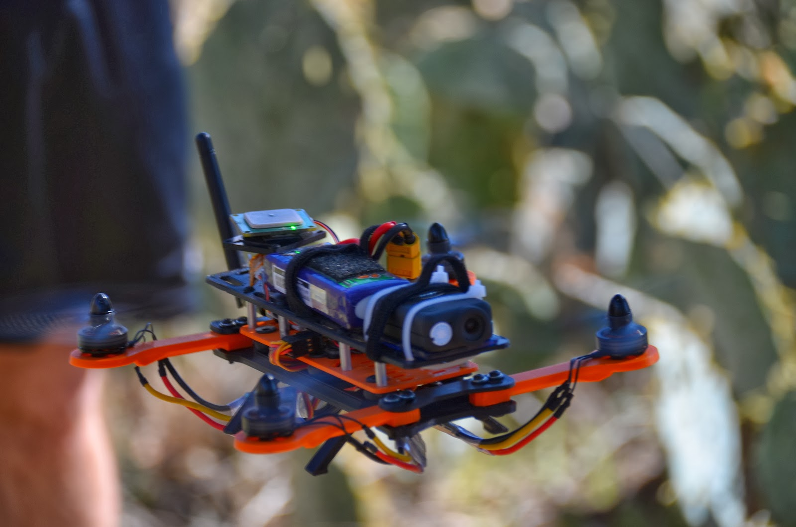

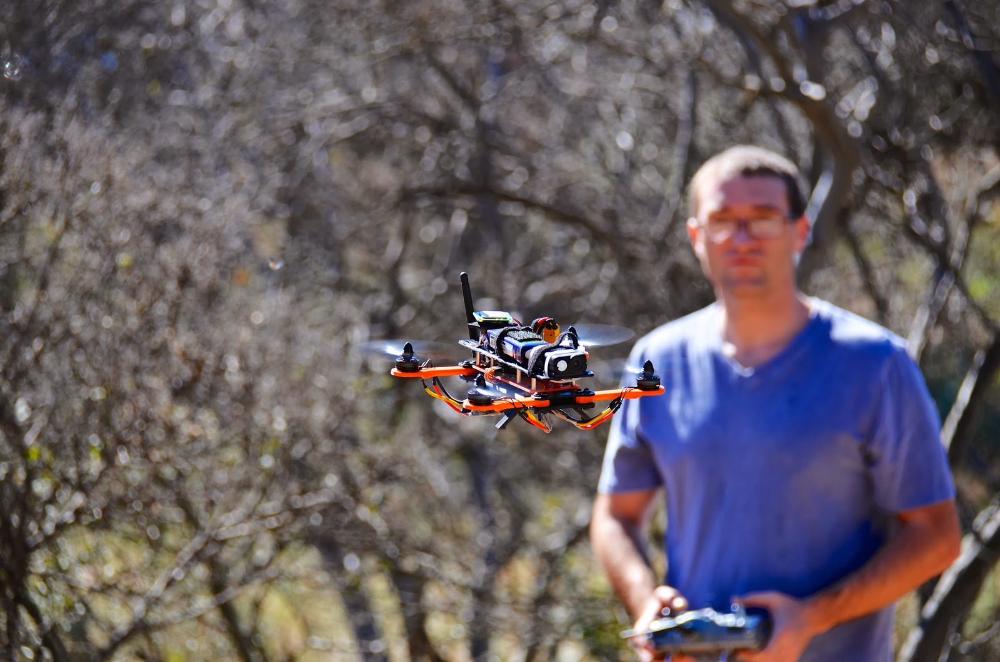

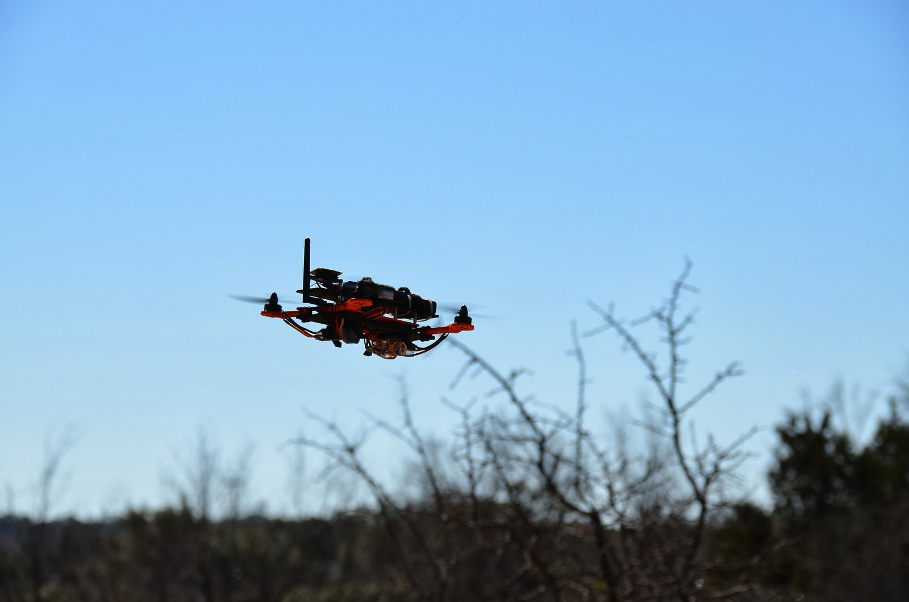

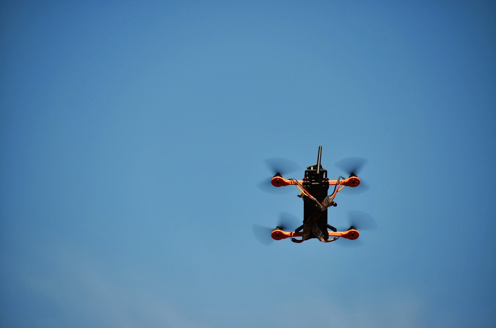

The video from the mobius is pretty good.

::: {.archive-video video-id="88023020" source="vimeo"}
:::

All the video that is not stabilized was from the miniquad. It was quite windy on the top of that rock and I was super impressed with how it handled it. Then I was testing it out with our new code for altitude hold, and was that's even more impressive. I need to get some FPV gear on it to try out this mode better.  

  

::: {.archive-video video-id="88439963" source="vimeo"}
:::
