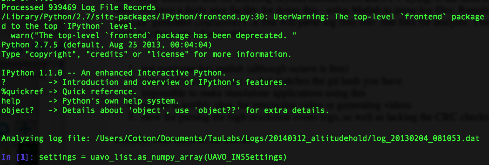
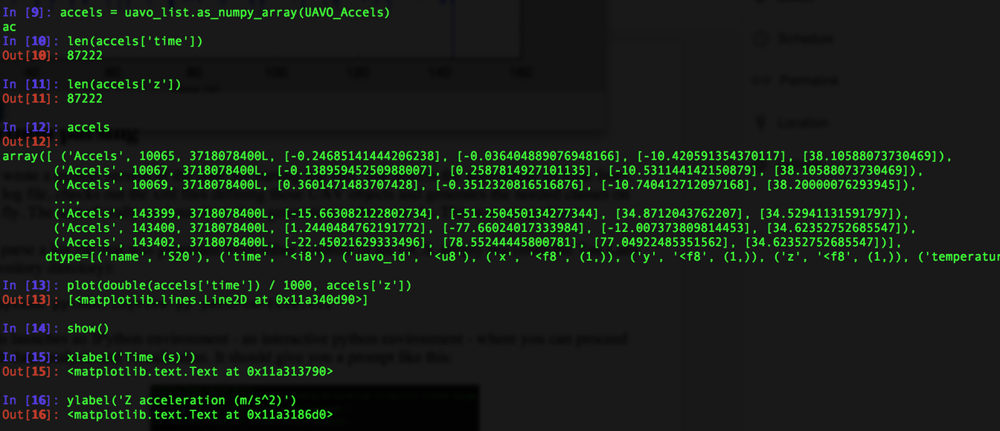
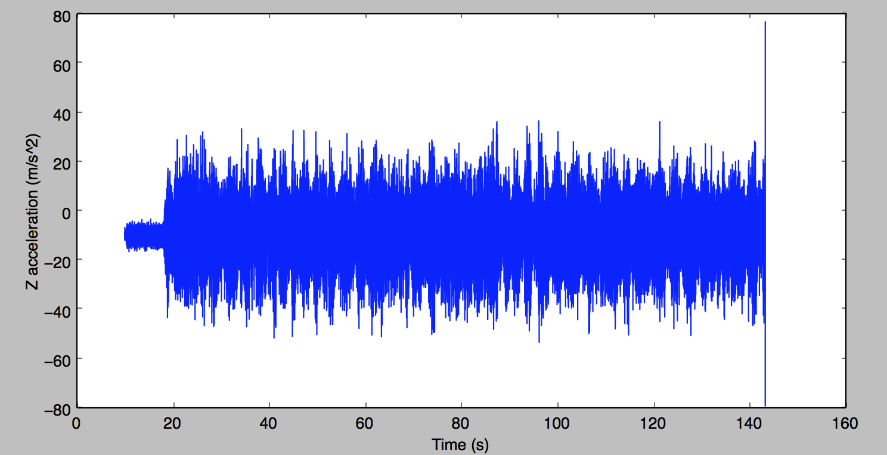
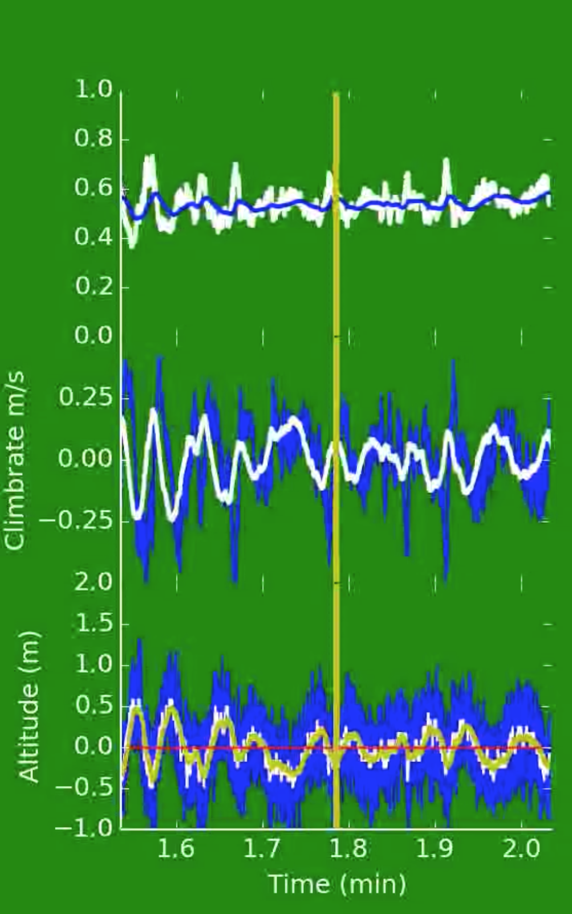
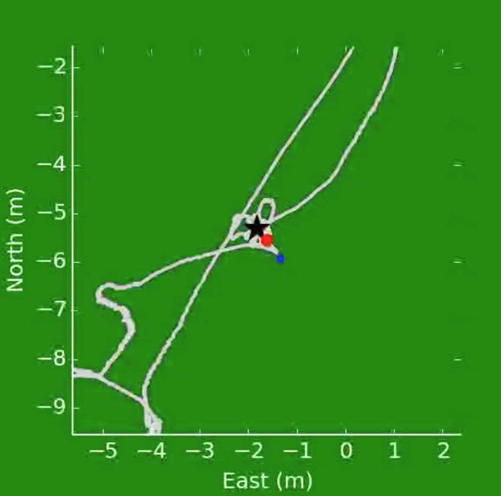

## Current state

One really common task for anything beyond normal LOS and FPV flying, is the need to analyze log files. We have a fairly nice facility for doing this - using Matlab to parse log files. Running ` build matlab ` generates `LogConvert.m` that will parse log files into .mat files for analysis. That works quite well, but there are a few problems:

1. not everyone has matlab (although octave is free)
2. you need a `LogConvert.m` that matches the git hash you have
3. impossible to make standalone applications using this
4. matlab is terribly slow for processing video or generating videos
5. slow for parsing the high resolution overo logs, as well as lacking the CRC checks

Luckily, Stac came to the rescue. 

## Getting logs

  

So the easiest way to get logs is through Android (it logs all connected flights) or with GCS. This is what I'd recommend for most people.

But what do you do if you want better data. My goto option is Freedom which logs *everything* and I think is awesome. However, since I haven't finished that or made more than 2 that doesn't help most people. 

    

Another option is something I came up with a [while ago,](../2013-11-30-easy-logging-with-openlog/index.qmd) using OpenLog. It's limited but useful.  

## Python parsing and plotting

He wrote a python version of the code for parsing log files, that detects the appropriate git hash from the log file, checks out the xml files defining those UAV objects and generates the needed classes on the fly. The sort of really cool run time class generation python can do. This was merged [here](https://github.com/TauLabs/TauLabs/pull/1108). 

To parse a log file that was generated from either Android or the GCS, simply run (from the Tau Labs repository directory):

`   $ python python/logview.py path/to/file.tll`  

This launches an IPython environment - an interactive python environment - where you can proceed with data analysis and visualization. It should give you a prompt like this:


There will be a few variables in your workspace at this point. The most important is `uavo_list`, which contains all of the parsed log entries of all the object types. To get the data from a particular UAVO, use the `as_numpy_array` method. You have to pass it the `UAVO_ObjectName` which is the class to cast the appropriate elements too. This will create a `numpy.ndarray` that can be indexed like a set. For example, to get the accelerometer data and plot the z component:




I won't delve further into the details of plotting in python since I'm sure that is covered better elsewhere.

However, a side note for processing either Overo logs or logs recorded with [OpenLog](https://www.sparkfun.com/products/9530) and my [Logging branch](https://github.com/peabody124/TauLabs/tree/logging). In these files there are two differences: they enable the embedded timestamps in the UAVTalk message (described [on the wiki](https://github.com/TauLabs/TauLabs/wiki/Development-UAVTalk-Protocol)) and do not write the githash into the file. The later is pretty annoying because you have to keep track of what version of the firmware your log files were created with, so hopefully I can fix that later. To parse these log files use this command

`   $ python -t -g GITHASH_OR_BRANCH_NAME python/logview.py path/to/file.tll` 

The -t switch tells it to use the internal timestamps (which are more accurate since they are when the FC sent the data) and the second part tells it what git hash to get the set of xml files from.

## Generating videos

I've been developing a set of methods that take these log files and generate a video of graphs. Just for general analysis, I find overlaying data on top of the video of flight is really informative. I also think this could evolve into a cool set of overlays for FPV flights. 

At the core of this is the `matplotlib.animation` library. You write a function that will plot (or manipulate a plot) to what you want at a given time stamp. For example I often shift plots to center at that time stamp and show a brief segment around it, with markers centered at the current time:

```
# Plot a segment of the path
def update_img(t, mark_0=mark_0, mark_1=mark_1, mark_2=mark_2, ax=ax):

 # convert to minutes
 t = t / 60

 import matplotlib.pyplot

 matplotlib.pyplot.xlim(t - 0.25, t + 0.25)

 mark_0[0].set_xdata([t,t])
 mark_1[0].set_xdata([t,t])
 mark_2[0].set_xdata([t,t])

```

Then you want to run this over a set of times and generate the video. To do this, I use this something like this:

```
fps = 30.0
dpi = 150
t = arange(t0_s, t1_s, 1/fps)

ani = animation.FuncAnimation(fig,update_img,t,init_func=init,interval=0,blit=False)
writer = animation.writers['ffmpeg'](fps=30)
ani.save(output_filename,dpi=dpi,fps=30,writer=writer,savefig_kwargs={'facecolor':'green'})

```

The `blit=False` and this set of codecs seems to work pretty well for OSX, but your mileage may vary. Now, because I'm typically wanting to use this to create an overlay, I use a green background everywhere. If I have multiple axes that I am plotting, this is what I use:

```
for a in ax:
 a.set_axis_bgcolor('green')
 a.xaxis.label.set_color('white')
 a.yaxis.label.set_color('white')
 a.spines['bottom'].set_color('white')
 a.spines['top'].set_color('green')
 a.spines['right'].set_color('green')
 a.spines['left'].set_color('white')
 a.tick_params(axis='x', colors='white')
 a.tick_params(axis='y', colors='white')

```

  This will use white text and labels and set the background of the axis to green. Notice also the `savefig_kwargs={'facecolor':'green'}` section in the `ani.save` command which also is important. 

Here are some of the results:





Finally, I combine this all in Premiere or IMovie (although that can only handle one overlay and doesn't allow positioning), and get something like this: 

::: {.archive-video video-id="89117769" source="vimeo"}
:::

  
Here are some of the scripts I used to generate this:

- https://gist.github.com/peabody124/9571409 - generates the altitude overlays
- https://gist.github.com/peabody124/9571455 - generates the position overlays

## Next steps

As is, this is a really powerful tool. However, what I think would be really awesome is to organize some scripts to generate a bunch of nice overlays, and then ideally write standalone python scripts that parse the log and spit out a video instead of going through IPython. The end goal would ideally be compiling to standalone applications, or alternatively integrating into the GCS and calling out to python (plausible?).
