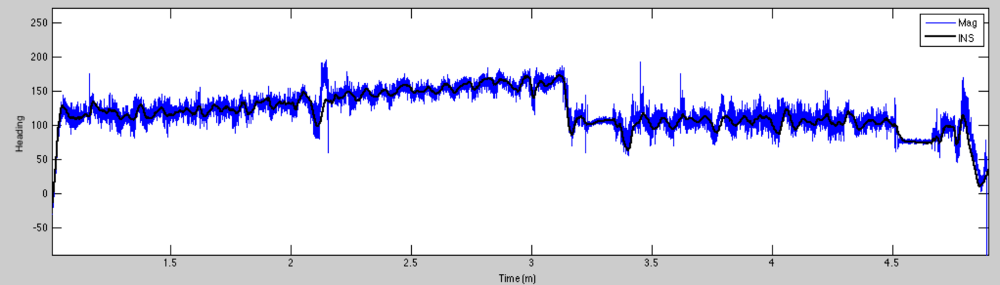
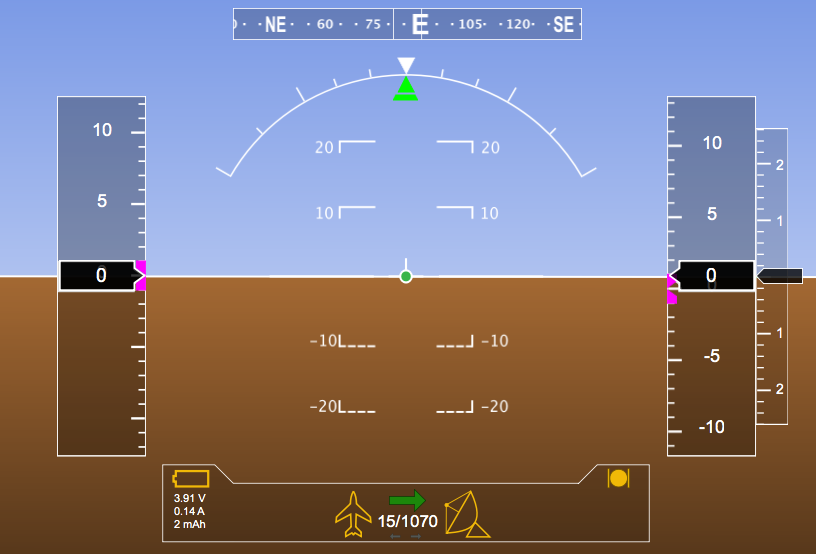

The Tau Labs INS (written by Dale Schinstock) works really well and has been used for various navigation tasks for the last few years. However, one aspect that I have found problematic is the magnetometer handling. The way it works currently is that the Earth's 3D magnetic vector is rotated by the attitude to predict the 3D measurement we should get.

In principle that is a great idea, and on planes probably fine. However, on multirotors that generate a lot of local field distortions from the motors, it is rather problematic. The reason is that as the Z (down) component is altered, it creates a bias in the roll and pitch components of attitude to deal with this. We already know (from years of experience flying the complementary filter) that the gyros and accels are sufficient to stabilize those components. As a work around we generally have just used fairly high variances for the magnetometer. This isn't optimal though, as I've seen the INS bias estimate for the Z axis sometimes destabilize since it isn't sufficiently constrained by the mag when initially converging if things are fairly miscalibrated.

I have been wanting to alter the EKF for some time to only allow the magnetometer to influence the heading estimate, but the path wasn't obvious. Today I decided to sit down and implement this, and I'm fairly happy with the result.

## Derivation

We want to measure just the heading aspect of the mag, in order to get rid of the mag influencing attitude. Currently the predicted measurement of the magnetometer is  

$\bar B_b = R_{be}(q) Be$

So we want a version that only depends on the *heading*component of $q$. That turns out to be less trivial that it sounds. To achieve this, we essentially want to only work with magnetic information projected into a plane parallel to the earth (called the $h$ plane). The rotation $R_{be}$ can be decomposed into two matricies, $R_{be}=R_{bh} R_{he}$, where $R_{bh}$ applies the pitch and roll transformation and $R_{he}$ applies the yaw transformation. We can rotate the raw mag measurements in order to undo the influence of just the roll and pitch by using the inverse (in this case transpose) of $R_{bh}$, $B_h = R_{bh}^T B$, and then only keep the components in x and y.

To calculate both $R_{bh}$ and $R_{he}$, we can get the equations from [the code](https://github.com/TauLabs/TauLabs/blob/next/flight/Libraries/math/coordinate_conversions.c#L131). I then used this code in matlab and the symbolic toolbox to get the matrix. It took a little bit of massaging afterwards to get an efficient implementation:

```
syms q1 q2 q3 q4 real
q = [q1 q2 q3 q4];

q0s = q(1) ^ 2;
q1s = q(2) ^ 2;
q2s = q(3) ^ 2;
q3s = q(4) ^ 2;

R13 = 2.0 * (q(:,2) .* q(:,4) - q(:,1) .* q(:,3));
R11 = q0s + q1s - q2s - q3s;
R12 = 2.0 * (q(:,2) .* q(:,3) + q(:,1) .* q(:,4));
R23 = 2.0 * (q(:,3) .* q(:,4) + q(:,1) .* q(:,2));
R33 = q0s - q1s - q2s + q3s;

roll = atan2(R23, R33)
pitch = asin(-R13)
yaw = atan2(R12, R11)

% compute the rotation matrix that is for the attitude component
% this is the matrix that will rotate from the earth frame to the
% current roll and pitch. The inverse will take the magnetometer
% reading back into a horizontal place
sF = sin(roll); cF = cos(roll);
sT = sin(pitch); cT = cos(pitch);

r = sqrt(R23^2 + R33^2)
sF = R23 / r;
cF = R33 / r;
sT = -R13;
cT = sqrt(1 - R13^2);
Rbe_bh = [cT, 0, -sT;
          sF*sT, cF, cT*sF;
   cF*sT, -sF, cT*cF]

```

Then we need to modify the EKF to predict a measurement in the horizontal plane. That aspect is pretty straighforward, it is the same equation but keeping the yaw component instead of pitch and roll

```
% direct equation
sP = sin(yaw); cP = cos(yaw);
Rbe_h = [cP, sP;
       -sP, cP];

% another expression that results in code that doesn't use imaginary
% numbers
x = R12;
y = R11;
r = sqrt(R12^2 + R11^2)
Rbe_h = [y/r x/r; -x/r y/r];

% calculate predicted B_h in the horizontal plane
B_h = Rbe_h * Be

% generate c code to compute this
ccode(B_h)

```

I ended up having to manually expand $cos(atan2(x,y))=\tfrac{y}{\sqrt{x^2+y^2}}$ for matlab because it kept trying to use imaginary numbers to calculate the norm. The last line of this actually generates C code for the two components of $B_h$. It needed a fair bit of massaging after that to factor out common terms and get an efficient implementation.

The other thing needed for the INS is the derivative of the measurements with regard to the state, or in this case $\tfrac{\delta B_h} {\delta \mathbf{q}}$.

```
% and compute the derivatives wrt to the attitude
ccode([diff(B_h,q0)'; diff(B_h,q1)'; diff(B_h,q2)'; diff(B_h,q3)'])

```

Again, Matlab symbolic toolbox to the rescue, saving me from a lot of tedious algebra, although again lots of massaging was required.

## Testing

So again, Freedom Overo logs saved me tons of time, since I can replay previous flights through the new filter and see how it performs. It performs *really nicely*. The nice thing about this, is we can tighten up the variances on the mag and make sure the convergence behaves well, and not worry about the magnetic field biasing the attitude as we go. 

Here is the raw magnetic heading and the INS output: 



, which you can see is nicely tracking together.

I also loaded it up on my Freedom and power cycled it a bunch of times, as well as letting is sit for an hour. Rock solid - none of the oscillations I would sometimes see with the previous code - and now I can keep the gyro bias estimation on reliably. With a good accel calibration and board leveling, you get a perfect PFD:



This is with minimal tuning or tweaking, so that is great. I'll need to play around with a bit in flight but I'm pretty optimistic about this - and hopefully it will reduce the rare times we do see toilet bowling. I also now need to play around again with the mag compensation code, although hopefully it won't be necessary. 

It was also a really fun day project. I've played with kalman filters before but never had to go quite as deeply into the extended kalman filter. I also learned some more about playing with quaternions and rotation matricies, so that was productive.
