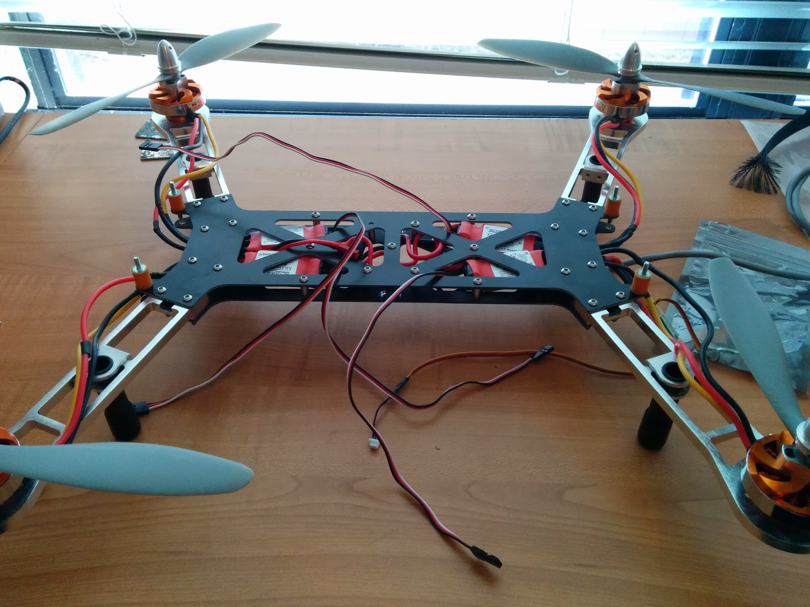
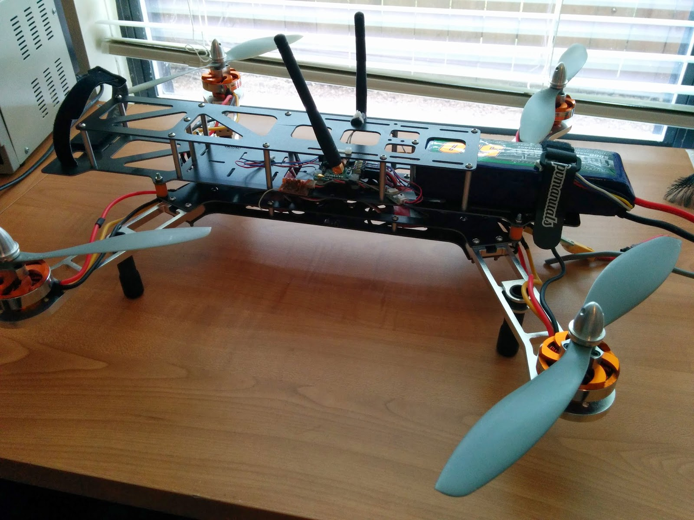

Vertical control is still not at a state that I'm happy with. We recently took [one very important step](https://github.com/TauLabs/TauLabs/pull/1080) in the right direction by making the same code and settings be used for standalone altitude control and navigation altitude control. At least with this, there is only one thing that requires tuning. After a fair bit of work, I'm pretty happy with the result. If you just want to see the video here it is

::: {.archive-video video-id="89844044" source="vimeo"}
:::

f 

## Sixteen state INS

One issue I see is that the accelerometer bias is not reproducible enough flight to flight, and because this is integrated into velocity that creates a non-trivial amount of noise. In the review I linked above, the complementary filter that is used for the vertical axis (based on ardupilot, to give credit where it is due) estimates the accelerometer bias. However, when running navigation (and thus the INS algorithm) the bias is not tracked for the accelerometers. The most obvious consequence of this is when you enable position hold mode or something else you initially get a throttle surge or dip. After it drops enough, the outer position control kicks in and the you get about a reasonable behavior.

One solution to this, which has already been merged, is the [zero accel button](https://github.com/TauLabs/TauLabs/pull/1001). This will let you correct this error, but because the bias changes flight to flight will only be a short term fix.

This is more of a problem, though, for landing when only the velocity is controlled. If the decent rate is 1 m/s and the velocity axis has a 0.5 m/s error you get quite a large error in landing rate and either a long wait or quite a bump.

We had previously played around with a 16 state INS that added the accelerometer bias but it did not work terribly well. One issue for this was that when the board is sitting still, there is essentially a manifold of valid states - the board could be upside down if the accel bias were set to 16 m/s^2, for example. Unobservable systems are **very** bad for control. There was a fairly simple way of fixing this: I made the state equation for X and Y accel biases have a drift towards zero. This allows it to get to non-zero values (when flying around and really accelerating there might be good evidence for it) but keeps those values fairly well grounded near zero. This is appropriate, too, because the accel bias does not get that far from zero with a reasonably calibrated system.

The second problem turned out to be some bugs in the automatically generated efficient version of the covariance prediction. Manually finding the five typos in this wall of code (and this is only about a third of it)

was not the most fun I've had in the last few weeks. However, after fixing that and a few other tweaks it seems to be working quite well. Manually miscalibrating the system with an accelerometer bias of even 1 m/s^2 is accounted for perfectly and after thirty seconds the error in the vertical velocity falls to less than 0.1 m/s.

Of course, going to a 16 state INS introduces a higher CPU and memory load. However, on Sparky the INS is still only less than 1/4 of the CPU utilization which seems reasonable if it results in a good state.

### INS Testing and tuning

To test this version of the INS, I got some logs with the Overo on [Freedom](../2012-11-19-freedom-assembly-and-first-flight/index.qmd) and visualized the output of the INS and the quad movement. It seems to track quite well:

::: {.archive-video video-id="89117769" source="vimeo"}
:::

  
Now one issue I'm running into is that when I tune the baro variance to make sure it does track the altitude well, that couples the noise from the baro into the velocity estimate. This seems to be limiting the tuning settings I can get away with.

  

## Vibrations and Fourteen state INS

Since the main issue bias we have issue with is the vertical, at least for now, I wanted to try and not burn cycles on the horizontal biases (although it is quite possible we might go back on this eventually). With some help from Dale (the original INS author) I jumped in and modified it to a fourteen state estimator, with only the vertical bias term being tracked. This wasn't too hard in the end, and also does a great job of estimating the vertical velocity. 

However, no matter what settings I used, the vertical hold was not as good as I wanted. Interestingly, it was much better on my micro-quad. I finally broke down and moved Freedom from my POS HT-FPV frame that shakes like crazy to my QAV500. I hadn't flown this much because the pancake motors on it were not playing nicely with my ESCs and I hadn't had the time to tune them up. However, I switched to some SimonK ESCs:

And now no motor failures in flight. With this frame, suddenly the altitude control was much better. This was true using both the complementary filter and the new 14 state INS.

::: {.archive-video video-id="89844044" source="vimeo"}
:::

   

## Tuning

You can do all this tuning in the default StateEstimation (complementary, raw) which runs the simple inertial filter for vertical. Once the updated INS is merged you can also tune in INSIndoor mode, but for now I would avoid that with the 13 state since the velocity bias makes the next step a bad idea. 

Next, the altitude control loop should be tuned. Ultimately I found the default values were pretty close to what I wanted but the exercise was interesting. Lux (in IRC) recommended a method from baseflight which is very analogous to how I recommended tuning the main control loop (see [this video](https://vimeo.com/25742413) for a tutorial I did years ago). 

Basically first you set the AltiudeHoldSettings.AltitudeKp to zero and fly altitude hold. In this condition it will drift up and down a bit randomly but should behave essentially well. Then you gradually increase the AltiudeHoldSettings.VelocityKp until the motors begin to hunt and sound really twitchy. Once you hit that point bring it back down a bit. I didn't feel the need to tune the Ki component since it seemed to be working fairly well and not overshooting. 

Once that is done, then you can dial in the AltitudeHoldSettings.AltitudeKp again. If the altitude is wandering too much then increase that term. If the whole system is jumping up and down and hunting again, then reduce it. I found the default value of 1 or down to 0.5 seems to be a pretty good range.

**TL;DR**: set Velocity Ki to about 1/5 of Velocity Kp and increase that until you see fast twitches, then back off. Then increase the outer gain until you start seeing oscillations and back off. 

## Vertical Control

  

KipK in IRC also asked for more aggressive control of altitude when flying altitude hold mode. This has been on my TODO list for a while, and I kept putting it off. 

The current scheme waits for the stick to move out and then into the middle range to enable vario mode, but most people have found this unintuitive. Instead I went ahead and added an exponential to the range outside the dead band. This allows more sensitive control in the middle and aggressive control for further stick movements. 

Previously, moving the sticks only shifted the set point. Instead I wanted something more like AxisLock where in the middle range the setpoint stays the same and in the outer range you control rate instead of moving the setpoint. In control parlance this is called full state control where we pass the desired position and rate. 

I thought I was pretty clever coming up with this scheme, but looking around it seems like everyone has converged on it for vario mode - which probably means it is a reasonable idea.

Here is a video of OsoGrande testing it out and then myself. I'm pretty happy with the response and he said it felt fairly natural to fly.

::: {.archive-video video-id="88549064" source="vimeo"}
:::

::: {.archive-video video-id="88439963" source="vimeo"}
:::

  
There was also a glitch with vertical control when doing position hold and RTH that caused it to have a brief dip when engaged. The integral wasn't being properly preloaded with the hover throttle, but this should be [fixed now](https://github.com/TauLabs/TauLabs/pull/1154).

## Conclusion

  

So with all these changes, I think we are set to have some really clean navigation. Some care needs to be taken of vibration if you want to get a really clean hover. This is much easier on smaller quads in my experience.
