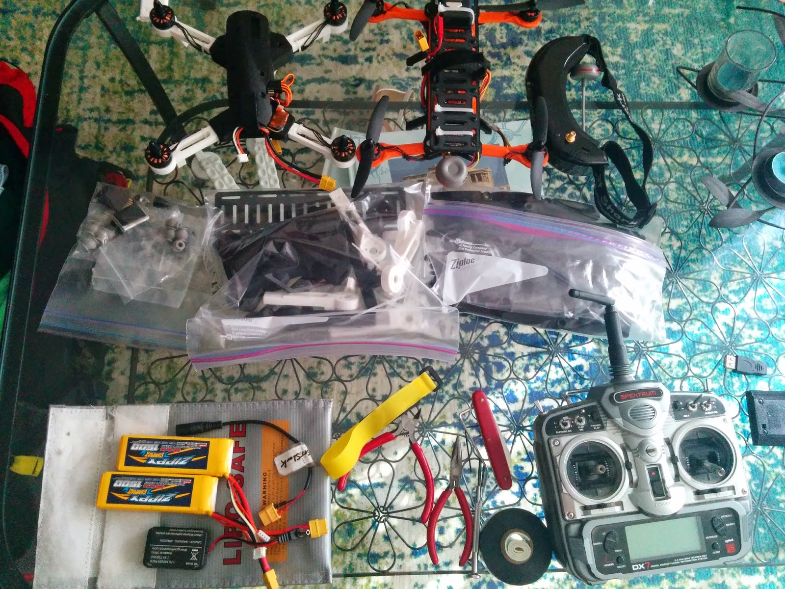
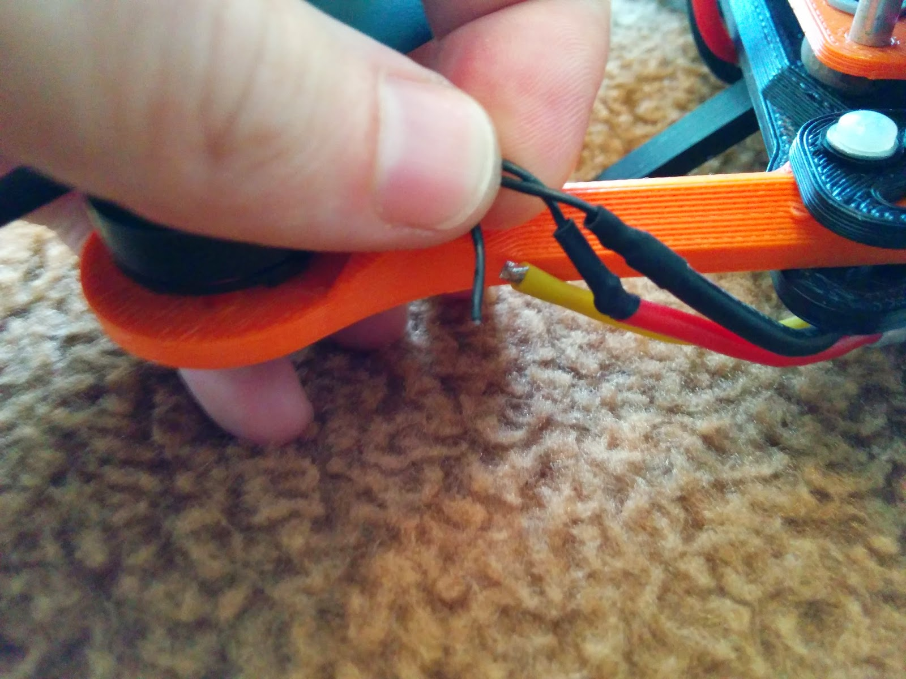
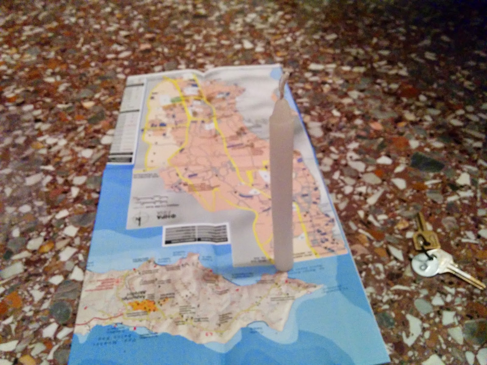
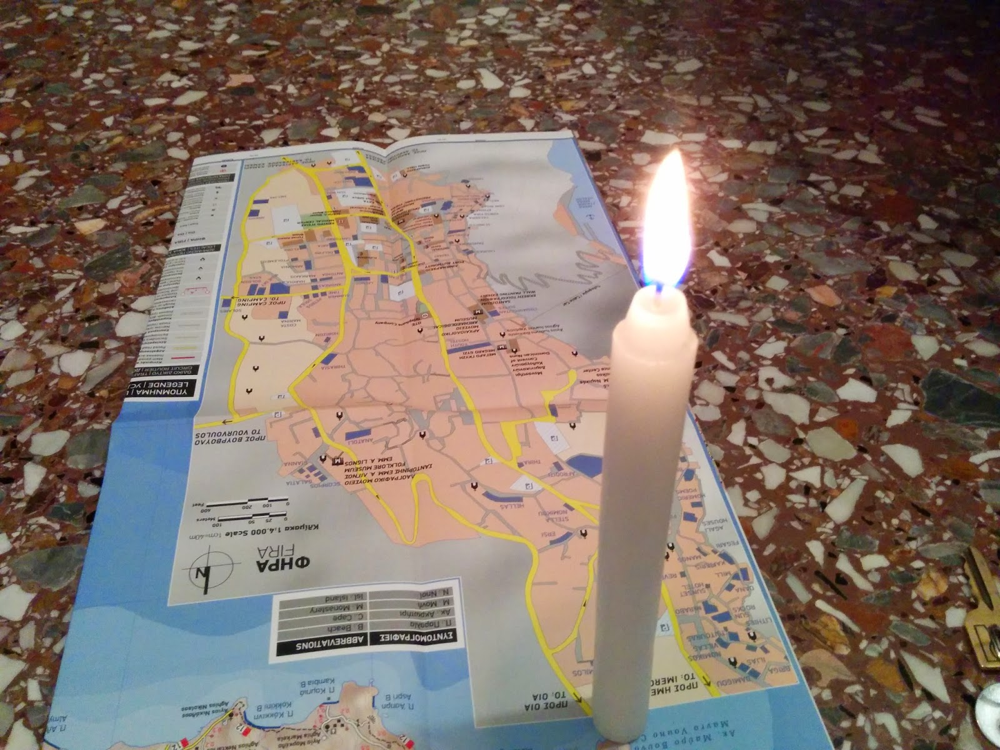

I just want to comment on a trick I learnt last week.

Last week I went to Santorini and diligently packed two quads. My [Flying Spark](../2014-07-04-flying-spark-3d-printed-mini-quad/index.qmd) for LOS and video recording and my [Hovership MHQ](../2014-02-23-microquad-from-hovership-pro/index.qmd) for FPV (or letting other people see the video stream). I thought I was pretty prepared with tons of spare parts, tools and screws:

Unfortunately when I got there, I had an issue with the MHQ:

Santorini isn't a huge island so my chances of finding an electronic repair shop were pretty slip. Luckily, one of my friends suggested a candle, so here was my soldering setup:

It turns out the trick is that because the flame has a low heat transfer efficiency compared to a normal iron things take a lot longer. Basically it took between 3-5 minutes to get the ESC wire hot enough for the solder to flow. This also resulted in warm fingers, but the results worked!
