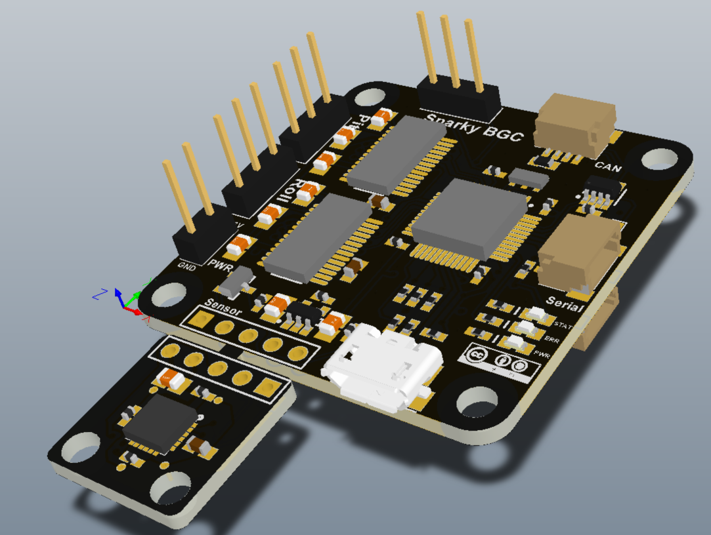
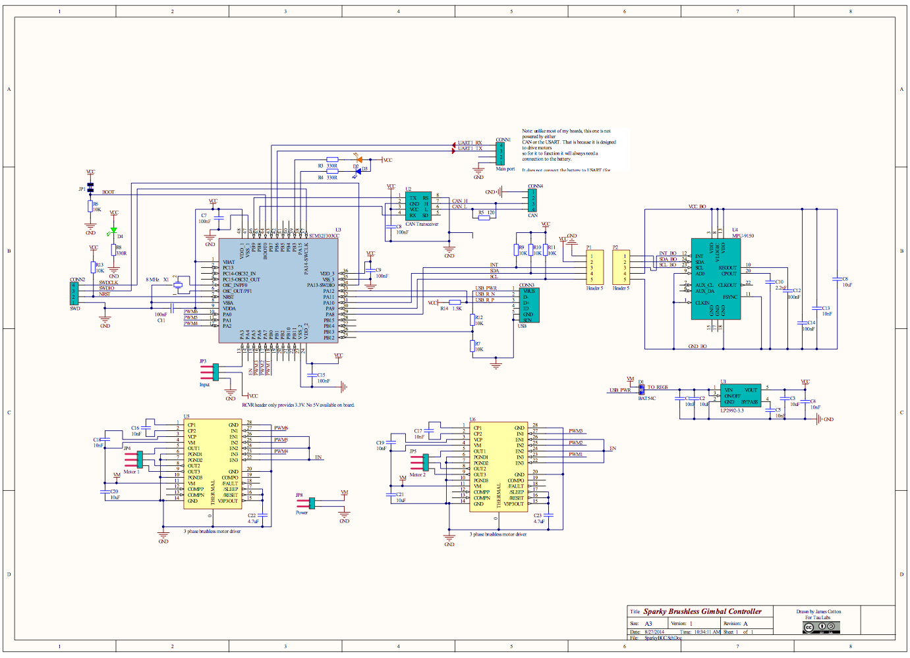
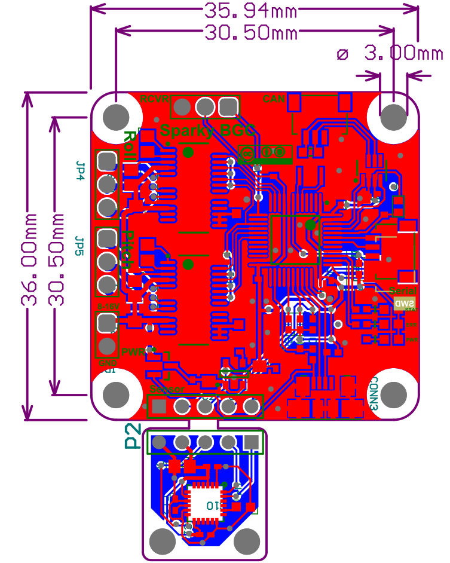
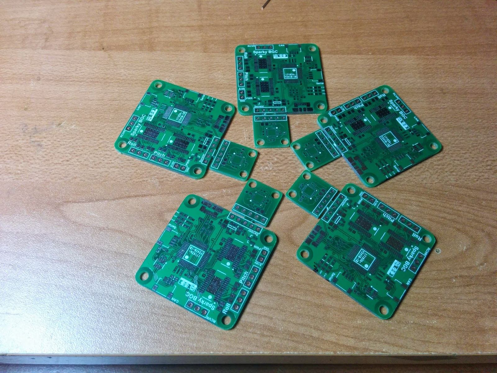
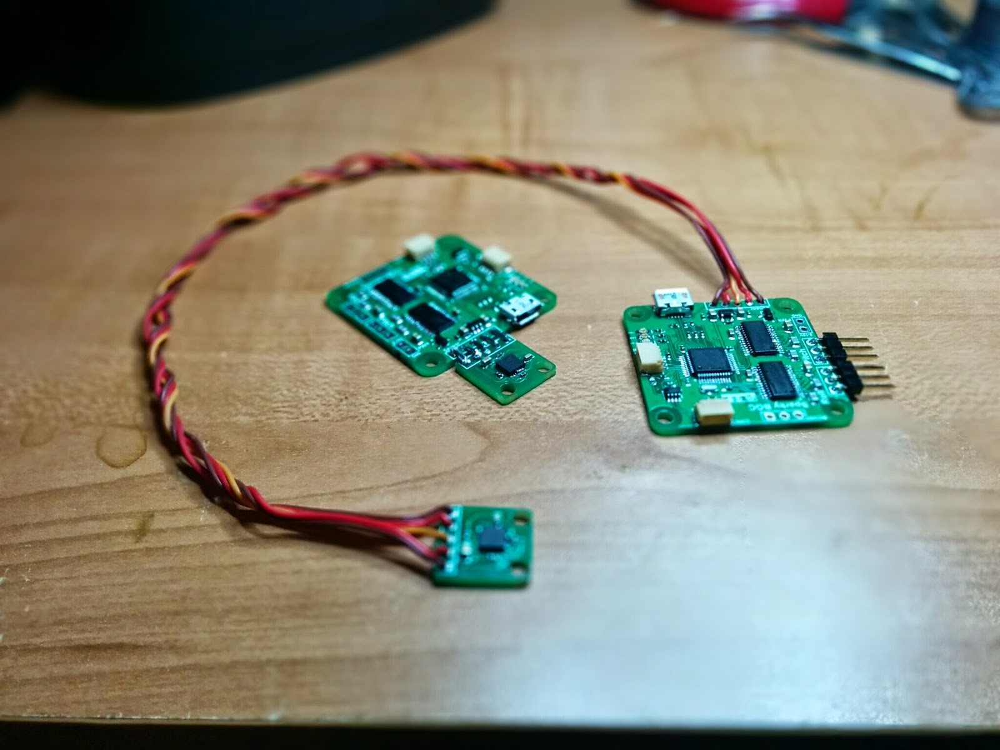
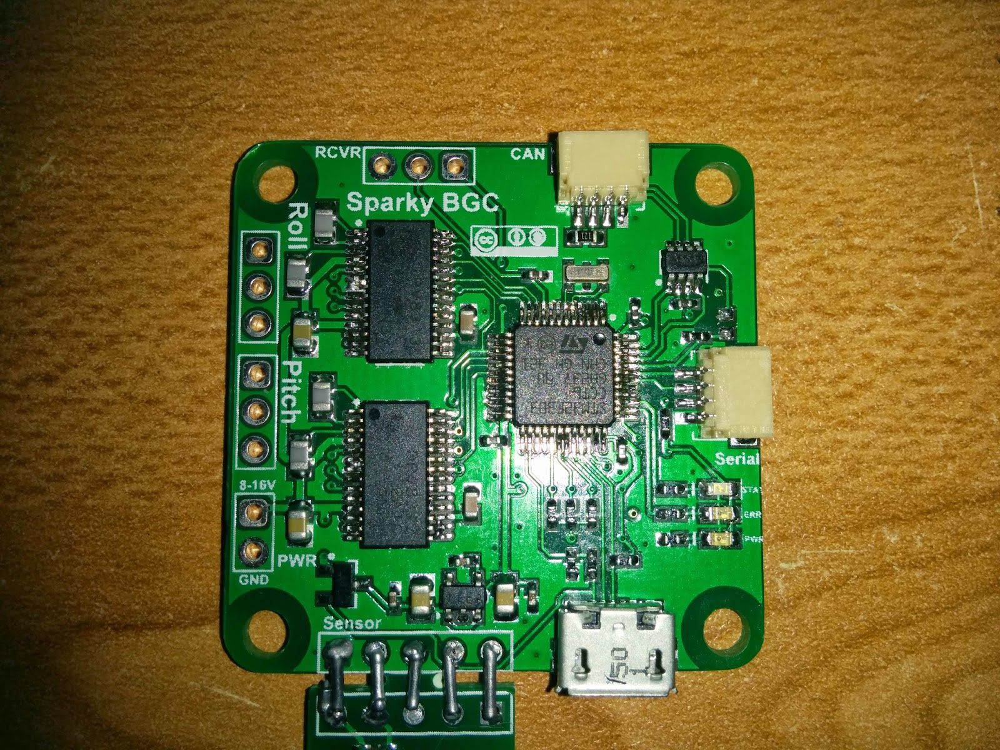

**Update: if you want a SparkyBGC please email me (my username at gmail.com) or drop a comment here**

I made an add on board for [Sparky last year that added brushless gimbal drivers](../2013-05-21-sparky-brushless-gimbal-controller-testing/index.qmd) and found it worked quite well:

::: {.archive-video video-id="66987484" source="vimeo"}
:::

   
However, because the sensors were all on the main controller board that was a lot to mount on the gimbal. Weight wise, it wasn't a problem. For tuning the gimbal though, having all the cables running to the moving part was a pain. So I redesigned it with a main board with our standard mounting holes and a satellite board with an MPU-9150 to provide the sensing (and be useful as an external mag for navigation).

### Assembly

And got the boards back. The sensor board is designed to break off to make it easier to populate the two of them together.

And some of the boards soldered up. 

### Flight testing

I went ahead and put it on my Iconic-X frame that had the previous BGC revision and was pleased with the results: 
  

::: {.archive-video video-id="104575370" source="vimeo"}
:::

And OsoGrande put it through some more aggressive testing: 

::: {.archive-video video-id="106104484" source="vimeo"}
:::

  

### Features

- Two axis control
- Easy tuning and configuration via Tau Labs GCS
- Integration with flight controller via CAN bus
- Point of interest tracking (e.g. phone/tablet tracking)
- Lock the gimbal position during flips and rolls
- Relay control signals via FC using CAN. Extremely convenient when you use a single wire receiver such as Spektrum Satellite.



*Added a locking function to #TauLabs #SparkyBGC. Using CAN it knows the attitude of the frame and avoids getting tangled.*



*#TauLabs #Sparky brushless gimbal controller connected to #Sparky2 via CAN, allowing the flight controller to relay attitude and setpoints for transmitter control and POI tracking.*

  

### Next

Now I have to connect it up via CAN and get some of the functions working like controlling the pitch angle via the transmitter and repeating the POI tracking that I have done with Oso Grande in the past. 

  

::: {.archive-video video-id="91046135" source="vimeo"}
:::
