**Update 2:** Sparky2 is available at [HobbiesFly](http://www.hobbiesfly.com/taulabs-sparky2-0.html).

I love [Sparky](../2013-05-19-sparky-testing-and-building-no-crashing/index.qmd). It's not too surprising, since I designed it to be everything I want in a flight controller. Simple, easy to solder, small, extremely capable, reasonably expandable.

I also really like [Freedom](../2012-11-19-freedom-assembly-and-first-flight/index.qmd), the more powerful cousin. The overo allows logging all the data, which has been hugely powerful. It has more connectivity which is great for having an external mag, spektrum, gps and OSD. The integrated radio is very convenient for connecting to Android.  The obvious thing to do was try and fuse them together and get the best of both worlds.

My main goal with this project is something that is really easy and effective for doing POI tracking, follow me, as well as still just flying really well and being great for navigation.

I present:

### Sparky 2.0

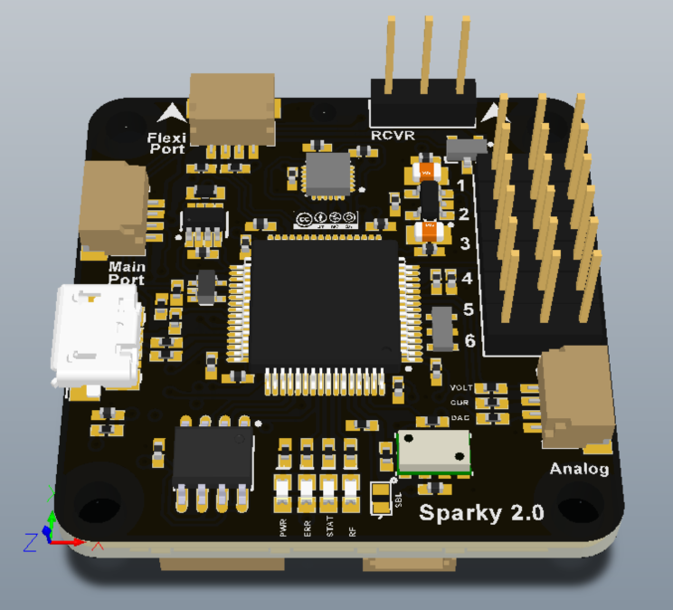

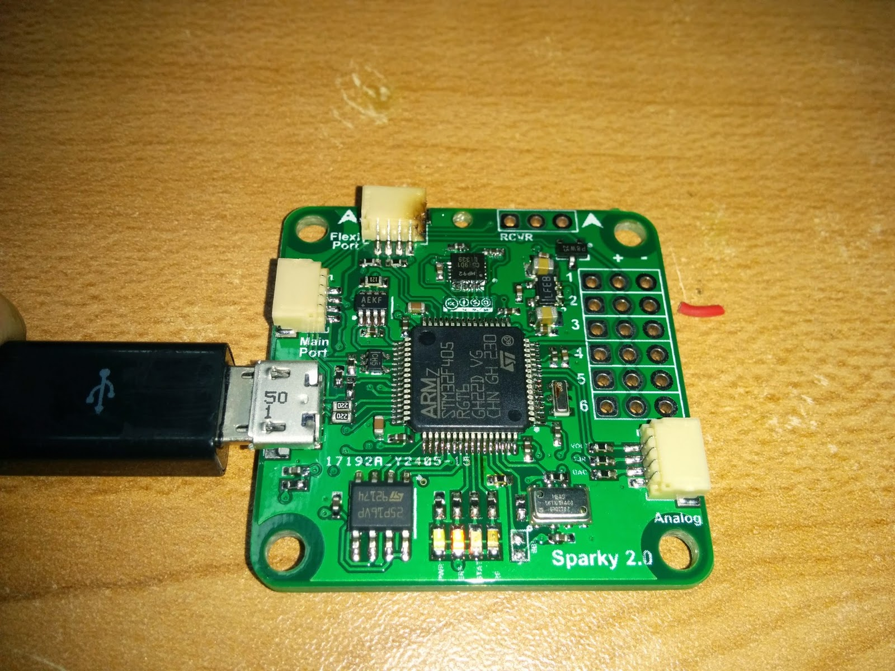

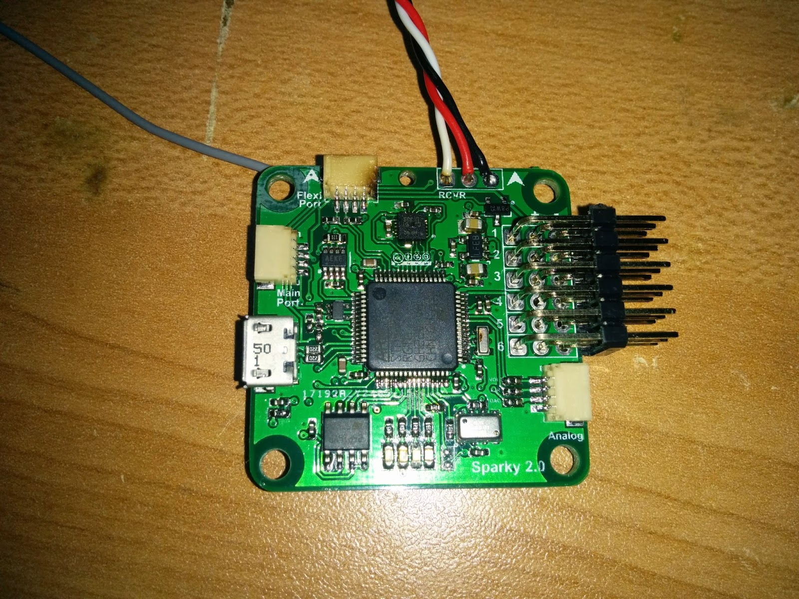

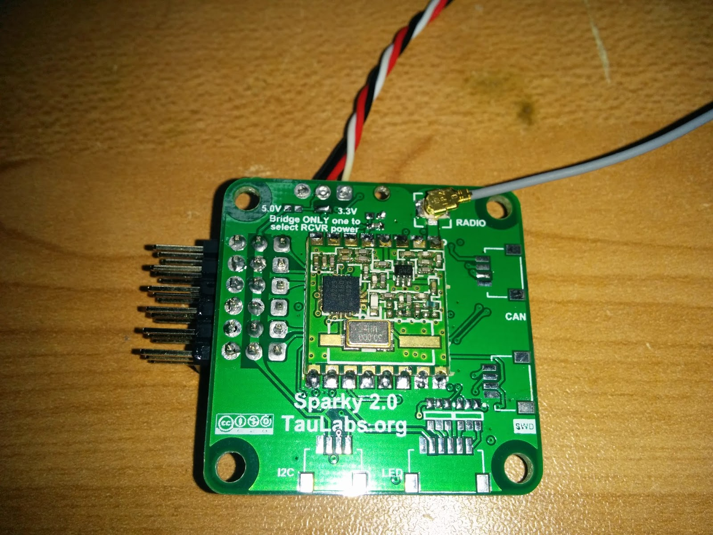

### Features

- Runs **Tau Labs** (of course ;-). Same great flight performance you've come to expect and standard features.
- **Open source hardware!**(also of course)
- **More powerful processor**. Uses an STM32F4 running at 168 Mhz with increased memory and flash. This is useful for storing and flying longer waypoint sequences and running more complicated code like picoC scripting.
- **More connectivity**. (RCVR, Flexi, Main, I2C Aux). This is really useful if you want to have an external mag, gps, and spektrum receiver or other things like OSD.
- **Flash chip** which can be used to store flight plans, picoC code, or logging
- **RFM22b radio** can be used for telemetry or with openlrng (not implemented yet). The receiver antenna uses the same U.Fl. connector that Freedom has. I really like this because it is very small and you can easily an SMA break out cable or a whip antenna. It also has just the right amount of tension - strong enough to hold together in flight but in a crash it will disconnect and not damage the board. There is a small hole at the front to provide strain release for a whip antenna that you can just pass through and solder straight to the RFM22b for minimal configurations.
  - **OpenLRS support:** [directly control from your OpenLRSng radio](https://vimeo.com/124850842) if you don't want a TauLink.
- **Four buffered outputs** to drive either LEDs (indicate flight status) or brushed motors. I'm really excited to have different colored LED strips turn on to indicate the direction it is facing relative to home.
- **DAC output** for VTX audio telemetry. I'd like to be able to some prerecorded audio sounds so the headphones can provide useful information for FPV.
- **Dual analog input** for voltage and current monitoring. The DAC output can also be used as an analog input.
- **CAN Bus** which is very useful for talking to external devices like the [brushless gimbal](../2014-08-27-sparky-brushless-gimbal-controller-version-2/index.qmd) to coordinate [POI tracking](https://vimeo.com/91046135) or control the gimbal pitch from transmitter. Also CAN enabled ESCs are coming out which will allow serious improvements in flight quality.
- **Full sensor suite** of course. MS5611 baro and MPU-9250 combined gyro/accel/mag. I was really conflicted on switching from the MPU-9150 to the MPU-9250. However, being able to utilize an SPI bus which is much better handled on the processor side made it worthwhile.
- **Optional single sided assembly** - the necessary things to fly are all on the top of the board. The bottom has the CAN bus connector, RFM22b, antenna, external LED drivers. So if you just want a more powerful flight controller with more memory and CPU over Sparky it's still single sided.

### Ground modem - TauLink

I also needed a ground side modem. This uses the same RFM22b module used on openlsrg as well as on the flight controller and uses an STM32F1. It was inspired by the PipXtreme (which also inspired the OPLink) done by Pip when we were with OP a few years ago, but is a bit smaller and easier to assemble. It's running code written by Pip, Brian Webb and myself.  

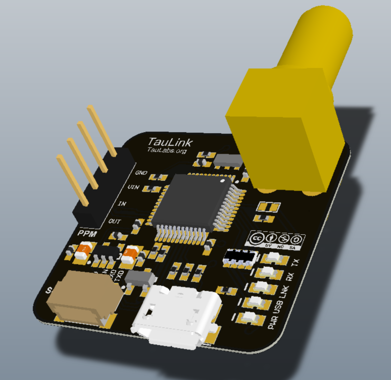

The modem has a standard SMA connector so can accept a wide selection of 433 Mhz antennas.  It uses micro USB and can be powered by a phone or tablet and works with the [Tau Labs Android GCS](https://play.google.com/store/apps/details?id=org.taulabs.androidgcs&hl=en). There is also a port that can serve as a receiver port for relaying signals from a transmitter or taking in PPM for a transmitter module. Finally, there is a serial port for connecting to a GPS. This is important for any tracking applications like POI mode since the accuracy of the phone GPS is not sufficient in my experience. 

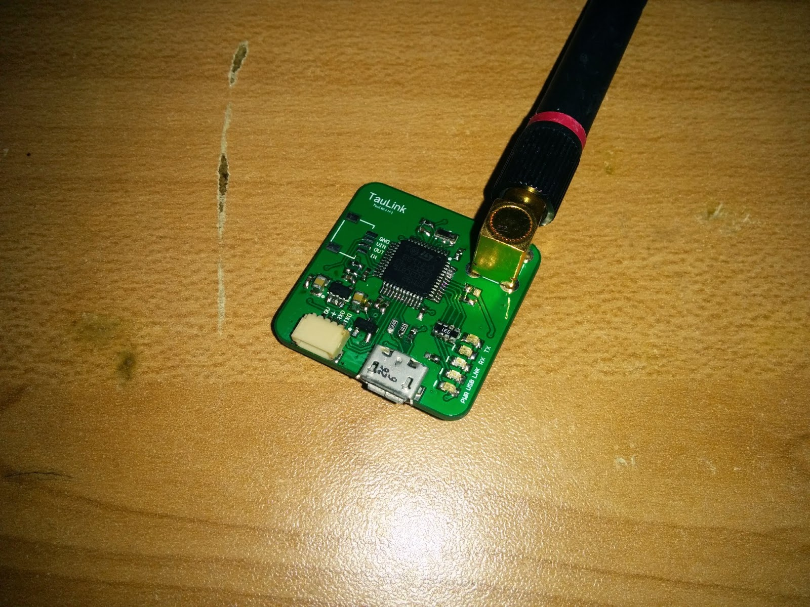

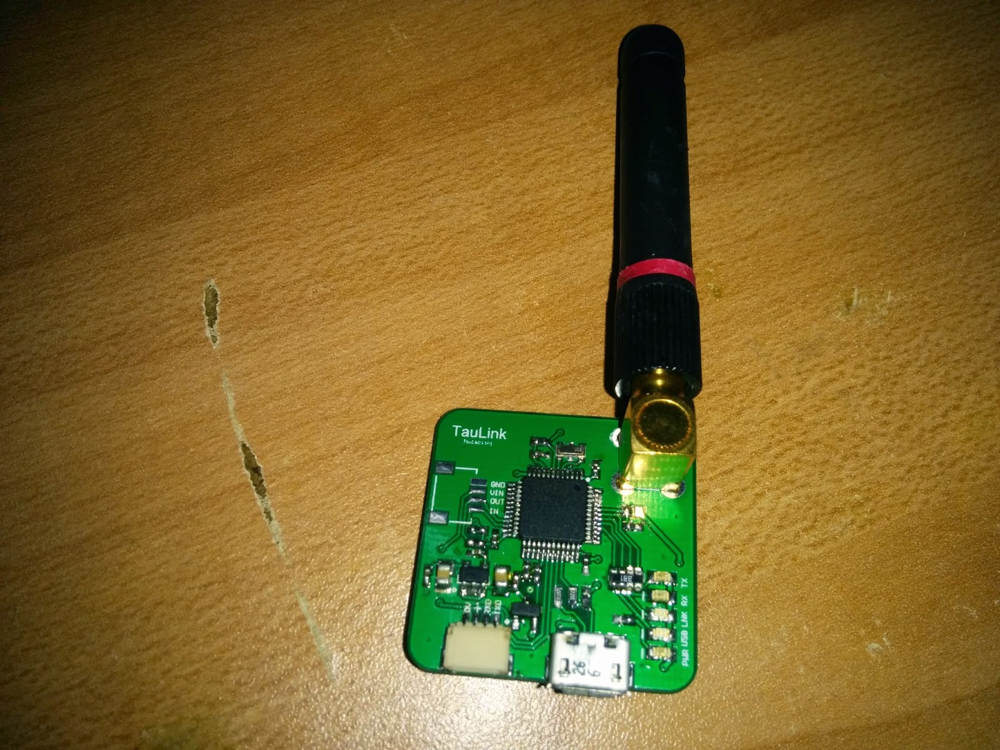

I also want to break out a few pins to a housing with buttons so the modem can be used to relay a few simple commands like "land" or "follow". 

And a quick little case to make it easier to stick to things. 

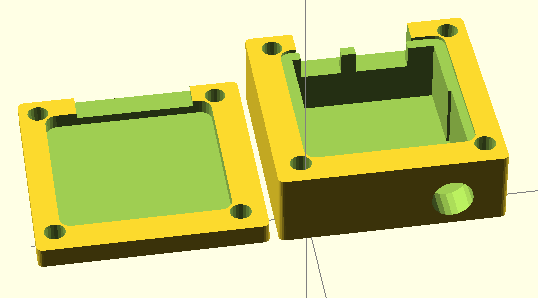

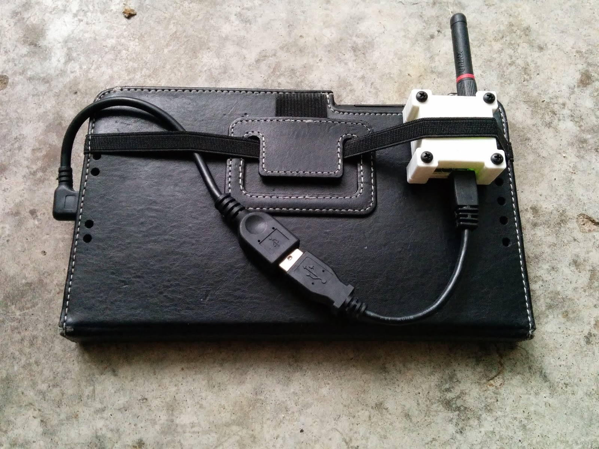

### GPS

I picked up [this super cheap Ublox 8 GPS](http://www.ebay.com/itm/RY825AI-18Hz-UART-USB-interface-GPS-Glonass-BeiDou-QZSS-antenna-module-flash-/181465343124) that ReadError recommended on IRC. Conveniently, Sparkfun have also started selling the [JST-SH cables](https://www.sparkfun.com/products/10359) needed to connect it. So far the performance looks really quite good, although I haven't flight tested it yet. Our software picked it up right away and autoconfigured it, which was nice. 

Unfortunately it didn't have any mounting holes, so I quickly designed a case in OpenSCAD that uses the standard 30.5 spaced holes: 

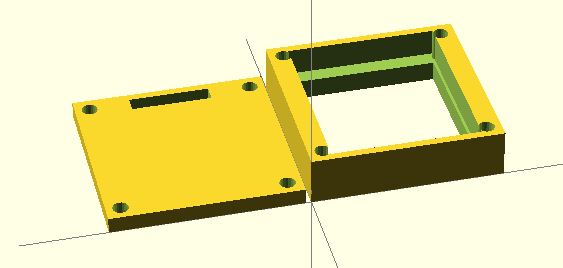

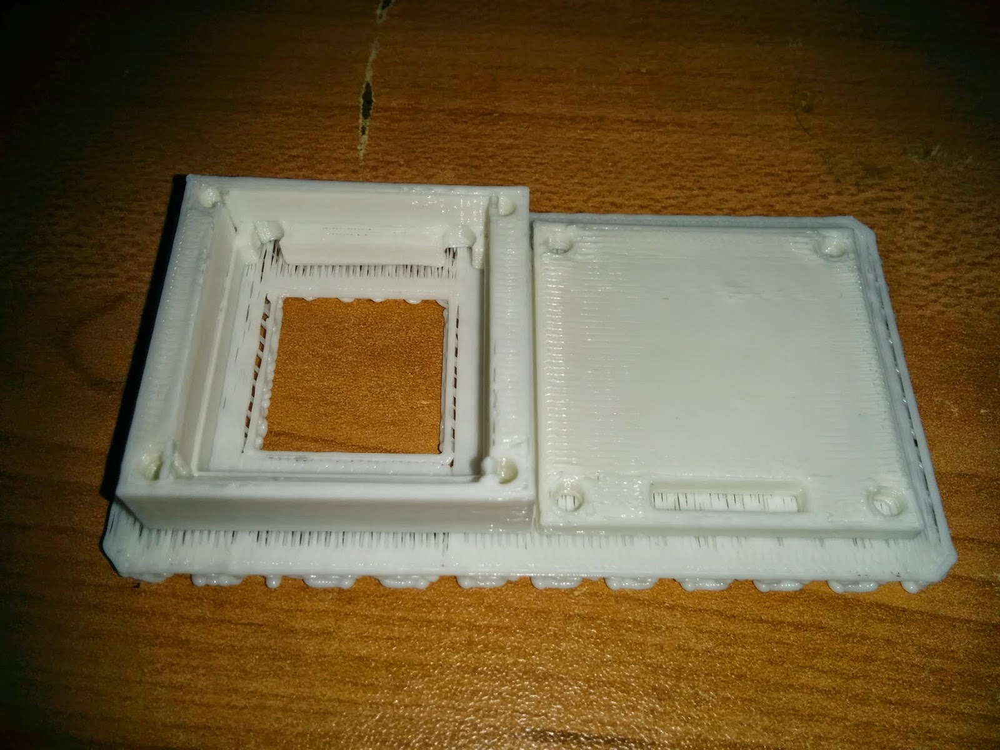

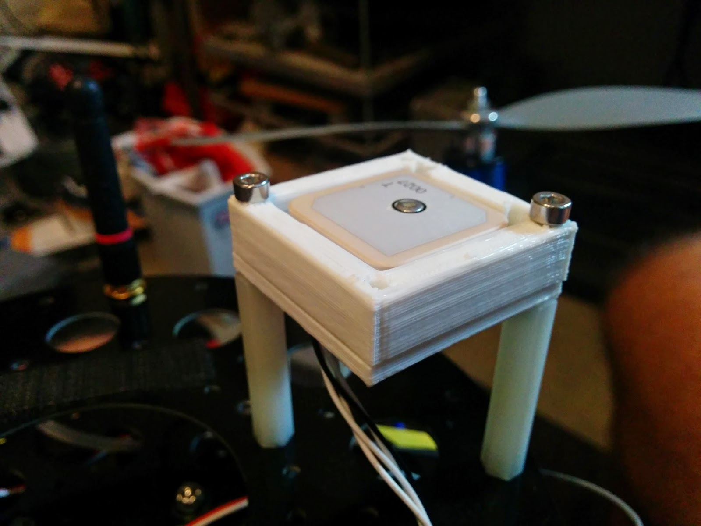

## Flight Testing

First test was to put all these pieces together. I'm using a modified UAP-1 frame for this. No particular care taken for wiring or spacing between cables and FC. Let's just see how it does. 

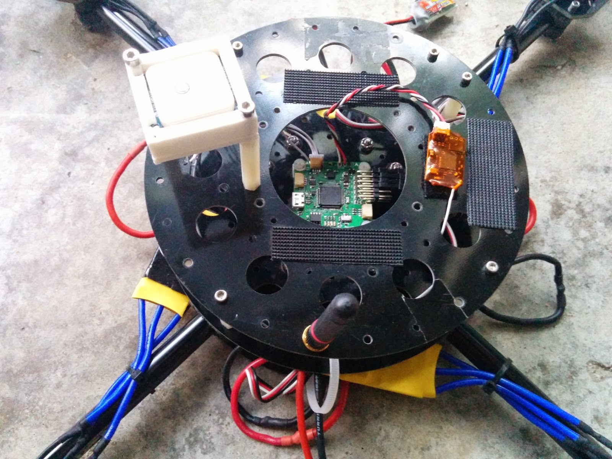

I ran through the standard configuration aspects to make sure position hold would work: performed the six point calibration and leveling, got a rough PID tuning dialed in (haven't merged autotune in this branch yet), enabled the appropriate modules, checked the EKF variances, used complementary/INS mode, set one flight mode position switch to leveling and the other to position hold. Took it outside with my phone connected via the modem.  

::: {.archive-video video-id="104718506" source="vimeo"}
:::

   

This is super convenient and practically necessary for any navigation related things - navigation is too complicated and error prone to risk blind. With this I could verify the GPS lock quality, check on the map that things things look sensible, and get audio alerts of any error conditions (e.g. when the GPS loses a lock, which didn't happen today). 

Position hold mode performed really well for a first try (and pretty much first flight of this board outside). Loiter also worked well, although sometimes it seems like it moves 10-15 degrees different than what I expect. I need to check into this. Still it was comfortably controllable, and in fact at one point someone was walking near me and I shifted it without thinking. 

   

::: {.archive-video video-id="104670658" source="vimeo"}
:::

The graphs showing where the quad is were generated from the android logs and the [python parsing code](../2014-03-15-logging-and-python-parsing/index.qmd).

### Radio Control via RFM22B (TauLink)

   

::: {.archive-video video-id="127703051" source="vimeo"}
:::

  
  

I got out my old transmitter designed to hold a tablet that was made by Kendall and JoeCNC to play with transmitting the PPM stream via the RFM22B module (directly from TauLink to Sparky2 without another transmitter). It worked pretty well and android was connected and giving me updates. 

I also tested altitude hold for Sparky2. Worked well first try. 

Range testing still to do, although of course the first thing I did was verify that turning the transmitter off put the flight controller into failsafe mode. This actually replicates something I did over a year ago with RevoMini and PipXtreme: vimeo.com/51659303 . Of course, it is nice to do it with Open Hardware. 

Thanks to Brian Webb specifically for writing the PPM transmission code with OpenPilot. 

### picoC scripting

A really awesome feature that was implemented for erniefti is the ability to load custom scripts into the flight controller. This makes it possible for people to pass around small pieces of functionality and easily run it without a custom firmware. He also added an awesome UI for loading this code and testing it recently.  

This seemed like a good thing to learn for driving the external LEDs that Sparky2 can run. I decided to write a little code that takes the heading and turns on the LEDs facing northing, giving me an easy external indication of the compass. Here is a video of how easy it is to upload this code and make it run when you start up the flight controller. 

  

::: {.archive-video video-id="105504442" source="vimeo"}
:::

### Future directions

Now the hardware is working, there are a few things to implement: 

1. LED outputs based on flight. This will probably use picoC to make it easy to change on the fly. I'm envisioning something where the color indicates the heading relative to home and brightness the distance.
2. Audio alerts. Again, I envision having some prerecorded sounds stored in flash that it transmits over the VTX audio channel and you can hear on the headphones. Low RSSI, low battery, GPS satellites, distance from home every X m, etc. Also possibly just simple beeps encoding health.

More important is the cool things this will enable. Relaying the accurate GPS position of the pilot via TauLink and then having a chase mode. We already have follow me for the tablet (have for a year or two now), but for higher speed stuff a better control scheme that accounts for the target velocity should help.  

  

::: {.archive-video video-id="63529694" source="vimeo"}
:::

If you are interested in testing this board and previously got a Sparky v1 from me, then send me an email.
