As I was digging through my bins of parts to find an original analog CopterControl, I was struck by how much work and how many things we have designed with both Tau Labs and originally with OpenPilot over the last 5 years. I thought I'd take a wander down memory lane and look at some of the boards (released and unreleased).

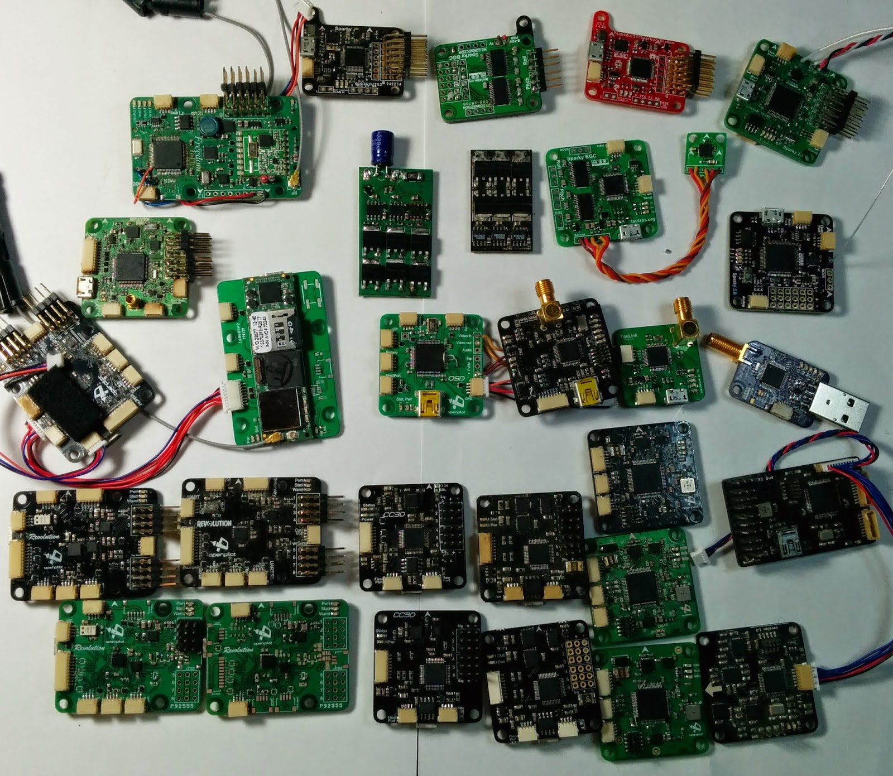
  

### Mainboard and AHRS (2010)

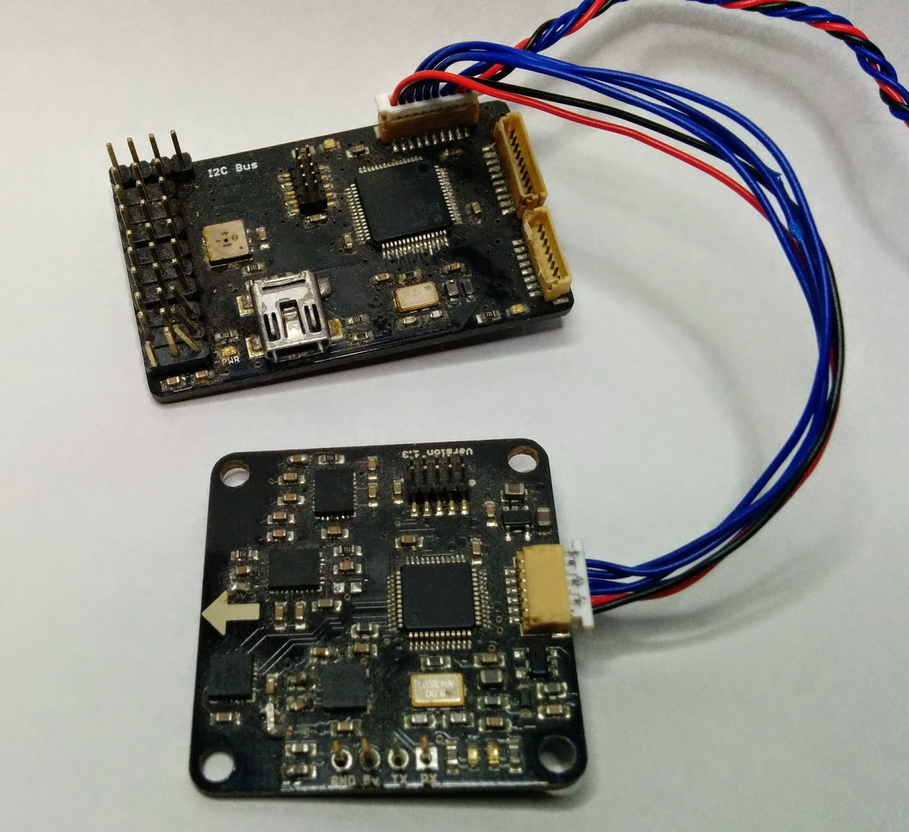

And a closeup of the INS (slightly different revision - BMP085 and ports for GPS moved to AHRS). 

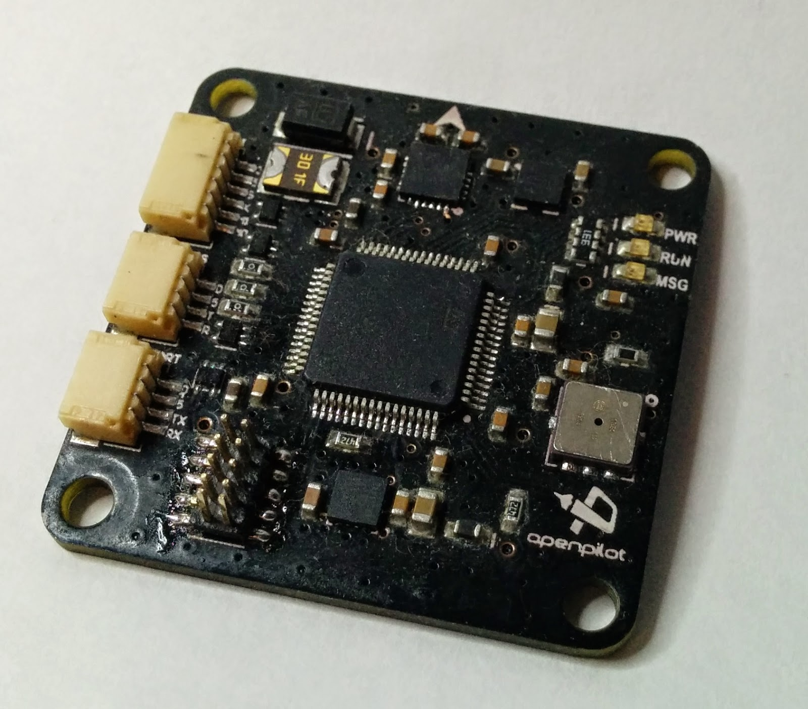

These boards were designed by Angus Peart, one of the co-founders of OpenPilot and also a founder of the Omniloco foundation which is the foundation behind TauLabs.  They were painstakingly hand soldered by David Ankers, the other co-founder of OpenPilot. The F1 processors at the time were not (and still aren't) powerful enough to run a full suite of algorithms for navigation, so the decision was made to have one board (AHRS) acquire all the sensor data and fuse it (run the INS) and another (Mainboard) to handle all the control code and input/output. The sensors were analog  

The fusion algorithm is one we still use, an INSGPS algorithm written by Dale Schinstock. A lot of my original work on the OpenPilot project was originally getting this fusion algorithm working with our sensors and behaving well, as well as the original control code to stay in the air.
Here is the very first stabilized flight using the OpenPilot software.

     

::: {.archive-video video-id="14679877" source="vimeo" title="OpenPilot: First stable flight"}
:::

And the first flight of a quadcopter with our hardware. Unfortunately, I had no idea how to fly one so it simply floated into a tree...

  

::: {.archive-video video-id="15057610" source="vimeo" title="OpenPilot Stabilized Quad Flight"}
:::

  

Then there was the aborted attempt to get more power from the INS. This used the F2 series of CPUs which had a bit more power than the F1. You can see little bridges of wire where we didn't quite account for the CPU differences and I had to hack it up to get it running. Where there is a will, there is a way. Ultimately this was one of many boards that were made but didn't become a viable product. I think we also did a number of sensor trials on these boards because I have some lying around with various sensors like BMA180. Lots of work writing and testing those drivers and getting the data to ultimately not use them. Still, gotta try it to know which is best. 

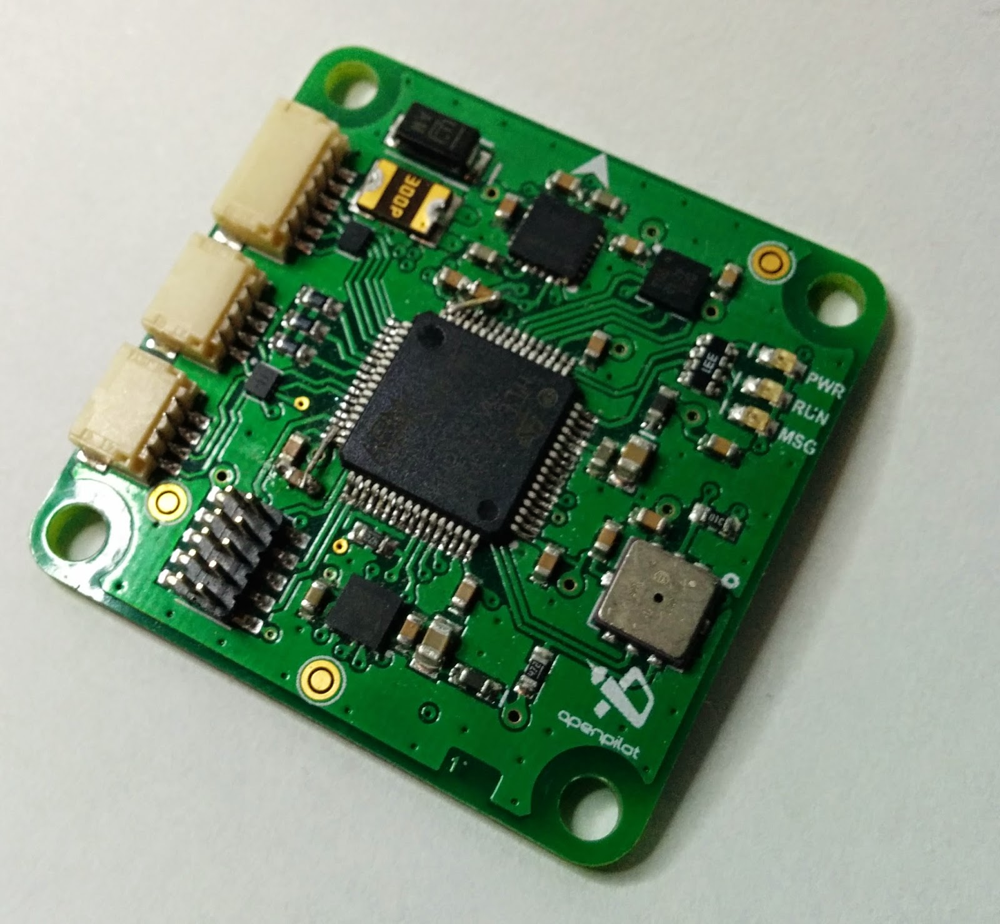

The AHRS+Mainboard was ultimately a pretty powerful setup, although programming and syncing data between the two boards was a real PITA. PT_Dreamer did an impressive job of writing the bootloader so it would upgrade both boards at the same time. We even managed to get some demonstrations of position hold working on this hardware, around three years ago now at our developer retreat in Portugal (oh fun times: https://vimeo.com/23865574. 

### CopterControl (early 2011)

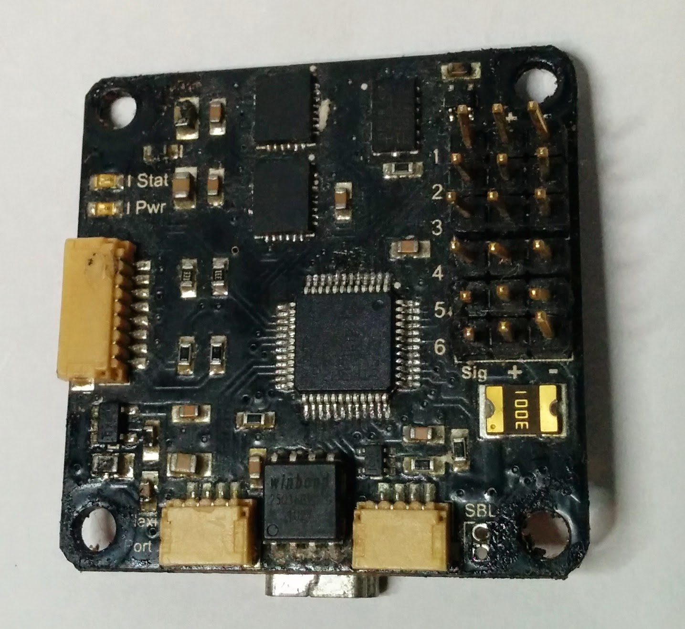

This board was designed by David with help from Pip (I think) and took the AHRS designed by Angus and added the input output ports to it. The processing / memory limitations of the F1 were still there, but this board was meant to be a stripped down user-oriented version of the original hardware capable of stabilizing a quad or plane. It used the same analog invensense sensors as the AHRS. These were fairly good sensors in terms of noise performance, but their drift (and especially zero bias at powerup) were quite problematic. It had a 3-axis gyro and 3-axis accelerometer.

Of course, here is the mandatory first flight video:

::: {.archive-video video-id="19612039" source="vimeo" title="CopterControl Initial Testing"}
:::

  
Because of the limited processing power of CC3D, the INS algorithm could not run without negatively affecting the flight performance. I designed a complementary filter implementation (based on Mahoney's papers) that was quite efficient and allowed us to process data at several hundred Hz. This really improved the flight performance, and having everything on one controller really improved the latency.

In retrospect, I can't decide if this was a good or bad direction for the project. In a lot of ways, it created a several year distraction from a lot of autonomous functionality. At the time we were probably comparable with Arducopter in terms of PH and navigation, but ended up quite a distance behind.

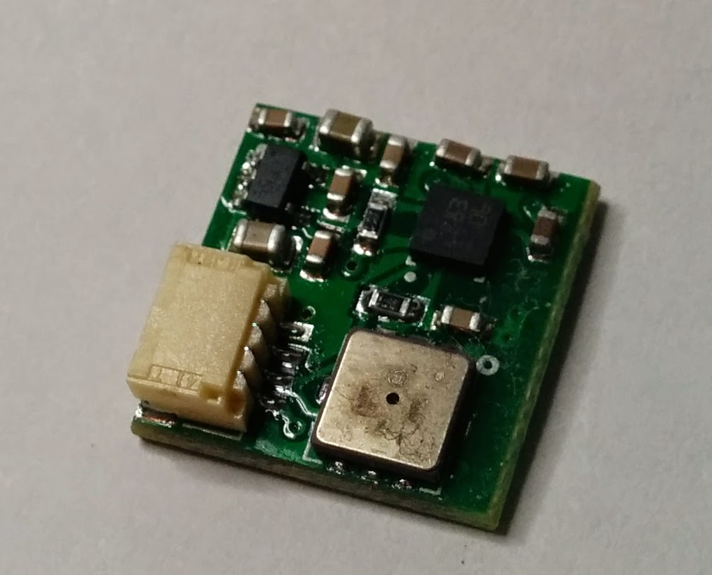

This little mag/pressure sensor was an attempt to bring more functionality to CopterControl (and CC3D) but ultimately there just wasn't enough processing power or memory to do it.

On the flip side, the focus on usability led to very nice improvements in the ground side of things. It (and CC3D) also created a lot of positive publicity as well as a revenue stream for the project. 

The first several hundred of these were manufactured by CheBuzz, elafargue and Dankers - so a big thanks to them for taking that risk and getting OP on the map. 

### PipXtreme modems (2011)

  

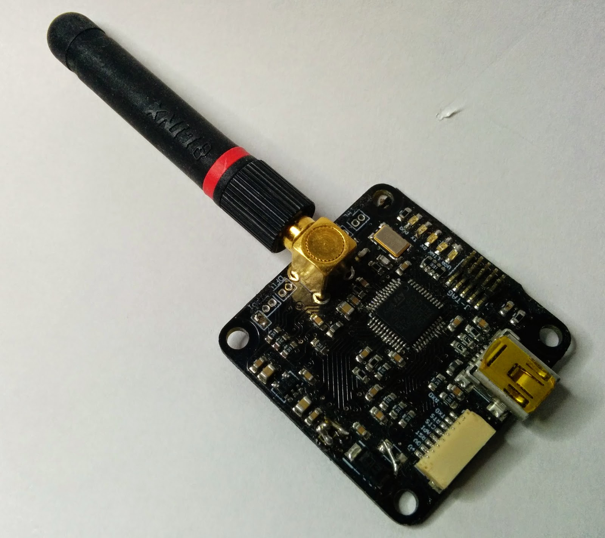

These modems were designed by Pip, a really talented electrical engineer who was in the project and helped out a ton with lots of designs. They were much more convenient to bind and configure than my experience with other modems and were quite useful for debugging and testing. They also allowed us to build in awareness of UAVTalk into the modem. 

Here is Edouard Lafargue testing his out (he also made a nice case for the modem): https://vimeo.com/17200010 

### CC3D

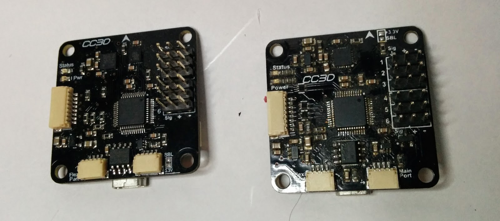

This was an update to the sensors for CopterControl. Above you can see two versions - one using L3GD20 gyros and BMA180 and the other using the MPU6000. That was interesting because I got to learn about Allan variance testing to compare the sensor drifts. Ultimately we went with the MPU6000. 

One thing that really helped jump start this board was sending out samples to some pretty good pilots in the community, as well as a few developers. Here are 15 boards I soldered by hand: 

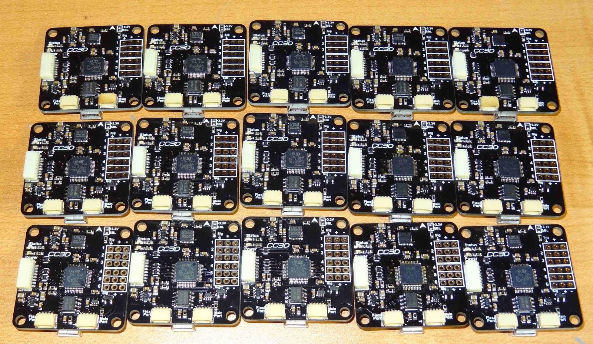

Not a lot of fun to make, but everyone was really happy with how it flew. I believe one of these went to juz, and we all know how worthwhile those videos ended up being.

This board really sold well and it was hard to keep up with demand. In fact the first few batches were quite terrifying. The yields were extremely low, with sensors frequently failing. Over the batches of the CopterControl the yield had been steadily decreasing but never quite so bad (which also confused us since the first batch from CheBuzz was >95%). It turned out that the assembly house was using ultrasonic cleaning which the MEMS sensors **do not** like. David had to heroically replace **hundreds** of MPU6000 by hand, which was weeks of work and cost quite a bit as Invensense would not replace them all.

Again, in retrospect some decisions could have been done differently. One of the biggest criticisms of CC3D was that it was always unavailable. Once the design was released CC-BY-SA (due to pressure from the developers that things were meant to be open source and the design was years old), tons of manufacturers started making it. Lots of them contributed back to OP and thus provided a risk-free and stress-free revenue stream instead. Trying to corner all the profit ultimately created a lot of stress (and thus pressure on the developers and a lot of tension in the project).

### [ESCs (end of 2011)](../2011-11-21-esc-development/index.qmd)

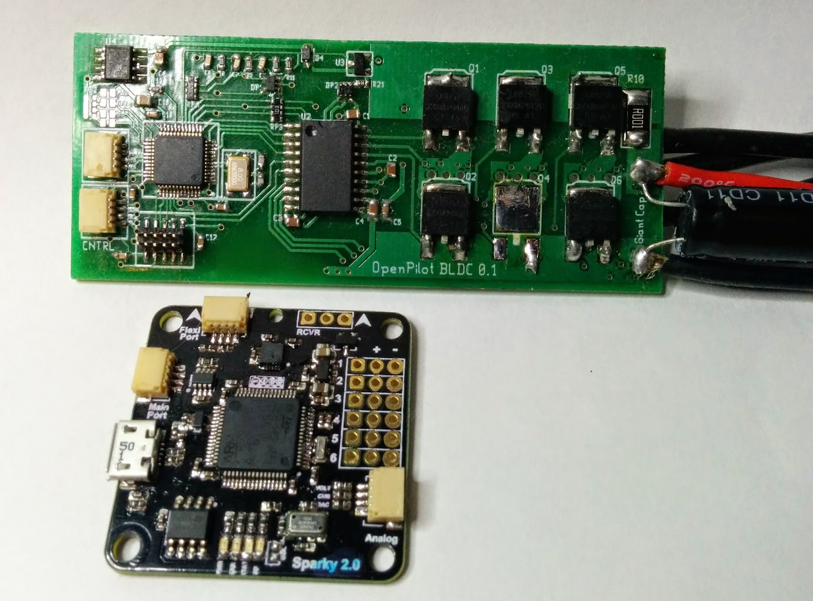

Who doesn't want an ESC as big as their flight controller? Believe it or not, I actually flew with those. Back then, there was no simonK firmware and the speed of ESCs was the biggest limitation in flight performance. This was confirmed when I saw our software flying on a mikrokopter with their ESCs and it was just totally locked in. Unfortunately, my experience with those I2C ESCs was a lot of bus lockups and crashes (I would not recommend I2C as a protocol for an ESC to my worst enemy). 

Anyway, I wanted to play with ESCs so whipped up that huge board you see above. That was a lot of fun. After some shrinking: 

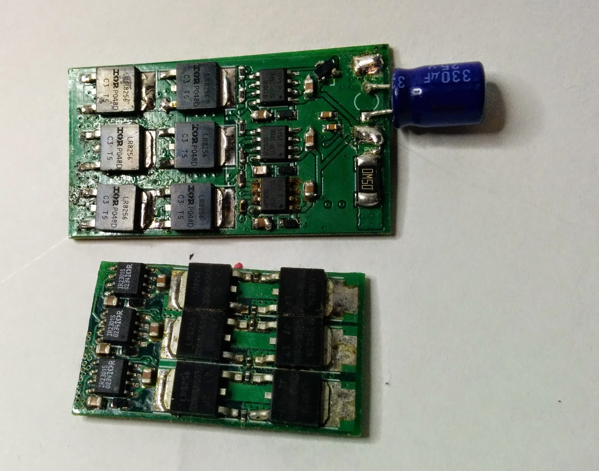

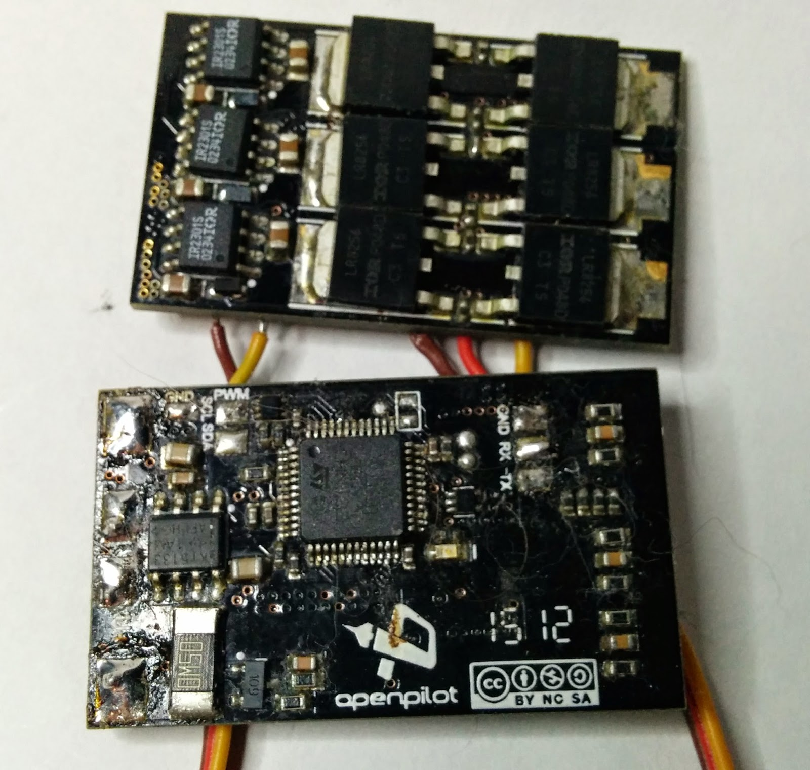

I had a board that worked pretty decently. However at the same time dirty cheap flashed ESCs became  available so these stopped being useful. I still fly them on a number of my boards though. Another pile of work that was wasted. I wrote a really nice system for switching the PWM lines into an emulated bidirectional USART and digitally configuring them via the GCS and the FC. You could even update the code via the PWM line. *sigh*.

::: {.archive-video video-id="32459975" source="vimeo"}
:::

  
Thanks to MattL for helping with the final shrinking of the design!

See more here: ../2011-11-21-esc-development/index.qmd 

### Revolution (end of 2011)

  

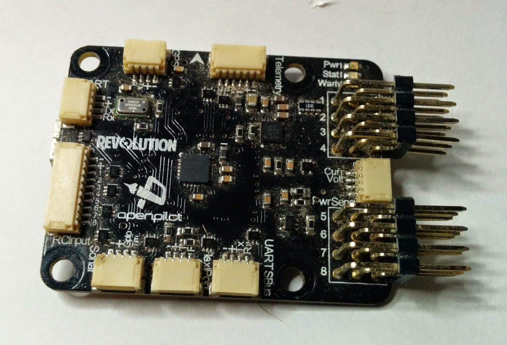

This board was designed by David to get development back on track for more advanced functionality. It had gyros, accels, mag, and baro so was capable of full navigation. It also upgraded to an F4 processor which had more than enough power to handle all these tasks. It was also nice for having tons of connectivity. Unfortunately I don't have any first flight videos, because for some reason we were trying to keep things quiet. Here is a video of the first altitude hold, though.

::: {.archive-video video-id="36433767" source="vimeo"}
:::

  
Of course, this board also had a number of revisions to try out various sensor combinations. Lots of hand soldering for me *sigh*. If you look closely below you can even see some nice blue wires and bent pins to work around various bugs in the early versions.

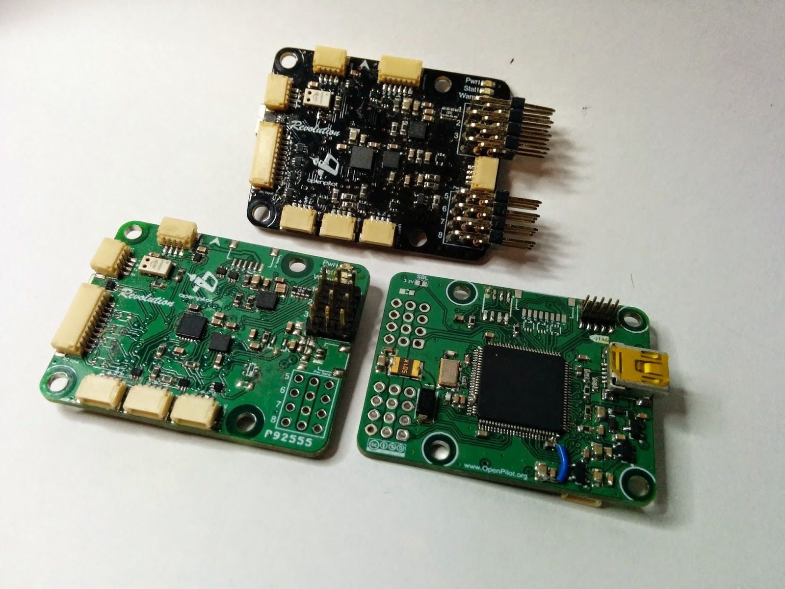

I'm calling this version the "nope". I got this board in the mail, took one look, and said no way am I populating that, because no one will ever want to fly it. Very big. 

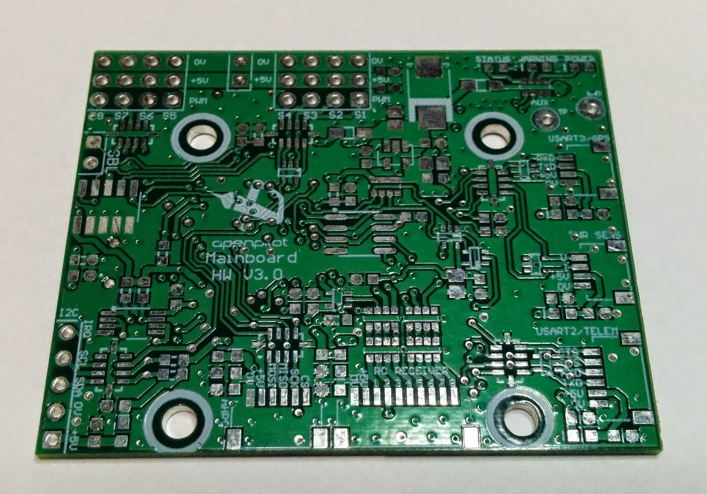

One thing that was super useful was designing a board that could carry an Overo gumstix connected to Revolution via SPI. I'm pretty sure I used this board to capture the data in this video (https://vimeo.com/42015859). 

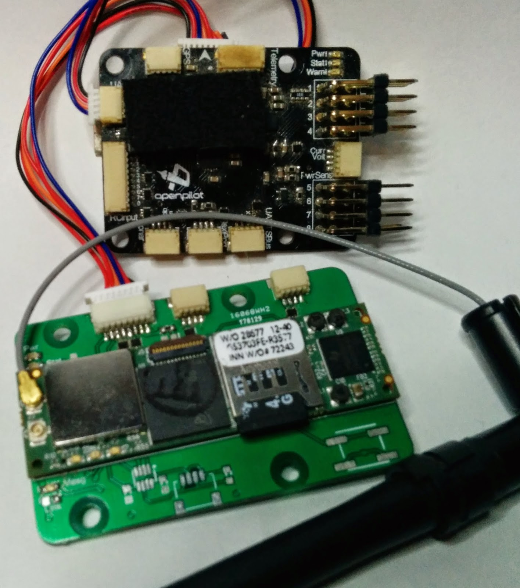

### OSD

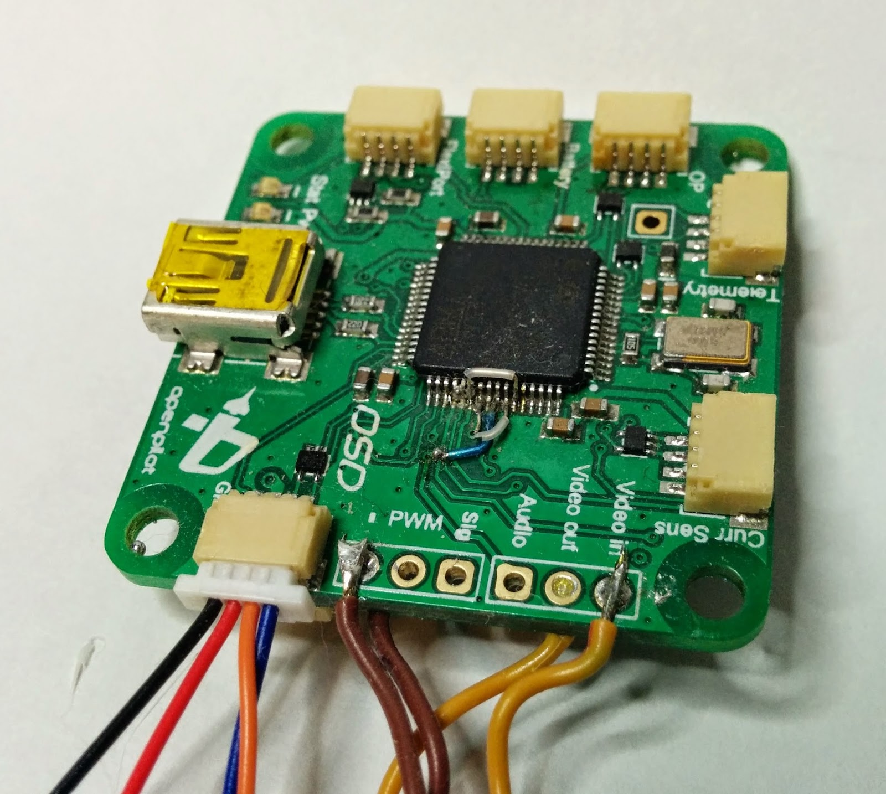

This board was motivated by Sambas who initially breadboarded some driver circuitry. I feel badly that I cannot remember the name of the guy that did the design and layout. The original design didn't work great for black and white so you can see the work I did jury-rigging up a different driving circuit. This worked reasonably (although still had issues drawing to the edges of the screen). Ultimately, this stalled due to lack of time. 

This is where the strength of open source is great, though. Two people with Tau Labs have designed new flight controllers that have integrated OSD using this code.  

[Draco](http://forum.taulabs.org/viewtopic.php?t=154&p=1445)

::: {.archive-media-placeholder}
**YouTube Video** — Embedding unavailable; [try watching on YouTube](https://www.youtube.com/watch?v=KBf34QRr3P8).
:::

   

### and [Brain](http://forum.taulabs.org/viewtopic.php?f=21&t=150)



   

### RevoMini (2012)

  

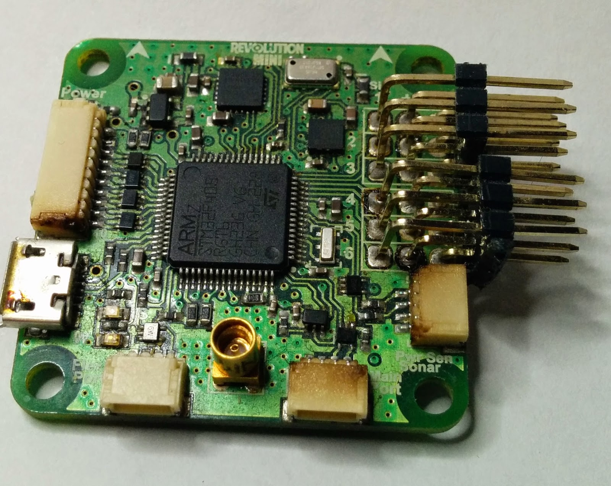
RevoMini (which became known as Revo) was a stripped down (in terms of connectivity) version of Revolution with an integrated modem designed by David. It was good and bad, too. After spending almost a year working on Revolution it created another serious delay in progress on the flight front to focus on basic hardware bringup. In addition it went a bit too far (IMO) dropping connectivity since I use a digital receiver that left one port which isn't enough for GPS and an auxillary mag, or an OSD, etc. Another one that wasn't fun to solder, especially with all the EMI filters on every port.

Of course, the obligatory first flight video:

  

::: {.archive-video video-id="48211124" source="vimeo"}
:::

  
I ended up being quite unhappy with the flight performance of Revo (I could never get it tuned as nicely as CC3D). There was ultimately a question of whether the problem was hardware or software (although the same software was used on full Revolution, so that wasn't really a question in my opinion). There was also an issue that Revo wasn't looking like open source hardware and there were a lot of political problems within OP (such as doing a preorder for a board that didn't fly well).

Ultimately this and a number of other issues led to the majority of the developers being told their opinions don't matter and leaving OpenPilot to create [Tau Labs](http://taulabs.org/).

It also led to me designing...

### [Freedom](../2012-11-19-freedom-assembly-and-first-flight/index.qmd) (end of 2012)

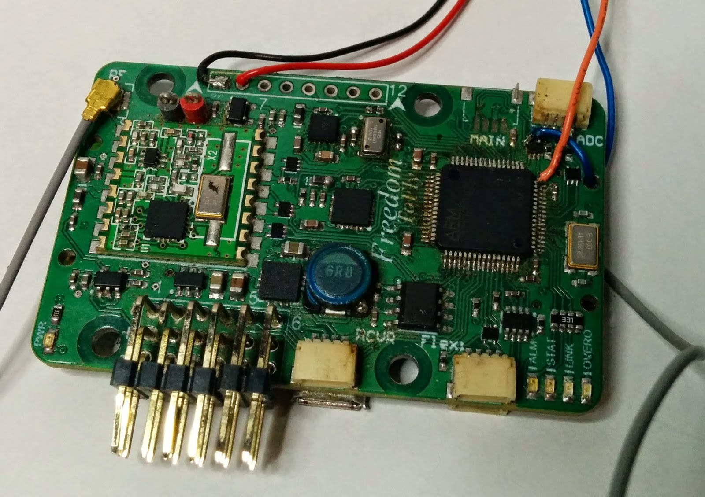

This board has an MPU6000, HMC5883, RFM22B radio, nice switching regulator, and F4 processor, not to mention a Gumstix Overo computer running linux on the back. The computer and FC stay in sync with a high speed serial bus. I have mostly used it for collecting high resolution sensor logs from flight for offline analysis and algorithm development. This is extremely useful, because you can replay the sensor data from the same flight through numerous algorithms or the same algorithm with different parameters and compare the performance. 

It also resolved the question of tuning since it tunes up and flies very well and didn't have the same sensor noise as RevoMini. 

Ultimately most end users don't want a linux computer on their flight controller so it didn't make much sense to make lots of these. There are still some issues with not using the ports optimally, and I'm always meaning to clean it up, update the sensors to more modern ones, and make a new revision. There is also something called Aerocore from Gumstix that is similar and I'd like to port the linux code to.It's always a matter of not enough time! I love it though and it is great for development, still.  

### [Sparky](../2013-05-19-sparky-testing-and-building-no-crashing/index.qmd) (2013)

At this point, I knew what I wanted in a flight controller. Reasonable expandability and IO, capable of altitude hold, position hold and return to home, cheap and easy to assemble, and open source. Since there wasn't something like that, I designed one. 

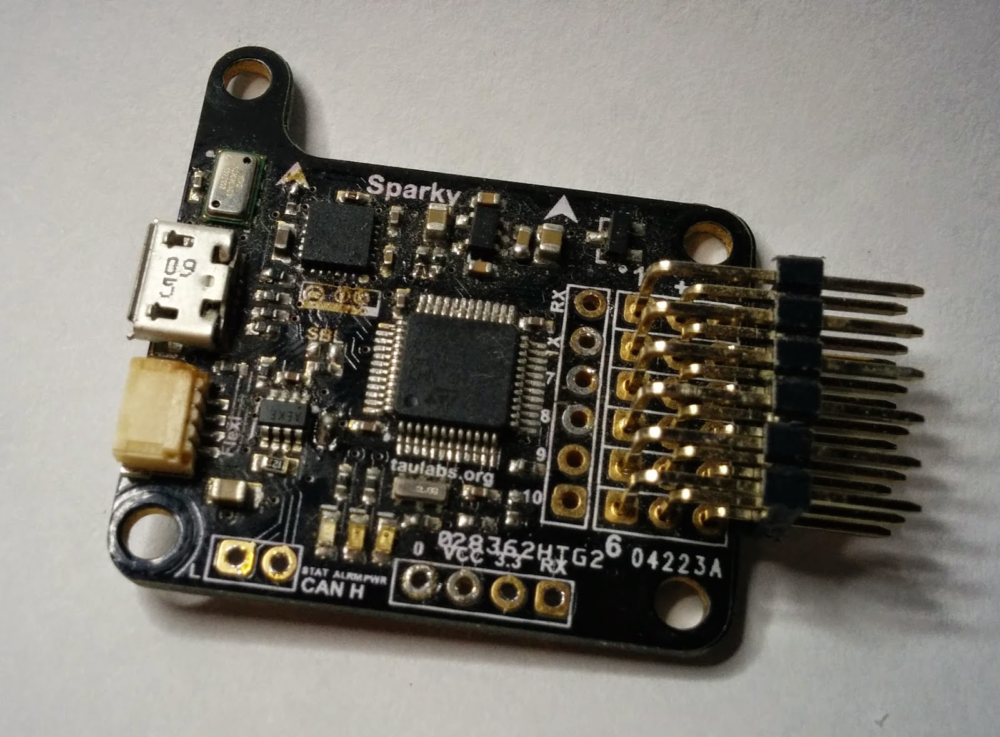

I'm quite proud of Sparky. It flies *extremely* well. It switched to the MPU9150 which integrates the mag into the accels and gyros and keeps the sensors all together. It uses an MS5611 pressure sensor, which is quite nice. It has enough resources to be quite capable while keeping it fairly affordable (the Chinese make it for < 40$), all the components are on the top so it is not too bad for assembling yourself (the MPU9150 is a bit nasty). I find the receiver port extremely useful compared to tying up one of the serial ports for my Spektrum receivers.

::: {.archive-video video-id="63619336" source="vimeo"}
:::

  

I get some grief about the shape ;-). It was designed for my tastes, so that is fine. Typically I use a three point mounting and have never had an issue. I figured if I don't need to use board space, why keep it?  I did make an earlier version that kept the thing as small as I could get it (without using the back). This **was** a pain to mount since none of my frames had that spacing. Ultimately adding the tab made it compatible with other frames while able to have the tab cut off and fit in smaller spaces (since the back is flat you can mount it by taping). 

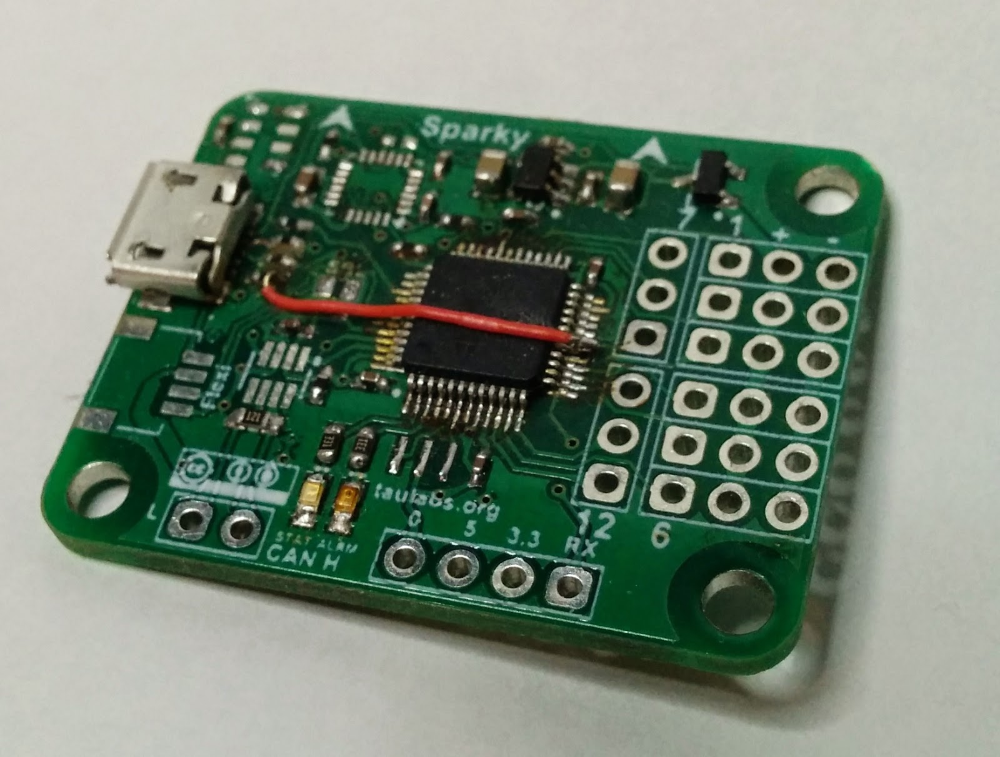

Here is version 1.1 which updated a few of the passive on the sensors to be better in spec and also switched to a three pin header for the receiver so standard cables can be used. I still flip-flop on the 3 versus 4 pin distinction. 

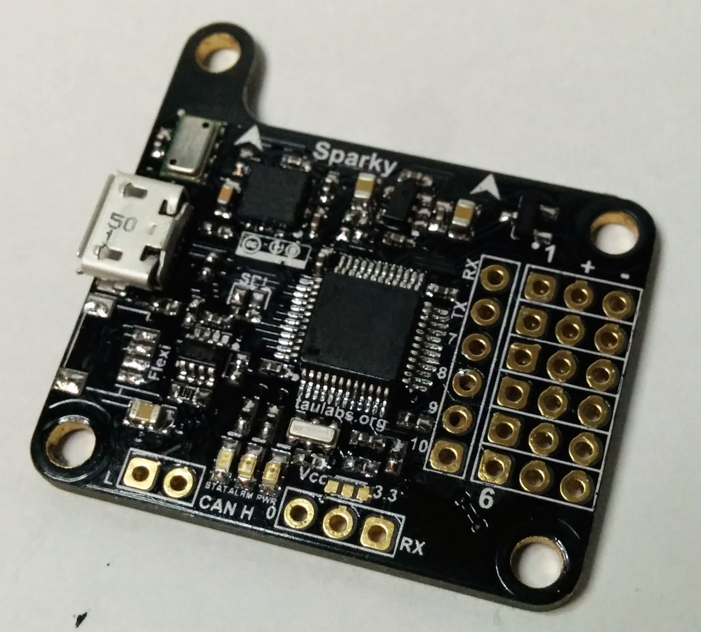

And they same imitation is the best form of flattery, so here are some boards made by Dragon Circuits. The design is CC-BY-SA so that is totally legal and ethical. I do not receive anything from them for the boards, but that is fine. They make it available more cheaply to more people and that is good. 

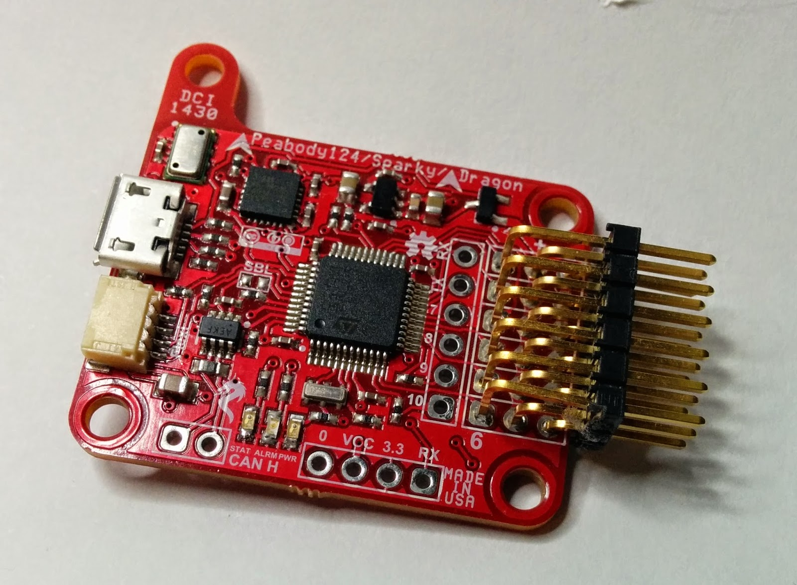

### [Sparky Brushless Gimbal Controller](../2013-05-06-brushless-gimbal-driver-add-on-for-sparky/index.qmd)

  

At the same time as Sparky, I also designed a "shield" that could be soldered to the back and converted the 6 PWM outputs to 2 brushless gimbal outputs. 

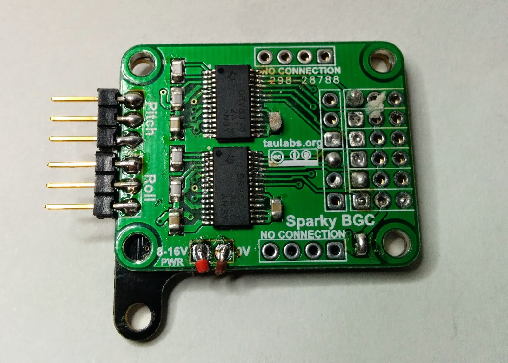

This was a pretty different project and I won't write it up too much here.  I was happy with the performance.

::: {.archive-video video-id="66987484" source="vimeo"}
:::

  
Having the ability to talk (via CAN) between the BGC and FC is quite useful and can allow things like point of interest tracking:

::: {.archive-video video-id="91046135" source="vimeo"}
:::

  

The shield made it easy for me to test this out without designing a new board. However, ultimately having the whole FC+driver on the gimbal isn't the optimal configuration so I redesigned it with a more 'traditional' configuration.

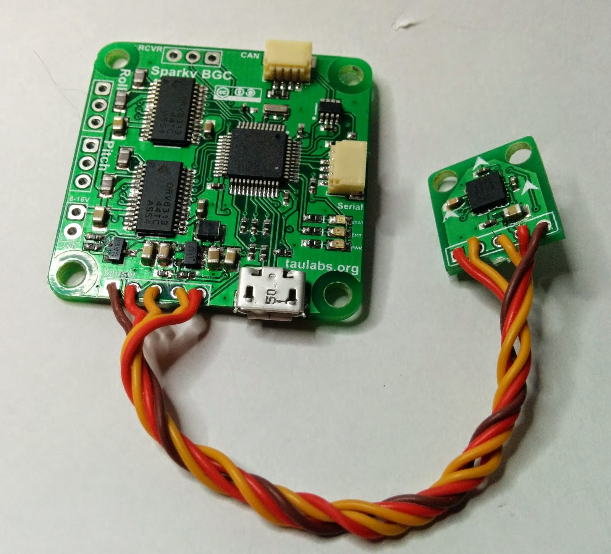

### [TauLink](../2014-08-29-sparky-20-and-taulink/index.qmd) (2014)

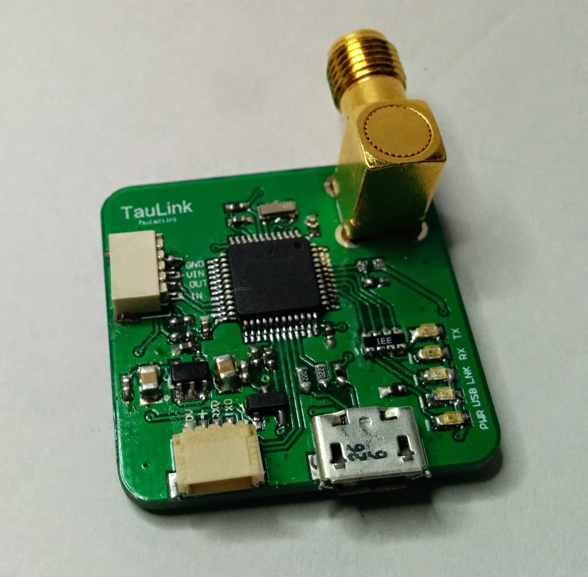

I wanted an radio link I could use to talk to Freedom and Sparky2 that stayed code compatible with the original PipX. This is the result, it's fairly straightforward - just a few serial ports and the RFM22b modem on the bottom. 

Since I mostly use this on the ground side plugged into either my laptop or an OTG adapter for my phone, I realized the form of a thumb drive is actually a bit more effective for my purposes. 

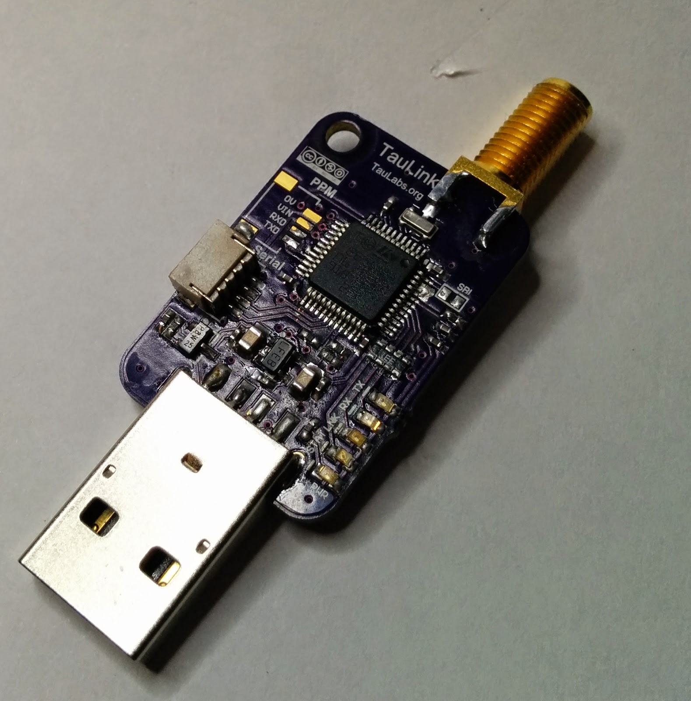

f It can also be used on the flight side with Sparky, in which case I'd probably leave the USB connector off ;-).

### [Sparky 2](../2014-08-29-sparky-20-and-taulink/index.qmd) (2014)

  

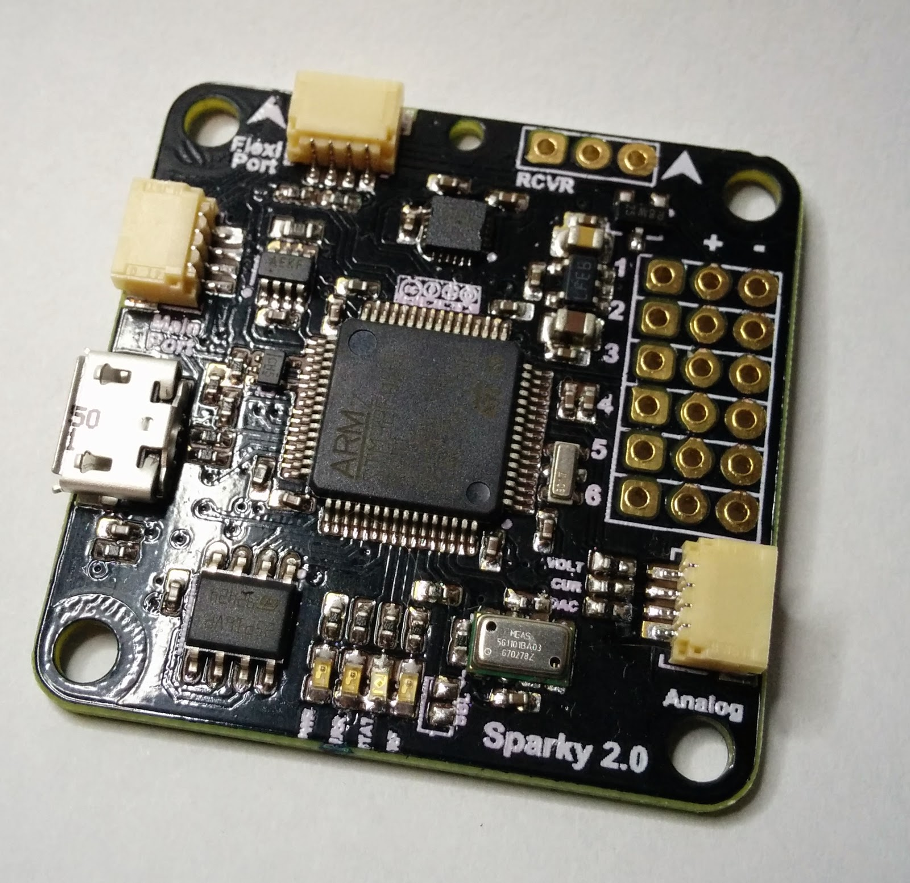

Finally Sparky2. This is designed more with navigation and advanced features compared to Sparky1. It switches to an MPU9250 which has a tiny bit worse noise performance (although so far below the motor noise it is irrelevant) but has the benefit of being an SPI sensor and not taking up as much CPU usage. It adds an RFM22b module for telemetry which is key for serious navigation (and honestly advised for even PH). It also adds an additional auxillary I2C port for communicating with a mag, which is useful for having more accurate reading. It adds flash for storing short logs or storing waypoints and picoC code. There is a DAC outputs for an audio downlink with FPV, although I haven't had the chance to play with that yet. 

::: {.archive-video video-id="104670658" source="vimeo"}
:::

  

## Summary

That is a lot of hardware. Tons of people were involved in all aspects - hardware design, soldering prototypes, writing code and testing. Thanks to everyone that has been involved and made it a very fun and interesting four years. I won't even pretend this is a complete list but special thanks to PT Dreamer, Edouard Lafargue, stac, pip, kubrak, CheBuzz, Vasillis, Corvus, Bwebbn, Angus, and David for their tireless work and contributes to keep this going in various forms. 

This post also focused heavily on hardware that I had a hand in designing or getting flying. In fact I think all the flight controllers listed above were first flown by me ;-). Open Source is very powerful in the fact the Tau Labs system keeps growing and supporting tons of other targets not mentioned here. This includes: 

  

- Quanton
- FlyingF3
- FlyingF4
- Gemini (Colibri flight controller)
- Brain
- Draco

and probably others I don't even know about yet!
