One of the more exciting added in the [latest Tau Labs release](https://github.com/TauLabs/TauLabs/releases/tag/20141026) is support for the Colibri flight controller. This is the flight controller that is used in the [Gemini](http://www.team-blacksheep.com/products/prod:gemini) hexcopter (designed in collaboration with an awesome designer William Thielicke of [shrediquette fame](http://shrediquette.blogspot.com/p/shrediquette-gemini.html)). I've been lucky enough to have access to a Gemini for several weeks now for development and wanted to write up my thoughts.

Here is a video of me flying which also shows you the ground station and some chase shots. It uses some early PID settings and is a bit wobbly.

::: {.archive-video video-id="110564442" source="vimeo"}
:::

  

And here is a video from TBS that is better tuned and flies more smoothly: 

::: {.archive-video video-id="110831709" source="vimeo"}
:::

The short version is **impressive.** What impresses me most is the level of *system integration* involved. This is what you get when you design the whole system for a purpose, rather than taking parts and figuring out how to put them together. In a way, this is the type of achievement we had hoped people would do from day one with CopterControl - creating something that is elegant and easy to fly.

### Unboxing

Ok, this is the first time I have had a real "unboxing" experience with a multirotor. Probably because I never get prebuilt systems, but this was great. It comes in a slick traveling case, nicely embossed with a TBS logo and a hexcopter symbol. 

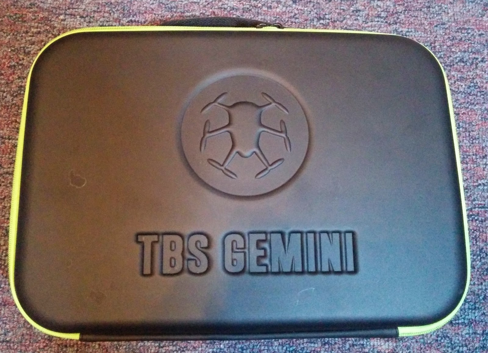
Inside I found Gemini, spare props and the FPV antenna. The whole system was already wired up and ready to go (except for the receiver). I'm assuming the production versions will come enclosed in the canopy, but mine did not have one.

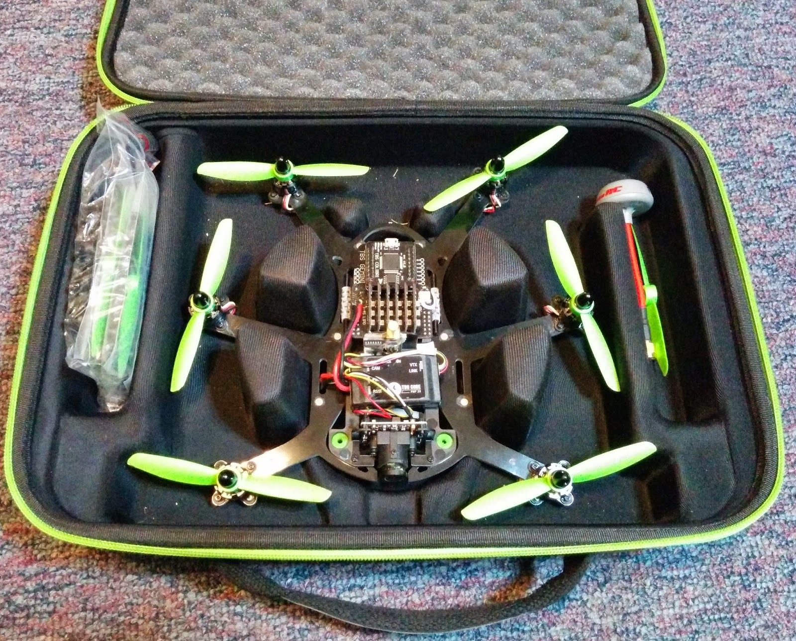

### Frame

So here you see it! A very compact elegant setup. 

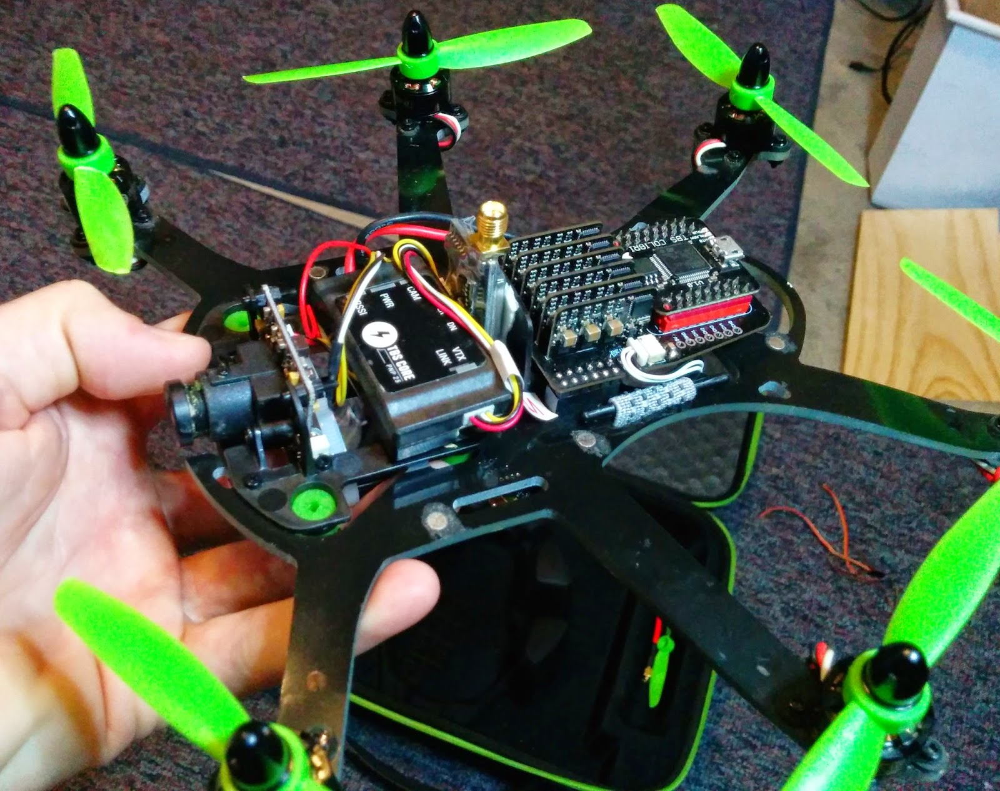

And a side view shows the tilted motors. This is really well done with the frame material actually conformed to hold the motors at the right angle. I dread to think the cost of setting up prototypes of this. Despite the shaping, the frame feels *incredibly* strong. 

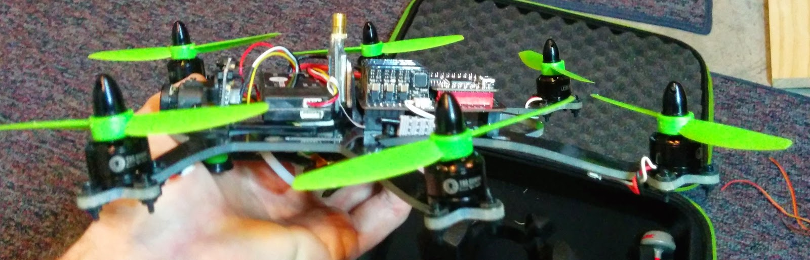

The motors are tiny little T-Motors. Basically the size of my thumb. What is really nice is that the ESC wiring is integrated into the frame. This means no confusing which lead is which and no ugly wires to try and hide. You can also see the little OrangeRX satellite receiver I'm using in this shot. Also, the mount for the mobius camera is evident and hanging from the frame by four vibration damping mounts (with the tie wrap I use to secure it). 

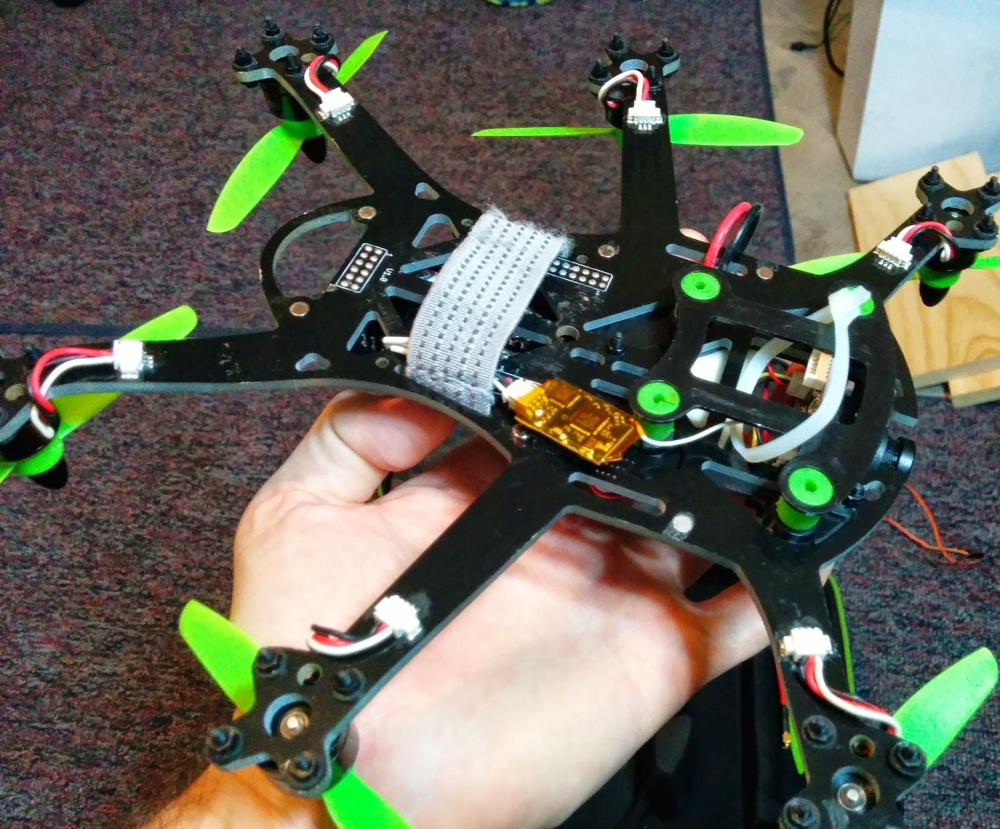

I also really like the elastic strap for mounting the battery. In the early photo you can see there is a little plastic stick through the ends of it on the top to secure it, rather than wrapping it around everything. Attention to detail is obvious in this design. 

The arms also come with vibration dampeners between the frame and the motor mount. This two stage vibration isolation (arm and then at camera) works really well for larger frames and I think contributes to the video quality I'm getting. Plus higher RPM motors just produce much less jello.

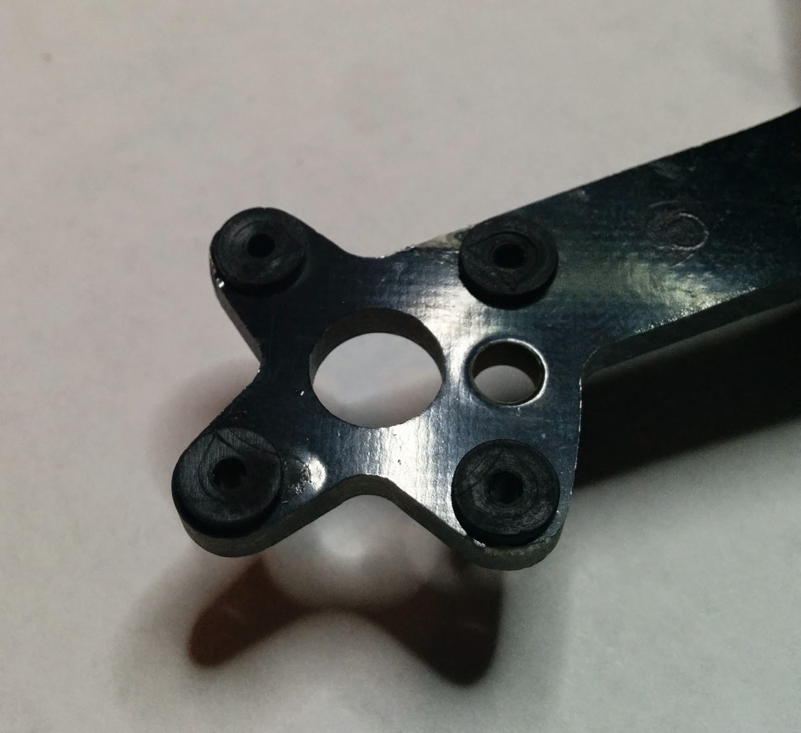

You can also see that the motors attach to the frame wiring via JST connectors. Again, a nice detail focus was keeping the pinout the same for each motor and handling the lead swapping in the PCB layout. This makes sure no one can get confused. I will comment that the final version uses the **opposite** motor direction as our default orientation, so if you are configuring from scratch one must remember to reverse the motor directions in software. However, most people will use the configuration file provided by TBS and not need to deal with this.

### Flight Controller and electronics

Colibri is a really small flight controller designed by Team Black Sheet that takes the [Quanton](http://www.quantec-networks.de/shop/en/quanton/1/quanton-flight-control-rev.-1) design (by lilvinz of Quantec) and shrinks it down. TBS did the right thing from day 1 here - they approached Lilvinz and asked to make a derivative of his CC-BY-SA-NC design and he acquiesced. This is open source working the right way!

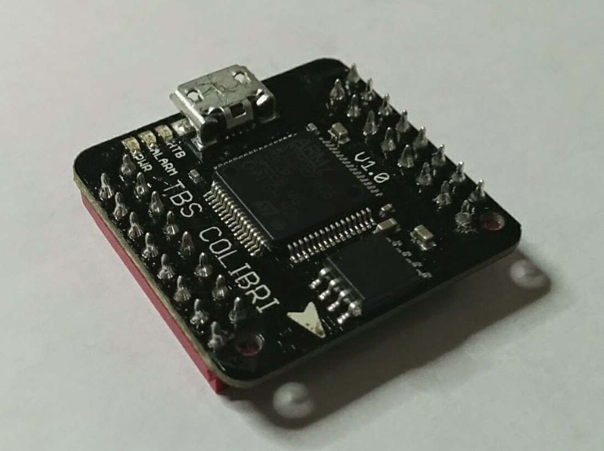

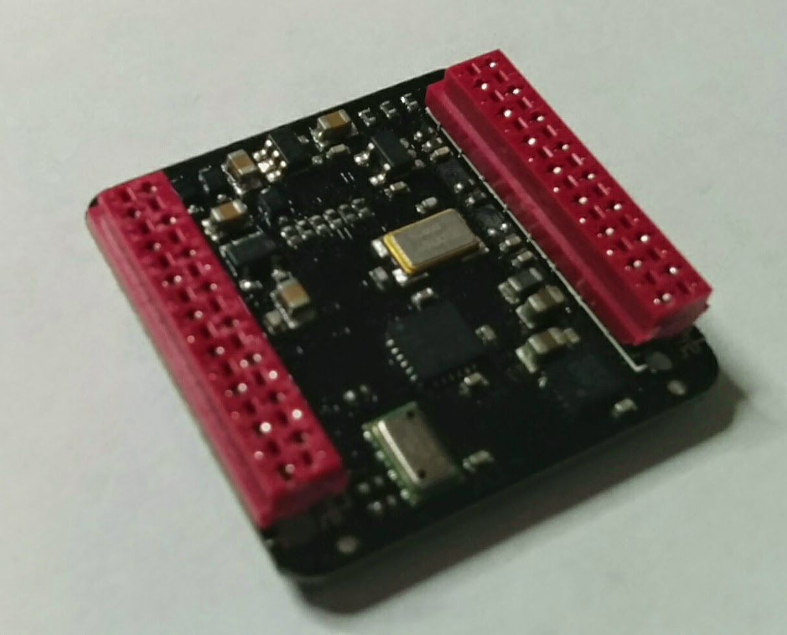
As you can see the board uses microtouch connectors. It is a really small design, but still packs in the full suite of barometer, magnetometer, 3-axis accel and 3-axis gyro and flash. The breakout headers give access to all the Quanton IO so in principle it supports 8 channels in and out, as well as a number of serial and I2C ports. Here it is compared to a quarter. Sorry non-Americans, this might not mean much to you.

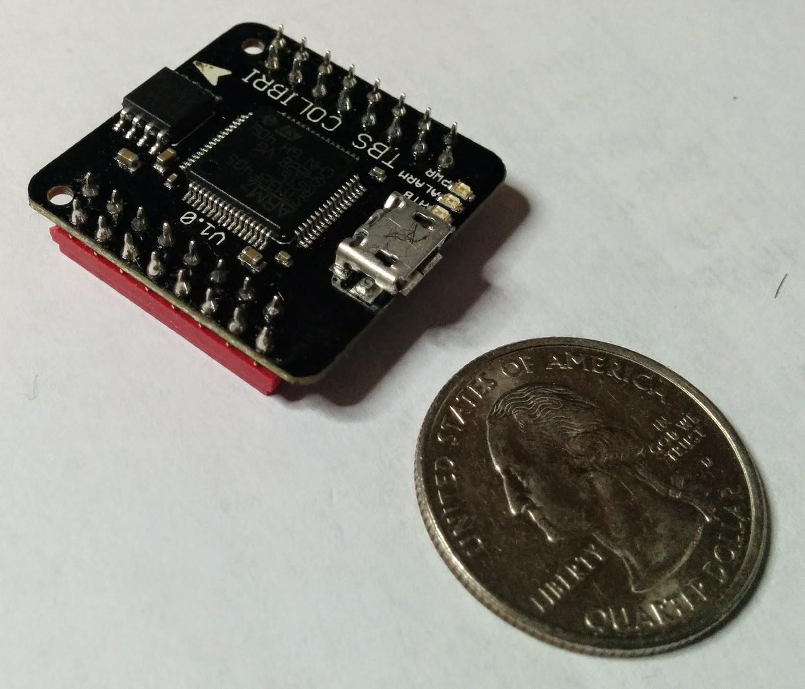
The approach of a high-density powerful flight controller is not ideal for end users making their own frames, but is absolutely perfect for this custom, focused, miniatured design that doesn't want to sacrifice features. Kudos to TBS for the work required to miniature this design so much.

This board then sits on an IO board that breaks out the wire from Colibri for use on Gemini. This IO board has the 6 bulletproof ESCs, an receiver port breakout (supports PWM, PPM, DSM2/X, SBus) and a second serial port which can be used for telemetry or GPS. You can see the wire going to my OrangeRX satellite in the lower right.

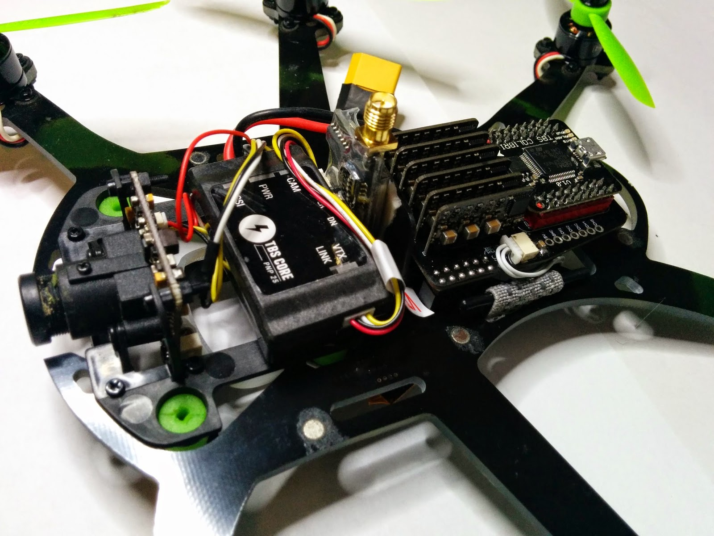

Here is a closer front view of the electronics. You can see the TBS UNIFY 5.8 GHz 200mW transmitter connected to the TBS Core and the camera. It is hard to appreciate in this photo, but all of this is mounted as a plastic sub assembly to hold and mount the camera, support the vibration damping to the mobius, and provide the vertical support for the VTX. Again, a nice custom solution that got everything needed into a compact space. 

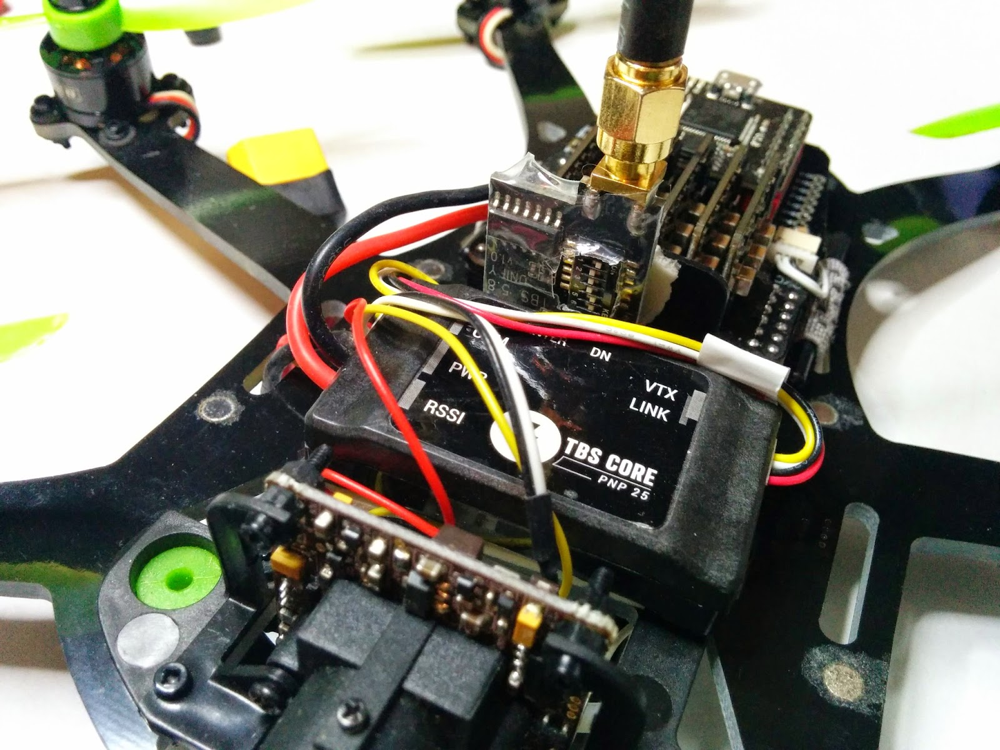

And here are the electronics viewed from the back. This gives you another nice view of the 6 ESCs in parallel. The board mount approach is really space efficient and again contributes nicely to the compactness of the design.  

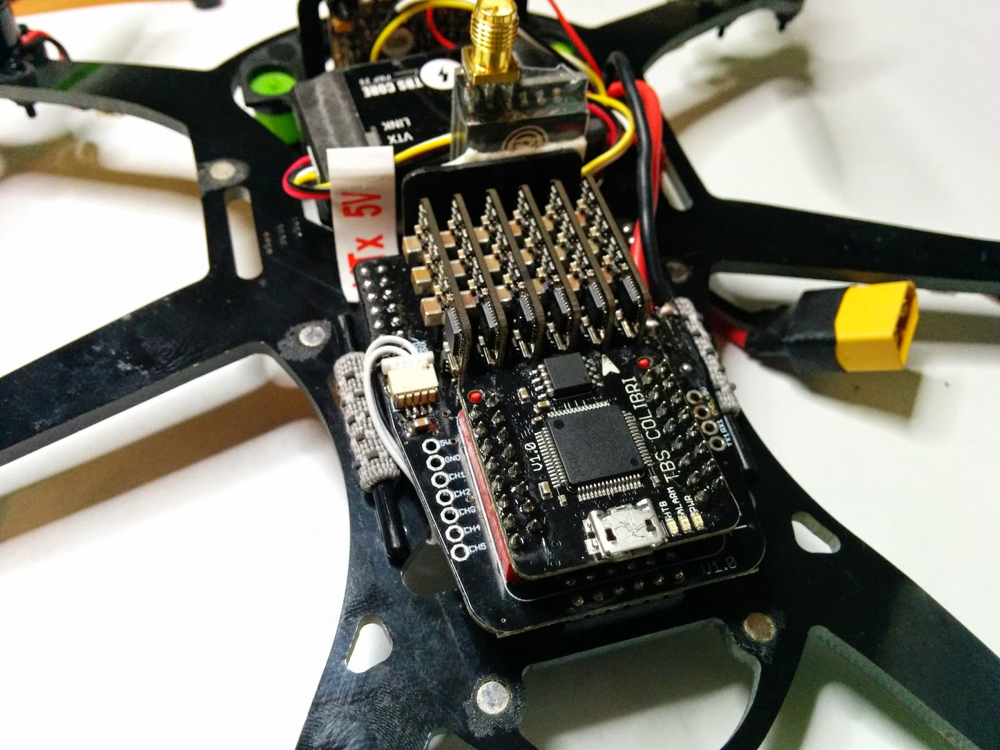

And lifting up Colibri reveals some nice foam used to protect the barometer from turbulence and get a clean measurement. The flight controller makes a very nice firm fit on these headers, despite the number of times I've had it on and off.

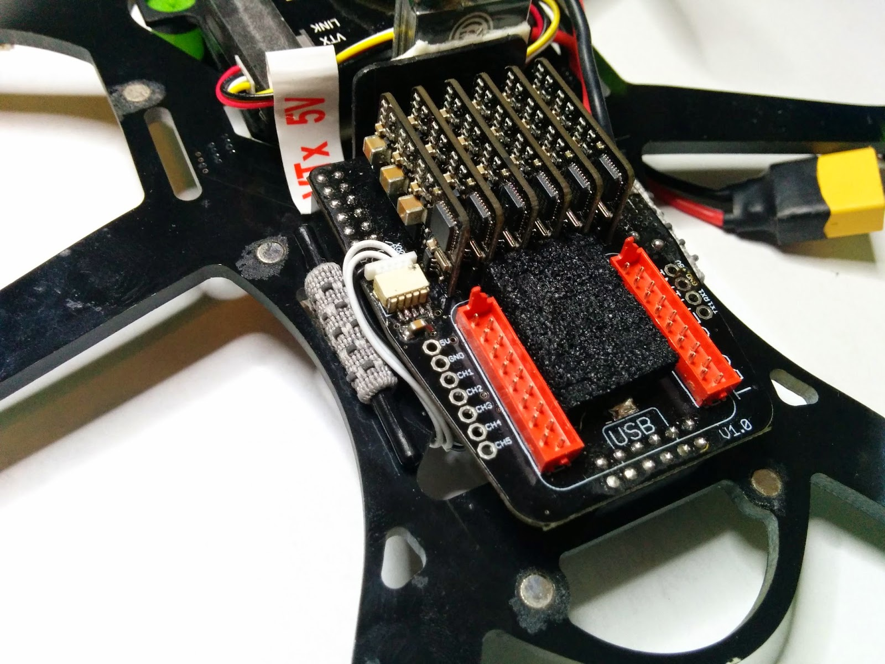

And finally the whole IO board can be lifted up to show the ESC connections from the bottom. The connections to the main frame is done through a series of standard 100-mil spaced headers. This routes the cables from the ESCs into the main frame wiring, as well as providing power to the IO breakout board. 

You can see in this photos the soldered connections to the ESCs. It will be interesting to see how easy that is to remove and replace. The board mounts protrude 1 or 2 millimeters past the board which might make it easier to break the connection. However, it might be that a bit of flux and braid are required to really free them up. Either way, it wouldn't be worth the increased height and weight to have a connector for each ESC. 

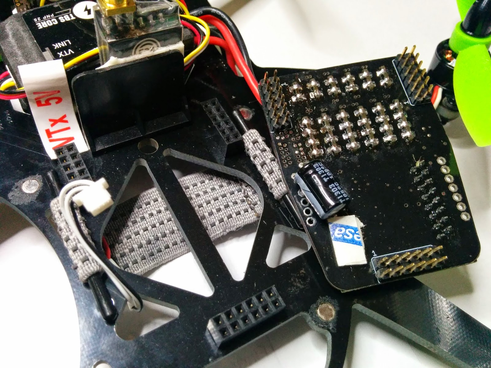

Finally the integrated wiring into the frame mentioned above is really nice. I'm not entirely sure the process that went into making a PCB laminate and then applying it to the frame with the twisted motors. The motor wires do run on straight segments of the frame, so perhaps that helped. Anyway, I don't envy the cloners who are trying to rush an mimic this process. 

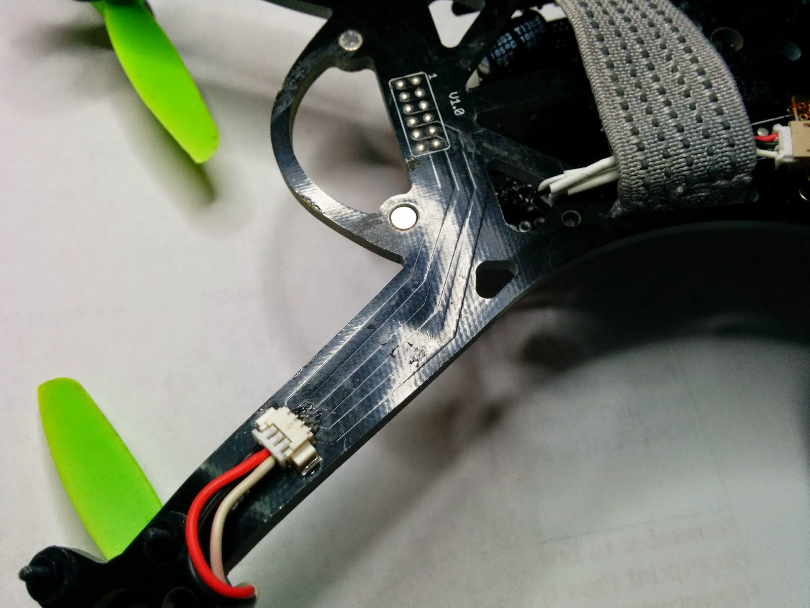

### Crash resistance

Well I've only flown this for an hour or two. However, I have already done a good job of crashing it. One thing I'm less used to (flying mostly quads) is that it does a great job of crashing into things. I flew into a tree while in altitude hold mode and the flight controller totally recovered and had me floating in clear sky.  

I tried teaching a friend to fly it under a tree and only lost a prop. 

I flew into a tree about 10 feet up and just had to pick it up and replace a prop. 

Finally, I flew it at full throttle (probably 35+mph) into the bottom side of a bridge. Completely misjudged the height by a foot. I really expected to be picking up pieces, but in the end nothing important was damaged. The bolts holding the front two motors sheared. The frame was entirely intact. All electronics are ESC traces are good. Even the motor connectors on the frame are still attached. The plastic assembly that holds the flight camera either needs some glue or replacing. Overally, I was shocked by how minimal the damage was. 

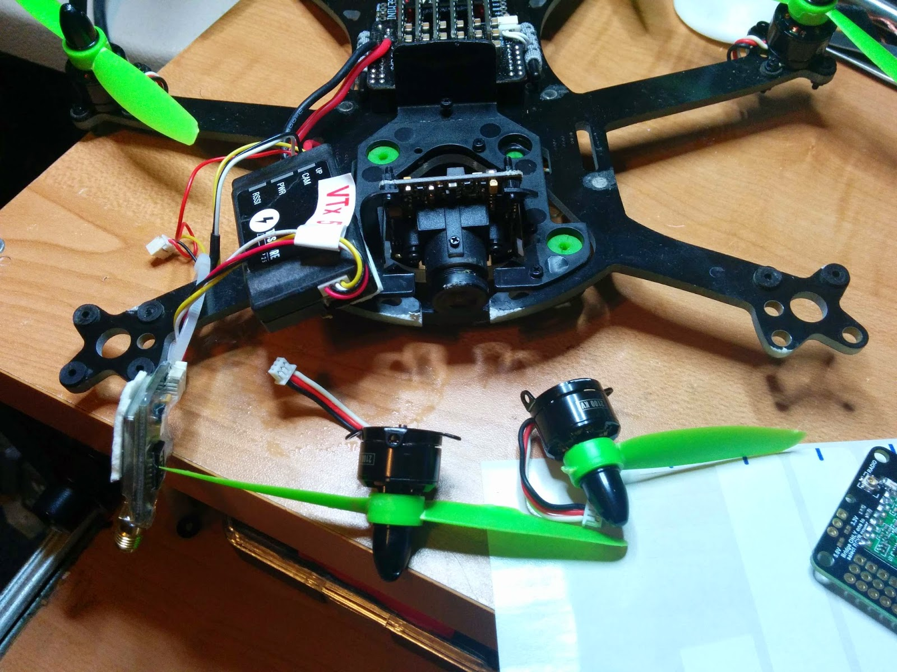

### Summary

Ultimately, I am very impressed with this frame. There are a lot of fairly novel (if not entirely unique) concepts here that aren't in many frames. The integrated wiring with the frame as a PDB is pretty uncommon in anything this size (obviously things like Crazyflie have done it) and makes the lines really slick looking, not to mention aerodynamic. The twisted motors I first saw in William Thielicke's shreddiquette designs and they have done a nice job of taking that into a custom warped frame.  

The level of integration with the tiny Colibri flight controller, IO board that with integrated ESC connections and then the breakout into the frame is what really impresses me. This was all made custom for Gemini and just makes the whole thing light, compact, and probably quite robust to crashing. I also haven't see this approach to integration in **any** frame running open source software (maybe some proprietary frames are similar?). 

A big congratulations to Team Black Sheep for making an awesome product and I'm glad they wanted to use Tau Labs to really get the most out of it. I'm sure this will be extremely popular with pilots and hopefully as a trickle down effect we will get some people active in the TL community.
