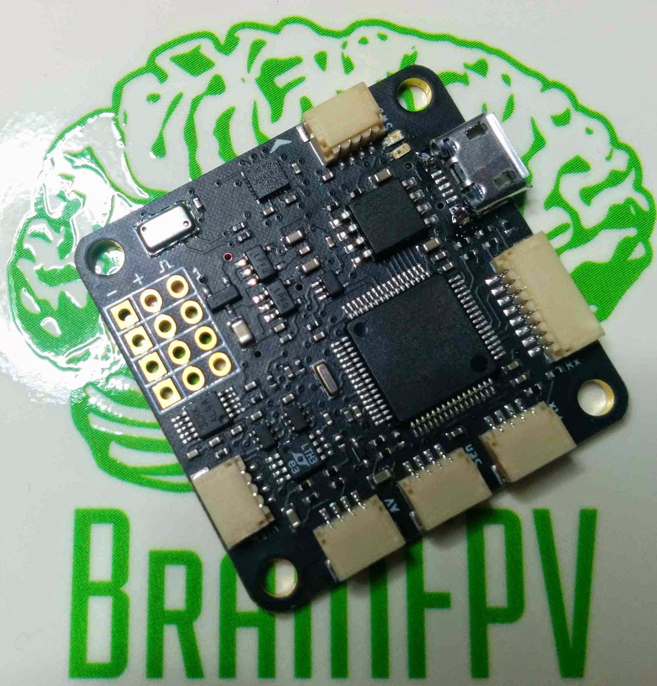
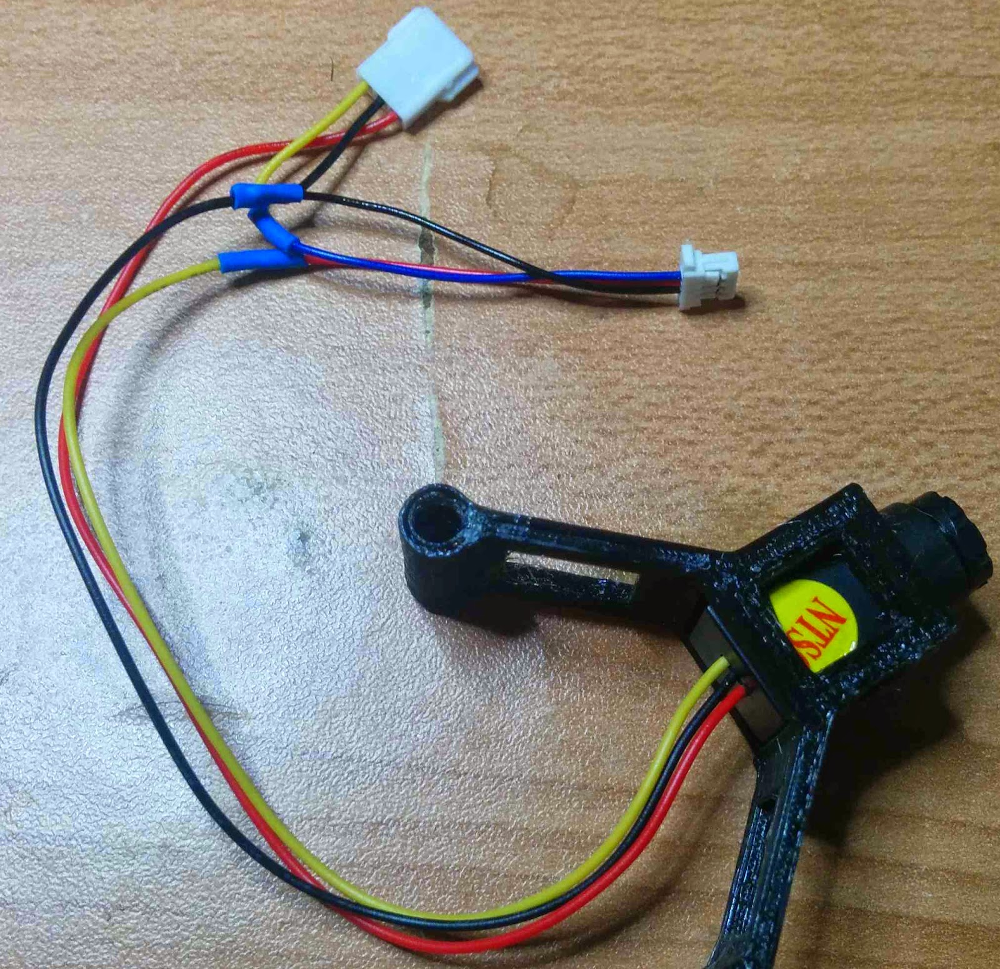
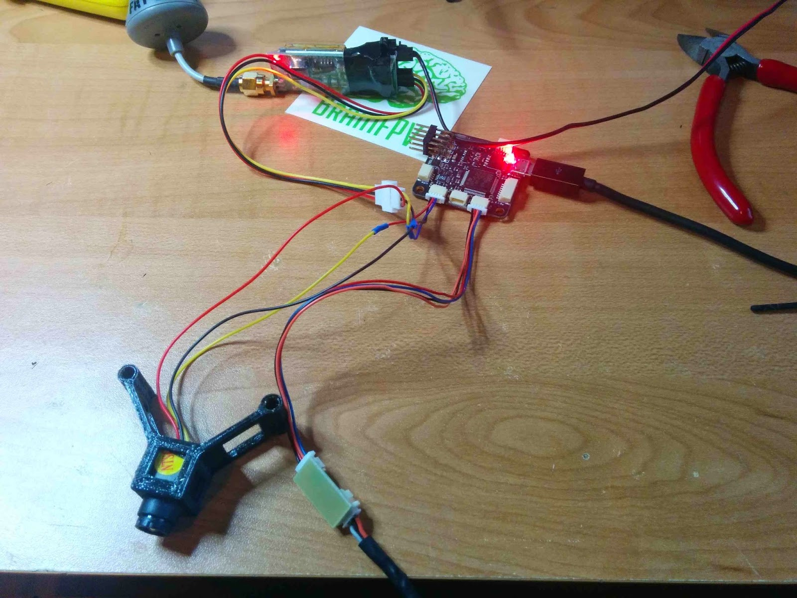
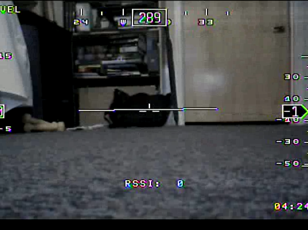
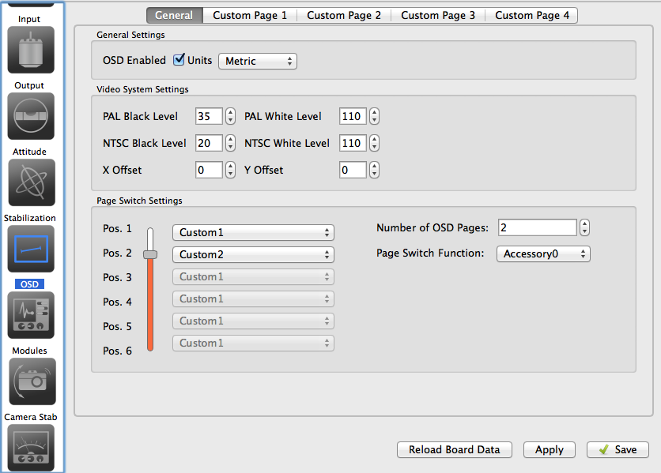
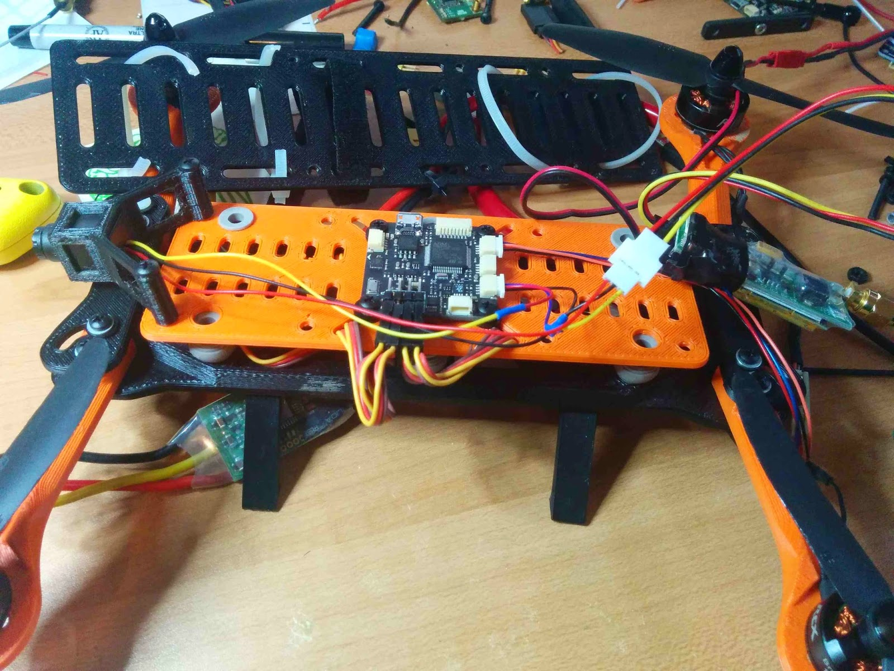
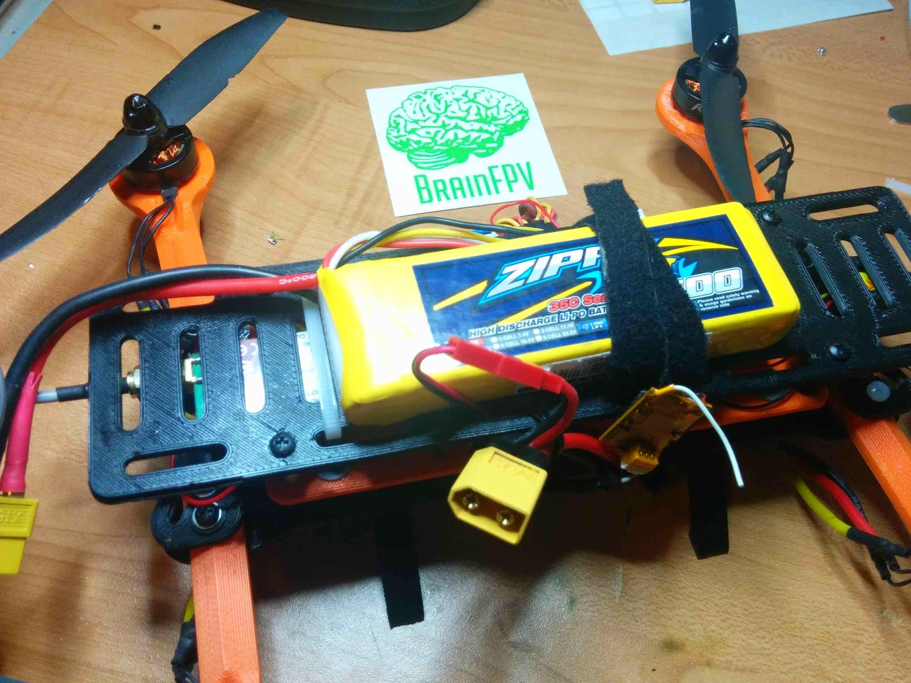
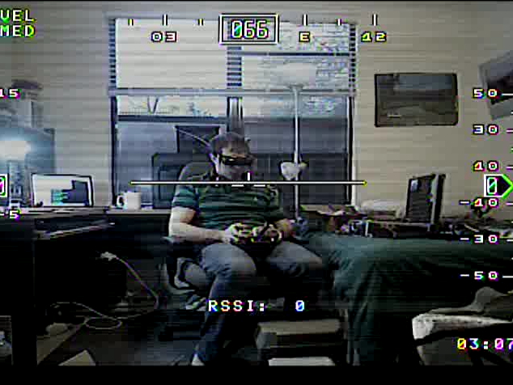
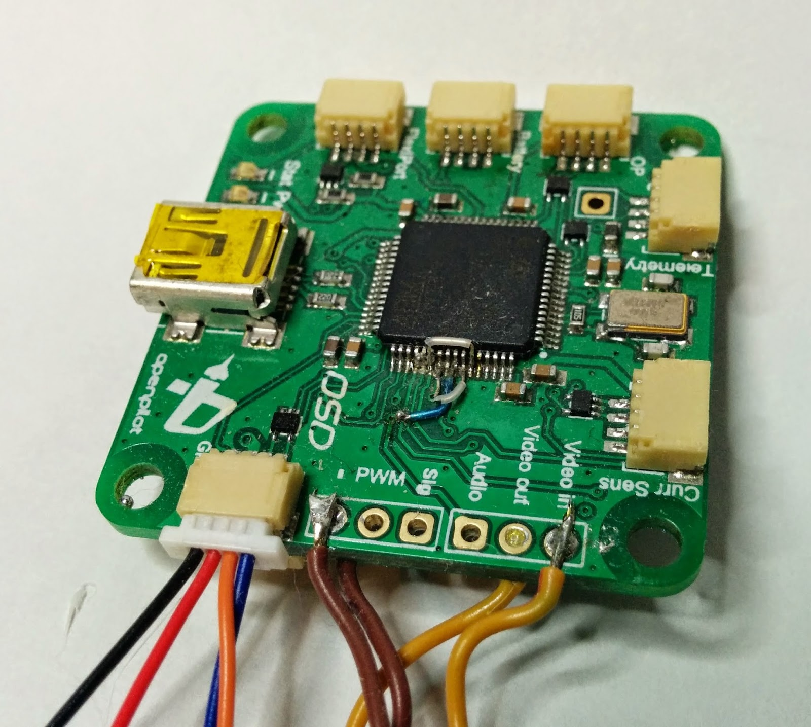

I was lucky enough to get a [BrainFPV](http://www.brainfpv.com/) from HeliShredder last week, which is a new flight controller that uses Tau Labs.

It is an impressive board with a lot of features in it's 36x36 mm size. Beyond having a full sensor suite (3-axis gyro, 3-axis accel, mag, and baro), its biggest unique feature is of course an integrated OSD. 



This kind of integration also gives a lot of power - like the ability to switch OSD display modes on the fly.

I'll just paste from Brain's page for htFPV Specific Features:

**FPV features:**

- Full-graphic OSD (360x266 for PAL):
  - Software adjustable black and white levels
  - PAL/NTSC autodetect
  - 4 fully user configurable OSD pages, selectable using switch on transmitter
- Audio output (not yet supported by software)
- 3 analog inputs for voltage, current, RSSI measurement
- RSSI measurement using PWM, PPM, or analog input
- Other Features:

**Other features:**

- CPU: STM32F405RG (32bit, 168MHz, 192kB RAM, 1MB Flash)
- 64Mbit flash for settings, way points, logging
- InvenSense MPU-9250 latest generation 3-axis gyro/accel/mag
- Barometer: MeasSpec MS5611
- Receiver compatibility: PWM, PPM, S.Bus, DSM2, DSMX, HoTT SUMD/SUMH
- Up to 10 PWM outputs (up to 400Hz update rate)
- Up to 3 serial ports for telemetry, GPS, RC receiver, etc.
- External I2C port, can e.g. be used with an external HMC5883 compass
- Micro USB port for configuration via PC

## Installing into MHQ Quadcopter

To test it out, I decided to use my [foldable MHQ quadcopter](../2014-02-23-microquad-from-hovership-pro/index.qmd) from Steve ([thingiverse link](http://www.thingiverse.com/thing:251002)). First I had to splice a JST connector into the video line so it could plug into the BrainFPV controller. 

This is the [Pico camera from GetFPV](http://www.getfpv.com/lumenier-cp-520-pico-520tvl-nano-camera.html) with a [mount that I designed](http://www.thingiverse.com/thing:341752) to hold it in the MHQ. Then I plugged it into the BrainFPV and immediately had a nice little OSD showing. 

Unfortunately my video recorder crops the edges so you can't see most of the OSD field. In the GCS you can also modify the layout, white black balance, and even switch the layout with a toggle of the switch. 

HeliShredder did a nice job of fitting the OSD configuration into the configuration gadget. With it all tested, then I just had to finish reassembling my quadcopter. 

It definitely makes the wiring really nice and simple having just that one board. I really need to get add a battery current/voltage sensor to this frame now, since the OSD can show that to me. I just hate soldering on the wiring harness :(

And all closed up and ready to fly. Time to practice my FPV flying ... indoors ... 

You can see a bit of line noise from the motors. It is recommended to have a filter on the power line, but I don't have one at the moment. I'd recommend checking out HeliShredder's videos to better see the performance. 

## OSD History

I'm really stoked to see this board out there and running Tau Labs. Hopefully the hardware designs will be open sourced in the not-too-distant-future and it can become included as an official target. 

Sambas (now with the LinuxDrone project) started the OSD project in [2011](https://www.google.com/url?sa=t&rct=j&q=&esrc=s&source=web&cd=1&cad=rja&uact=8&ved=0CCAQFjAA&url=http%3A%2F%2Fforums.openpilot.org%2Ftopic%2F6736-openpilot-osd-prototyping%2F&ei=0AeWVKW5CceZgwSf44JA&usg=AFQjCNEiCLpEXkZSkwxwDoJaI8xCY9u4Vw&sig2=02f0kNkaY9eVwz2Cmxg72g&bvm=bv.82001339,d.eXY) back with OpenPilot. The original design had some issues and I ended up cutting up one of the prototypes to design a new way of syncing the two SPI channels together.  

The end result was we got it going, although with some issues that limited drawing to the edge of the screen and required running the microcontroller at a strange rate. 

  



  

I believe some more work was done on the code subsequently, but ultimately the OSD with OpenPilot stagnated and nothing came of it. Luckily HeliShredder came along at picked up the code and ran with it. I believe he'd previously also had some experience developing on the Super-OSD project in the past. 

Interestingly, he independently came up with a better way to sync the SPI channels that resolved those issues that Sambas and I had discussed way back when and it works great. There is also some nice tricks he used to also adjust the white / black balance to make sure it always looks nice that ended up an issue for us. He also did a lot of work to optimize the code so it can run with the flight controller jitter-free as well as the configuration interface to make it adjustable.  

Ultimately, this is a great example of open source where something would have otherwise died in a pile of unused code (sadly [like my ESC](../2011-11-21-esc-development/index.qmd)has become) is now improved and used and I think will make a lot of people happy. Consistent with OSS principles, all his changes are available on [github](https://github.com/BrainFPV/TauLabs). 

## Final Thoughts

  

This board is going to be really popular, I suspect. Of course since it runs Tau Labs (and from my limited testing) it flies wonderful ;-) and I was able to simply import my configuration on this frame from when it was running Sparky and immediately it was tuned and flew well. 

The OSD looks super crisp and sharp with good black and white levels and responds nice and quickly. I haven't even tried the modes where it shows waypoints and such, but apparently it does that. I can't wait to throw the battery monitor and GPS on there so I can see my speed, direction to home and battery status. 

Between this and Gemini, I really need to spend more time FPVing.
