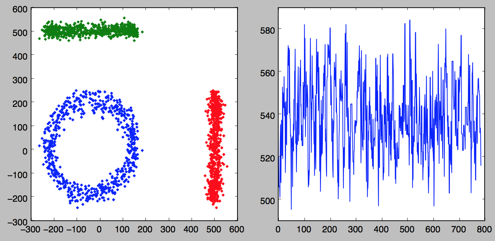
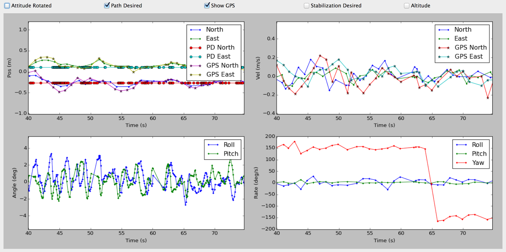
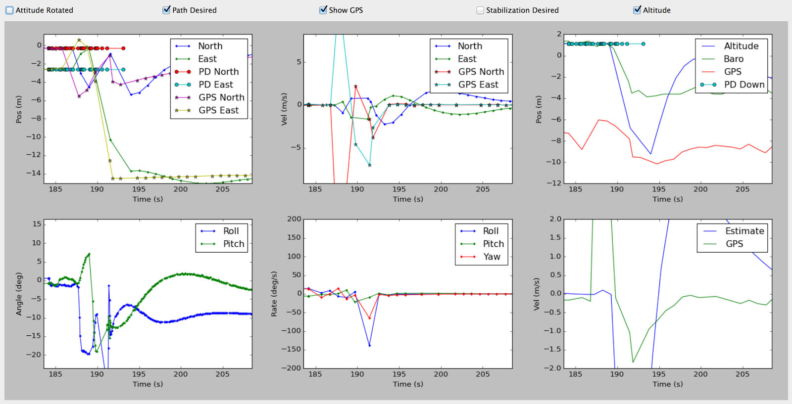
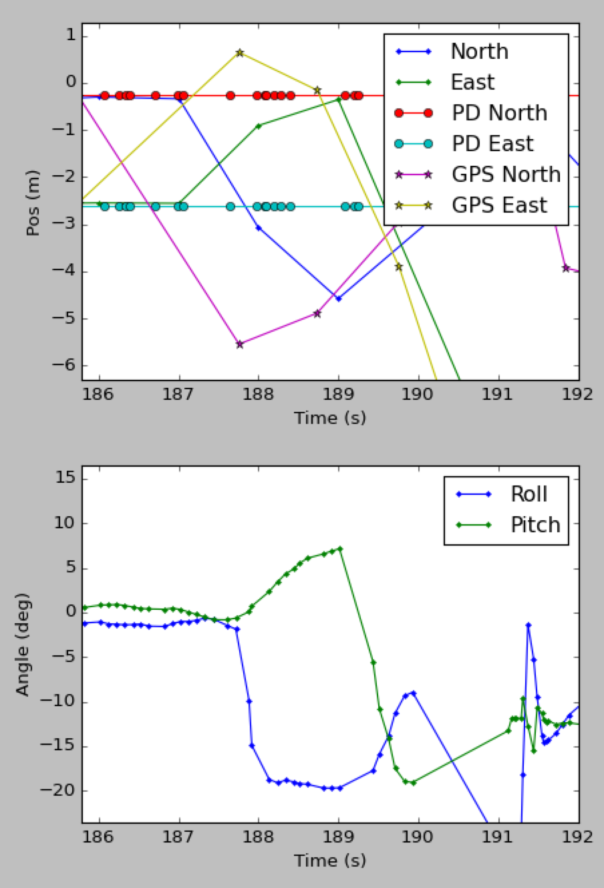

I've [written previously](../2014-03-15-logging-and-python-parsing/index.qmd) about using python and log parsing, which this writeup uses heavily.

I was testing position hold with the new 14 state INS the other day with [Sparky2](../2014-08-29-sparky-20-and-taulink/index.qmd) on [Seeing Spark](../2014-11-02-seeing-spark-sparky2-and-sparkybgc-quad/index.qmd). The new filter is working great. I ran autotune and 6 point calibration and engaged position hold and it held beautifully still. The new estimation of the z-axis accel bias worked as it should so there was no glitch in the altitude. The new magnetometer handling meant that the attitude was wonderfully locked in and not biased while tracking the heading really well. Spinning around while holding and it didn't budge a bit.

I wrote some code to calibrate the magnetometer while spinning which I think will be quite useful. It fits the data to a sphere as well as making sure the horizontal component has the appropriate magnitude (this prevents fitting to an edge condition).

You can see that the blue data (x versus y axis) quite nicely fits a circle. This is both an easier calibration procedure than 6 point and more useful since you can see the deviation from correct (the plot on the right shows the magnitude of the mag data) and the is performed with the motors running at hover. This will also work with the [built in logging to flash](https://github.com/TauLabs/TauLabs/pull/1423).

### Analyzing glitch

However, at one point it was just hovering and then started going to the side. I've occasionally seen things like this in the past and really wanted to get to the bottom of this. Whenever I started digging into navigation logs I typically end up writing the same lines in python over and over again. I finally decided to sit down and write a [log analyzer](https://github.com/TauLabs/TauLabs/issues/1428) to facilitate this.

./python/logview.py -v TauLabs-2014-12-31_16-11-30.tll 

This shows a snippet of the log file. The upper left panel shows the position and the upper right the velocity. You can see there is substantially less than a meter movement while holding and very low velocities. The bottom left shows the attitude and there are only a few degrees perturbation. The bottom right shows the gyro and shows that the quad was spinning around at the time. The interface also has a few options to toggle extra plots. 

I zoomed in on when the hold deviation occurred: 

What was extremely informative about this is that you can see the raw GPS position and velocity jump by a few meters at 188 seconds. Critically this occurs *before* the attitude deviates and not as a result of flying. Here is that time point zoomed in: 

Again showing that there are clearly sample with the attitude nearly horizontal right up to the point where the bad position sample comes. In addition, you can see the INS racing to catch up (which wouldn't happen if there was a real change first since the accelerometers would sense it). 

The end result of this bad position sample was the UAV flies the opposite direction to fix the perceived error. This is a tough problem since we have to trust the GPS generally to have any hope of a good position hold. It is also exactly what ArduCopter had to implement GPS glitch protection to solve. It has been extremely rare in my experience and within 2 seconds the GPS had corrected the error. However, it is definitely something where I'd like to get better logs.
