We have a very nice EKF that was written by Dale Schinstock from Kansas University that is used for navigation in our code. Generally it works quite well, although it is fairly sensitive to tuning parameters. I've discussed this somewhat in [this post about the magnetometer](../2014-03-22-magnetometer-handling-in-ins/index.qmd) and this about [vertical control](../2014-03-23-vertical-control/index.qmd).

One thing that I haven't liked (and has slown me down for rolling out updates to the EKF) is that we don't really have any test coverage of it - especially for various initial conditions and systematic biases that might exist.

## Unit tests

Recently I wrote a python wrapper that calls into the EKF. I've had something similar for Matlab in the past, but of course the problem with that is it requires a matlab license and cannot be easily integrated into a test environment. With this wrapper in hand, I wrote a series of uni tests (using the Python unittest platform). With this I can systematically test things like how rapidly it converges from various initial conditions given a set of inputs and measurements (with the option to visualize the results, but of course having this disabled when systematically testing things).

For example, I can simulate bias gyro inputs and verify that it tracks that bias correctly

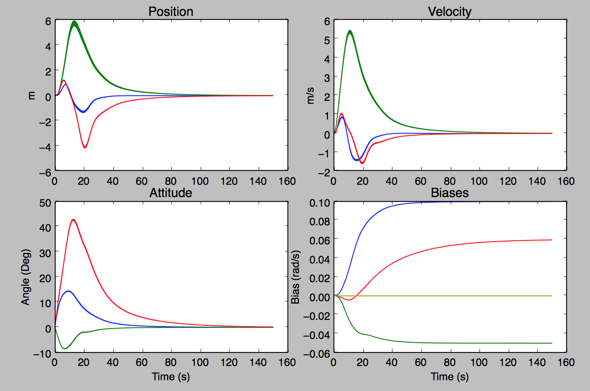
  
Or initialized at the totally wrong attitude, the EKF will converge to the correct one. Here, it takes longer than I would like and optimizing convergence times (through the EKF tuning) is on my list of things to do and then add worst case values to the test assertions.

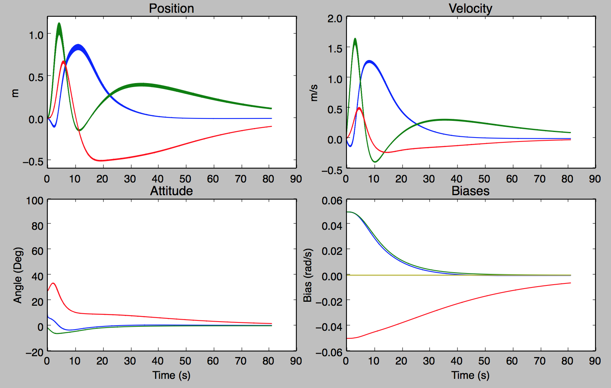
  
When given a position different than the initial location, it quickly snaps to that location at the first update (because the initial position variance is quite high)

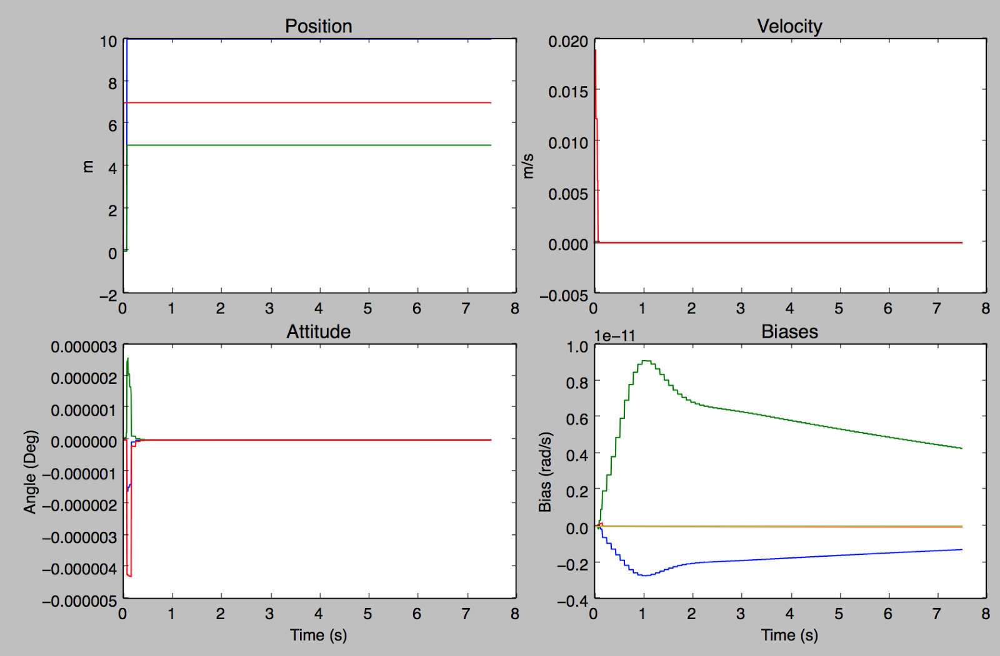
  It is also possible to inject noise and verify that the system remains stable in this case

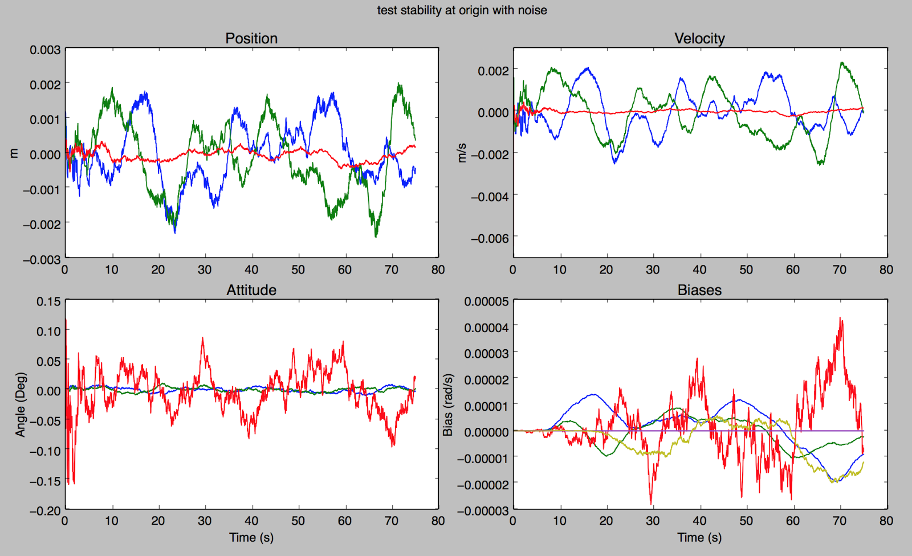
  

### Problematic cases

It can also expose certain problems with the current EKF. For example, if the mag isn't perfect (for example I shrink the z-axis measurement) that results in a biased attitude and the subsequently coupling bias into the velocity and position. In this case, the quad is meant to be sitting still at the origin (except for the mag). It also learns a bias (that isn't there) to explain why the attitude isn't making sense.

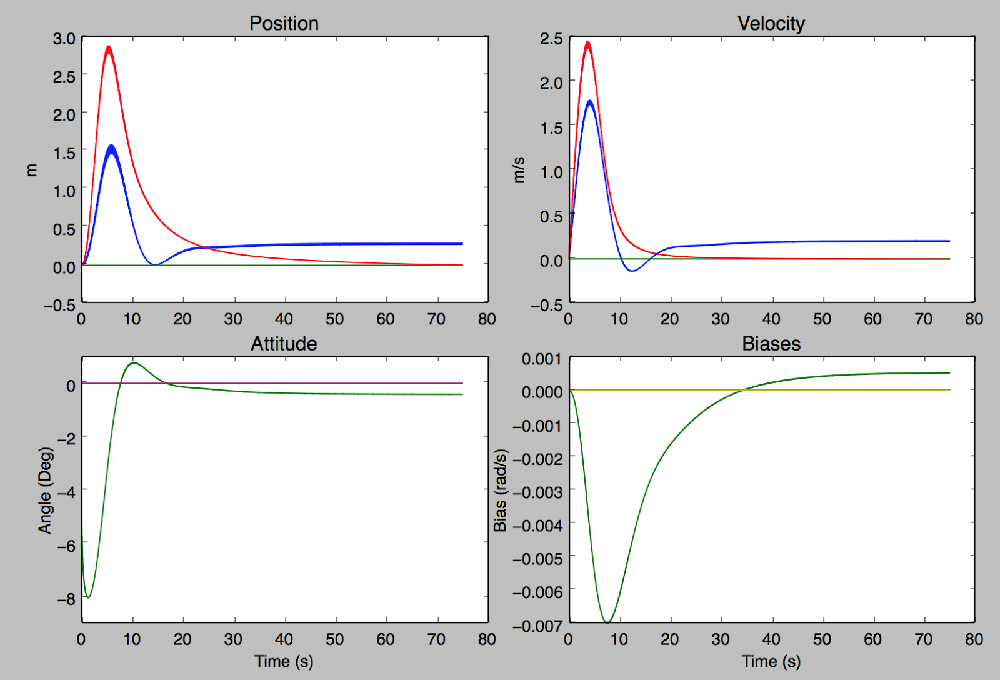
  
In a related problem, when simulating starting facing north and presenting mags consistent with facing East, it does reasonably but ends up picking up some roll/pitch errors that influence position:

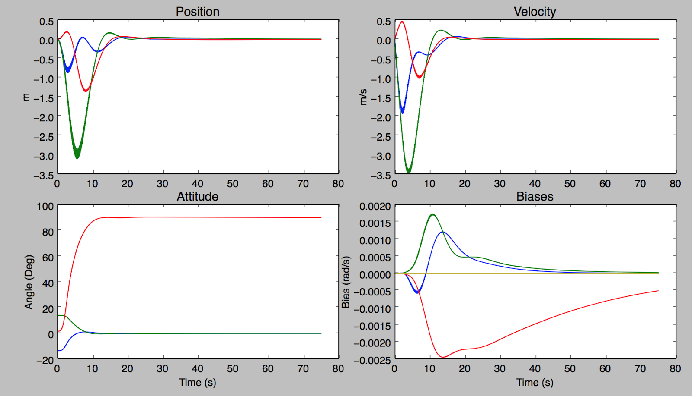
  Another issue is that a fairly small (e.g. 0.2 m/s^2) bias in the accelerometers can really bias the vertical velocity and altitude

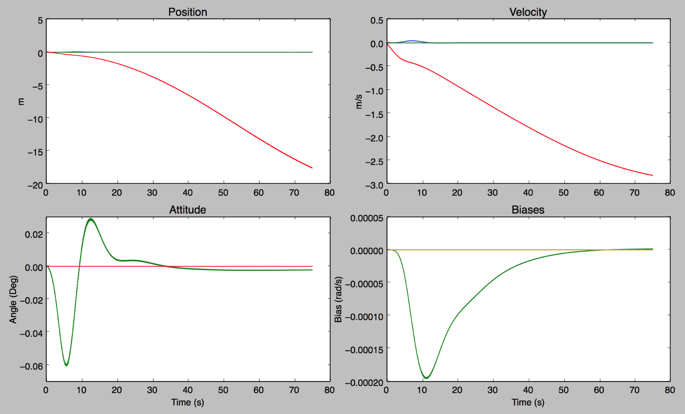
  

## Fourteen state EKF with mag-attitude decoupling

To address these shortcomings, I made two major changes to the EKF. The first, is to track the bias of [accelerometer in the z-axis direction](../2014-03-23-vertical-control/index.qmd). The complementary filter used for altitude hold mode has such a feature and it proves quite useful for getting robust performance. We previously had a 16-state variant with biases on all three axes, but in my hands that is overkill and actually can be overparameterized - so there can be incorrect solutions to a given set of measurements that are not a good state. 

The second was a bit trickier - to make the [magnetometer values only influence the heading](../2014-03-22-magnetometer-handling-in-ins/index.qmd) (in earth frame) without influencing roll and pitch. The solution to this is to pre-transform the measurement measurements by backing out the current estimate of roll and pitch. Then the predicted measurement is based only on the heading term. It ends up being quite a bit of math so I used matlab to rework all the equations and come up with an efficient covariance prediction matrix. 

This combination ended up fixing those issues. For example, having a badly scaled (but facing the correct way) magnetometer reading ends up producing positively boring results, with no bias of the attitude: 

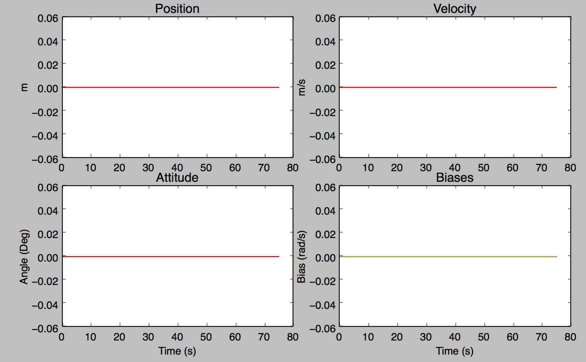
  

Starting facing the wrong way just nicely rotates around to the correct heading without any errors in the attitude (and thus no position errors) 

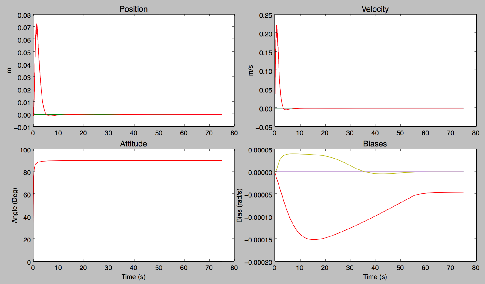
  

And having a biased accelerometer is nicely tracked and corrected for 

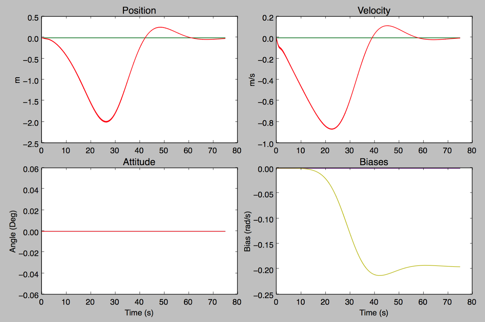
  

At the same time, it still correctly identifies when there is a bias in the gyros and learns this without having a problem identifying zero accel bias. Note that the position and velocity drift while it learns the gyro bias and gets the attitude correct 

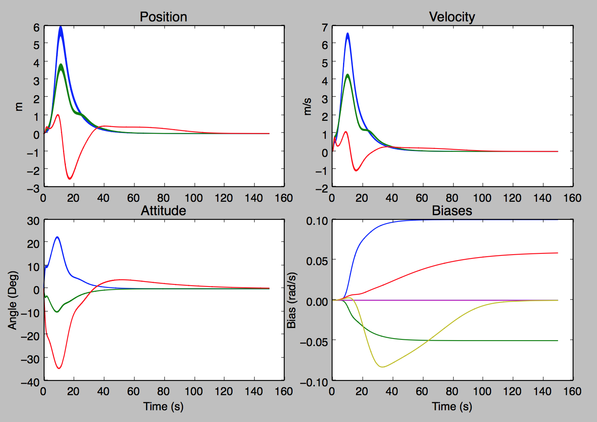

[*Note to self.*49549c3b9c682641d2461a90e176a2f3db7dc1b8 *passes all these tests*] 

## Tuning and optimizing convergence

Armed with a filter that can at least deal with some of the systematic errors we anticipate seeing on a multirotor (e.g. distorted mag fields, imperfect accel bias), the next step is to tune it to behave well in real life. There are a few sets of major parameters that define the EKF performance: 

- gyro noise - Q[0..2], this is the amount of error expected between the gyro inputs and the change in state. increasing this variance will make the system trust the gyros less (and thus make things like the mags relatively more influential)
- accel noise - Q[3..5], this is the amount of error expected between the accel inputs and the change in velocity. Increasing this variance will make the velocity estimation trust the GPS and baro relatively more. It will also alter how the roll and pitch are estimated - basically tuning between trusting the gyros versus accels)
- bias walk - Q[6..9], how much the bias is expected to change during flight. Making this value smaller means the system will take longer to convergence when estimating the bias terms, but will be less likely to get random bias values when there is noise
- gps position noise - R[0..2], how much noise is expected from the GPS position measurements. setting this lower will trust the GPS more and setting it higher will trust the integrated velocity estimate more
- gps velocity noise - R[3..5], how much noise is expected from the GPS velocity measurements, setting this lower will trust the GPS more and setting it higher will trust the accel (and position) more
- mag noise - R[6..8], how much noise is expected from the mag. trusting this more will get a more accurate heading but be more susceptible to anything that distorts the mags

There is also a component of redundancy amongst these term, in that the covariances can all be scaled by a constant without changing the behavior of the state estimate. However, it is convenient to try and preserve the real units (position in m, velocity in m/s, etc) so the variance has meaningful units (true m^2 variance).

### Bias convergence rates

One important parameter to converge quickly enough are the gyro bias terms. We try and initialize these at startup but still tracking changes in error is important and a critical function of the EKF. To test this I see how quickly the EKF learns the gyro bias (within 10%) after initialization. This takes multiple minutes to converge which is slower than we want in practice. Using this code we can increase the bias walk parameters for both the XY gyro, the Z gyro (which is affected differently since it gets corrections from mags instead of accels) and the Z accelerometer. The goal I wanted was for the gyros to converge within 10% of the correct value (when initialized at 10 deg/s off) within 30 seconds. For the accel bias I initialized with 1 m/s^2. After tweaking the variances this was achievable (without making it too fast -- thus tracking noise -- or failing any of the previous tests). 

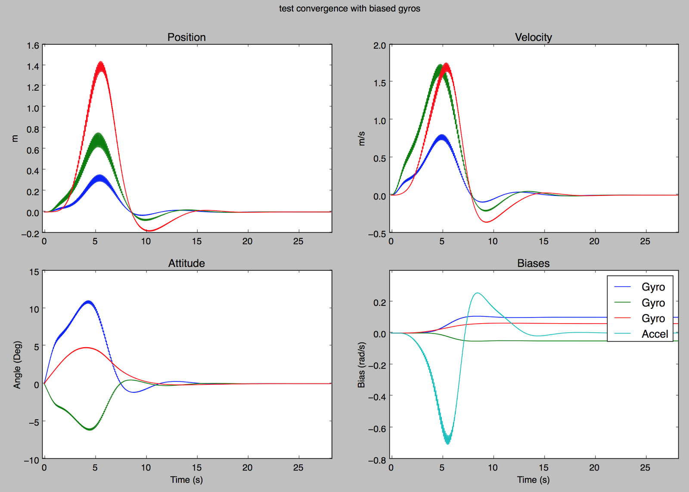
  
Checking that it did fail any of the previous tests (including those with simulated noise) is critical because if the bias drifts around it can create very bad estimates.

### Changing biases

An initial mismatch in the biases is also different than a change during flight. The initial covariance parameters also play into the former. The later is important to be fairly stable although should still track slower changes. This can be simulated by letting the filter run for 30 seconds and then introduce the bias.  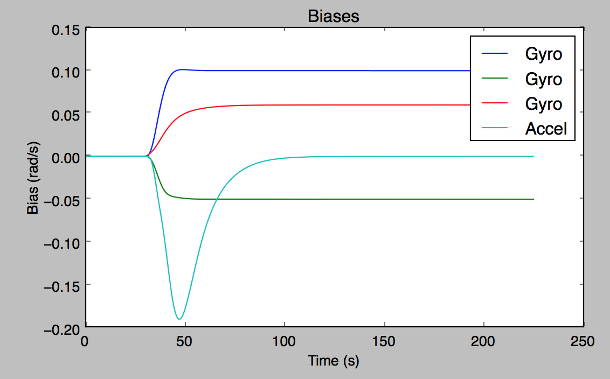 
*changing test_gyro_bias*
  
You can see changing the gyro bias causes the accel bias to briefly change. This is because the biased attitude makes the velocity and position have error, but it self corrects. These influences are unavoidable in a coupled filter like the EKF. Similarly, we can change the accelerometer bias which takes a bit longer to correct.

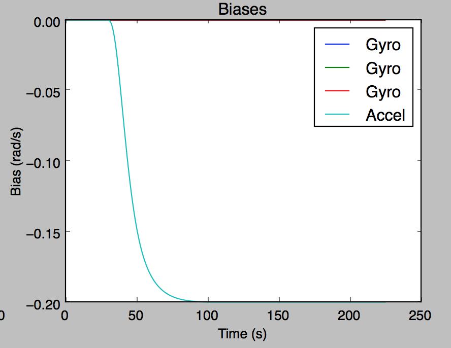
  

## Replaying simulated flights

I also wrote a very simple simulator which mimics taking off and flying in circles (with a net drift) and passes that data plus noise to the real implementation of the EKF to make sure that it behaves correctly. Again, this can also be done with an initial bias added or incorrect state to verify that the system ends up at the correct state. 

First for a simple flight without anything mismatched (except for sensor noise) the state estimates all do the correct things. 

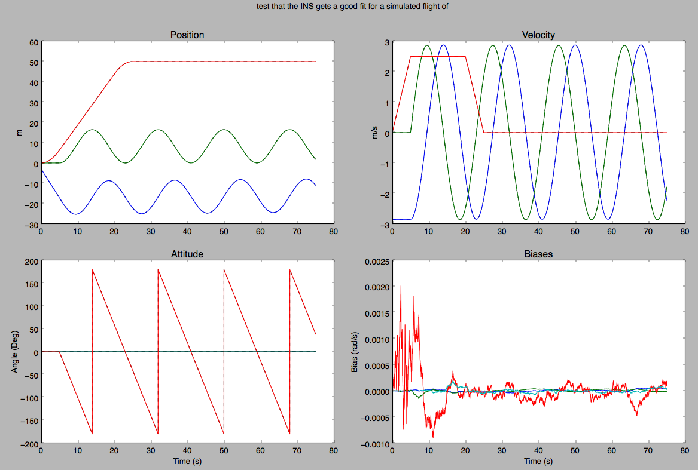
  

Then we can test that it converges when initialized with the wrong attitude (the dotted line shows the real data): 

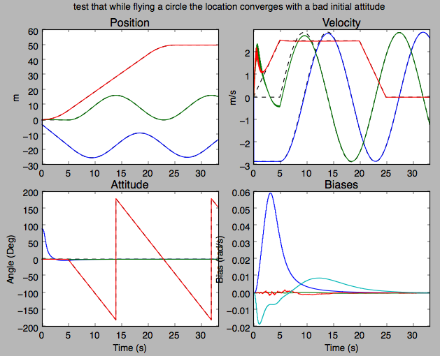
  

Or with either biased gyros or accels and check that it converges to the correct flight plan and bias values: 

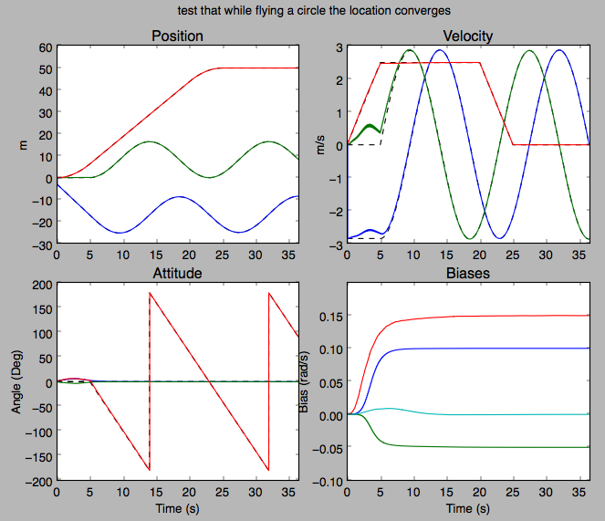
  
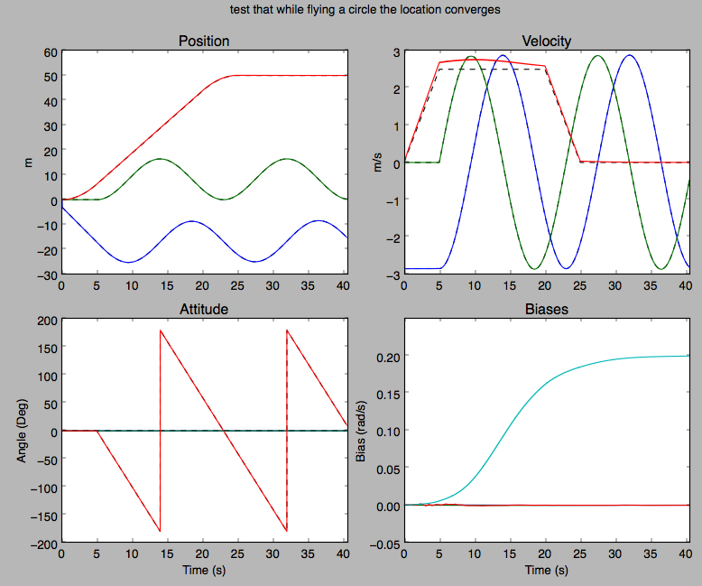
  This test is a really good one. Simulate the quad rocking pitch up and down while yawing. This is a good robust test on the mag attitude compensation. In fact I noticed at one point while doing this that I had an issue and the accel bias could wander a bit much. This led to me finding a bug in how the compensation was applied and fixing it. You can see below that the biases stay stable.

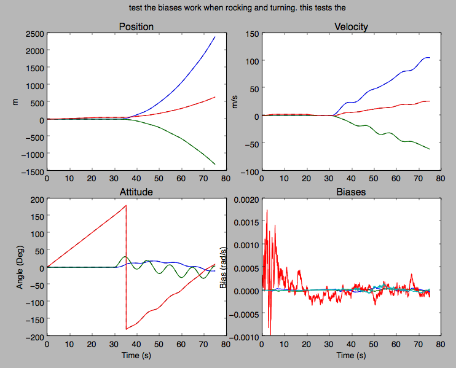
  

## Replaying real flights

I've written about using python to analyze logs we collect [here](../2014-03-15-logging-and-python-parsing/index.qmd) and [here](../2014-12-31-more-log-analysis/index.qmd), With this code it is also possible to replay log data  a real flight. This is important because there are numerous places where the real world violations of the model might cause issues.

Here is a replay of a position hold flight comparing to the real data (or online estimates). You can see the heading well tracked the previous estimate. The position tracked the real data. And finally, the biases were fairly stable through the flight, although perhaps with a bit more oscillation in the gyro bias than I would like.

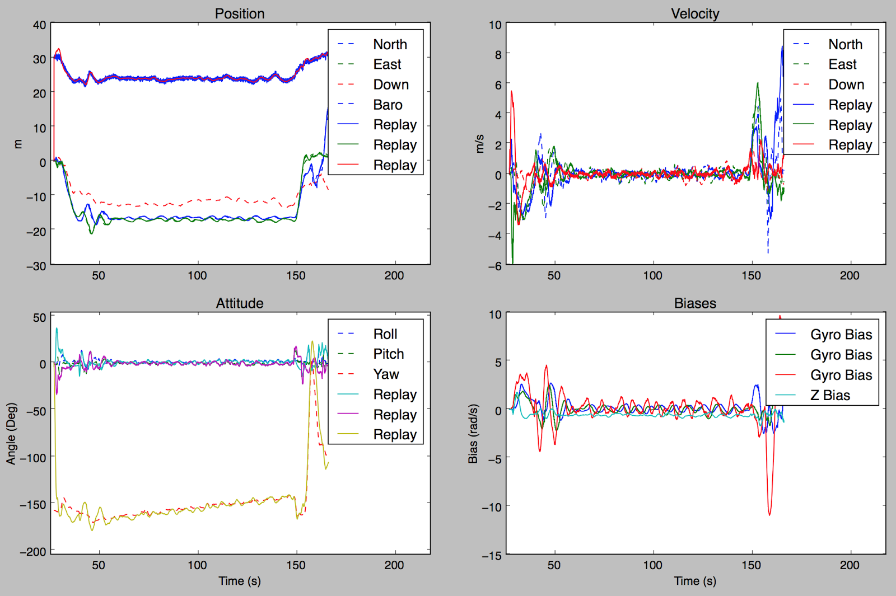

## Flight tests

  

Of course all this simulation is all well and good, but what really matters is how well it performs. In practice the heading was nice and locked in and the annoying twitch in altitude that I had observed in the past when engaging position hold was gone. 

::: {.archive-video video-id="117686343" source="vimeo"}
:::

  
  

Here is another flight. This was flying [Seeing Spark](../2014-11-02-seeing-spark-sparky2-and-sparkybgc-quad/index.qmd) with [Sparky2](../2014-08-29-sparky-20-and-taulink/index.qmd) running this new INS and logging to the android app via a [TauLink](../2014-08-29-sparky-20-and-taulink/index.qmd). I used the log files to generate a video overlay to better see the performance in time with the video. I was mostly flying in position hold mode and using the [loiter](../2014-01-05-loiter-mode-and-more-rth-testing/index.qmd) feature.

  

::: {.archive-video video-id="118370663" source="vimeo"}
:::

  
The estimates for position look really good and track well with what the video shows the quad doing. Some of the time it drifted laterally but it pretty much always indicated that on the map, so this means it is most likely an issue of tuning rather than a problem with the filter. For vertical velocity it seemed to be generally in agreement with what the video showed. In forward flight, though, the altitude estimate did not seem to track as well - often indicating it was climbing while it was dropping. At the end of the maneuver the altitude estimate would drop rapidly to catch up. Interestingly, in a number of these occurrences it was my impression the climbrate plot was doing the correct thing (and contradicting the altitude estimate).

This disagreement where the velocity looks correct and the altitude goes the opposite way suggests that the accels are producing fairly good data but the baro is not. It's possible the airframe shape of seeing spark with the board on the inside of a cavity creates negative pressure when flying forward. This could cause it to think it is climbing while it is not. I need to try repeating this with another open frame.

#### Baro glitch

Here was another interesting moment. I was testing with Freedom on a QAV500 frame. I noticed in the logs some times when the baro put out REALLY weird values. Like shooting up 50m in a very short time. When analyzing the logs with video, something became really clear: 

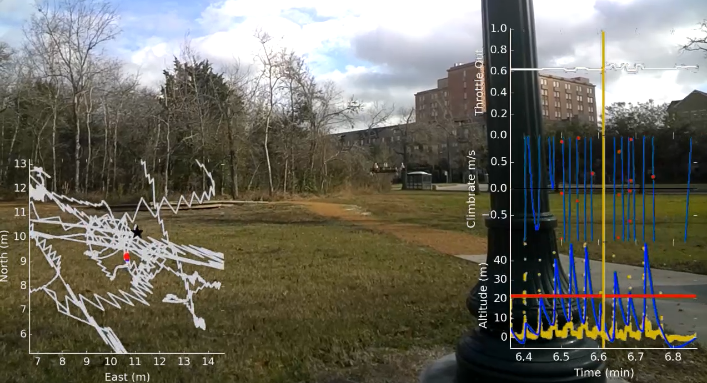

So the bottom right has this silly spiky pattern on altitude that is not real. Interestingly, they happen once every cycle while I'm spinning level. I realized, this is when the sun is hitting the baro. Definitely time to cover it.
