**Note: this original spoke of the sensor rate being 666. However, this was a mistake and the sensor rates were 500 Hz and 1000 Hz.**

There has been a lot of talk about OneShot125 mode for ESCs and how much better you can tune your quadcopter with it. Briefly, this is a mode that uses a pulse width of 125-250 µs instead of the typical 1000-2000 µs. This shorter pulse width allows a higher update rate (up to 2khz). In addition, the recommendation is to update the output as soon as you calculate a new value. This improves the latency of sensor to ESCs in two ways: the synchronous update reduces the latency due to two independent loops and the shorter pulse duration saves another 1.5ms waiting for the falling edge of the pulse. With an update rate of 400 Hz on the PWM outputs that latency has a worse case of 2.5 ms so ultimately you are talking about 4ms latency reduction.

It sounds somewhat unlikely that such a small time delay would make a difference, but at the same time the ESC latency is the ultimate performance bottle neck for quadcopters. With ESC response times getting into the 10-20s of ms, this communication latency can become an appreciable component.

Back in December ernieieft wrote Tau Labs [support for it](https://github.com/TauLabs/TauLabs/pull/1424) and with autotuning got higher PIDs and felt like it was quite locked in.  Here you can see the outputs from the four channels as well as the interrupt from the MPU9250 on Sparky2. This shows that each time there is a sensor update, shortly after it there is a pulse on the output channels (synchronous updates).

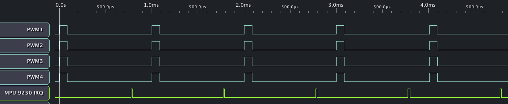
Zooming in, we can see what the latency is from the MPU9250 indicating a sample is ready to actually completing the pulse, and it is about 300 µs. Much better than the worst case 4 ms described above. This is with a short output pulse so in reality the time could go as high as 450 µs.

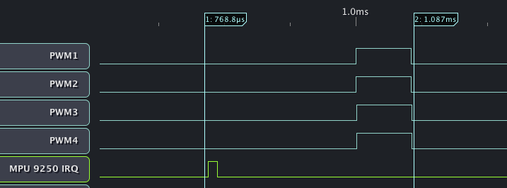
However, I wanted to quantitatively compare how much specifically OneShot125 mode really makes a difference. Luckily, we have our [autotuning algorithm](http://forum.taulabs.org/viewtopic.php?f=17&t=99) which actually allows monitoring the time constant of the delay from a change in the output to a change in the gyros.

## Normal PWM mode

So first I ran autotuning with [Seeing Spark](../2014-11-02-seeing-spark-sparky2-and-sparkybgc-quad/index.qmd) and Sparky2 using KISS ESCs in traditional mode. This is with the sensor running at the default rate for Sparky2 (500 Hz).

::: {.archive-video video-id="118383414" source="vimeo"}
:::

  

After three repeats, this is what I got:

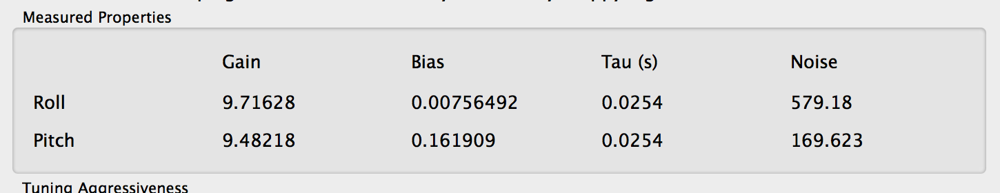

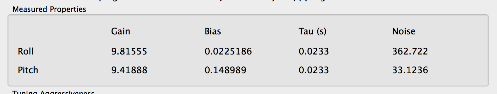

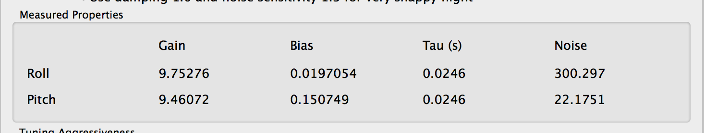

## OneShot125

Then I cracked SeeingSpark open and soldered the [JP1 bridge](http://ultraesc.de/downloads/KISS%20ESC%20Manual%20EN%20v01.pdf) to enable OneShot mode. 

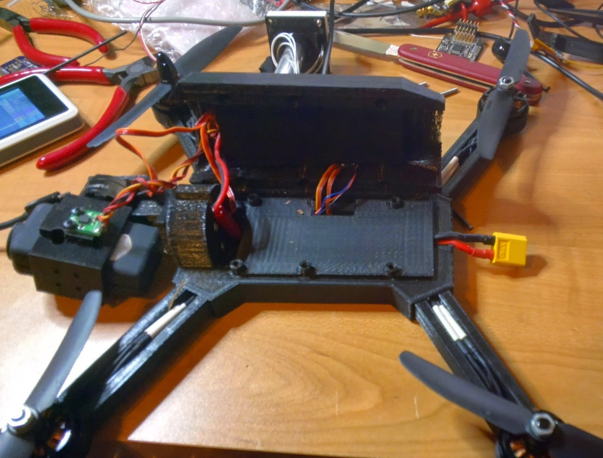

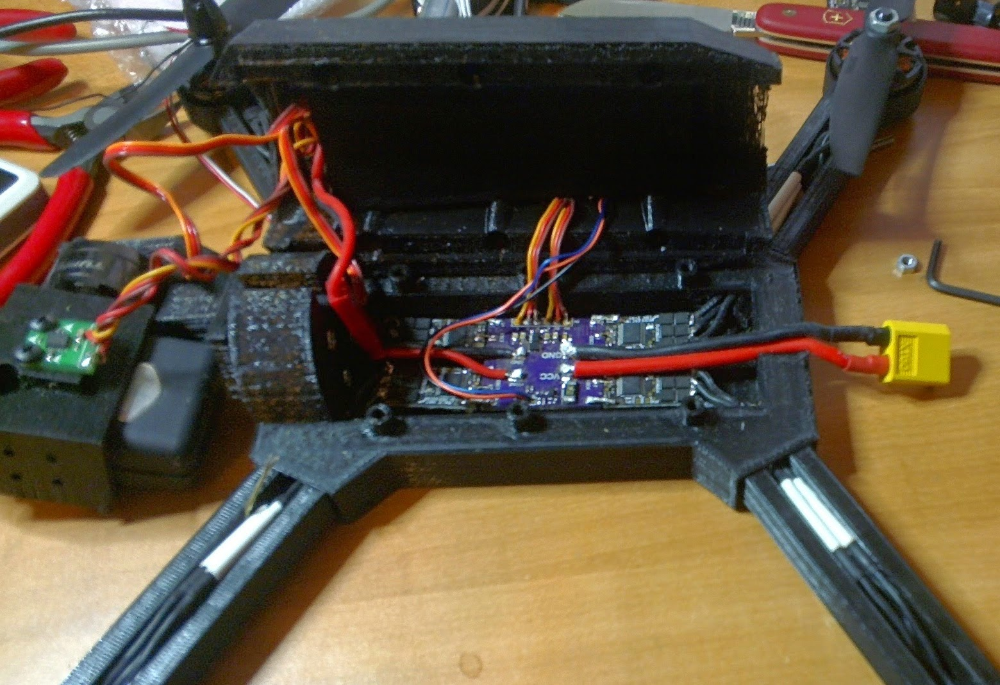

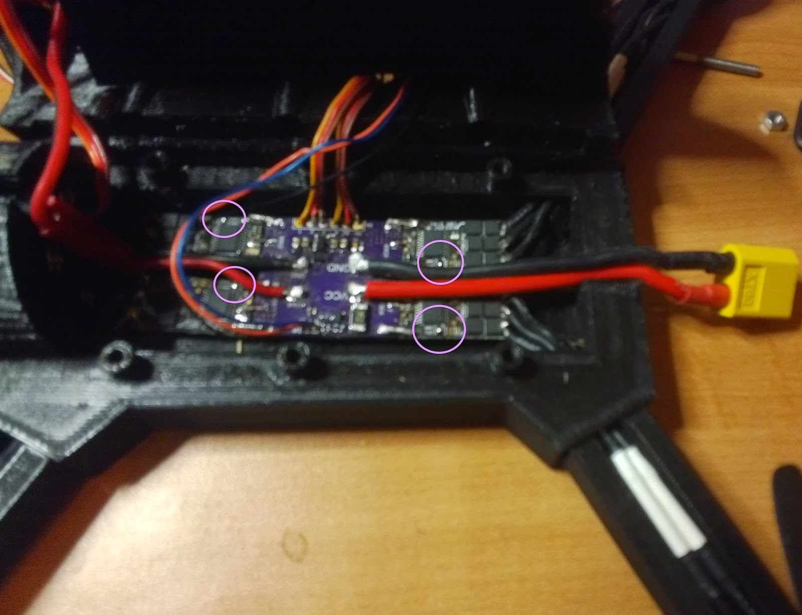

*Note: per request I have put the files to make this [power distro board on OSHPark](https://oshpark.com/shared_projects/5MMpnB1l). I'll try and make a BOM and assembly guidelines and upload that soon.* 

Here you can see the outputs running at 500 Hz synchronously to the sensor.

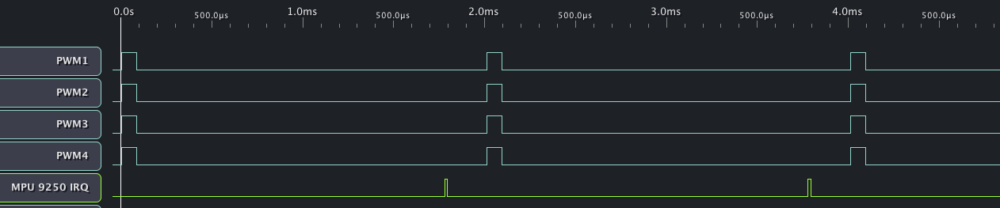

Then popped in a fresh battery, and did a few more sessions of autotuning.

## [Vimeo Video](https://vimeo.com/118384283)

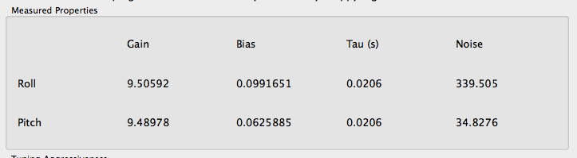

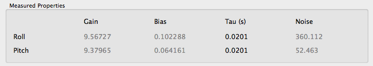

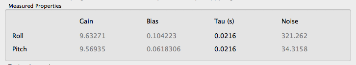

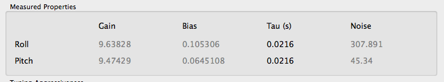

## OneShot125 - 1000 Hz sensor rate

I also wanted to see if increasing the sensor rate to further reduce the latency would cause more improvement, so I set it to 1 Khz.

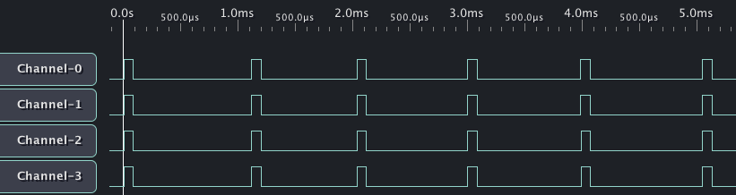
  and ran another three rounds of autotuning. 

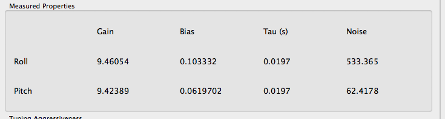

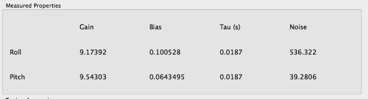

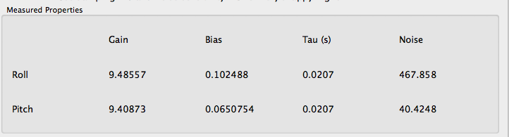

## Statistics

  

So of course the punchline. Is there a significant difference between traditional PWM and OneShot mode as measured by the time constant of the response? Yes. Anova shows p < 0.01 for an effect of output type: 

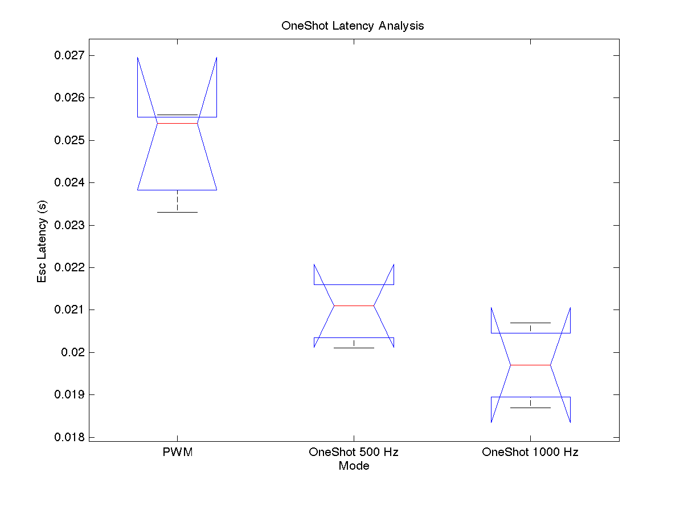
  

And the multiple comparison shows that both OneShot tests were significantly different than traditional mode. 

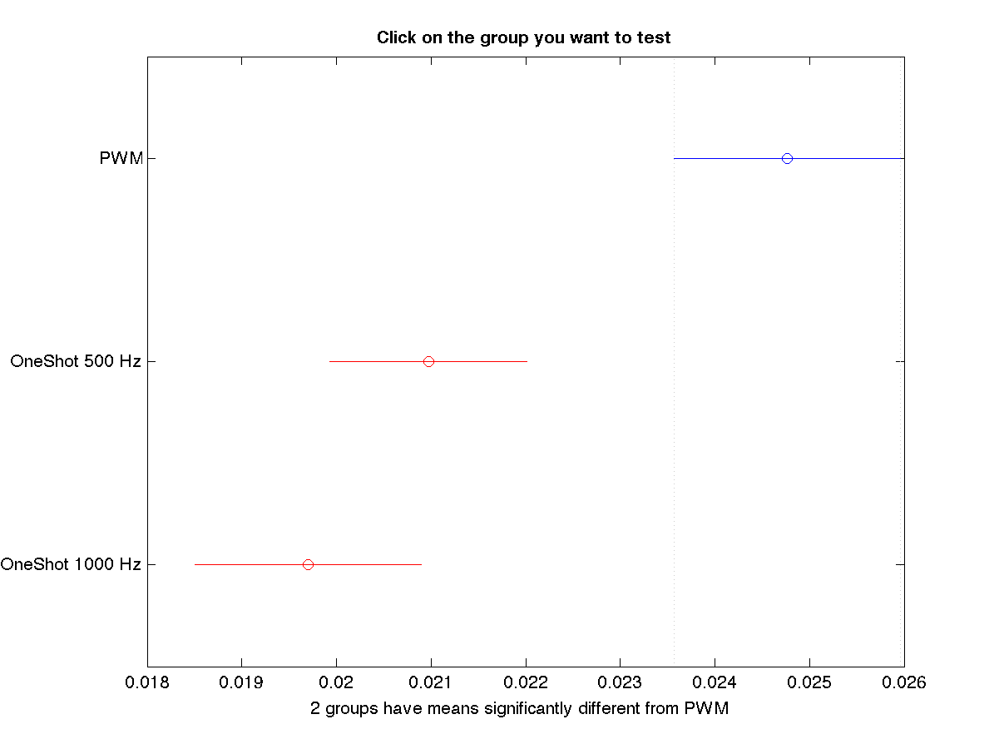

## Conclusion

  

Using OneShot mode on this quad results in about a 20% reduction in ESC latency. Even before OneShot, these KISS ESCs were pretty damn fast so it already flew really well. I'm not sure I'll be able to tell the difference in rate mode, but I do believe a better acro pilot than me could. I also didn't run these parameters through the system models to start seeing what the difference in effective control bandwidth will be for the outer loops (e.g. attitude).

It also remains to be seen if there are similar benefits with BLHeli and I believe SimonK has support coming soon for OneShot. I'll probably repeat these tests once I have the right hardware.
