**Update: see the next revision [here](../2015-03-25-brushedsparky-v02/index.qmd)** 

**Also [you can purchase Sparky2 here](http://www.hobbiesfly.com/taulabs-sparky2-0.html)** 

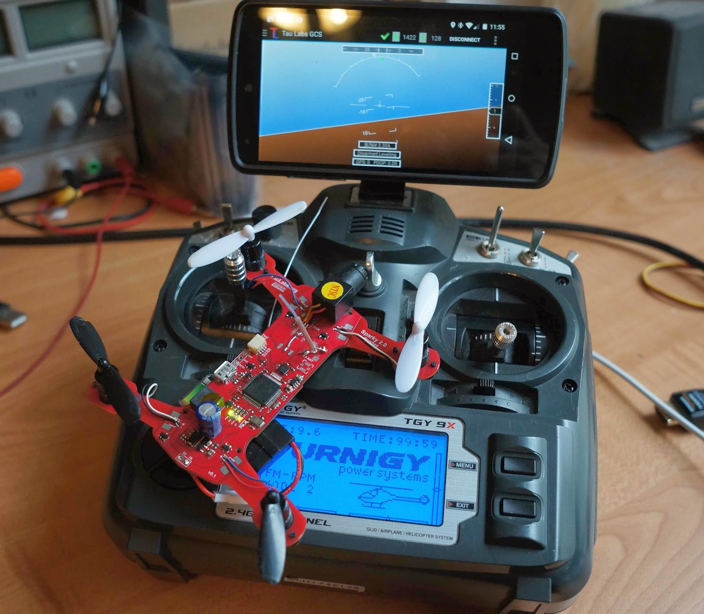

::: {.archive-video video-id="120901200" source="vimeo"}
:::

  

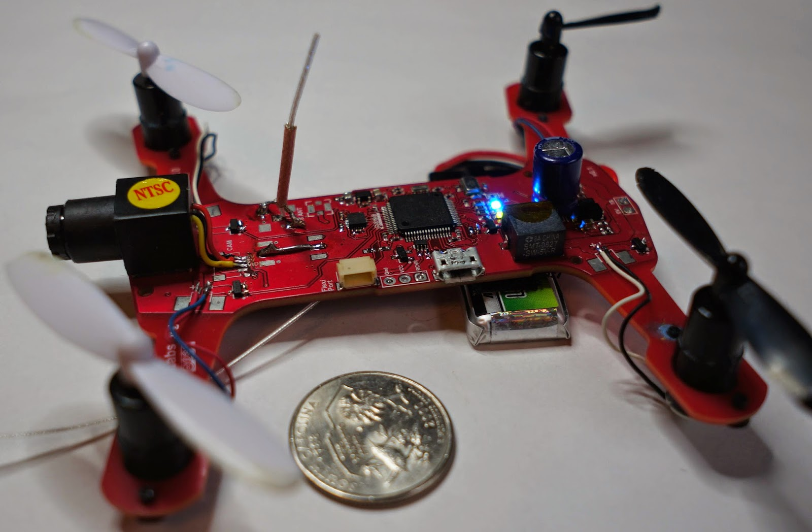

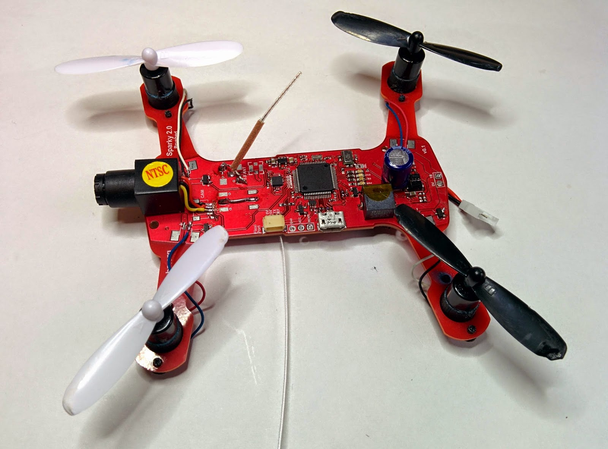
This is a new [TauLabs](http://taulabs.org/) board I just finished making.

I am now really into microquads for a number of reasons. They are much cheaper and relatively easier to build than full sized ones. They are great for testing things indoors while being quite safe. They make FPVing around a small space an adventure. Finally they are extremely easy to transport and then just quickly throw in the air.

The last month or so I've been on an adventure to build the best microquad I could. The photo above is my latest and greatest creation. It is essentially the guts of [TauLabs](http://taulabs.org/) [Sparky2](../2014-08-29-sparky-20-and-taulink/index.qmd) integrated into a single PCB with an integrated VTX and radio module on the bottom. This is a writeup of how I ended up there.

### Sparky2 based micros

[Sparky2](../2014-08-29-sparky-20-and-taulink/index.qmd) has some transistor buffered outputs. I've previously demonstrated these to [control LEDs via PicoC to create a visual compass](https://vimeo.com/105504442). However, their real goal was to control brushed motors on a microquad. OsoGrande finally motivated me off my butt to actually try this the other day. We both got some of [these brushed motors](http://micro-motor-warehouse.com/collections/all/products/cl-0820-17) that can draw a few amps and supposedly generate 40g of thrust each.

Here is his:

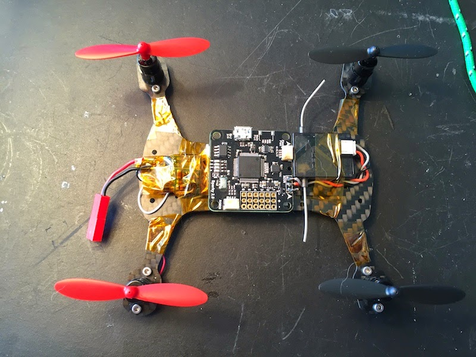

and mine (actually with a frame of his): 

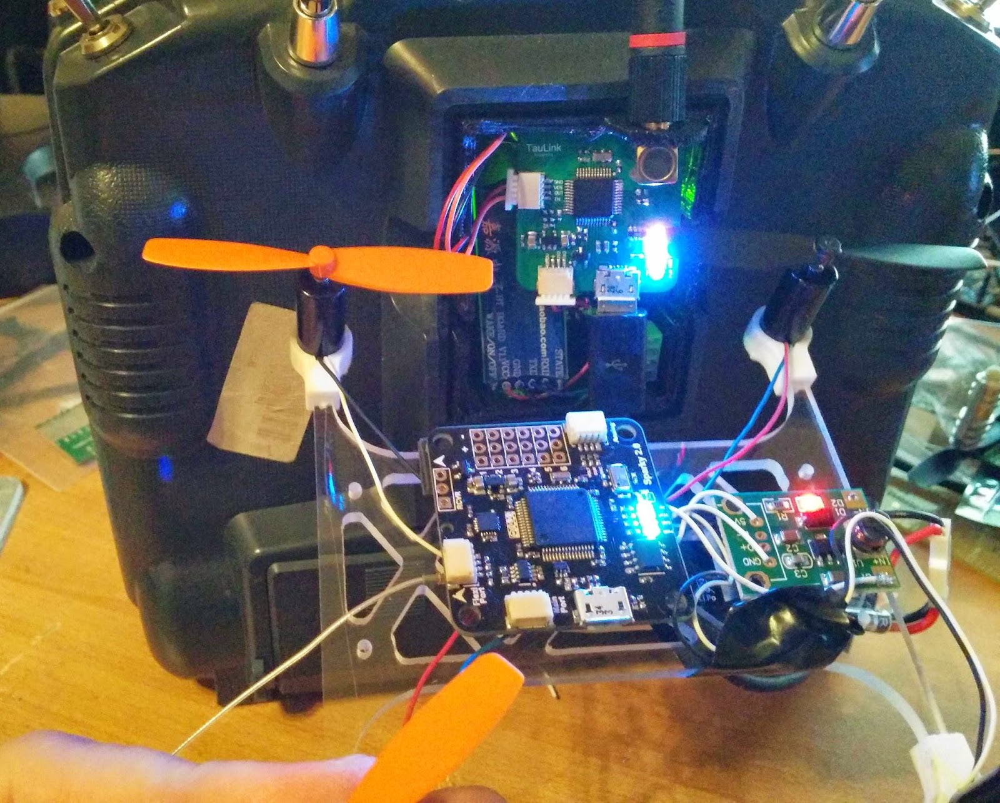

#### I hate wiring

To get this ready for FPV, it is really annoying to add the 1S to 5V step up, not to mention dealing with the cables and adding a VTX. To make this easier, I made a board that takes care of some of the details (compatible with both Sparky1 and Sparky2) 

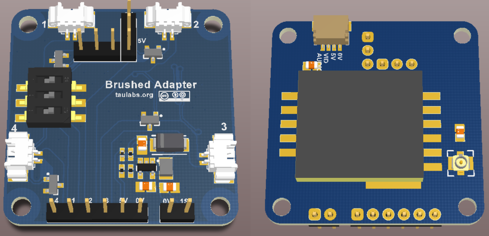

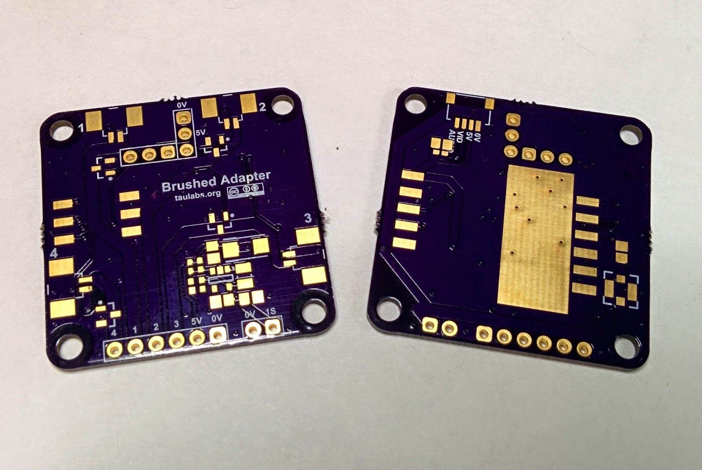

This adds the voltage boost, VTX, channel selection and connectors for standard motors. Before this even arrived, though, I was already on to a more fun idea (and want to redo it with 6 outputs for 3D printed hex's) ...

About this time OsoGrande received a really nice little PCB frame that has pads for a Polulu step up and a VTX module for doing FPV as well as mounting holes compatible with Sparky2 (and AlienWii):

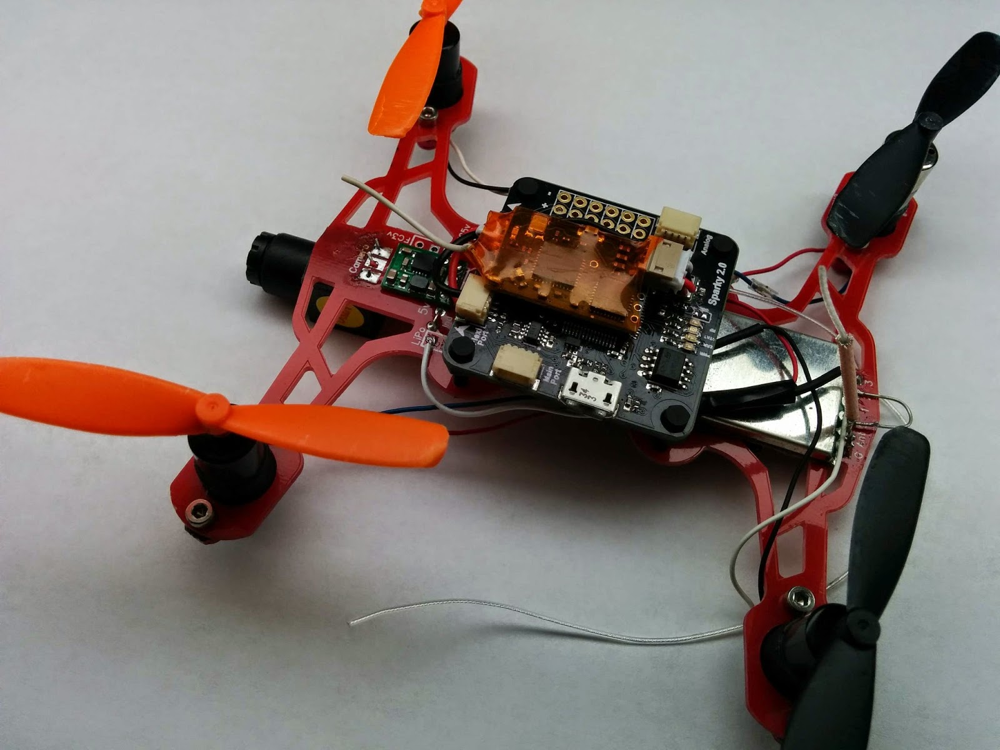

These were just too much fun to fly, but I really hated the wiring and ugliness of cobbling all these parts together.  

### BrushedSparky - A.K.A. Let's build a lot of these!

These tiny things are so much fun to fly, that I really wanted to make it easier to build them up and get rid of all the annoying wires and such. They are also great for micro FPV (see OsoGrande [having fun](https://www.youtube.com/watch?v=Uv9lHI-XzzA)) but soldering up the wires for the camera seemed like a giant pain.  

I designed a board that should double as a frame. It's a little less than 100x100 mm. It is basically [Sparky2](../2014-08-29-sparky-20-and-taulink/index.qmd) has the RFM22b module for control and telemetry without an additional receiver, integrated 1S to 5V step up, [TX5200M VTX](http://www.rangevideo.com/58-ghz/10-tx5200m-58ghz-200mw-5v-transmitter-module.html) and a full suite of sensors (so can do altitude hold and even navigation). It also has voltage monitoring and the digital to analog converter from Sparky2 goes to the audio input on the VTX so we should be able to send sounds to indicate low battery and such. 

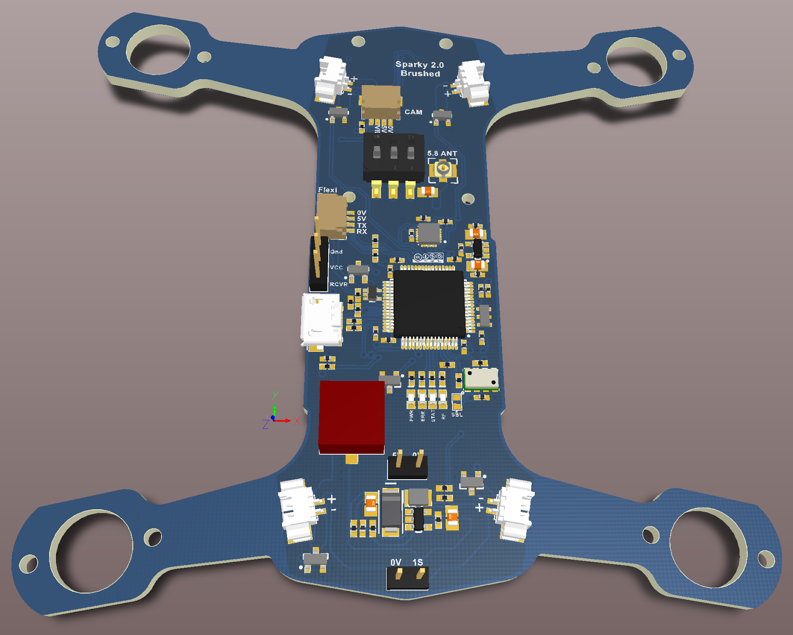

Specs: 

  

- Runs [TauLabs](https://github.com/TauLabs/TauLabs/releases)
- STM32F4 process (168 MHz, floating point unit) so lots of horse power
- MPU9250 gyro / accel /mag chip
- MS5611 pressure sensor
- RFM22b radio module (so hopefully this can be made OpenLRSNG compatible)
- TX5200M VTX module with DIP switch for channel selection
- 4 6A buffered outputs

#### Soldering and testing

DragonCircuits was awesome enough to make these four layer boards quickly and at a great price! The boards looked as good as I hoped they might.

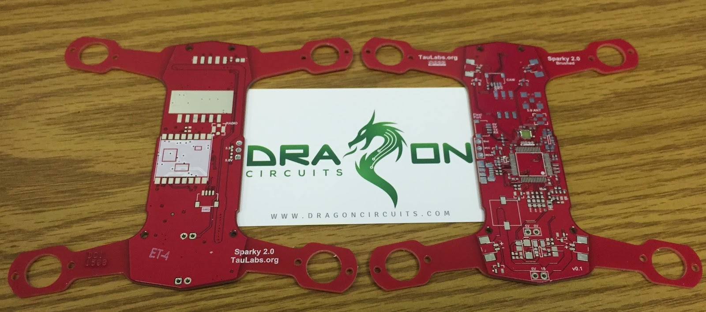
Here is one fully populated:  

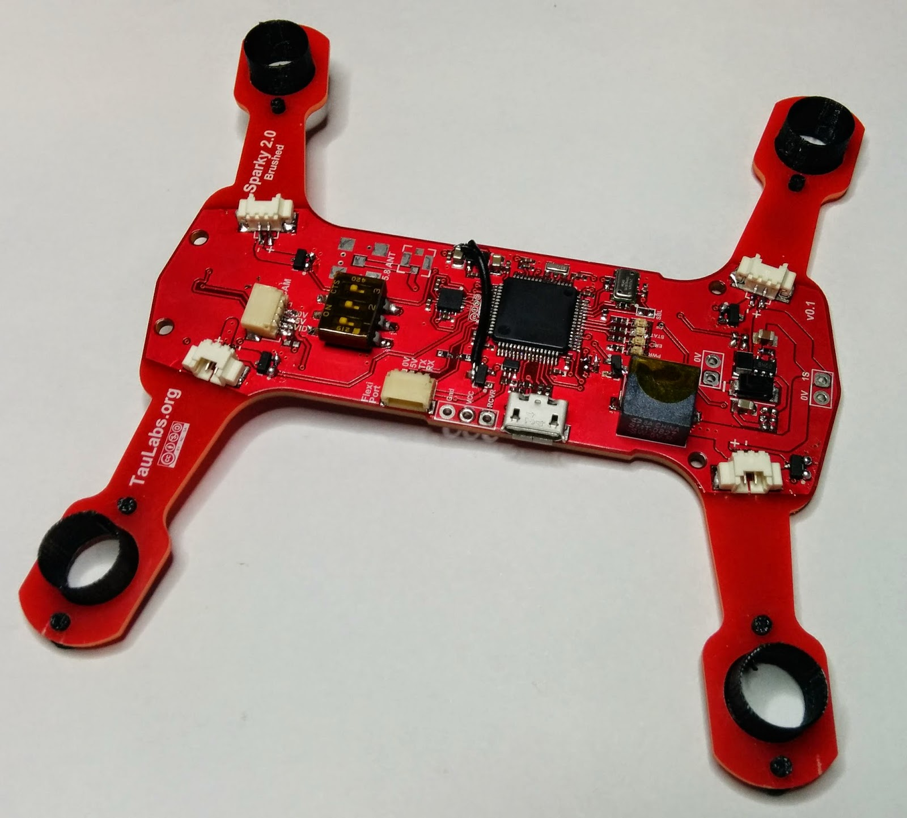

Here are the motor mount files I designed: 

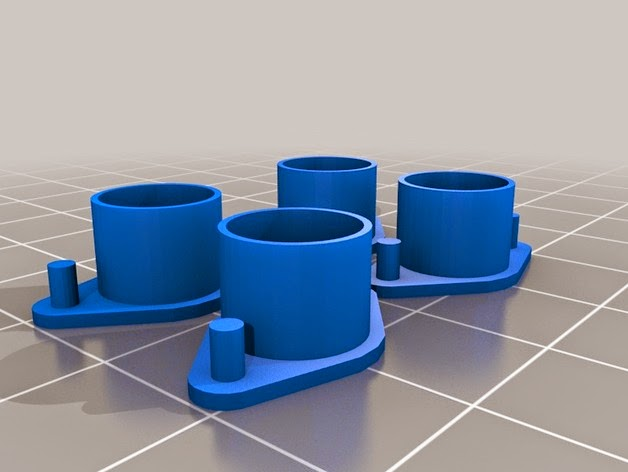

To save weight I used pegs on the mount instead of holes with hardware. This seems to work quite well, although I add a drop of loctite to keep them in place. I uploaded the files to [thingiverse](http://www.thingiverse.com/thing:704474). 

A few things I already want to change 

  

- Fix some small mistakes I made :)
- Adding holes for the camera and motor connections to make it easy for the headers to be optional.
- Add current sensing
- The buzzer I used is really not loud enough so I'll be looking for another one of those.
- Finally I really need to add a power switch for the VTX and camera so you can have it off when it isn't desired.
- VTX channel selection routed to the F405 to avoid carrying the DIP switch
- Few other fun surprises

Here is one that is populated to be a bit lighter. I'm soldering the motor wires directly to the pads and used a solder bridge to select the video channel instead of using the dip switch. It comes in at 43g. 

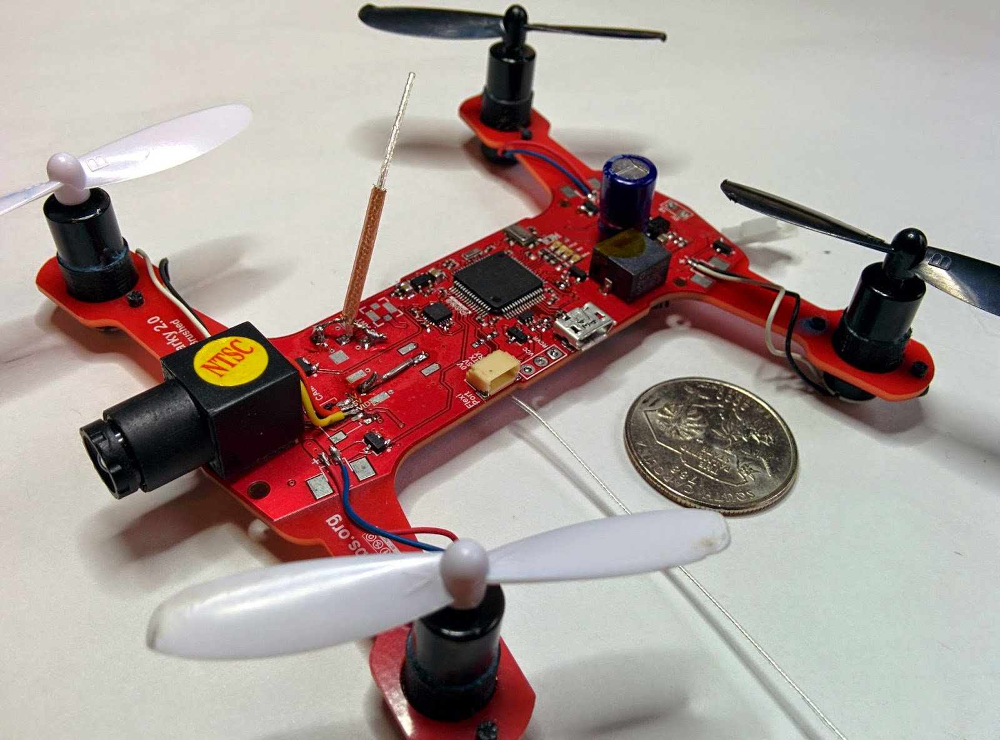

Here is an image of the bottom. You can see the radio module in the middle (RFM22b) and the VTX a bit further forward. The velcro on the VTX module is for when I want to carry a keychain camera. 

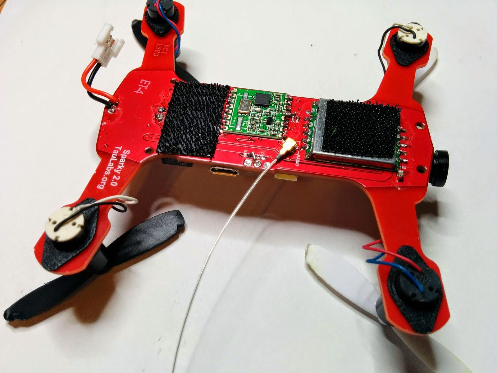

They are small enough I kept losing them, until I realized a little velcro could easily secure them over my desk: 

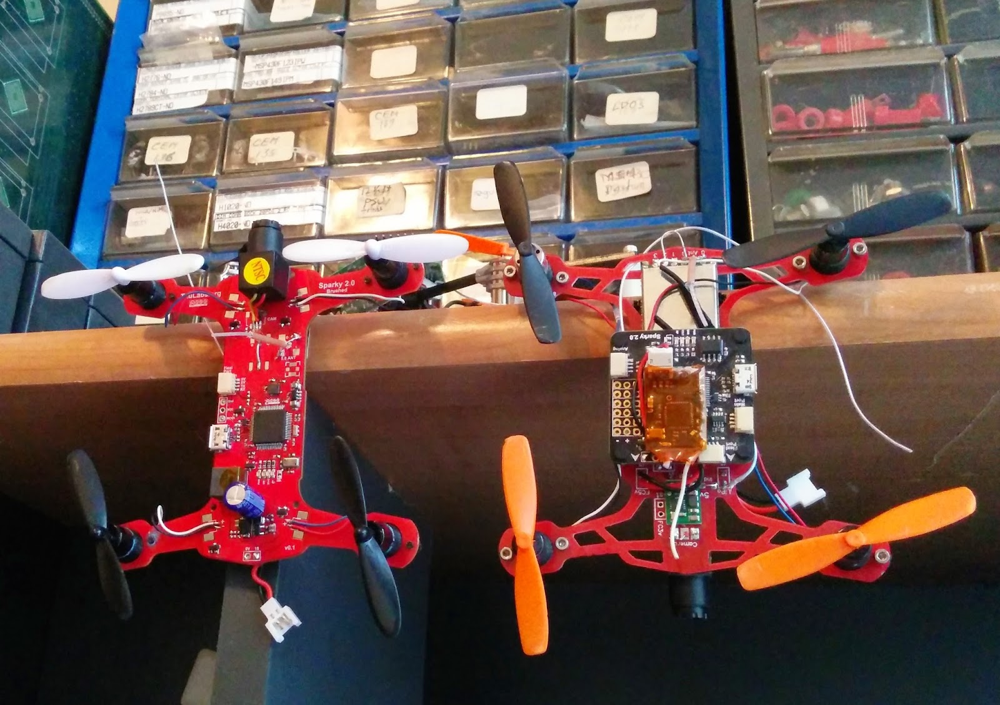

### Control Module

Since every gram counts on these things, I'd prefer to use RFM22b control instead of a satellite. I've already been using [TauLink](../2014-08-29-sparky-20-and-taulink/index.qmd) for this but it is annoying to jury-rig into a JR socket with a bluetooth relay module (shown below). I ended up designing a module that should fit into a JR socket and also has a bluetooth module to relay telemetry. This should allow me connect android (or even iphone is someone wrote code) to the quad without any additional wires. This uses a HM-10 bluetooth low energy module (which is actually compatible with iPhone as well) and the RFM22b module used on Sparky2 and TauLink.



*Update to my previous #taulink #androidgcs tablet transmitter—putting everything into a JR socket and using a normal transmitter.*

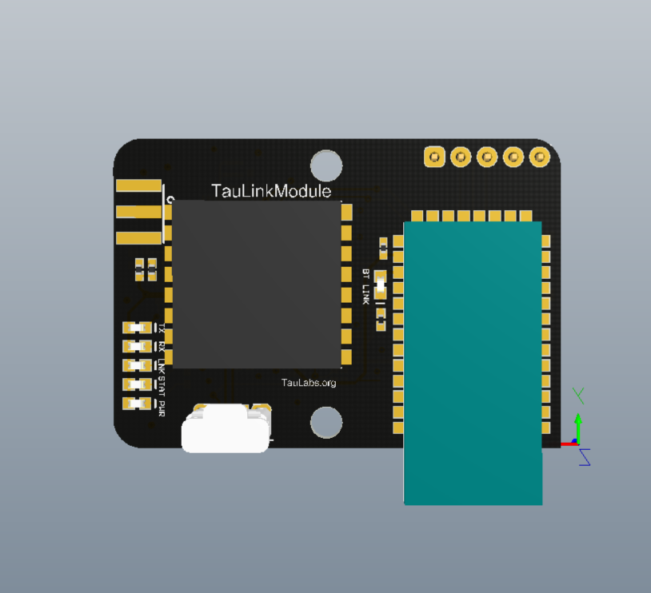
It plugs in quite well and fits into a JR socket easily. I'll probably make it a touch bigger just to give a few more mounting points for stability, but it fits well as it is. Plugs in nicely and smoothly into the socket pins.

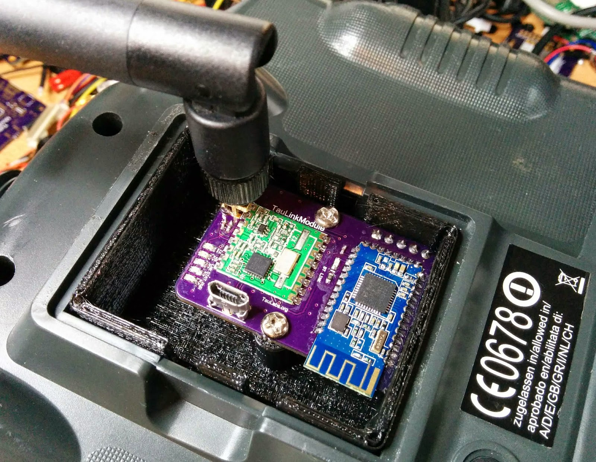

And of course the important thing is that it of course connects well to the quad for telemetry and PPM control. It was a bit of work to add support for this type of bluetooth low energy module to the androidgcs but it is also working. Gives me nice audio alerts for things like a low battery voltage and verbally tells me the flight mode. 

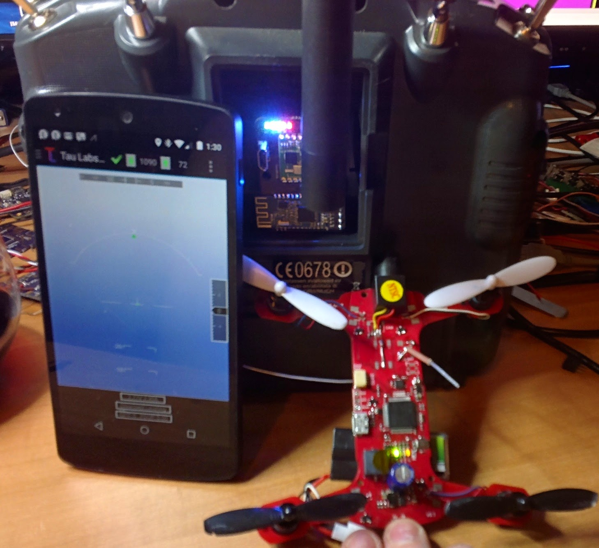

And a quick 3D printed mount to secure my phone over the transmitter to make it easy to use at the field: 

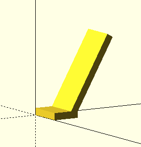

  

One thing that is annoying right now. The BT LE module doesn't work as simply as standard serial modules so I'll have to see if it is possible to relay to computer. This might be a reason to change modules, although with laptop it's easy enough to plug in USB cable since I'm normally inside rather than in field. This might not apply as well for everyone else, though. 

The other important goal of this module is actually to pump information back into the Taranis, so even without a tablet or computer you can see things like battery voltage, RSSI and LinkQuality. I'll update more about this later. 

### Flight testing

Overall I'm really happy with how they fly. The VTX module gets fairly hot (as do the motors) but so far nothing too much so. The video is pretty good, although not great. I think my receiver module is not on the same frequency bands as this module (it is on Boscam A frequencies and I think my stuff is on ImmersionRC frequencies). Alternatively, maybe a small circularly polarized VTX antenna will help since my breaking up seems to be at strong angles. 

With a 750mAh battery it will hover for around 5 minutes at about half throttle. It weighs 65g in this configuration.

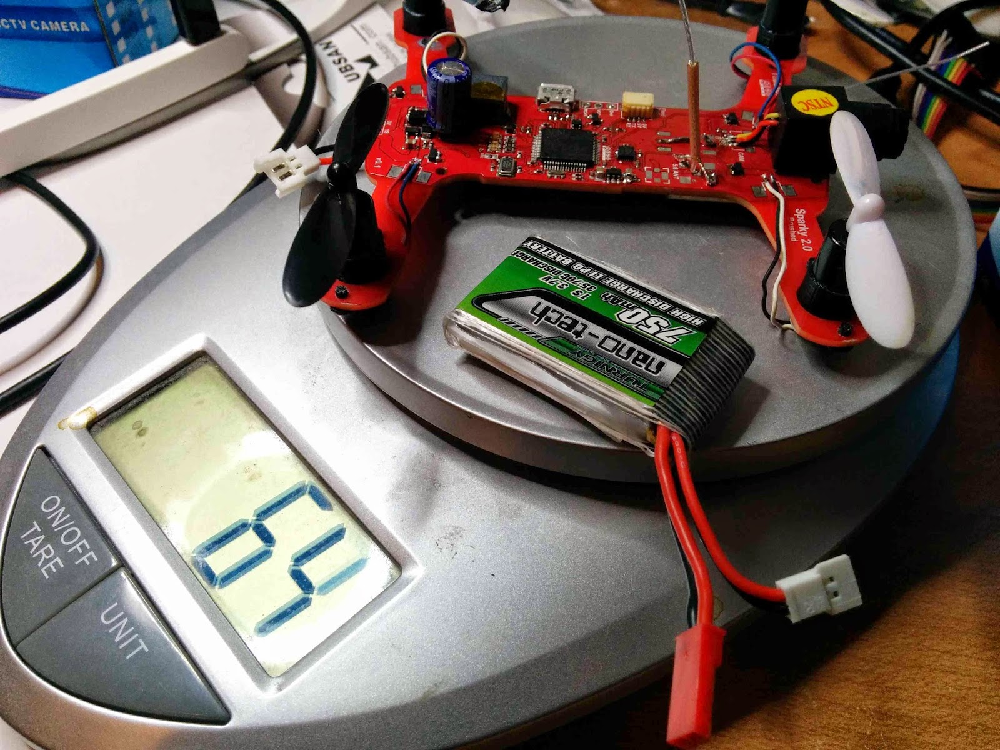

Of course, here is the video (same as above):

::: {.archive-video video-id="120901200" source="vimeo"}
:::

Here is OsoGrande out testing his using some people as obstacles:



  

It will also fly with a keychain camera attached to the bottom, but that adds another 19g and
  takes most of the spare thrust so I don't really enjoy flying like this. Ground side recording for now it is.  

### Future fun

- The Pico camera I'm using right now is a bit heavier than I'd like, so I want to try out [this one](http://www.multirotorsuperstore.com/fpv/fpv-cameras/micro-600tvl-120-degree-camera.html) from multirotorsuperstore.com that also has a wider FOV for exploring the furniture **(update: tried it and I like it!)**:

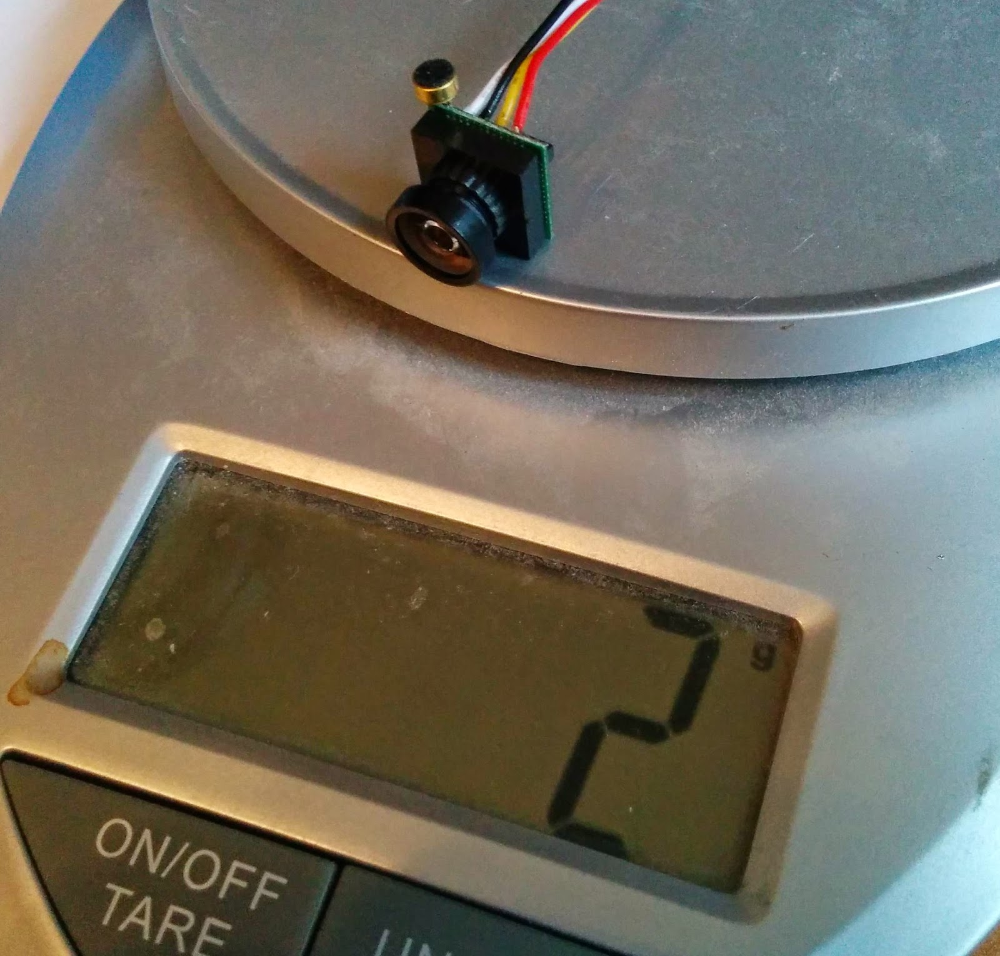

- I also wanted to see if this would behave well for navigation, so spun it a few times while logging and threw the data into the python calibration script:

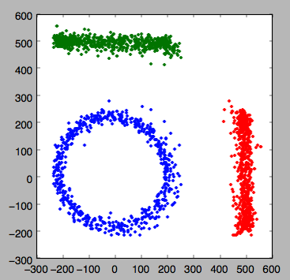

  
The nice round circle shows that the magnetometer is a beautiful round circle, so with a GPS it should work great for navigation.
- Get Taranis input straight from telemetry with the TauLinkModule so basic things (e.g. RSSI, Battery voltage) are shown on transmitter without even needing phone or tablet.
- I really need to join up with OsoGrande (who I made one of these for as well) and do some FPV racing in the garage near him...

### Fun for you too?

Also since I know the inevitable torrent of questions about this is going to be "where can I get one", I'm working with someone to try and get them manufactured. In the mean time I'll likely make a few for friends and developers for testing purposes, but not too many. Keep an eye on my Instagram/twitter account and I'm sure you'll know not long after I do.
