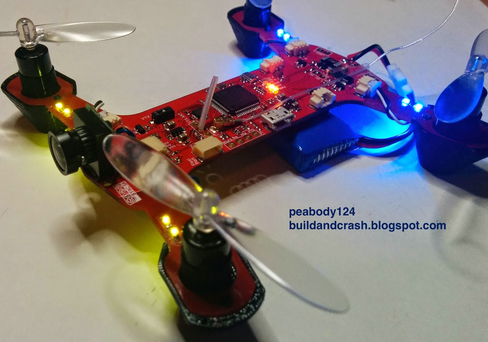
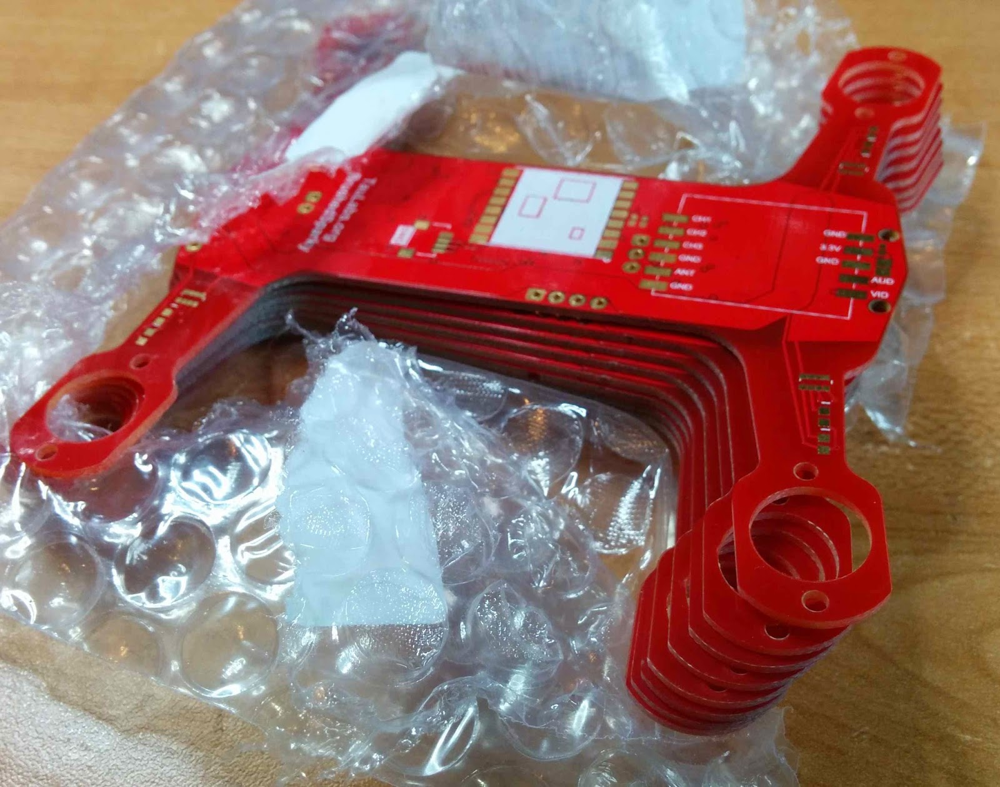
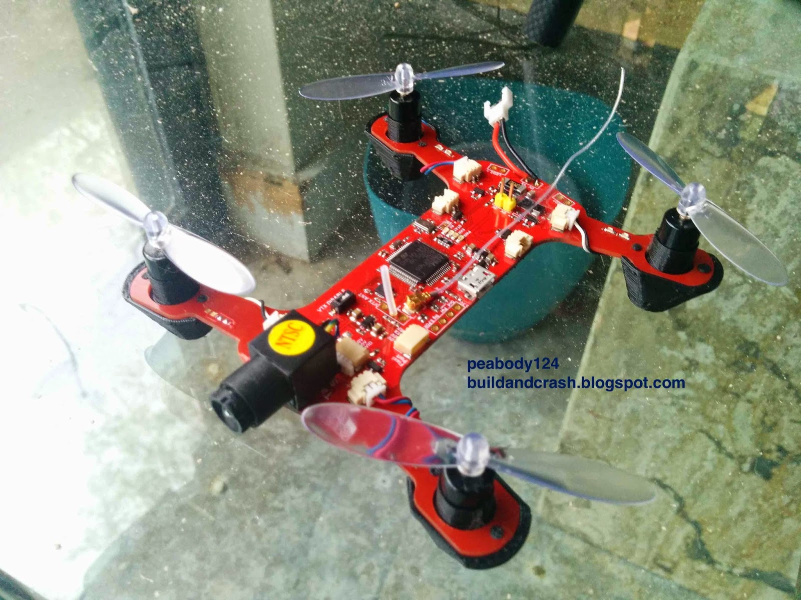
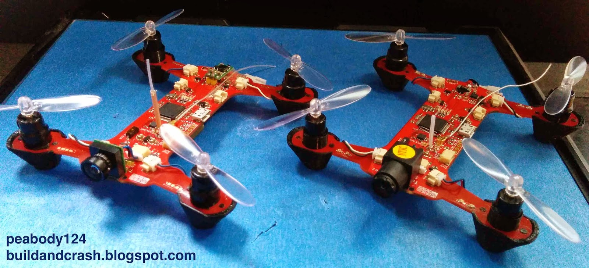
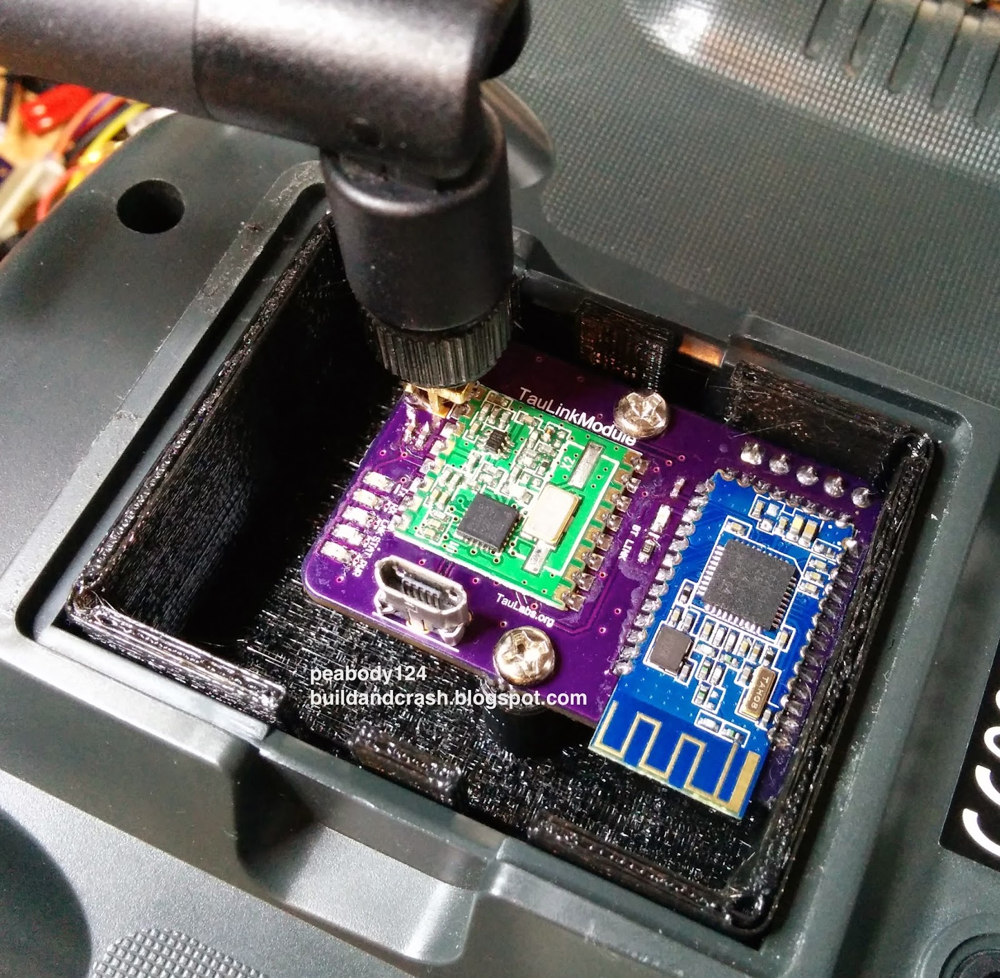
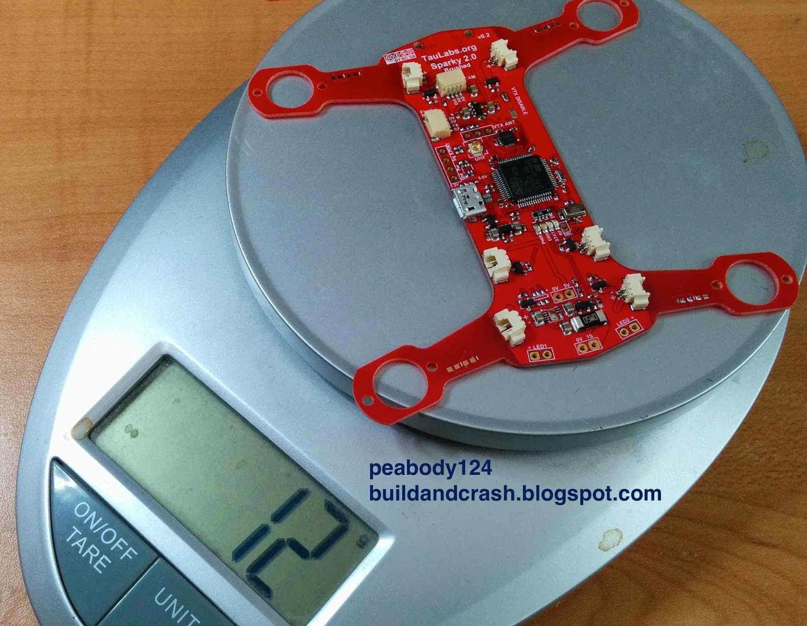
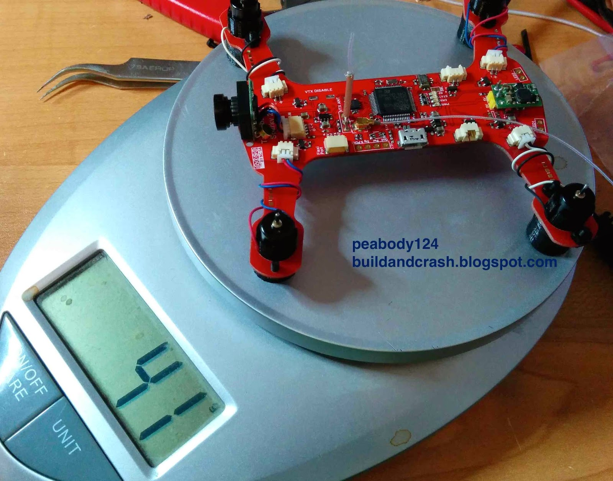
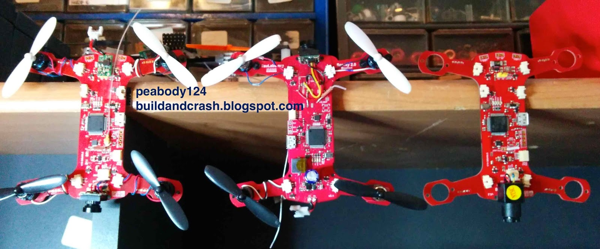
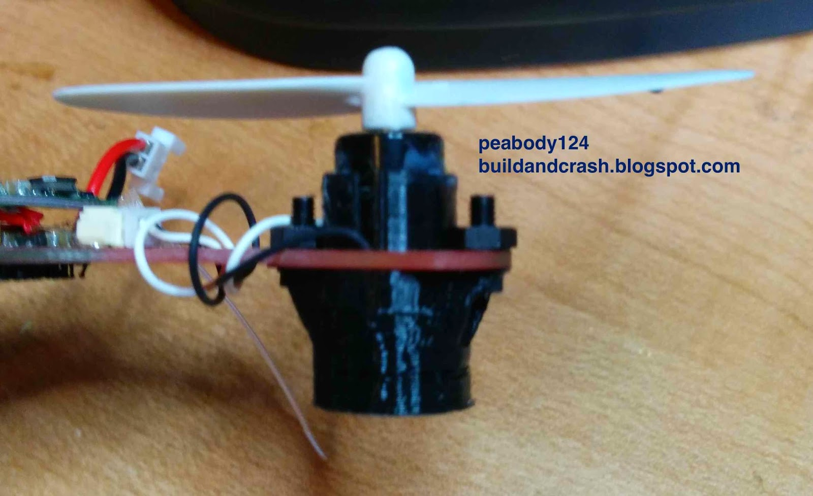
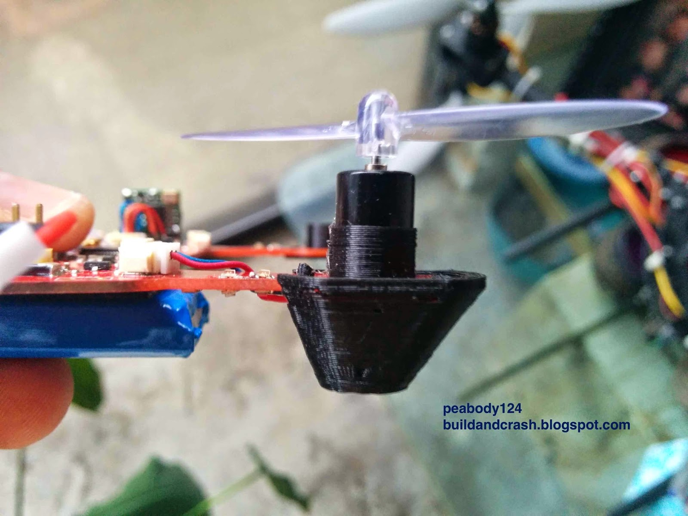

**[you can purchase Sparky2 here](http://www.hobbiesfly.com/taulabs-sparky2-0.html)** 

BrushedSparky version 0.2 arrived a few days ago.  

#### Improvements

There are a number of improvements over the [previous revision](../2015-02-28-brushedsparky-sparky2-microquads/index.qmd). 

  

- A bigger motor mount hole allows for stronger mounts.
- Using a 1.2 mm PCB shaves a bit of weight off.
- Changed the 5V step up regulator for a new one that is more efficient (and doesn't hum).
- Using a more available VTX module so I can build more :)
- Shuffled some components around for a slightly slimmed profile (also got a stencil to make it faster to populate).
- Current monitoring (enables mAh consumed calculation)
- Switch to disable VTX for flying LOS
- VTX channel selection via the FC
- LEDs on the arms for following via FPV
- Two additional PicoBlade connectors for clipping arms to it and making a hex. Also two more buffered outputs on the back such as for LEDs.

I'm still controlling it via Tau Link Module, which gives me voltage, current, mAh remaining (as well as logging) on my phone relayed using the module in the transmitter. See the [previous](../2015-02-28-brushedsparky-sparky2-microquads/index.qmd) writeup for more information. Quite convenient since it gives me audio alerts. The new revision of Tau Link Module also has SPort support so hopefully I get this information on the Taranis soon. 

#### Assembly

The bare board assembled (without VTX on bottom) is only 12 grams: 

And 41g ready to fly (without battery): 

And now I have a nice row of micros above my desk: 

#### Landing gear

One failure point is hitting the bottom of the motors and damaging them. I tried to design a more robust motor mount that protected them better and served as a landing gear: 

Unfortunately it coupled vibrations too strongly into the frame and resulted in bad attitude estimation (not hovering level). I went with the original design for the [motor mount](http://www.thingiverse.com/thing:704474) and a [landing cup](http://www.thingiverse.com/thing:737486)that clips onto the arm and protects things. 

They do pop off in crashes, but that's fine since it still saves any serious damage. I want to get my friend to try printing these in different materials - abs or flexible material - and see if it works any better.

#### BOM

Here are the parts I'm using for my preferred assembly. You can either buy all the parts from multirotorsuperstore or in pieces. 

- motors:
  - \$20 [Multirotor Superstore CL-0820-17 coreless motor set](http://www.multirotorsuperstore.com/cl-0820-17-coreless-motor-set.html)
  - \$30 [Micro Motor Warehouse CL-0820-17](http://micro-motor-warehouse.com/collections/all/products/cl-0820-17) (precrimped with connectors)
- props:
  - \$3 for 4 colored: [Hubsan prop set](http://www.multirotorsuperstore.com/propellers/propellers-nylon/hubsan-prop-set.html)
  - \$9 for 20 clear: [Amazon Hubsan clear props](http://www.amazon.com/dp/B00RE5US38/ref=sr_ph?ie=UTF8&qid=1427170689&sr=1&keywords=hubsan+clear)
- camera:
  - \$30 [Micro 600TVL 120-degree camera](http://www.multirotorsuperstore.com/micro-600tvl-120-degree-camera.html) (nice FOV)
  - \$50 [Lumenier CP-520 Pico 520TVL Nano Camera](http://www.getfpv.com/lumenier-cp-520-pico-520tvl-nano-camera.html)
- VTX module:
  - \$10 [TX5823 5.8G 200mW VTX module](http://www.banggood.com/FPV-5_8G-200mW-Wireless-Audio-Video-Transmitter-Module-TX5823-p-84780.html) (Boscam E band)
  - \$14 [RangeVideo TX5200M 5.8GHz 200mW VTX module](http://www.rangevideo.com/58-ghz/57-tx5200m-58ghz-200mw-5v-transmitter-module.html)
- VTX antenna:
  - RHCP \$10: <http://www.fpvhobby.com/231-8-ghz-micro-cl-antenna-.html>
  - LHCP \$5: <http://www.banggood.com/FPV-5_8G-Circular-Polarized-LHCP-VTX-Antenna-p-961731.html>
- battery:
  - \$5 [1S 380mAh 35C LiPo](http://www.multirotorsuperstore.com/battery/1s/1s-380mah-35c.html) (note these are 35C)
  - \$3.50 [Turnigy nano-tech 750mAh 1S 35-70C LiPo](http://hobbyking.com/hobbyking/store/__33260__Turnigy_nano_tech_750mah_1S_35_70C_Lipo_Pack_Fits_Nine_Eagles_Solo_Pro_180_US_Warehouse_.html) (750mAh)
- charger and miscellaneous:
  - charger: [4-in-1 X4 Battery Charger](http://www.banggood.com/4-In-1-X4-Battery-Charger-For-Hubsan-X4-WLtoys-UDI-JXD-Syma-Quadcopter-p-933932.html)
  - [use this](http://www.amazon.com/gp/product/B007OXK330/ref=oh_aui_search_detailpage?ie=UTF8&psc=1) for attaching. It is magical.

#### Video

   

I'm really happy how it flies as well as the video quality (which the Dom V2 built in DVR doesn't do justice to). I started playing around in acro mode too and got some flips in, as well as a number of crashes. It takes abuse quite well, typically in a really bad crash just cracking the motor mount which takes about 2 minutes to replace.

::: {.archive-video video-id="123224072" source="vimeo"}
:::

  
**(Update)**I also got telemetry on the Taranis via the TauLinkModule S.Port

  



*Playing with #BrushedSparky Taranis telemetry via #TauLinkModule: RSSI, voltage, current, flight mode, altitude, vario.*
