I [previously did some tests](../2015-01-31-oneshot125-quantitative-testing/index.qmd) with KISS ESCs comparing the performance with OneShot to normal PWM modes showing Tau Labs implementation has a nice low latency from sensor update to output pulse, as well as the fact that OneShot results in better system performance.

Since then, I've wanted to replicate it with BLHeli's OneShot mode and see if it is has similar benefits. I got some BearHug ESCs, which **unfortunately are quite unreliable** and needed a few to be replaced which slowed things down. (In retrospect I wish I'd used [these four in one ESCs](http://www.banggood.com/BLHeli-12A-4-In-1-Brushless-ESC-Speed-Controller-p-949609.html)). Anyway, I eventually got a working set of four and soldered the programming cable to them. I used my [KISS PDB board](https://oshpark.com/shared_projects/5MMpnB1l) again which provides a 5V BEC as well as current/voltage monitoring.

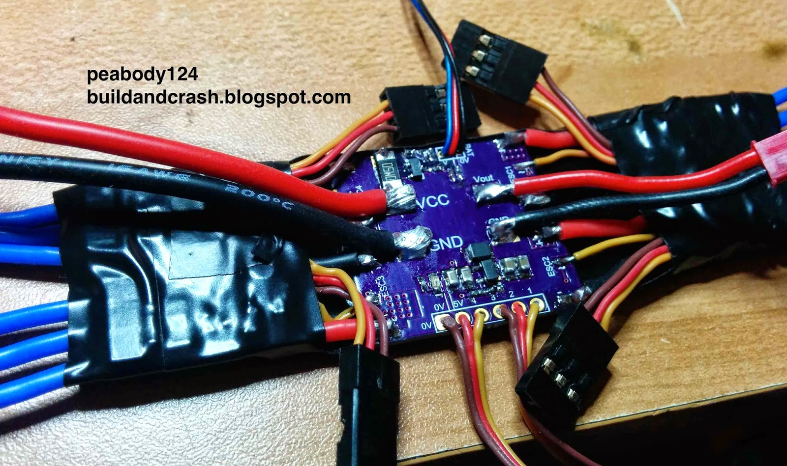
I put them on a [ZMR250](http://us.banggood.com/Wholesale-Warehouse-H250-ZMR250-250mm-Carbon-Fiber-Mini-Quadcopter-Multicopter-Frame-Kit-wp-Usa-933185.html) frame using and this pretty [nice cheap FPV](http://www.banggood.com/Eachine-700TVL-13-Cmos-FPV-110-Degree-Camera-w32CH-Transmission-p-965760.html) system that seems to work fairly well. I'm also using these [new plastic motors](http://hobbyking.com/hobbyking/store/__69296__Emax_PM1806_2300Kv_Brushless_Multi_Rotor_Motor_Set_1xCW_1xCCW_.html) that are dirty cheap (30$ for four). They are spinning 5 inch props.

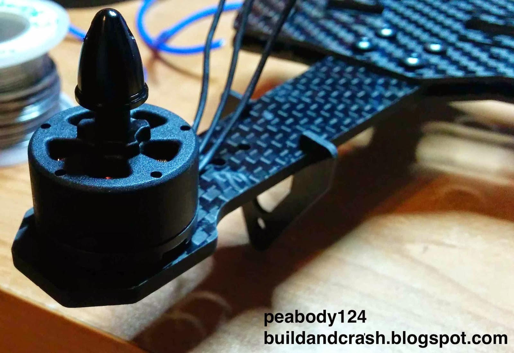
Of course, it's running a [Tau Labs](http://taulabs.org/) [Sparky2](../2014-08-29-sparky-20-and-taulink/index.qmd) for the flight controller and [TauLinkModule](../2015-02-28-brushedsparky-sparky2-microquads/index.qmd) for control.

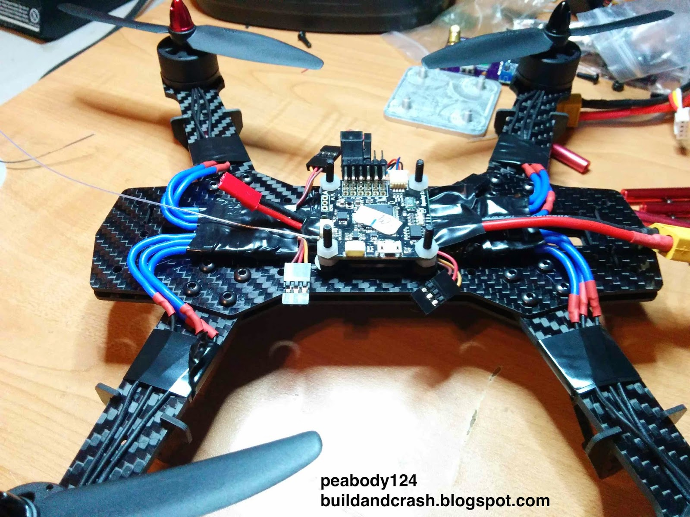
The PDB and ESCs fit quite nicely under the flight controller and leave room for the programming cables. And here it is all put together with the FPV system.

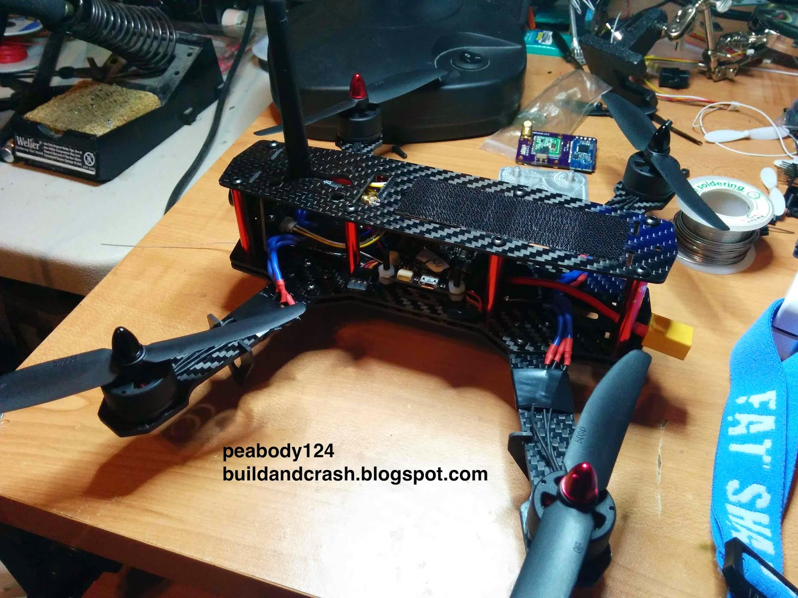
The antenna placement is probably a terrible idea ... the VTX is connected with velcro so can pop off in a crash. I'll redo this once some cloverleaf antennas arrive.

#### Flashing and Configuring

Once it was all put together, I followed this nice video by AKFreak on how to flash the ESCs (using a VM). This was actually the first time I'd played with an Arduino other than the one in my Shapeoko. 



I programmed all of them with BLHeli 13.1 

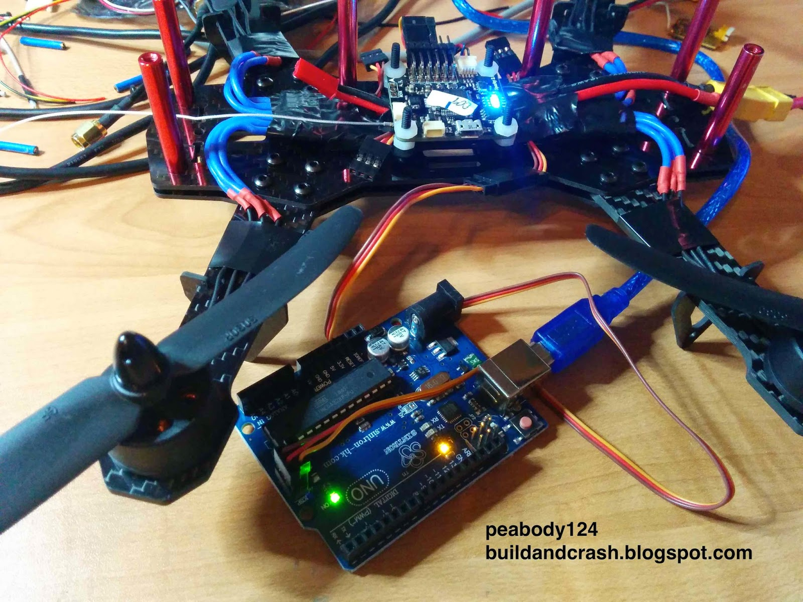

I went ahead and enabled Damped Light mode: 

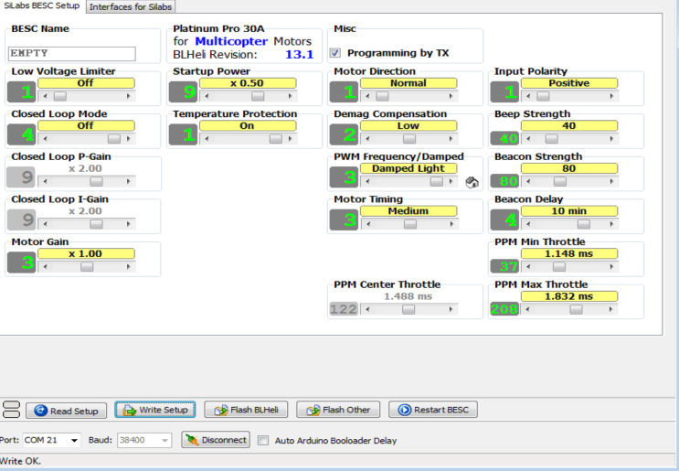

#### Results:

I used the [Tau Labs system identification](https://vimeo.com/104806460) performance to measure the latency of the ESC responses with regular PWM and OneShot125 mode. 

  

**Regular (PWM High)** 

  

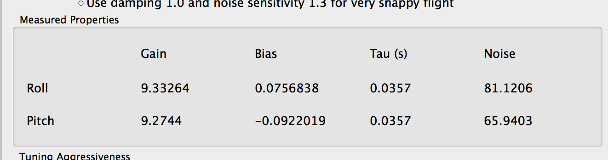

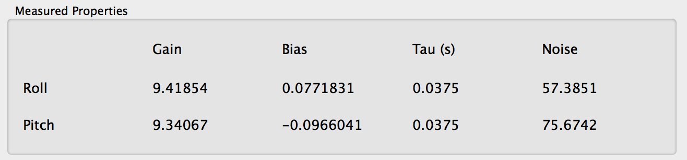

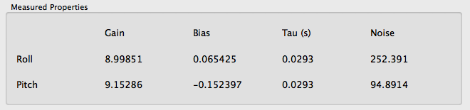

  

**One Shot (PWM High)** 

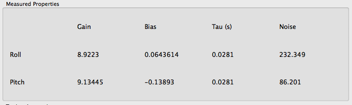

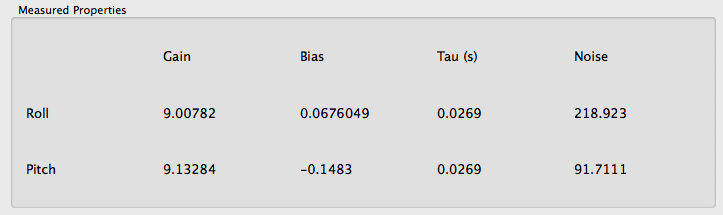

  

**One Shot (Damped Light)** 

  

This was done over two batteries so a range of voltages, although one of the slower outliers was actually with a fairly charged battery. 

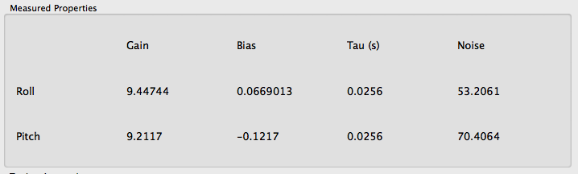

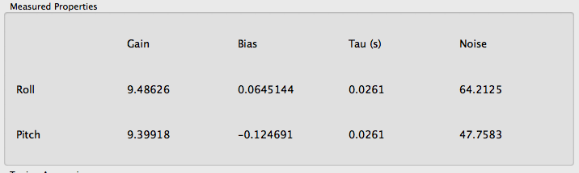

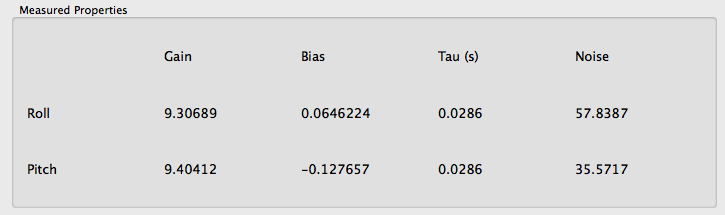

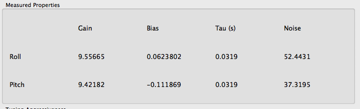

**Regular (Damped Light)** 

  

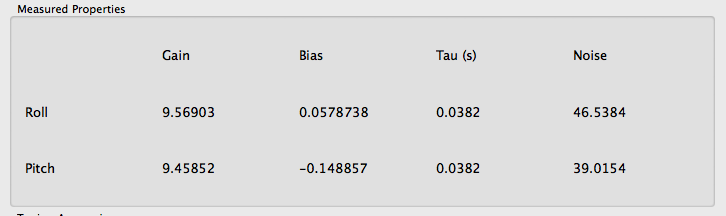

  

At this point the BearHugs were becoming incredibly unreliable and dropping out of flight during autotune so I couldn't repeat it 3 times. Eventually I smelt the magic smoke and just gave up. 

#### Conclusion:

*BearHug ESCs are really not reliable :( I've burnt so many hours trying to get flying on these. Can someone recommend alternatives that run BLHeli and are good for fast switching?* 

  

Average Tau: 

Regular (PWM High): 0.034 (s) 

One Shot (PWM High): 0.028 (s) 

Regular (Damped Light): 0.038 (s) -- note this is only one trial 

One Shot (Damped Light): 0.028 

I'm not comfortable running statistics on this since the ESCs failed and I didn't get enough trials. There was more spread in the data than I'd have expected that wasn't explained by battery sag. One of the good regular runs was 0.029 and a two of the One Shot (damped) runs were greater than > 0.03. However, on average OneShot definitely seems to be trending in the right direction.

That being said, enabling OneShot consistently improves performance with these ESCs. The performance improvement was actually greater than for KISS (17% improvement) although it is hard to say if that is because of greater improvement for OneShot or worse performance for regular. I'd have to compare on the same motors / frame.  I'd be curious to see if Damped Light makes more of a difference on larger props. 

The autotune settings were really snappy and I just wish I could trust this thing to stay in the air for five minutes (or now to even power up).

TL;DR: OneShot with BLHeli seems like a worthwhile improvement if you want that last ounce of performance.
