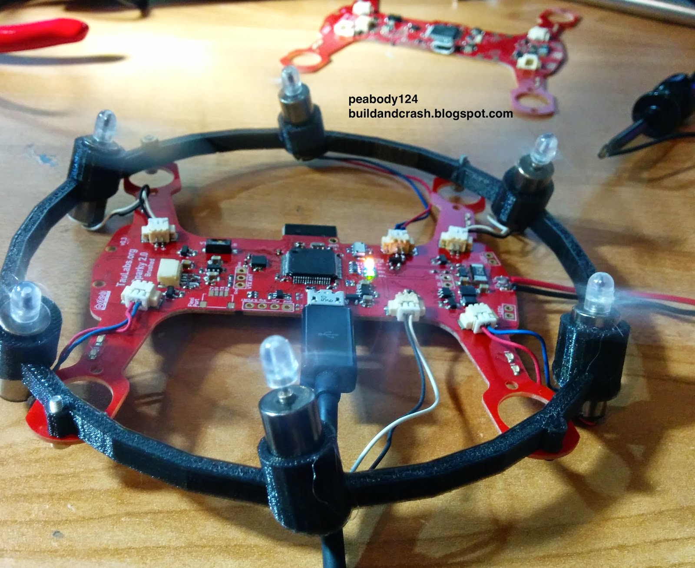
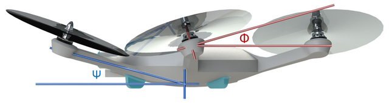
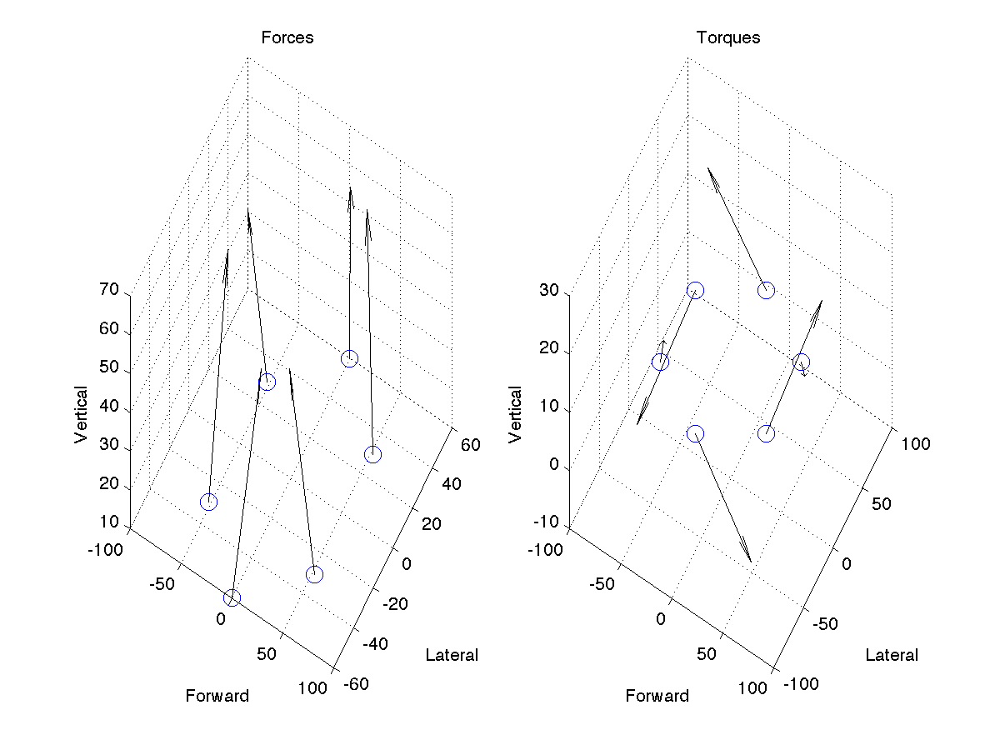
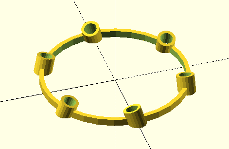
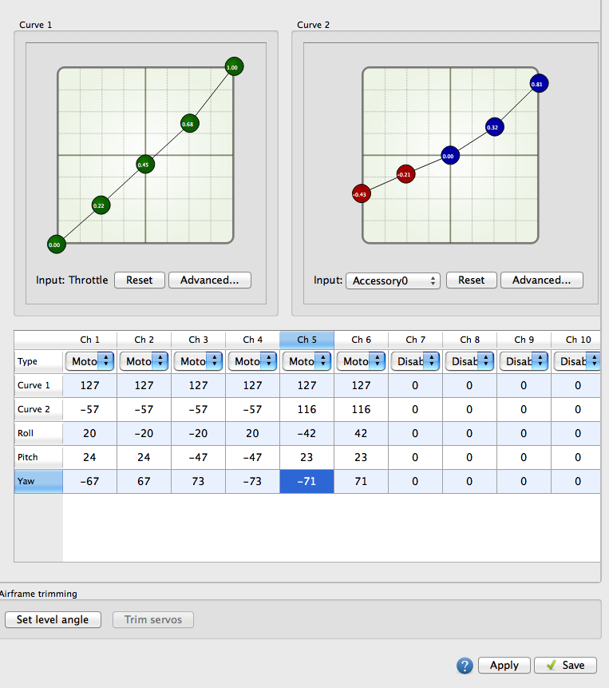

It was exciting to see another player adopting Tau Labs at their core with the announcement of the CyPhy LVL 1 [kickstarter](https://www.kickstarter.com/projects/1719668770/cyphy-lvl-1-drone-reinvented-for-performance-and-c?ref=popular). This is a really neat drone project that removes the need for a gimbal while flying by being able to navigate around and remain level. This is a neat idea but traditionally multirotors fly by tilting to generate lateral acceleration. While they are using Tau Labs, they haven't yet released any code, so we can't look there. So how do they do it?

**Note: I am affiliated with Tau Labs not CyPhy or LVL1 so this is all inferred from their press information**.


  

  

Figuring this out seemed like a fun evening challenge, and also highlights that Tau Labs is flexible enough to really make things like this easy. The best way to understand something is to replicate it, so let's dive in.

### Traditional system

So a traditional quadcopter has four motors. The speeds of these four motors are computed based on four inputs: roll torque, pitch torque, yaw torque, and finally total thrust. This is a fully constrained system and has no possible other inputs. There are some ways to permanently alter it. For example many people are experimenting with tilted motors to generate horizontal force while staying closer to level. This allows faster FPV flights while keeping the camera more level (e.g. [TBS Gemini](http://team-blacksheep.com/products/prod:gemini), which also uses Tau Labs).

You can also make this more flexible but tilting the motors dyamically using a tilt mechanism. For example I put this on [TriBlivion](../2013-04-18-triblivion-and-sparky/index.qmd), which allows you to fly forward controllably while staying level.

Once you go to a hexcopter, you have an overactuated system: where you have more control outputs than you have desired inputs. For a traditional arrangement of motors (all horizontal, such as Y6 or flat 6) there is no way to use a different mixer and generate more forces. This can be written more formally: there is a matrix that translates from motor RPMs to torques (3 rotation directions) and thrusts (in 3 directions, forward, leftward, and upward) and they cannot be dissociated.

  

### A more controllable hex

This does not have to be the case. If we do not have all the motors parallel, then is it possible to separately control thrust forward (like with tilted motor racing quads) separately from the thrust upward. I saw this [image online](http://www.clubic.com/mag/transports/actualite-765710-cyphy.html): 



Which shows the side profile in a more informative manner. You can see the front motor is tilted back and the middle motor is tilted forward. If you were to speed up the middle motor while slowing down the back and front motor, you would create no net rotational force while generating a forward force. If you speed up the front and slow down the back motor while speeding up the front motor, you would create a pitching upward torque. If you speed up all three, you create an upward force. So for these three motors you can separate forward force, vertical force, and pitching torque. 

*TL;DR: 6 motors means 6 controls!* 

  

As an aside, basically anyone that has been flying a V-tail has been doing this type of vectored thrust for years. With a V-tail you have two motors at the back that are angled and fighting each other. Combined they create a pitch force. Their difference creates a yaw force. However this is not an over-actuated system -- it has four motors and four controls. 

   

### Let's math it

Now let's try and extend this to a general solution with 6 motors and also while at it solve for the mixer that would allow us to control things. 

Each motor will have a position -- in this case spaces at 60 degrees along a unit circle (although since this is a general solution we can change this later and re-derive it). The front two motors will be tilted backward and slightly outward (adding some yaw and lateral maneuvering). The middle is tilted inward and force, and the back are only tilted inward. 

Put these into quaternion notation, we can then do a little bit of math to convert their thrust into the frame reference plane: 

```
for i = 1:N
    q(i,:) = RPY2Quaternion([mot_r(i), mot_p(i), 0]);
    
    % the last column of the matrix that rotates from the body (motor)
    % to the earth (hexcopter) reference frame gives the force it generates
    % in each axis
    Rbe = Q2Rbe(q(i,:));
    force(i,:) = Rbe(:,3)';
end

```

  
Now those thrusts can be used to compute the lateral forces. However, they also create torques on the frame which we want to solve for. The yaw force from each motor is a mixture of two components. the first is from the drag of the blade on the air creating a rotation force on  the frame that will be proportional to the Z force. the second and larger will be the cross product of the position of that motor relative to the center of mass. Since I plan to use this with tiny props, the thrust component of the yaw will be dominant and I will ignore the drag.  

```
k1 = 0.0; % the drag component
k2 = 1;
for i = 1:N
    torques(i,:) = cross(force(i,1:3)', pos(i,:)');
    torques(i,3) = k2 * torques(i,3) + k1 * CW(i) * force(i,3);
end

```

  
We can visualize these forces and torques in 3D:


From this, we can generate a matrix that takes the set of motor RPMs and computes the torques and accelerations:  

```
k1 = 0.0; % the drag component
% W maps from 6 motors to six control outputs
% roll, pitch, yaw, forward, sideways, up
W = [torques'; ...
     force'];

```

Then finally using the pseudo-inverse (or since this is 6x6 we can use true inverse) we can calculate mixer matrix that will let us take the desired roll, pitch, yaw rates, and forward, sideways acceleration and solve for the motor settings.  

```
k1 = 0.0; % the drag component
M = W'*(W*W')^-1;

```

The result gives us a nice sensible mixer matrix 

```
k1 = 0.0; % the drag component
M =

    0.0068    0.0034    0.0084   -0.6356   -0.9976    0.1764
   -0.0068    0.0034   -0.0084   -0.6356    0.9976    0.1764
   -0.0060    0.0034    0.0101    1.2963   -0.0296    0.1764
    0.0011   -0.0068   -0.0115   -0.6433   -0.9510    0.1785
   -0.0011   -0.0068    0.0115   -0.6433    0.9510    0.1785
    0.0060    0.0034   -0.0101    1.2963    0.0296    0.1764

```

So basically we multiply this matrix by the desired behavior (roll, accel, etc) and get the motor speeds. BTW as a sanity check, if we remove the tilts the result says singular matrix and makes no sense. That's because a traditional (non-tilted hex) cannot do this.

### Let's build it!

Ok, so now we know these motor positions create a controllable system, let's build it! I went ahead and whipped this up in no time in OpenSCAD. You can download your own (or change the motor parameters) [on Thingiverse](http://www.thingiverse.com/thing:814357). 



Ninety minutes of printing later, I had my motors in position. Luckily I'd be planning on making a hex version of [BrushedSparky](../2015-03-25-brushedsparky-v02/index.qmd) using a 3d printed attachment and already have the 6 necessary brushed outputs. So let's go ahead and mount this. 

  

### Flight!

Next we use the custom mixer calculated in matlab with arbitrary scales applied to get normal ranges. This scaling is equivalent to changing the PIDs and we will autotune this at the end to get it better. At this point, it should not have as much unrequested forward and sidways motion. However, this isn't fun yet! We are still flying like a traditional system.

I then set up the slider on my transmitter to map to Accessory0 and added the entries into the mixer so that controlled forward thrust. Later if this starts flying really well I can actually make the slider provide roll and pitch and use the roll and pitch sticks on Accessory0,1 to fly around purely level.


At this point there was no more excuse to not fly :). It still can do with some tuning, but here are the initial flights. Here I'm using [Brushed Sparky's](../2015-03-25-brushedsparky-v02/index.qmd) native [OpenLRS support](https://vimeo.com/124850842). It has a tiny chip antenna mounted which is convenient for keeping it low profile.

::: {.archive-video video-id="127173233" source="vimeo"}
:::

  
You can see when I enable forward mode, there is a tendency to climb. At this point I think I'm hitting issues because of the linearization of the mixer. For small changes where the motors are nearly running at the same speed this is appropriate. However, for large forward inputs that makes the middle motor run quite high (which creates excessive thrust because that is super-linear with input) and the decrease in the front and back motors is not sufficient. This might be fixable with some static non-linearities in the mixer (e.g. sqrt) or could require a more sophisticated controller.

A second issue that is related but probably more about weight-to-thrust is that as when I generate enough forward thrust to be entertaining, it starts rocking in pitch a bit. I need to get some logs to confirm this, but I'm pretty sure the middle motor is running and practically shutting off the front and back motors.

Anyway, it doesn't fly wonderfully yet - but this is 12 hours after I got the idea ;-). I think it is a pretty solid demonstration of how you can take funny motor positions and generate a mixer to get new control dimensions, and a pretty nice proof of principle.

### Conclusion

CyPhy have a really cool frame design, and it really shows off the versatility of Tau Labs that we can control airframes like this that weren't conceived of when we wrote the code. I definitely need to play with mine more to get it better tuned in and explore doing some level FPV flying. It might be that something a bit more substantive with brushless motors might be required to have sufficient thrust. I'll also be interested to see about flight times and efficiency. Having the motors fight each other (some pushing forward and some backward) is definitely burning batteries.

  
Speaking of thrust, I will be really really curious to see more videos of their frame flying in windy conditions. By using thrust vectoring like this to maneuver, the maximal amount of forward thrust is much less than traditional hexcopter navigation. For example, with a whole hex tilted at 30 degrees you get essentially 0.5 * gravity acceleration forward. On a vectored design like this for max forward thrust (while keeping the thing level) is substantially less than that.

Also behavior in wind will be interesting. An advantage of a gimbal is you have a relatively small mass that simply has to not rotate (it's natural state). For example I took this video at the beach in extremely stable conditions with Sparky Brushless Gimbal Controller:

::: {.archive-video video-id="66987484" source="vimeo"}
:::

  
Even though it is getting hammered by wind, the video is rock solid. I'm not sure you can ever get a stabilization controller so tight that you won't have wind moving it, so lacking that gimbal to isolate the motion might be tough.

I'm sure there are some clever tricks that CyPhy developed to get really nice performance. The clips in their demo reel look really nice. Tau Labs is GPL, so hopefully they will release their code changes at some point so we can see what they were!

### Future!

  

So as much as vectored thrust is fun, I really like traditional flying. The control authority of pointing the motors in the direction you want to haul ass is huge. However, this motivated me to work out something I've wanted forever: *how to take an arbitrary set of motor positions and angles and calculate the mixer*.  

This is useful for some simple reasons: got your custom shaped frame, weird H, V tail, etc? Now we can solve for the mixer. Even more excitingly, this is exactly what is required to recompute the mixer on the fly for something like a tilt rotor airframe :). [TriBlivion](../2013-04-18-triblivion-and-sparky/index.qmd) might be getting pulled back out of storage.
