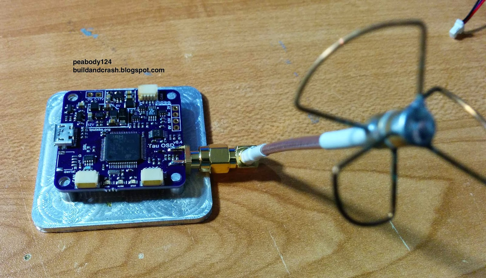
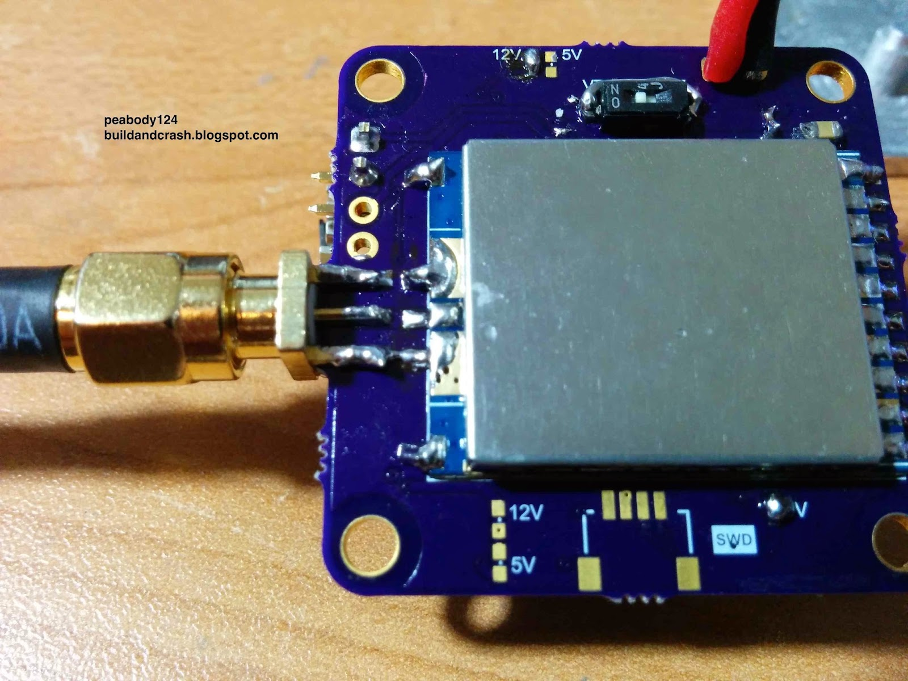
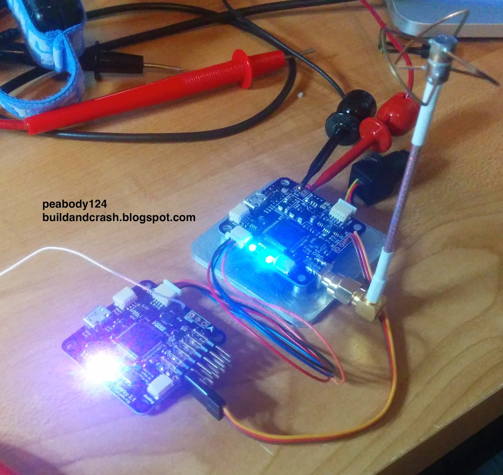
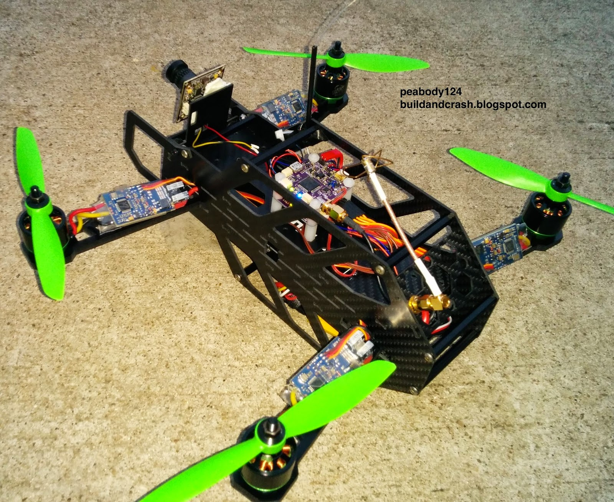

**Sparky2 is available here [http://www.hobbiesfly.com/taulabs-sparky2-0.html](http://www.hobbiesfly.com/taulabs-sparky2-0.html)**

In case you want the video first:

::: {.archive-video video-id="128424367" source="vimeo"}
:::

  
After the amount of fun I had putting a VTX on [Brushed Sparky](http://tps63002/), it got me asking what else would benefit from integration? In the background, I've also been plodding away at a few various revisions of TauOSD. This was inspired by BrainFPV resurrecting and vastly improving the OSD code. The video overlay of that was working fairly nicely, so adding a VTX directly on board seemed like a fun idea.

### Features:

- Fully graphical OSD with crisp black and white OSD and double buffering
- Integrated 32ch 600mW 5.8ghz VTX. Channel selection provided via GCS.
- Powered by STM32F4 with enough CPU power to redraw every frame
- 5V and 12V switching supply that can be used for camera and external VTX. Nice clean power.
- Switchable camera input (can be controlled via transmitter)
- Runs up to 4S batteries.
- Gets data from flight controller via CAN
- Serial port available for mavlink telemetry (not implemented yet)
- standard 36x36mm footprint

  
This creates a really compact setup as you can stack a Sparky2 on top of this and have everything you need for flight, telemetry, OSD, and VTX in a 36x36 footprint (although I'd recommend a heatsink on the OSD). I still don't find an OSD incredibly useful, but the minimal set of things like altitude, battery, current and flight time really are quite useful.

  

### Testing:

I installed both Sparky2 and TauOSD+VTX in my havoc for testing. This is using the 12V supply to a PZ0420 board camera mounted on the front.

Here it is flying. This is running on a 4S battery directly into the OSD, which is then also powering Sparky2.

::: {.archive-video video-id="128424367" source="vimeo"}
:::

  
  
So far I'm quite happy with the video, which looks really crisp and clean. The OSD is stable and easy to read (thanks BrainFPV)!

The previous VTX used a TX5813 module followed by an HMC406MS8G. It was a learning experience to get all the video traces routed carefully at 50 ohm (working out for OSHpark specs), with components placed at various phases along the transmission line. I was happy to see it seems to work well, although I really could do with a VTX power monitor to see if it really hit the spec'd power.

The latest version uses a really nice 600mW 32ch module which is convenient for supporting all googgles.

### Future plans

- Sync the settings back and forth between Sparky2 and TauOSD to allow the awesome settings configuration menu that BrainFPV developed to be used.
- Do more flight tests showing off features like video input switching.
- Embed telemetry information in the audio stream
