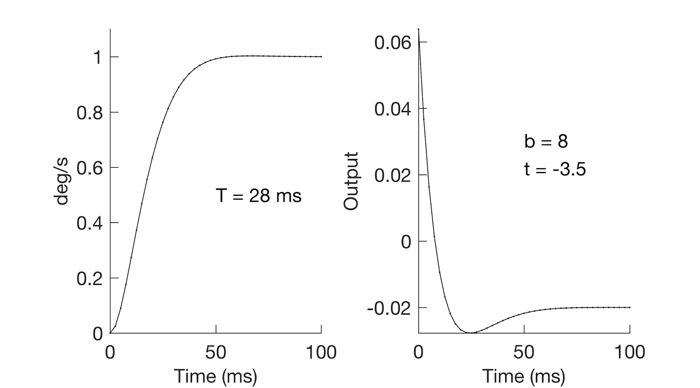
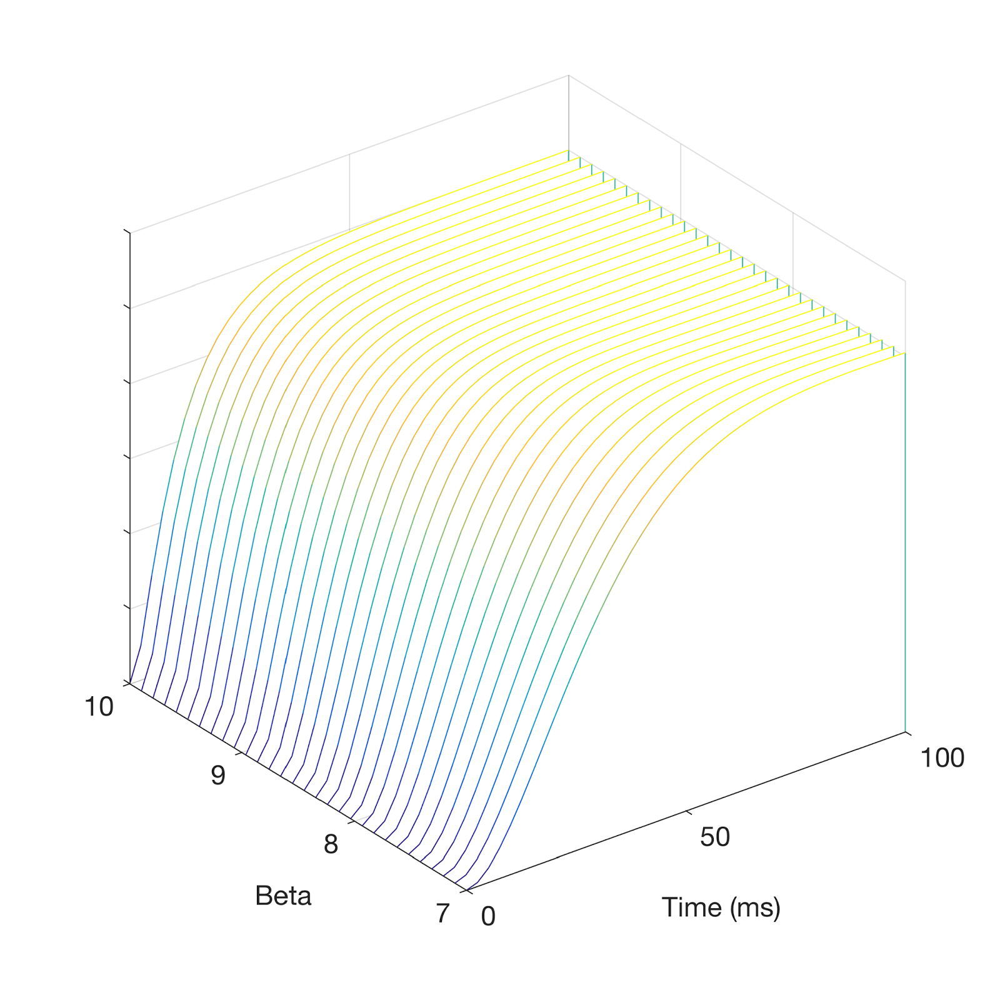
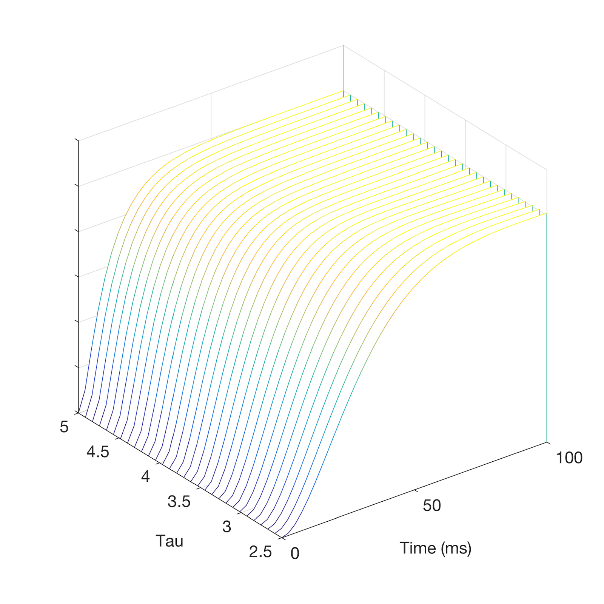
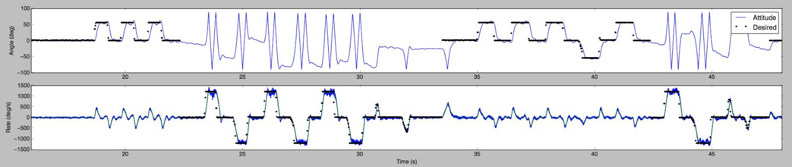
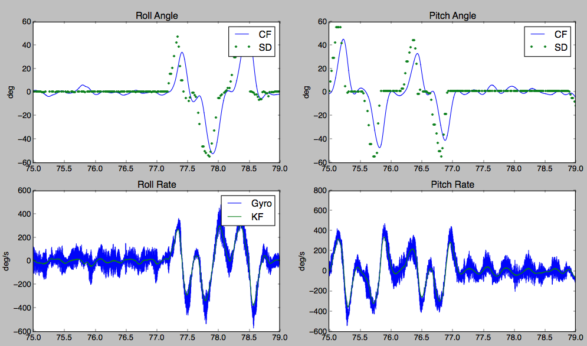

For the last year when I've had time, I have been developing an entirely new control scheme (at least as far as I know for the open source community) for multi rotors that replaces PID by expanding upon [Tau Labs System Identification](https://vimeo.com/104806460) (see the mathematical description [here](https://github.com/TauLabs/TauLabs/raw/next/flight/Doc/Autotuning%20Derivation.pdf)).

The way linear quadratic control (LQG) works is by simultaneously estimating additional properties in the system we cannot directly measure (in this case the instantaneous torque and true rate of rotation) and the using those to control the system. I had previously experimented with something a bit ad hoc [like this in the past](https://vimeo.com/59860771).
    

## System Identification

A while ago Korken [proposed a nice EKF](http://forum.taulabs.org/viewtopic.php?f=17&t=99&start=10#p965) that would extract a few critical properties of the system (primarily the 'gain' of each axis and the time constant of the motors). I wrote up an implementation of this and we got it running and measuring reasonable values. Based on this, I came up with some [analytic approaches](https://github.com/TauLabs/TauLabs/raw/next/flight/Doc/Autotuning%20Derivation.pdf) to optimize the PID control parameters based on these estimated system properties.

More specifically we use a model with several parameters that are specific to each frame $\beta_1$, $\beta_2$, $\tau$. The latency of the ESC/Motor/Prop is captured by $\tau$ and is one of the most performance limiting factors in a frame. For roll and pitch only $\beta_1$ is used and corresponds to the strength of that control output. For yaw there is a component that has no latency -- $\beta_2$ -- and that corresponds to directly generating a reaction force torque by accelerating the props.

$$
\begin{aligned}
\dot \theta &= \omega \\
\dot \omega &= \beta_1 \cdot \nu + \beta_2 \cdot \left(u_c - \nu \right) \\
\dot \nu &= \frac{u_c - \nu}{\tau}
\end{aligned}
$$

The EKF above will estimate these parameters for a frame by having it [shake while flying](https://vimeo.com/104806460).
    

## Online estimation

To perform linear quadratic control (LQR) we need to be able to estimate $\nu$ which is the instantaneous (normalized) torque on the frame. In addition, we would like to estimate $\omega$ -- the true rotation rate -- although we have the noisy measured values of it from gyro.

We can take the above system dynamical equations and convert it to a continuous time state space representation. Because the output may be slightly biased we also need to include this into the state estimation $b$. In addition, this estimator will not estimate the angle as we will take that from either the complementary filter or the INS.

$\mathbf x = \left( \begin{matrix} \omega \\  \nu \\  b \end{matrix} \right)$

We can the write down the equations above (including bias) as

$\dot {\mathbf x} = \mathbf A_c \mathbf x + \mathbf b u + \mathbf w$

$\mathbf A_c = \left( \begin{matrix}
   0 & \beta_1-\beta_2 & -\beta_2 \\
   0 & -1/\tau & -1/\tau \\
   0 & 0 & 0
  \end{matrix} \right)$

$\mathbf b_c = \left(  \begin{matrix}
   \beta_2 \\
   1/\tau \\
   0
\end{matrix} \right)$

Of course since we are going to be implementing this in discrete time, we need to convert from the continuous time representation.

$\mathbf x_{t+1} = \mathbf A_d \mathbf x_t + \mathbf b_d u_t + \mathbf{w}_d$

$\mathbf A_d = e^{\mathbf A_c T_s}
  = \left( \begin{matrix}
   1 & A_{d12} & A_{d13} \\
   0 & e^{-T_s/\tau} & e^{-T_s/\tau} - 1 \\
   0 & 0 & 1
  \end{matrix} \right)$
$\qquad A_{d12} = \beta_1 \tau - \beta_2 \tau - \beta_1 \tau \exp(-T_s/\tau) + \beta_2 \tau\exp(-T_s/\tau) = (\beta_1 - \beta_2) \left(\tau - \tau e^{-T_s/\tau}\right)$
$\qquad  A_{d13} = - T_s \beta_1 + \beta_1 \tau  - \beta_2 \tau - \beta_1 \tau e^{-T_s/\tau} + \beta_2 \tau e^{-T_s/\tau} = - T_s \beta_1 + A_{d12}$

$\mathbf b_d = \int_0^{T_s} e^{\mathbf A_c s} ds \, \mathbf b_c
= \left(  \begin{matrix}
   -A_{d13} \\
   1 - e^{-T_s/\tau} \\
   0
\end{matrix} \right)$

$\mathbf c = \left( \begin{matrix} 1 \\ 0 \\ 0 \end{matrix} \right)$

Because this system is a linear time-invariant Kalman filter, the covariance matrix will converge to a constant regardless of the observations and can be used to pre-compute a kalman gain. This requires solving the discrete algebraic Ricatti equation (DARE) to estimate the steady state posterior noise distribution (details omitted). With this we get an equation for the estimator.

$\hat {\mathbf x_{t+1}} = \mathbf A_d \hat{\mathbf x}_t + \mathbf b u_t + \mathbf l \left( y - \mathbf c^\mathrm{T} \hat {\mathbf x}_t \right)$

$\mathbf l = \mathbf P \mathbf c \left[ \mathbf c^\mathrm{T} \mathbf P \mathbf c+ r\right]^{-1}$

Which means once we have solved the DARE and for $\mathbf l$ the kalman filter only requires several multiplications and addition operations to update. When controlling attitude we use the angle estimate from the original complementary filter or INS algorithm.

  

## Control algorithm

Armed with the state estimate we can use a linear quadratic regulator (instead of traditional PID) to compute the desired output. Here we talk about controlling the attitude. This controller has the form

$u = -\mathbf k^\mathrm{T} \hat {\mathbf{x}} + b$

Where $\mathbf k$ is optimized to minimize a cost function $J$ and $x=\left( \begin{matrix} \theta \\  \omega \\  \nu \end{matrix} \right)$.

$J=\sum_{t=0}^{t=\infty}{\mathbf x_t' \mathbf Q \mathbf x_t + u_t r  u_t}$ -- this uses $u$ without the bias added in.

$\mathbf x = \left( \begin{matrix} \theta \\ \omega \\ \nu \end{matrix} \right)$

Again converting the continuous dynamics to discrete time gives a system

$$
\mathbf A_d = \left( \begin{matrix}
   1 & T_s & A_{d13} \\
   0 & 1 & A_{d23} \\
   0 & 0 & e^{-T_s/\tau}
  \end{matrix}
  \right)
$$

$$
A_{d13} = \tau (\beta_1 - \beta_2) (\tau e^{-T_s/\tau} - \tau + T_s), \qquad A_{d23} = \tau (\beta_1 - \beta_2) (1 - e^{-T_s/\tau})
$$

$$
\mathbf b_d = \left( \begin{matrix}
   T_s^2 \beta_1 / 2 - A_{d13} \\
   T_s \beta_1 - A_{d23} \\
   1-e^{-T_s/\tau}
\end{matrix} \right)
$$

We can then plug these dynamics into DARE, as well as the parameters $\mathbf Q$ and $r$ from above to which determine performance tradeoffs. From that we can solve for $\mathbf k$. 

$\mathbf k^\mathrm{T} = (r + \mathbf b^\mathrm{T} \mathbf P \mathbf b)^{-1} (\mathbf b^\mathrm{T} \mathbf P \mathbf A)$ 

### Costs

  

The parameters in the $\mathbf Q$ matrix ultimately determine the system performance -- how aggressively it attempts to drive the state to the setpoint (which will be discussed below). In this system we use a diagonal $Q = \mathrm{diag}(q_1  (1-s), q_2, q_3)$ which allows us to write the cost function a little bit more naturally. 

$J=\int_{t=0}^{t=\infty}{q_1 \theta^2 + q_2 \omega^2 + q_{3} \nu ^2 + u_c^2 r \, \mathrm{d} t}$ 

This expression makes it clear that by having $q_1$ greater the system will more aggressively try and correct angular errors. By having $q_2$ greater it will also try and keep $\omega$ closer to zero when doing that, which has the effect of smoothing out the response. Similarly setting $q_3$ greater will attempt to drive the error to zero with the minimal amount of torque possible. Both of these will smooth the response out and lessen overshoot. 

Because we are optimizing the feedback gains ($\mathbf k$) to minimize this function, we can divide out r -- or without loss of generality set it to 1 -- without changing $\mathbf k$. 

### Setpoints

To use LQR to control either rate or attitude (as opposed to drive both to zero) we need to redefine error from setpoint as 

$\mathbf x_{r} = \mathbf x-\mathbf r$ 

which leads to us having a new control rule 

$u=-\mathbf k^\mathrm{T} \mathbf x_r + b$ 

In order to have an attitude controller, we want 

$\mathbf r_\theta = \left( \begin{matrix} \theta_r \quad 0 \quad 0 \end{matrix} \right)^\mathrm{T}$ 

In order to have a rate controller, we similarly change the setpoint reference to control the angular rate state and set the angle to zero 

$\mathbf r_\omega = \left( \begin{matrix} 0 \quad \omega_r \quad 0 \end{matrix} \right)^\mathrm{T}$ 

and then set $q_{0,0}=0$ in order for the LQR controller to not penalize the angle not being at zero. This could be equivalently done with a two state system but would just complicate the code (and prevent doing things like smoothly transitioning from rate to attitude control, like in horizon mode). 

### Frame invariant behavior and costs

Without getting too much into the derivation, by slightly tweaking the cost parameters so that $q_3 = \beta_1 q_4$ we can ultimately generate responses that are much more similar across frames regardless of their parameters. It will never be possible to get exactly identical performance if we are pushing frames to the limits of what they can do as some performance simply is not achievable on a more sluggish frame.   

I simulated the closed loop response when changing parameters and using this representation of the cost and show that fairly consistent closed loop responses in rate mode would be achieved across a wide variety of frame types. 

  

  

  

**Similarly as we sweep $\tau$ there is also only a small change in the simulated closed loop performance.**
  

Having this type of invariance has the benefit that once some more serious pilots and tweakers find a set of costs that work well for them it should apply more -- both when using them on different frames and sharing them amongst other pilots. 

### Real world results

As usual when testing these kind of control algorithm, I threw [Freedom](../2012-11-19-freedom-assembly-and-first-flight/index.qmd) on a frame, which is a flight controller that has an Overo Gumstix on it that lets me log all the sensor data in the flight. I can then analyze the filter offline (as well as reprocess the data to refine things like the filter). 

Here it is tied up to isolate one axis so I could test extremely high rotational speeds that I couldn't otherwise indoors. 



*Collecting data for @taulabs #lqrcontroller in both rate and attitude modes (no PID tuning required).*

And from that I can download the logs and look at the performance when doing fast movements in attitude mode as well as in rate control.

  

   
Here is some data from a free flying frame.

  

  

  

  
This graph shows that the system responds very promptly. Because of the smoothed gyro and torque estimates, LQG can tolerate much greater effective gains than can work with PID control and no smoothing.

## So why LQG?

After going through all this, it is worth taking a moment to ask why do we want to implement this. There are two main benefits corresponding to the two halfs of LQG.  

The first part is the benefit of the estimation component. By running the Kalman filter we fuse together the inputs that we are sending to the motor and the noisy gyro estimates to get the best possible estimate of what is really going on. Superficially, this has the benefit of significantly denoising the gyro signal -- after all that very high frequency noise is physically implausible but applying a low pass filter to it introduces latencies that people are always trying to chase out. In addition, it allows us to directly estimate the instantanous (normalized) torque being generated by the motors. This comes from the latency of their responses and allows us to properly damp the control algorithm rather than the *ad hoc* derivative term typical in PID. The derivative is **critical** for good performance and those who have been in this game long enough to remember when the bandlimited derivative from APM was ported over to OpenPilot recall how much of a performance boom it was. However, that band limiting is required because of the amount of noise when directly taking the difference of gyro measurements. The state estimation reduces the amount of noise there allowing much greater derivative terms. **When looking at the parameters as the corresponding PID terms we can use much much higher PID parameters when using the state estimator. In practice I'm using a factor of 10 higher values than without this estimator.** 

  

The second half is the actual calculation of the gains. As I referenced in the beginning after we got the system identification going I came up with some analytic equations to optimize the PID coefficients from this (derivation is [here](https://github.com/TauLabs/TauLabs/raw/next/flight/Doc/Autotuning%20Derivation.pdf)). This has worked well and feedback on Tau Labs autotuning  has always been quite positive. However, LQR is a much more principled and mainstream approach to the same problem. It is more computationally intensive, but by only having to calculate the DARE equation once given the system identification parameters, we can do this before take off and avoid this cost in real time. Thus the costs of running this LQG is essentially the same as PID.

## Conclusion

LQG is a more modern control scheme than PID. It flies much better. This implementation simply requires a regular autotune flight, but instead of using the math I previously developed that is now used by TauLabs/LibrePilot/Dronin it directly computes LQR coefficients. Here I show it flying on 3 frames of much different sizes without issue: 

     



*Testing @taulabs LQG controller on three different frames.*
