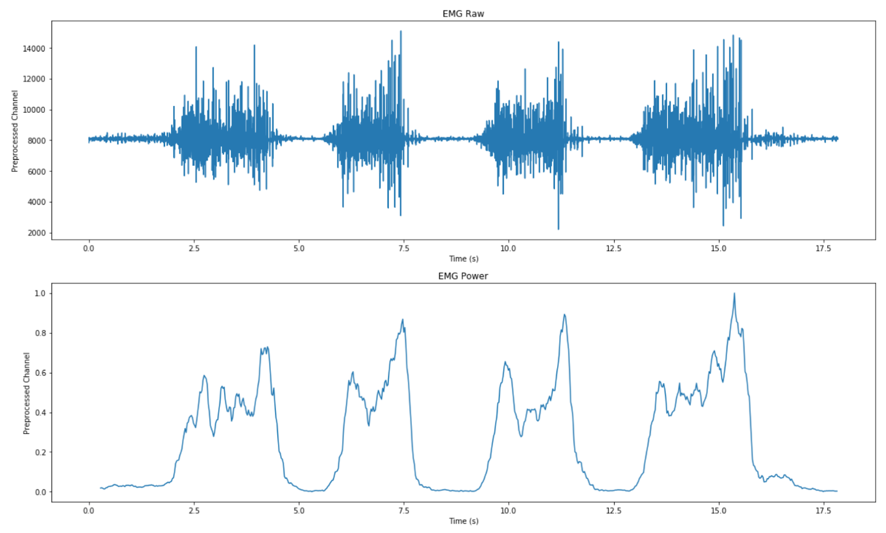
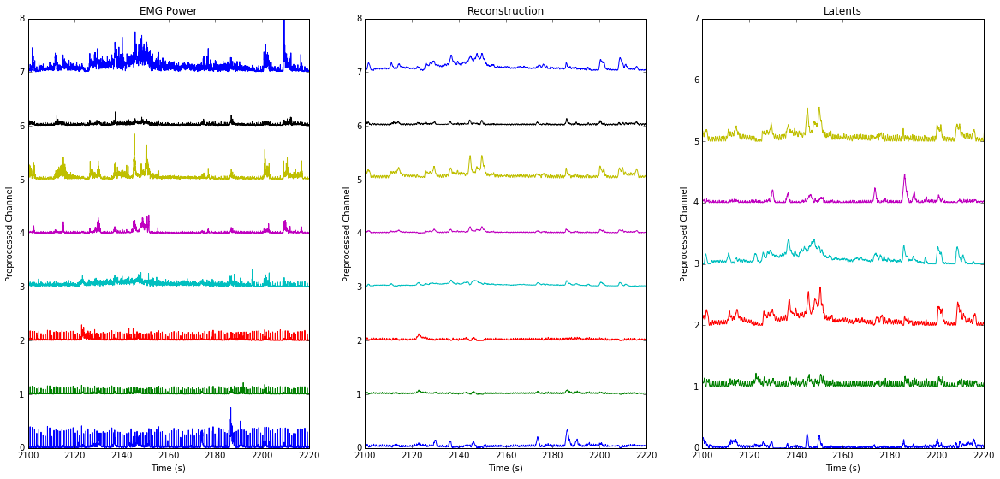
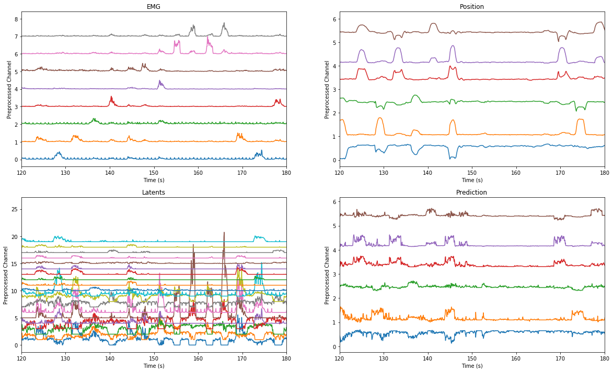
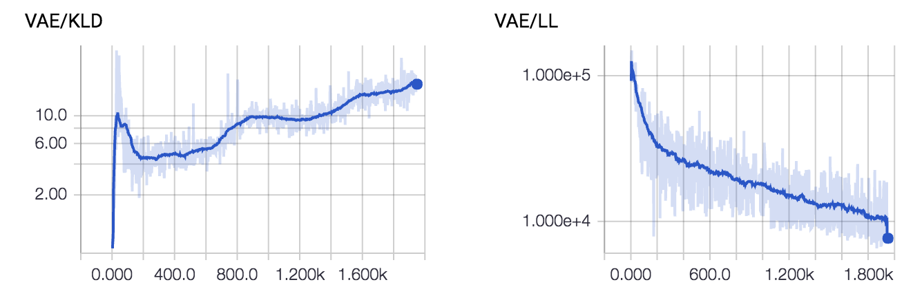
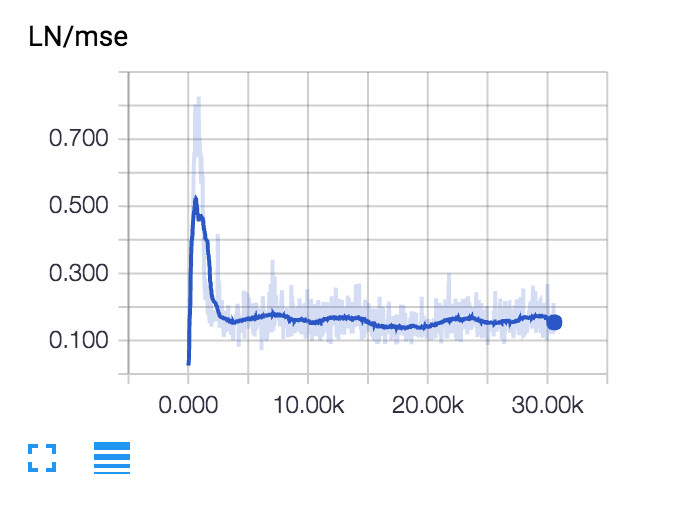

I dusted off [SparkyEEG](../2014-01-13-eeg-stuffing-and-testing/index.qmd) recently and used it for some fun with EMG processing, as well as an excuse to do some learning with [TensorFlow](http://tensorflow.org/) and deep learning (as an aside I read the [Deep Learning Book](http://www.deeplearningbook.org/) by Goodfellow et al. and really enjoyed it). I placed the 8 electrodes across various muscles, mostly around shoulders.

I'm using some fairly simple (and common) preprocessing on the raw electrophysiology data to first get the EMG power. This applies a bandpass filter, rectification, and then measures the "waveform length" which is the integral of the absolute value of the difference.

### Representation learning

First I wrote up an autoencoder (and then a variational autoencoder) to take some EMG data and perform unsupervised dimensionality reduction. It also helps denoise the data and remove things like EKG contamination.



*Fun times with #sparkyeeg and #tensorflow training an autoencoder in real-time on my muscle activity.*

    

And here are some graphs of the latent variables learned

### Arm movement tracking

Then I used my kinect to record my arm positions while recording EMG data in parallel. I used the a neural network to predict my arm positions based upon the EMG data. 



*Recording movements and joint positions with a Kinect to correlate with EMG activity. Soon… arm-controlled quad?*

   

And again here is a graph of the reconstruction (the data after 150s is held back test data), sorry for the time shift.

### Game

Then sort of putting this all together I wrote a game to chase a maker using EMG activity. The way this works is first prelearning a representation using a variational autoencoder as I sit and move my arms around. These graphs are from the tensor board that shows the log likelihood of the data improving and the Kullback-Liebler divergence of the latent space increases (the total lower bound does continue to increase). I should probably run it for longer as it hasn't stabilized, but it gets a bit boring :). 

Then I start playing a game which adds a linear network to the output of the latent space to try and predict the X and Y positions of the cursor. Here you can see the mean squared prediction error improves while playing the game and then stabilizes after a while. The residual noise appears to be mostly high frequency noise. The learning function initially learns just the output network but then after enough time to initialize that can back-propagate through the representation layer to try and improve the representation. 

Here is a video of me playing this game and how well it does. Not perfect but not bad for a first implementation I wrote up an autoencoder (and then a variational autoencoder) to take some EMG data and perform unsupervised dimensionality reduction. It also helps denoise the data and remove things like EKG contamination. 



*More fun with #sparkyeeg and #tensorflow training a neural network to map from EMG to cursor position.*

   

While playing it's basically co-learning with the user, as you pick some movements to try and control the cursor and keep sticking with it, and it tries to map from those movements to the cursor position. It will take some exploring to figure out the right dynamics to try and let it optimally bootstrap this system. For example: 

 1. picking the set of cursor position where the decoder is most uncertain 

 2. how long should the memory buffer be to stabilize the system versus to allow it to evolve 

 3. how should the learning rate of the network adapt with time.
