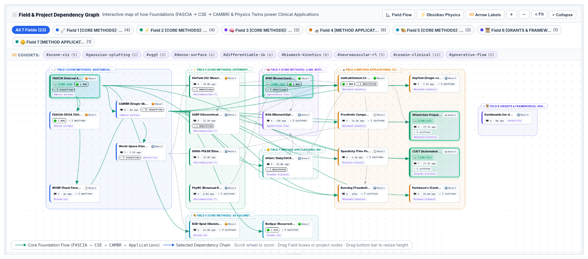
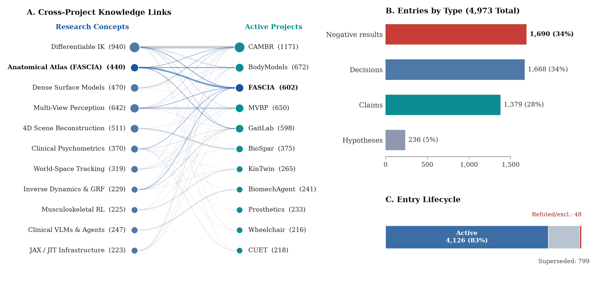

The last month has been crazy productive. I have used LLM coding assistants for a couple of years and CLI coding agents for a little over a year, so I was already used to moving faster than I used to. However, since the Gemini 4 models (Argon, then Carbon, and now Neon) were released, things have been on another level. I am pulling together projects in days to weeks that I would previously have budgeted months for.

Part of why I am starting this blog now is that as the rate of progress changes, how we manage and communicate science will need to evolve. This is also a place for me to ramble about my thoughts on the process itself.

## A Long Bet on Google Tools and FAIR Data

One thing that is really helping now is a set of long-term investments starting to pay off. When given a choice, I have tended to build on top of the Google ecosystem for quite a few years. This started with the early prototypes of my EMG biofeedback platform ([Petrie et al., 2026](https://doi.org/10.1186/s12984-026-01930-x)) using Google Cloud Platform (GCP) for cloud data management from our wearable sensors, which then evolved into the backend for our Portable Biomechanics Laboratory ([Peiffer et al., 2026](https://doi.org/10.1038/s41746-026-02825-w)). Additionally, because machine-learning-optimized biomechanics is central to everything we do, we heavily gravitate toward [JAX](https://github.com/jax-ml/jax), which aligns naturally with the [MuJoCo MJX](https://mujoco.readthedocs.io/en/stable/mjx.html) physics backend. *(Fun story: I was at WACV 2024 presenting our infant dynamic Gaussian splatting paper ([Cotton & Peyton, 2024](https://arxiv.org/abs/2310.19441)) when MJX acceleration for biomechanics came out. I ended up skipping two days of the conference and produced what became our core differentiable biomechanics approach, which immediately opened up tons of opportunities—with only limited coding assistance back then; [Cotton, 2025](https://doi.org/10.1109/ICORR66766.2025.11063174).)* I have also loved [Equinox (Kidger & Garcia, 2021)](https://arxiv.org/abs/2111.00254) as a machine learning framework, which makes it so elegant to express and massively accelerate both pure math (critical for many of the algorithms we design) and complex deep learning models. Finally, Google DeepMind has consistently been doing (IMO) some of the highest-quality and most rigorous work on language models in medicine ([Singhal et al., 2023](https://doi.org/10.1038/s41586-023-06291-2); [Singhal et al., 2025](https://doi.org/10.1038/s41591-024-03423-7); [Tu et al., 2025](https://doi.org/10.1038/s41586-025-08866-7); [Saab et al., 2024](https://arxiv.org/abs/2404.18416)), and I was super stoked that we were able to host Vivek Natarajan in our seminar series back in summer 2024. Thus, when we started building [BiomechGPT (Yang, Kennedy, & Cotton, 2025)](https://arxiv.org/abs/2505.18465) and [BiomechAgent (Cotton & Leonard, 2026)](https://arxiv.org/abs/2602.06975), we built them on top of Gemma and Gemini.

Another investment that has paid huge dividends is our early data infrastructure. Even as a resident, I was developing [`PosePipeline` (Cotton, 2022)](https://arxiv.org/abs/2203.08792) on top of [DataJoint (Yatsenko et al., 2015)](https://doi.org/10.1101/031658) to make sure our clinical movement data was cleanly organized and managed. These systems make FAIR data principles (Findable, Accessible, Interoperable, and Reusable; [Wilkinson et al., 2016](https://doi.org/10.1038/sdata.2016.18)) central to how our data is handled from the moment it is acquired with our multi-camera capture system ([`MultiCameraTracking`](https://github.com/IntelligentSensingAndRehabilitation/MultiCameraTracking)) all the way through downstream analyses. This relational DataJoint philosophy has been central to scientific-operations ("SciOps") workflows ([Yatsenko et al., 2018](https://arxiv.org/abs/1807.11104); [Yatsenko et al., 2021](https://doi.org/10.1101/2021.03.30.437358)) and is even more valuable in the agentic era, where declarative schemas give agents an unambiguous contract for how data tables and computations connect. Maintaining a lab documentation wiki with project notes pointing directly at those data schemas complements this, serving as shared context for both human researchers and coding agents. We have also used containers heavily in our workflow (e.g., devcontainers) to create reproducible environments with strictly controlled access to data. That combination—structured relational data, consolidated documentation, tiered data-access silos, and containerized sandboxes—turned out to be the ideal substrate for agentic systems to accelerate research safely.

## Two Inflection Points

Pulling nearly four years of my GitHub activity, you can see two clear step-changes (@fig-github-activity; note the log scale on the bottom panel!).

![Monthly GitHub commits (top) and lines of code changed on a log scale (bottom) across personal and lab repositories from January 2023 through November 23, 2026 (*partial month). The 2023–2024 baseline averaged 153 commits/month (median 39K LOC/month) including the December 2023 spike (342 commits) building Project Centaur; adopting CLI agents in late July / August 2025 (Gemini CLI, then Claude Code on August 11) initiated a steady fall ramp that reached 723 commits/month in December 2025, before jumping to 1,870–1,899 commits/month in October–November 2026 with Gemini 4.](fig_github_commits_loc_2yr.png){#fig-github-activity}

Through 2023 and 2024, I averaged ~153 commits/month (median 39K lines of code changed), which was already accelerated by early LLMs. For example, the React and FastAPI web UI for `MultiCameraTracking` started by copying and pasting out of ChatGPT and iterating with Copilot in VS Code. I'll be honest: I barely even noticed I didn't know JavaScript until one day when Copilot went down.

The next real shift started in late July 2025 when I switched to CLI agents, beginning with Gemini CLI. I was blown away when I ported complex vision and body models from PyTorch to JAX/Equinox, which opened up a whole world of foundation models to integrate directly into our differentiable biomechanics pipelines. Having high-quality numerical equivalence benchmarks ensured the agents stayed focused on the goal and produced reliable ports. After switching to Claude Code about two weeks later, I couldn't go back—at the time, Gemini was impulsive enough that it could create bugs faster than I could supervise it. By December 2025, like many people last year, I was incredibly productive and antisocial around the holiday season thanks to Claude. Of course, LOC is not a great measure of productivity, and agents can easily create more problems through bloated code, duplicate implementations, and bad abstractions. I have spent many an angry evening stripping out 80% of what an agent had written. 

Despite this, the subscription model and how costly Claude overusage is have been a major barrier. With intensive work on the weekend I can typically consume the whole 20x usage. This meant constantly pausing projects and waiting for weekly quota resets. This is deeply disruptive not just for the five days of lost momentum, but for the cognitive switching costs. Paying per token on Claude beyond my fixed subscriptions has also never felt cost-effective. It can easily burn $50–$100/hour in API tokens with only modest progress to show for it. A few times when I needed to push a grant or paper across the finish line, I spent hundreds in API overages just to finish an analysis that was already 80% complete. Typically makes me wish I had just bought another month subscription. 

When Argon came out, because we already had enterprise GCP Vertex AI set up for our other projects, I could lean in immediately. My early tests right after Argon launched felt like they delivered dramatically more bang for the buck, and I wanted to see what we could accomplish if we put our foot on the gas (as JD, who recently graduated from the lab said: *all gas, no brakes!*). The timing also made sense because these models are subsidized 50% through the end of November, so I have treated this past month as a deliberate experiment: if we have the right infrastructure in place and simply do not let token limits be the bottleneck, what can we actually accomplish? I had no interest in "token-maxxing" or spending compute pointlessly, but I wanted to see what value we could unlock.

Over the last 30 days, my logs show **36.9B tokens**, split about evenly between Claude and Gemini. I have been doing so much that I ended up needing to develop a custom AI Co-Scientist productivity suite itself (thanks to Gemini 4 for building that too), which will be the topic of a future post (@fig-token-usage). Across four manuscripts we just finished and submitted to ICORR, the GCP Vertex token cost ranged from **$252 to $787** and averaged **$496 per paper**. While that is still expensive, it is a relatively small fraction of the total cost of producing a scientific paper, and as I discuss below it materially improved both our velocity and the rigor of the work. The least expensive of the four (`$252`) was a paper we had drafted previously where I was unhappy with the empirical results; Argon tracked down a bug in my math and substantially improved the algorithm, so the remaining effort was much more modest. At the other end, `FASCIA` (coming to a preprint server very soon) grew out of an idea kicking around since CVPR leading to a next-generation, biomechanically rigged version of [HIT (Keller et al., 2024)](https://doi.org/10.1109/CVPR52733.2024.00334)—with clinical movement analysis. We needed a representation to bridge computer vision (meshes) and musculoskeletal biomechanics. It went from a concept to a state-of-the-art model that is actively improving our downstream biomechanics in a matter of weeks to months (with some prior uncaptured Claude subscription usage before I built the cost tracker). Similarly, the wheelchair propulsion paper realized a whimsical idea I had when chatting with a graduate student. Specifically, it extended the periodic Extended Kalman Filter ideas from our earlier [`GaitTransformer` (Cotton et al., 2023)](https://doi.org/10.1109/ICORR58425.2023.10304683) to estimate hand-rim forces and contact dynamics directly from video; Gemini 4 helped work through the EKF observability math, reduce the formulation to a scale-free minimal parameter set, and run the sensitivity analyses. We have even been using Lean (a language I don't know!) to formalize mathematical invariants across these papers, which has repeatedly caught subtle bugs in the math and led to stronger empirical results. Removing the token bottleneck also let us finish several long-standing projects that had been hanging over my head—including returning to clinical datasets collected five years ago and writing them up with rigorous COSMIN psychometrics, now that our next-generation computer vision algorithms are finally reliable enough to handle that challenging historical video.

Financially, though, there is a real academic sustainability paradox here. Even though the return on investment per paper is solid, this overall burn rate is not sustainable for an academic lab. Part of being deliberate during this subsidized window was specifically targeting what had been my one-year roadmap of core methods for Precision Rehabilitation and seeing how much of that foundational roadmap we could compress into a single sprint (turns out a lot!). Of course, this was all dependent as I mention above on having the right infrastructure, data (in silos), and compute to make this happen.

{#fig-token-usage}

## Building an AI Co-Scientist Productivity Suite

As I noted above, running out of tokens acted as a natural throttle, so working in individual CLI terminal windows was fine. Without that limit, coordination became the bottleneck. Because of how fast things are moving, we essentially have chains of several papers advancing in parallel. For example, one thread is our next-generation computer vision framework for joint mesh and biomechanical skeleton recovery—an extension of our [Biomechanical 3D Body (B3D)](https://arxiv.org/abs/2608.29928) work generalized to both monocular and multi-camera video with substantially better accuracy. Building directly on that is a second paper that infers ground reaction forces and joint kinetics with calibrated uncertainty (extending our probabilistic kinematics and [KinTwin (Cotton, 2025)](https://arxiv.org/abs/2505.13436) work) with extensive force-plate validation. And building on *that* are clinical studies already in progress that apply these tools to patient cohorts to generate new insights into impaired movement—which is the real goal! So when work in `FASCIA` refines how we align the external skin mesh and internal calcaneal bone geometry to inform heel-pad contact, it ripples through and requires re-evaluating that entire downstream cascade. Keeping track of all of those moving parts and centralizing our accumulated knowledge along a larger roadmap became a major barrier.

**A brief detour: `ProjectCentaur` and `BiomechAgent`.** The commit spike back in December 2023 (@fig-github-activity) was from when I prototyped `ProjectCentaur`—the direct ancestor of `BiomechAgent`. I named it after [Advanced Chess](https://en.wikipedia.org/wiki/Advanced_chess) ("centaur chess"), referencing when the strongest chess players in the world were neither grandmasters alone nor supercomputers alone, but human–computer centaur teams (sadly, now computers alone win, which is likely relevant to this post). The idea of [AI Co-Scientists (Gottweis et al., 2026)](https://doi.org/10.1038/s41586-026-10644-y) fascinated me early on, and `ProjectCentaur` was my first attempt to build one for biomechanics. Running on GPT-3.5 and early GPT-4, it could fetch rows from our DataJoint database, stream agent reasoning steps, perform basic analyses with plots, and attempt to build reusable skills and knowledge notes for common analyses. While it was a fun proof of concept and learning opportunity, it cost roughly $20 just to answer a modestly interesting database retrieval and analysis question—with only about a 50% chance of succeeding and a high failure rate on anything complex. Thus this experiment showed then, such a system was not practically useful. Today, a descendant of `BiomechGPT` and `BiomechAgent` is integrated directly into our core lab infrastructure and can execute complex clinical and biomechanical analyses—complete with publication-ready figures—straight from a dictated prompt for pennies.

What made `BiomechAgent` doubly valuable is that, in addition to being a practical analysis tool, most of the paper was actually designing the benchmark. The value of rigorous benchmarks for ML in science cannot be overstated: beyond guiding and optimizing our initial agent architecture, we can continuously rerun the exact same 447-case benchmark as new foundation models drop to measure how frontier progress translates into real domain reasoning (@tbl-biomech-agent). Thus by doing absolutely nothing our performance improved from 67% with Gemini 2.5 in our publication to 91% with Argon. Amazingly, Argon started performing well on the spatiotemporal tasks which previously needed a bespoke tool (the [`GaitTransformer`; Cotton et al., 2022](https://doi.org/10.1109/EMBC48229.2022.9871036)).

| Model | Family / Type | Overall (447) | Database | Clinical | Activity | Segment | Spatio-Temp | Visual | Percept |
|---|---|---:|---:|---:|---:|---:|---:|---:|---:|
| **Gemini 4 Argon** | **Gemini 4 (Vertex)** | **91.0% (407)** | **95.5%** | 91.4% | 97.1% | 78.3% | **85.7%** | **100.0%** | 90.0% |
| Gemini 3.7 Flash | Gemini 3 (Vertex) | 89.3% (399) | 90.9% | **92.6%** | **100.0%** | 78.3% | 71.4% | 96.0% | **98.0%** |
| Gemini 3.6 Flash | Gemini 3 (Vertex) | 88.8% (397) | 95.5% | 90.1% | **100.0%** | 71.7% | 72.9% | 98.0% | 96.0% |
| Gemini 3.8 Flash | Gemini 3 (Vertex) | 85.9% (384) | 90.9% | 90.1% | 98.6% | 80.0% | 58.6% | **100.0%** | 86.0% |
| DeepSeek V4 Flash | Open-weight (vLLM) | 85.2% (381) | 95.5% | 82.7% | 94.3% | 73.3% | 62.9% | 98.0% | 96.0% |
| Qwen 3.8 27B | Open-weight (vLLM) | 84.6% (378) | 92.4% | 84.0% | 98.6% | 66.7% | 62.9% | 98.0% | 94.0% |
| Gemini 3.5 Flash Lite | Gemini 3 (Vertex) | 79.2% (354) | 90.9% | 74.1% | 91.4% | **81.7%** | 44.3% | 98.0% | 82.0% |
| Gemma 4 31B | Open-weight (Google) | 73.4% (328) | **98.5%** | 76.5% | 97.1% | 70.0% | 45.7% | 60.0% | 58.0% |
| Gemini 3.1 Flash Lite | Gemini 3 (Vertex) | 71.1% (318) | 93.9% | 74.1% | 88.6% | 78.3% | 37.1% | 94.0% | 28.0% |
| Gemini 2.5 Flash Lite | Gemini 2.5 (**Published Baseline**) | 66.7% (298) | 93.9% | 56.8% | 84.3% | 65.0% | 20.0% | 92.0% | 64.0% |
| Gemma 4 26B-A4B | Open-weight (Google) | 64.4% (288) | 84.8% | 71.6% | 80.0% | 61.7% | 31.4% | 54.0% | 64.0% |
| MedGemma 27B | Open-weight (Google) | 44.1% (197) | 93.9% | 55.6% | 28.6% | 28.3% | 20.0% | 50.0% | 28.0% |

: Progression of frontier and open-weight models on the 447-case deterministic `BiomechAgent` benchmark (post-rescore pass rates across 7 categories). {#tbl-biomech-agent}

Returning from that detour: clearly the models themselves are getting dramatically better at scientific coding and analysis ([Aygün et al., 2026](https://doi.org/10.1038/s41586-026-10658-6)), and the vision of an AI Co-Scientist is becoming very real. However, to truly operate like a centaur team across many intertwined projects, I needed an **AI Co-Scientist productivity suite** to coordinate parallel research threads, manage agent workspaces, and systematically review and critique our manuscripts and code. Thanks to Argon and Carbon, I now have that infrastructure. For example, I have used [MyST Markdown](https://mystmd.org/) for a while so our manuscripts live in Git right alongside the code and scripts that generate their numbers and figures. What I always missed, though, was an Overleaf-like collaborative interface with rich text editing, inline comments, voice dictation, and track changes—where comments on a paragraph or figure can be dispatched directly to the agent working on that repository to run additional controls or ablations. Now I have a split-pane WYSIWYG/RTF studio that renders the live paper side-by-side with the editable manuscript (@fig-myst-studio), while also syncing and organizing the interactive 3D visualizations my agents build.

{#fig-myst-studio}

Right now, the suite tracks 23 active projects across 7 research pillars, building an explicit dependency graph of how our foundational models, calibration methods, and clinical studies connect (@fig-project-graph). Many of these projects will be coming out over the next few months, and the dependency graph makes the coordination challenge visually obvious.

{#fig-project-graph}

To keep hard-won lessons from getting lost across parallel research threads, the suite also maintains a bi-temporal **Knowledge Graph** that reviews agent transcripts nightly and extracts verified claims, architectural decisions, negative results, and hypotheses across projects (@fig-knowledge-manifold, @fig-knowledge-graph). It currently spans more than 5,500 nodes and 26,800 causal, semantic, and project links across 26 domain concepts—and roughly a third of the structured ledger entries are negative results (dead ends that agents should not repeat). Even as a recent addition, it is already surfacing technical connections between projects that we would have otherwise missed.

{#fig-knowledge-manifold}

{#fig-knowledge-graph}

I hope to write up this productivity suite in detail soon. One of the joys of being able to build software this quickly is that I could tailor an ultra-bespoke knowledge and agent management system to the exact way I like to write papers, inspect 3D visualizations, and organize projects. A huge part of that architecture is also built around a strict data-security and container-isolation model for human subjects research—controlling which agents can access which data silos and how isolated environments communicate without exposing clinical identifiers—which deserves an entire post of its own. I am gradually stripping out the assumptions tied to my specific server topology to see what can be cleanly open-sourced and shared. Stay tuned.

Also, while I am excited about this tool, my point in this post is less about the tool, and more that these new LLMs make it possible to produce such tools with (relative) ease to use them to be extremely productive in a way that was previously unimaginable and that is optimized for an individual.

## Seeing the Motion: Visualization as a Daily Verification Tool

Moving at this velocity across complex biomechanical models and motion data has made one thing unmistakable: you cannot rely on summary tables alone. Having high-quality interactive 3D and synchronized video visualizations to actually *see* what the algorithms and data are doing—checking whether bones stay inside soft tissue, whether joint kinematics and ground contact look physically plausible, or where an optimization breaks—is indispensable.

Recent frontier models across labs have made dramatic leaps in visual and 3D spatial reasoning, and I have found the Gemini 4 models remarkably capable at building rich, custom Three.js and WebGL visualizers tailored to each project. My productivity suite automatically pulls these visualizers from remote GPU sandboxes to my laptop and groups them by project so I can inspect the latest fits and give rapid feedback. (In fact, every figure and animation in this blog post was generated from verbal prompts to the suite with just one or two rounds of feedback.)

As an example, the animation below (@fig-fascia-anim) is captured directly from an interactive 4D visualizer for `FASCIA` (preprint submitted), which maps a **290-structure** population anatomical atlas—skeleton, viscera, neurovascular bundles, adipose compartments, and individual muscles—inside a personalized, translucent skin envelope. The interactive viewer lets me scrub through dynamic trials, orbit the camera, peel back tissue layers, and vary body morphology to verify that internal structures deform plausibly in any pose. Also note that while this structure is not perfect (e.g., the bones are dilated, the distal wrist falls apart, the femur has a slight bend, the toes are missing, etc) this is **learned from data**. 

::: {#fig-fascia-anim}
```{=html}
<video src="fascia_multilayer_animation.mp4" autoplay loop muted playsinline controls style="width:100%; border-radius:6px; border:1px solid #d0d7de;"></video>
```

Animated 4D multi-layer FASCIA model rendered directly from one of our interactive visualizers, comparing skeleton, organs, and vessels (left) against the full 290-structure musculoskeletal and soft-tissue anatomy inside a translucent skin envelope (right) during dynamic range-of-motion movements.
:::

## Rigor, Verification, and Velocity

Working this way has also pushed me into uncomfortable territory along several dimensions. One is operating over a codebase where I have not personally written every line, although this is not unlike leading a growing lab where trainees and engineers write most of the code, but compressed in time. Another is being able to deploy mathematical and formal verification tools that go well beyond what I could implement by hand. That second shift is both a superpower and a real epistemic challenge. For example, despite not knowing Lean, agents know it well enough to [prove the Riemann Hypothesis over the weekend](https://leanprover-community.github.io/blog/posts/riemann-hypothesis/), so they can definitely help me formalize key components in our repositories. When we combined our [probabilistic method (Donahue et al., 2026)](https://doi.org/10.1109/TBME.2026.3691128) with forward-dynamic rollout, Lean verification helped pinpoint why certain nonlinearities in the implicit network behaved poorly and guided a better formulation that converged faster and more accurately. Similarly, Carbon happily implemented the Lie-group algebra underlying the diffeomorphic warps in `FASCIA` while I'm still reading the source papers to (roughly) understand the math ([Ashburner, 2007](https://doi.org/10.1016/j.neuroimage.2007.07.007)) to feel comfortable writing about it. Regardless, I understand the anatomical evaluation metrics and can rigorously test that it works. Similarly, I don't know the MRI pulse-sequence physics inside the scanner either but will trust it in clinical practice. Science has always relied on operating across layers of abstraction, and learning how to do that rigorously with LLMs helping us without fooling ourselves is going to be a central skill of this era.

Code quality and technical debt remain genuine concerns. I worry about agents introducing classes of bugs I wouldn't write myself, even knowing full well how many bugs I write by hand. Unchecked code sprawl and poor architectural choices can quickly accumulate massive technical debt—there is no universe in which all 7.6M lines of code touched this month should survive! As a group, we are learning how to draw a sharper and more intentional boundary between exploratory scratch investigations (testing whether an idea works and tuning it) and compact, well-tested production library code that downstream projects depend on.

Despite that tension, I suspect these workflows will ultimately make our science *more* rigorous, not less. First, pairing quantitative benchmarks with mandatory 3D visual verification catches failure modes that summary numbers hide (I never trust a pose estimation or biomechanical method that doesn't show overlaid video renders!). Second, because of our velocity, we are heavily [dogfooding](https://en.wikipedia.org/wiki/Eating_your_own_dog_food) every new algorithm immediately: while we are still writing up Method A, we are already ramping up downstream clinical studies, exposing real-world edge cases far earlier than the traditional sequential paper cycle does where all the focus is on the method paper and the validation required for it.

## What Does This Mean for Publishing and Academic Products More Generally?

All of this has been exciting, but it has also led me to spending a lot of time reflecting on what we as a group should work on, what is genuinely valuable versus performative, and what the "publishable unit" should be when we are already halfway through the downstream clinical paper before the upstream methods paper is even submitted. I don't have final answers, but it is forcing us to think about doing science differently.

Take a concrete three-paper chain I'm working through right now:

1. **Multi-Camera Mesh & Skeletal Reconstruction:** Extending our Biomechanical 3D Body (B3D) framework from monocular video to calibrated multi-camera setups, fusing 3D surface meshes and anatomical skeletons to outperform existing baselines by a wide margin.
2. **Probabilistic Inverse & Forward Kinetics:** Building directly on those kinematics to recover ground reaction forces and joint moments with calibrated confidence intervals (extending our probabilistic multiview work and KinTwin), validated against clinical force plates.
3. **Clinical Discovery:** Applying that combined stack directly to longitudinal patient cohorts to answer rehabilitation questions.

Are these three papers? Are they one? Are they one with two preprints referenced? With the peer-review system already straining under volume, there is a need for us to maybe slow down and focus on seeking peer review for things that need it (e.g., things that might influence the treatment of patients). But if you put this all together, few reviewers will have the expertise to comment on all the components and the manuscript will be unwieldy and nearly impossible for a reader. Or do you release the upstream methods as blog posts and preprints so you can focus journal papers on clinical questions, knowing that clinical collaborators and readers may question the reliability of unreviewed methods?

I will say, writing a dedicated manuscript on each method enforces a discipline that is hard to replace and results in it being a better product that is more robust (even if one could question whether traditional peer review is necessary versus post-publication review). One thing (current) agents still do not do well is craft a coherent, compelling scientific story. A subtle consequence of that is they don't know what to actually test to get the data needed to guide the engineering (yay, we still have a purpose). Getting from a proof of principle to high quality code with a paper worth reading takes substantial human thought. That friction is actually where the **centaur synergy** shines. Having to deeply understand the method and shape the narrative forces me to ask *why* a component works, which in turn defines the exact ablations, sensitivity analyses, and Lean proofs needed to prove it. Once those questions are framed, the agents make it vastly easier to execute those experiments, manage the data, and fold the results back into the manuscript—creating a much tighter, more virtuous loop between narrative and rigor. Moreover, there is still a wide gap in time and engineering between an exciting initial draft with strong benchmark numbers and a model that has been tuned, stress-tested, and validated across diverse clinical populations—pediatric cohorts, neurologic impairments, assistive devices, messy camera calibrations—until it is robust enough to matter in clinic. That real-world robustness, reinforced by dogfooding our methods on clinical cohorts before we publish them, is the difference between a rapid machine-learning demo and an applied clinical tool worth shipping.

There is also an urgent conversation to be had about how we mentor and train students and postdocs in this era—knowing when trainees need to do things the slower, harder way to build intuition, because the alternative is "never-skilling," which defeats the entire purpose of academic training. An important layer to this paradox is that extracting real return on investment from agentic systems actually *requires* deep domain and technical expertise. Otherwise, no amount of compute can compensate for not knowing which scientific questions to ask, which physical assumptions are failing, or what counts as rigorous evidence. Recent empirical studies on AI and coding are already bearing this out: controlled studies of natural-language "vibe coding" show that foundational computer-science achievement and technical writing skills strongly predict who actually succeeds ([Thorgeirsson, Weidmann, & Su, 2026](https://doi.org/10.1145/3772318.3791666)), and labor-market analyses from Anthropic's Economic Index ([Massenkoff & McCrory, 2026](https://www.anthropic.com/research/labor-market-impacts); see also [Autor & Thompson, 2025](https://www.nber.org/papers/w33941) and [Brynjolfsson et al., 2025](https://digitaleconomy.stanford.edu/publications/canaries-in-the-coal-mine/)) find that the workers capturing the highest real-world leverage in AI-exposed technical roles are disproportionately senior, graduate-trained experts—while entry-level hiring for junior workers has slowed. 

## Doing bigger, bolder, and better science

Despite the questions and uncertainty around this, I think agents and co-scientists can really allow us to do bigger and bolder science and bring real solutions into the clinic much more quickly. None of this is to discount real problems and inequities arising in our society from these tools (token and compute rich labs as a microcosm in science), and I'll defer to others who focus on these issues to address better than me. 

As a small example of this leading to better science, one query we recently received from a reviewer of a manuscript would have previously seemed like too much work and I would have probably responded that it was beyond the scope of the paper. However, we realized these additional computational experiments were much more tractable to write and perform now, and so we buckled down and ultimately the findings improved our paper (yay peer review for the win). This made me realize we are in an era where "not wanting to do something" because the engineering looks tedious is no longer an excuse. Rather than writing more of the same papers, we should be trying to think—and do science—bigger. At least in the case where the questions can be answered with computation using data that has already been collected. I'm also not sure how to envision this "bigger" science because I lack the intuitions to make predictions over this rapidly evolving landscape as far into the future as I used to for project planning (resulting in lots of writing to myself and introspection about where to go). Nonetheless, I'm very excited to continue putting my foot on the gas and seeing how quickly we can develop new tools and analytics to meaningfully improve rehabilitation outcomes. 

---

*Addendum:* In keeping with the theme of this post, I also used Gemini in Google Antigravity to scaffold this Quarto blog and port over my old [Build & Crash (2010–2017) blog archive](/archive.html) (and [media gallery](/gallery.html))—if you are curious about some much older exploits building, coding, and crashing custom multirotors and open-source flight controllers, check out the **Build & Crash Archive** tab above.
